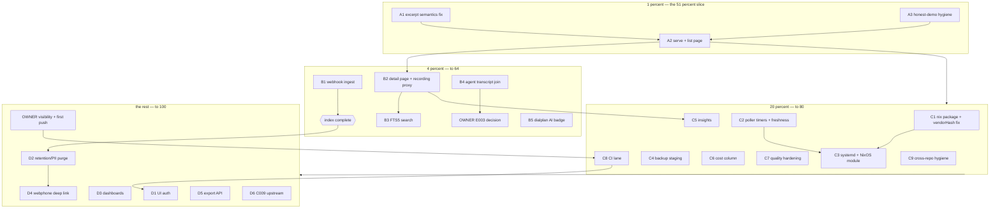

# SUPERB Plan: pbx-lens remaining work — Pareto re-cut after T1-T4 + docs

> **EXECUTED (annotated 2026-10-17, planning-doc closure):** every task in
> this plan was executed and verified during the 2026-10-11→12 era; the
> execution record is `docs/status/archived/2026-10-11_19-37_tier1-2-pareto-execution-status.md`
> (with the earlier same-day reports 03-55 through 18-21 alongside it) and the
> shipped outcomes are in `CHANGELOG.md` (R-series entries, v0.1.0/v0.2.0
> receipts). This file is a historical snapshot — never rewritten; open work
> lives in `TODO_LIST.md`.

Date: 2026-10-11 00:09 CEST. Input state: the ingest core is DONE and
live-proven (T1-T4: scaffold, domain, CDR ingest, Telnyx ingest; 24 tests;
idempotency proven against production data), the doc set exists
(`docs/status/2026-10-10_23-56_docs-health-audit-first-doc-set.md`), and the
original SUPERB plan
(`pbx-artmann/docs/planning/2026-10-09_20-28_SUPERB-pbx-lens-call-index-and-woolly-golive.md`)
still owns the task IDs (T5-T25, M15-M55). This plan RE-CUTS the remaining
work against today's tree: the backlog is `TODO_LIST.md` (20 rows), the known
bugs are the empty nix package + stale vendorHash + the excerpt
order-dependence, and the product still has ZERO user-facing surface.

**Customer:** the operator of pbx.artmann.tech. **Product promise:** for every
call the PBX ever saw — who, when, how long, AI or human, where the transcript
lives. The index behind that promise exists; nobody can look at it yet.

## Guardrails (Verschlimmbesserung protection)

- READ-ONLY over every source, forever. No write-back to FreeSWITCH, Telnyx,
  or the receiver webhook log. The index DB stays disposable and re-derivable.
- No dependency sprawl: stdlib + go-cqrs-lite + go-error-family only (html
  templates from stdlib; no web framework for the list page).
- Every "works" claim verified at ARTIFACT level (run the binary, GET the
  page), never at exit-code level — the empty-nix-package lesson from
  2026-10-10.
- The plan is a snapshot; `TODO_LIST.md` stays the living backlog. Done items
  get deleted there and logged in CHANGELOG, never parked in both.
- Owner gates are not self-assignable: GitHub visibility, E003 split, Woolly
  call batch (pbx-artmann lane).

## Pareto breakdown

| Slice       | Deliverable (against TODAY's tree)                                                                                                                                                                                                                                                                                                                                                         | Value |
| ----------- | ------------------------------------------------------------------------------------------------------------------------------------------------------------------------------------------------------------------------------------------------------------------------------------------------------------------------------------------------------------------------------------------ | ----- |
| 1 percent   | The list page: `serve` command rendering every CallView (who/when/duration/AI badge/excerpt + direction/date filters) — plus the excerpt-semantics fix so that column tells the truth (today it would show the LAST utterance, not the call opening), plus honest-demo hygiene (fake 555 number, README install line)                                                                      | 51    |
| 4 percent   | Source + depth completeness: webhook JSONL ingest (T5, third source family), per-call detail page with recording playback + role-split transcript (T8), FTS5 transcript search (T10), agent-transcript join (T9), dialplan-path AI badge (T11 — the badge column is empty for FreeSWITCH rows today)                                                                                       | 64    |
| 20 percent  | Autonomy, deployability, durability: nix package fix + vendorHash repair (deployability BLOCKER), poller timers + freshness (T12), systemd/NixOS deploy (T7), nightly backup hook (T14), insights (T13), cost column (T15), CI lane, quality hardening (e2e wiring test, CLI pkg extraction, cqrs-lint in flake, LSP reconciliation), cross-repo hygiene (§30 handoff, daemon-diff review) | 80    |
| 100 percent | The rest: UI auth (T24), retention/PII purge (T23), dashboards (T25), webphone deep link (T22, sibling), export API, upstream C009 filing, owner decisions (visibility + first push, E003 split)                                                                                                                                                                                           | 100   |

Rationale for the 1% tier: the original plan's 51% slice was "one sqlite + one
list page". The sqlite half is DONE (live-proven ingest, call_views read
model). The single missing half is the page — and shipping it with the known
excerpt bug would ship a lying column, so the fix rides in the same slice.

## Comprehensive plan (30-100 min tasks; ALL TODOs; sorted by importance / impact / effort / customer-value)

| #  | Task (source)                                                                                                                                                                      | Tier | Impact | Effort | Customer value                                           |
| -- | ---------------------------------------------------------------------------------------------------------------------------------------------------------------------------------- | ---- | ------ | ------ | -------------------------------------------------------- |
| A1 | Fix excerpt order-dependence: decide semantics (asc by created_at = call opening), implement, pin with regression test (TODO row 1)                                                | 1%   | High   | 30min  | The list page's human column tells the truth             |
| A2 | T6 list page: `serve` command, one table (who/when/duration/AI badge/excerpt), direction/date/AI filters, pagination, escape audit (M18-M20)                                       | 1%   | High   | 90min  | THE product surface — the 51% promise                    |
| A3 | Honest-demo hygiene: smoke 555 fake number, README install-line cleanup, CHANGELOG entries (TODO row + session finding)                                                            | 1%   | Med    | 30min  | Demo output and install docs stop lying                  |
| B1 | T5 webhook JSONL tailer + ingest command; extract FlexTime into shared internal/wire package (M15-M17 + §f.30)                                                                     | 4%   | High   | 90min  | "EVERY call" becomes true (third source family joined)   |
| B2 | T8 per-call detail page: route, lookup, role-split transcript pane, recording streaming proxy (signed URL refetch server-side) (M23-M25)                                           | 4%   | High   | 90min  | One place to RE-live any call                            |
| B3 | T10 FTS5 transcript search: FTS table + triggers, query endpoint, search box + highlighting (M29-M30)                                                                              | 4%   | High   | 60min  | Find any conversation by content                         |
| B4 | T9 agent JSONL transcript join: schema probe, parser, uuid join rule; revisit E003 after (M26-M28)                                                                                 | 4%   | Med    | 60min  | Transcript column filled for FreeSWITCH AI calls         |
| B5 | T11 dialplan-path AI-vs-human badge for CDR rows (M31-M32)                                                                                                                         | 4%   | Med    | 30min  | AI badge complete for BOTH source families               |
| C1 | Fix the nix package (empty result → real bin/pbx-lens) + stale vendorHash repair + artifact-verified gate re-run (TODO row 1 + 13)                                                 | 20%  | High   | 60min  | Deployability unblocked — nothing ships without this     |
| C2 | T12 poller timers + freshness self-check + stale-index UI banner (M33-M34)                                                                                                         | 20%  | High   | 60min  | Index keeps itself true without hand-running CLIs        |
| C3 | T7 systemd unit draft + thin NixOS module option for the sibling (M21-M22)                                                                                                         | 20%  | Med    | 60min  | Runs on the PBX host as a managed service                |
| C4 | T14 index DB into nightly backup staging: consistent sqlite snapshot + sync check (M37-M38)                                                                                        | 20%  | Med    | 30min  | Rebuild window shrinks from "re-ingest all" to "restore" |
| C5 | T13 conversation insights fetch + store + detail summary card (M35-M36)                                                                                                            | 20%  | Med    | 60min  | AI-call quality visible at a glance                      |
| C6 | T15 cost column via Detail Records poller, lag-tolerant + nullable (M39-M40)                                                                                                       | 20%  | Low    | 60min  | What did the PBX cost                                    |
| C7 | Quality hardening: httptest e2e for ingest-telnyx loop, resolveKey/parseSince into tested internal/cli package, cqrs-lint into flake, LSP INFO reconciliation (TODO rows 5,6,8,17) | 20%  | Med    | 90min  | Confidence per change; no /tmp binary dependency         |
| C8 | CI story decision + wiring (Actions lane like pbx-artmann vs buildflow-only) (TODO row)                                                                                            | 20%  | Med    | 30min  | Every push gate-checked                                  |
| C9 | Cross-repo hygiene: review daemon-landed flake.lock + telnyx_test diffs; strike pbx-lens rows of pbx-artmann TODO §30 (needs owner OK) (TODO row 13 + 18)                          | 20%  | Med    | 30min  | One backlog, no split brain                              |
| D1 | T24 UI auth reusing operator htpasswd pattern (M53)                                                                                                                                | 100% | Med    | 45min  | Call metadata not world-readable                         |
| D2 | T23 retention + PII policy purge job (E164/ParticipantHash become load-bearing) (M52)                                                                                              | 100% | Med    | 60min  | The index ages gracefully; PII promise enforced          |
| D3 | T25 quality dashboards: volume by day, AI share, MOS trends from CDR fields (M54-M55)                                                                                              | 100% | Low    | 90min  | Line health over time                                    |
| D4 | T22 webphone read-only deep link (sibling change, LAST) (M51)                                                                                                                      | 100% | Low    | 90min  | Click a call in webphone → land in the lens              |
| D5 | Export API: JSONL/CSV dump of the index (ROADMAP raw idea, refined here)                                                                                                           | 100% | Low    | 60min  | Anything can consume call history read-only              |
| D6 | C009 upstream: verify cqrs-lint exemption at source, file issue (TODO row)                                                                                                         | 100% | Low    | 30min  | Fleet-wide lint consistency                              |
| O1 | OWNER: GitHub visibility decision + git remote + first push + repo metadata (ROADMAP open question)                                                                                | gate | High   | 10min  | Unblocks CI lane + `go install @latest` someday          |
| O2 | OWNER: E003 split-vs-policy decision (trigger: B4 landing) (ROADMAP open question)                                                                                                 | gate | Low    | 10min  | Package structure settled                                |

## Micro plan (every task at 12 min or less; ALL TODOs; sorted within tiers)

| #   | Micro task                                                                             | From | Min |
| --- | -------------------------------------------------------------------------------------- | ---- | --- |
| m1  | Decide excerpt semantics (asc by created_at, first user line); note in DOMAIN_LANGUAGE | A1   | 12  |
| m2  | Implement message sort in `excerpt()` + unit tests incl. newest-first fixture          | A1   | 12  |
| m3  | Update mapper regression tests; package tests green                                    | A1   | 12  |
| m4  | `serve` command skeleton: http.Server, -db/-addr flags, graceful shutdown              | A2   | 12  |
| m5  | List handler: metaengine reader → all CallViews                                        | A2   | 12  |
| m6  | html/template table: who, when, duration, AI badge, excerpt                            | A2   | 12  |
| m7  | HTML-escape audit (numbers, excerpts) + template test                                  | A2   | 12  |
| m8  | Filters: direction + AI-or-human                                                       | A2   | 12  |
| m9  | Filters: date range (since/until)                                                      | A2   | 12  |
| m10 | Pagination + empty-state row                                                           | A2   | 12  |
| m11 | serve e2e test: ingest fixture → GET → assert rendered row                             | A2   | 12  |
| m12 | Flip FEATURES list-page row; README usage section; CHANGELOG entry                     | A2   | 12  |
| m13 | Smoke fake number → 555; fixture/test updates                                          | A3   | 12  |
| m14 | README install line: drop `@latest` apology until a tag exists                         | A3   | 12  |
| m15 | CHANGELOG hygiene-bundle entries; gate re-run                                          | A3   | 12  |
| m16 | Probe receiver webhook JSONL on host (read-only); capture fixture                      | B1   | 12  |
| m17 | `internal/ingest/webhook` reader: entries-array parse + tests                          | B1   | 12  |
| m18 | Lifecycle events → Observation mapping + tests                                         | B1   | 12  |
| m19 | `ingest-webhook` CLI command + -backfill flag                                          | B1   | 12  |
| m20 | Extract FlexTime → `internal/wire` shared package; telnyx switches to it               | B1   | 12  |
| m21 | Webhook e2e: fixture file → dispatch → serve row                                       | B1   | 12  |
| m22 | Detail route + call lookup by stream id                                                | B2   | 12  |
| m23 | Transcript pane: role-split, styled, escaped                                           | B2   | 12  |
| m24 | Recording proxy: signed-URL refetch server-side, key never in browser                  | B2   | 12  |
| m25 | Audio element + HTTP range streaming + tests                                           | B2   | 12  |
| m26 | Source badge + raw JSON debug view                                                     | B2   | 12  |
| m27 | FTS5 virtual table + triggers on view upsert                                           | B3   | 12  |
| m28 | Search query endpoint + query parser                                                   | B3   | 12  |
| m29 | Search box UI + result highlighting                                                    | B3   | 12  |
| m30 | Search tests: match, rank, empty query                                                 | B3   | 12  |
| m31 | Agent JSONL schema probe (transcripts location/format on host)                         | B4   | 12  |
| m32 | JSONL parser → Observation mapping + tests                                             | B4   | 12  |
| m33 | Join rule: FreeSWITCH call uuid → transcript file                                      | B4   | 12  |
| m34 | E003 revisit note: keep flat `internal/calls` or split (post-B4)                       | B4   | 12  |
| m35 | Dialplan-path AI detection in cdr mapper + tests                                       | B5   | 12  |
| m36 | Badge wired into list + detail                                                         | B5   | 12  |
| m37 | Diagnose go-standard flakeModule binary wiring (read module source)                    | C1   | 12  |
| m38 | Fix flake config (package path/mainProgram)                                            | C1   | 12  |
| m39 | ARTIFACT check: `./result/bin/pbx-lens version` runs                                   | C1   | 12  |
| m40 | `buildflow -s nix-hash-fix --fix` + full gate re-run, true rc                          | C1   | 12  |
| m41 | Poller timer loop: telnyx re-poll + cdr re-scan intervals                              | C2   | 12  |
| m42 | Freshness self-check (max started_at vs now) + /healthz                                | C2   | 12  |
| m43 | Staleness banner in list UI                                                            | C2   | 12  |
| m44 | Timer tests with fake clock                                                            | C2   | 12  |
| m45 | systemd unit draft (DynamicUser, ReadWritePaths=db)                                    | C3   | 12  |
| m46 | NixOS module option draft + sibling handoff note                                       | C3   | 12  |
| m47 | Consistent sqlite snapshot hook (VACUUM INTO / .backup)                                | C4   | 12  |
| m48 | Backup-staging inclusion check (existing nightly sync)                                 | C4   | 12  |
| m49 | Insights fetch endpoint in telnyx client + tests                                       | C5   | 12  |
| m50 | Store insights on ingest; detail summary card                                          | C5   | 12  |
| m51 | Detail Records poller skeleton                                                         | C6   | 12  |
| m52 | Cost join onto view + nullable display                                                 | C6   | 12  |
| m53 | httptest e2e for the ingest-telnyx command loop                                        | C7   | 12  |
| m54 | `resolveKey`/`parseSince` → `internal/cli` package + unit tests                        | C7   | 12  |
| m55 | cqrs-lint as flake devShell tool or app                                                | C7   | 12  |
| m56 | LSP INFO warnings: reconcile vs .golangci.yml; fix or AGENTS policy note               | C7   | 12  |
| m57 | CI decision note + workflow wiring (or documented buildflow-only)                      | C8   | 12  |
| m58 | Review daemon-landed flake.lock + telnyx_test.go diffs                                 | C9   | 12  |
| m59 | Strike pbx-lens rows of pbx-artmann TODO §30 (moved-to markers)                        | C9   | 12  |
| m60 | htpasswd auth middleware spike (operator pattern reuse)                                | D1   | 12  |
| m61 | Auth wiring + tests (401 path, static assets path)                                     | D1   | 12  |
| m62 | Retention purge job + policy flag                                                      | D2   | 12  |
| m63 | Purge tests: age cutoff, participant-hash-only export mode                             | D2   | 12  |
| m64 | Dashboard queries: volume by day, AI share                                             | D3   | 12  |
| m65 | MOS trend extraction from CDR quality fields                                           | D3   | 12  |
| m66 | Dashboard UI page                                                                      | D3   | 12  |
| m67 | webphone deep-link spike (read-only route; sibling repo)                               | D4   | 12  |
| m68 | Export API: JSONL/CSV dump endpoint + tests                                            | D5   | 12  |
| m69 | C009: verify exemption at cqrs-lint source; draft issue (verify-before-filing)         | D6   | 12  |
| m70 | C009: file upstream issue                                                              | D6   | 12  |
| m71 | OWNER: visibility decision; git remote add; first push; repo metadata                  | O1   | 10  |
| m72 | OWNER: E003 split-vs-policy answer (post-B4)                                           | O2   | 10  |

Coverage check: every TODO_LIST row maps to ≥1 task (rows 1→A1, T6→A2,
T5→B1, T12→C2, httptest→C7/m53, fake number→A3/m13, T8→B2, T10→B3, T9→B4,
resolveKey→C7/m54, cqrs-lint-flake→C7/m55, T7→C3, T14→C4, CI→C8, nix→C1,
LSP→C7/m56, §30→C9/m59, T11→B5, T13→C5, T15→C6, C009→D6, daemon-diffs→C9/m58;
README-line→A3/m14 NEW→TODO_LIST). Export API (D5) graduates from ROADMAP.

## Execution graph

Ordering rules: A1 before A2 (never ship the lying column); C1 before C3
(never deploy an empty package); B4 before O2; O1 before C8 (CI needs a
remote); D-tier strictly after its 20%-tier feeder.
