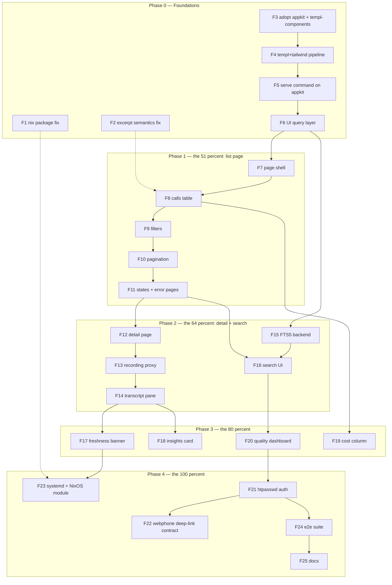

# SUPERB Plan: pbx-lens Frontend — templ-components UI on a go-appkit host

Date: 2026-10-11 01:32 CEST. Scope: the "lens" half of pbx-lens — the `serve`
command and every page that renders the call index (list, detail, search,
freshness, dashboards), plus the build pipeline they need. Ingest-side work
(T5 webhook tailer, T9 agent-transcript join) is NOT frontend and stays in
TODO_LIST as-is; this plan only consumes its outputs.

Relates to:
- `pbx-artmann/docs/planning/2026-10-09_20-28_SUPERB-pbx-lens-call-index-and-woolly-golive.md`
  (source of T-numbers, M-numbers, and the 51/64/80/100 slices)
- `docs/status/2026-10-11_01-05_session-qa-templ-components-cli-surface.md`
  (session that asked "why not templ-components?" — this plan is the answer)
- TODO_LIST.md (canonical backlog; this plan adds 3 genuinely-new rows there)

---

## 1. Context

pbx-lens today is a working CLI index engine with **zero UI**: four commands
(`version | smoke | ingest-cdr | ingest-telnyx`), a ContentHash-deduped sqlite
index, a `call_views` read model, and no HTTP server anywhere. The SUPERB plan
declared the 51% slice as "one sqlite + one list page answering: every call,
who, when, how long, AI or human, transcript link." The sqlite half is done;
the list page is not.

Constraints that shape every decision below:

- **ADR-0123:** `go-cqrs-lite` `system.New` is THE composition root. Never
  hand-wire event/command/decider/storage. Any framework adopted must wrap the
  process (HTTP hosting) — not replace the composition root.
- **Read-only doctrine:** the index DB is disposable; the UI must never gain a
  write path to any source. Recording playback goes through a server-side
  proxy that refetches signed URLs — no Telnyx key ever reaches the browser.
- **Dependency policy (AGENTS.md):** stdlib + go-cqrs-lite + go-error-family
  ONLY. Adoption of anything else is a deliberate policy edit recorded in
  AGENTS.md, not a silent `go get`.
- **Verschlimmbesserung guard:** the CLI must keep working unchanged. `serve`
  is a new verb, not a rewrite of `main.go`.

## 2. Research findings (verified 2026-10-11, source-level)

### templ-components v1.21.0 (`~/projects/templ-components`)

135 components + 102 icons, templ + HTMX + Tailwind v4, zero Node.js. Everything
the SUPERB UI tasks need already exists — hand-rolling would violate the skill's
"check the catalogue first" rule:

| SUPERB need                      | Library component(s)                                                                 |
| -------------------------------- | ------------------------------------------------------------------------------------ |
| T6 list table                    | `display.Table` / `DataTable` (`Row.Href` clickable rows), `ListNote` bounding       |
| T6/T11 AI-or-human badge         | `Badge`, `StatusBadge`, `StatusDot`                                                  |
| T6 filters (M19)                 | `forms.FilterBar` (auto-submit GET, noscript Apply), `FilterChips`, `SegmentedControl` |
| T6 pagination                    | `navigation.Pagination` / `LoadMore` + `EndOfList`                                    |
| T8 detail metadata               | `PageHeader`, `Breadcrumbs`, `DefinitionList`/`DefinitionGrid`, `layout.Split`       |
| T8 transcript pane               | `display.Scrollback` (terminal-style, role-tone tags, zero JS)                        |
| T10 search box                   | `forms.FilterInput` (debounced, HTMX auto-submit)                                     |
| T12 stale banner                 | `htmx.PolledRegion` (interval polling) + `feedback.Alert` / `LivePill`               |
| T13 insight summary              | `display.Card`                                                                        |
| T15 cost column                  | `utils/format.StringOrDash` (nullable display)                                        |
| T25 dashboards                   | `StatCard`, `BarChart`, `Sparkline`, `SegmentBar`, `LineChart` (all zero-JS SVG/CSS)  |
| Call durations / times           | `format.ClockDuration`, `format.CompactDuration`, `RelativeTime`                      |
| Empty/loading states             | `DataState` honesty ladder, `EmptyState`, `Skeleton`                                  |
| Error pages (go-error-family!)   | `errorpage.ErrorHandler` — go-error-family aware, same error doctrine as this repo    |
| Dark mode / shell                | `layout.Base` (auto-injects HTMX + CSS), `ThemeScript`, `ThemeToggle`, `SimpleNav`     |

Pipeline truth (from `docs/tailwind-v4-adoption-guide.md`): CSS build is the
standalone `tailwindcss` CLI (`pkgs.tailwindcss_4`, no Node) with `@source`
scanning over `.templ`/`.go`; `tc init` scaffolds `app.css` + `custom.css` +
theme css; **BuildFlow ships `templ-generate` and `tailwind-build` providers**
(`go-mod-vendor → templ-generate → tailwind-build`) — this repo already runs
BuildFlow as its quality gate, so the pipeline is configuration, not invention.
Consumers gitignore `*_templ.go` and generate at build time.
Recording playback has no ready-made audio component — a native
`<audio controls>` inside a `Card` is the intended answer (CSP-safe, zero JS).

### go-appkit (core, `~/projects/go-appkit`)

Production HTTP service framework: `Service` lifecycle (Run / graceful drain
with ready→503 / ShutdownHooks), default middleware chain Recovery → RequestID
→ Logging → Timeout → SecurityHeaders, health endpoints, `systemd` module
(sd_notify READY=1/STOPPING=1 — pairs directly with T7's unit), opt-in
`security` module (CSRF, rate limiting, CSP nonce), `errorpages` module.
Requires Go 1.27.1 (unified toolchain floor, json/v2 default-on — house style).
Core does NOT depend on go-cqrs-lite; the `appkit/cqrs` module does and we are
NOT taking it — `system.New` stays the only composition root.

### cqrs-htmx + `/setup` (`~/projects/cqrs-htmx/setup`)

`setup.New` is a one-call composition root for a FULL-STACK cqrs-htmx app:
event-sourced `usermgmt` (sessions, TOTP/WebAuthn/OAuth2 strategies), admin
panel, CQRS observability dashboard, login page, SSE feed, CSRF, projection
readiness health. It depends on go-appkit v0.8.0 AND templ-components v1.21.0
transitively — it is the "everything" button of this ecosystem.

### Stack decision matrix

| Criterion                        | A: stdlib net/http + templ-components | B: **go-appkit core + templ-components** (RECOMMENDED) | C: cqrs-htmx/setup full bundle                |
| -------------------------------- | --------------------------------------- | ------------------------------------------------------- | --------------------------------------------- |
| Lifecycle / graceful drain       | hand-rolled (~100 LOC, easy to get wrong) | free (`Service.Run`)                                     | free (via appkit)                              |
| Security headers / CSP           | hand-rolled                              | headers free; CSP nonce via opt-in security module       | full (sessions+CSRF machinery)                 |
| Auth fit for T24                 | hand-rolled basic auth                   | hand-rolled htpasswd middleware (T24 *is* htpasswd)      | WRONG SHAPE — usermgmt sessions/OAuth, not htpasswd |
| Composition-root conflict        | none                                     | none (hosts HTTP around `system.New`)                    | **CONFLICT** — setup.New is a second root for its own event infra/usermgmt |
| Dependency weight                | +templ-components only                   | +templ-components, +go-appkit                            | +setup → usermgmt, adminui, dashboardui, casbin, datastar, watermill, loginpage |
| Read-only doctrine risk          | low                                      | low                                                      | mounts write-capable user surfaces by default  |
| Dogfooding value                 | partial                                  | high (two own libraries get a real consumer)             | highest, but wrong-sized                       |
| NixOS deploy (T7)                | manual unit                              | `appkit/systemd` sd_notify built for exactly this        | heavier unit                                   |
| Reversibility                    | n/a                                      | high — appkit is under `svc.Mux`, swappable              | low once sessions/users exist in the DB        |

**Decision: Option B.** A re-rolls solved problems; C is a second composition
root with an auth model T24 explicitly did not ask for (operator htpasswd),
and it drags casbin/datastar/usermgmt into a read-only lens. C stays documented
as the escalation path IF the lens ever needs multi-user accounts, admin
panels, or live SSE dashboards with sessions — adopt it then, whole, not by
cargo-culting pieces.

Dependency-policy edit (deliberate, recorded in AGENTS.md during F3):
stdlib + go-cqrs-lite + go-error-family + **go-appkit (core [+security, +systemd
later])** + **templ-components** (+ golang.org/x/crypto for bcrypt htpasswd at
F21 — semi-stdlib, house standard for htpasswd files).

## 3. Pareto breakdown (frontend only)

| Slice       | Deliverable                                                                                                                                                     | Share |
| ----------- | --------------------------------------------------------------------------------------------------------------------------------------------------------------- | ----- |
| 1 percent   | `serve` on go-appkit + templ/Tailwind pipeline + list page: every call, who, when, how long, AI badge, excerpt, direction/date filters — on localhost            | 51%   |
| 4 percent   | Plus per-call detail (recording playback via proxy, role-split transcript, source badge) + full-text search box                                                  | 64%   |
| 20 percent  | Plus stale-index banner (T12 UI), insight summary card (T13), cost column (T15), quality dashboard (T25), systemd unit + NixOS module option (T7)                | 80%   |
| 100 percent | Plus htpasswd auth (T24), webphone deep-link contract (T22), PII/retention UI implications (T23 display-side), export hooks, e2e coverage, docs                    | 100%  |

The 1% needs the pipeline (F4) before any page renders — that is why
foundations outrank pages in the sort.

## 4. Comprehensive plan (30–100 min tasks, ALL frontend TODOs, sorted by impact/effort/value)

| #   | Task                                                                                                                                         | Phase | Impact | Effort  | Covers            |
| --- | -------------------------------------------------------------------------------------------------------------------------------------------- | ----- | ------ | ------- | ------------------- |
| F1  | Fix the nix package: wire flake output to `cmd/pbx-lens`, verify `nix run . -- version` + artifact-level guard                                | 0     | High   | 60 min  | TODO_LIST High      |
| F2  | Fix excerpt order-dependence (`internal/ingest/telnyx/map.go:70`): pin semantics with a test (default proposal: asc by created_at)             | 0     | High   | 15 min  | TODO_LIST High      |
| F3  | Adopt go-appkit core + templ-components: go get, go directive → 1.27.1, AGENTS.md policy edit + adoption table                                | 0     | High   | 45 min  | NEW (this plan)     |
| F4  | Build pipeline: templ + tailwindcss_4 into flake devShell, `tc init` CSS scaffold, gitignore `*_templ.go`, BuildFlow templ-generate/tailwind-build DAG, vendor hash via `buildflow -s nix-hash-fix --fix` | 0 | High | 90 min | NEW |
| F5  | `serve` command on appkit `Service` (flags `-addr -db`, mux skeleton, health endpoint, graceful-shutdown proof)                                | 0     | High   | 60 min  | T6 (M18 prereq)     |
| F6  | UI query layer: ListCallsQuery over metaengine (direction/AI/date filters, sort, capped pagination) + CallRow view model + tests               | 0     | High   | 60 min  | T6 prereq           |
| F7  | Page shell: `layout.Base` + `SimpleNav` + `ThemeToggle`, CSP nonce plumbing, render test                                                       | 1     | High   | 45 min  | T6                  |
| F8  | Calls table: Table with time/RelativeTime, parties, direction Badge, StatusBadge AI/human, ClockDuration, escaped excerpt, `Row.Href`, ListNote cap | 1  | High   | 90 min  | T6 (M18, M20) + T11 display |
| F9  | FilterBar: direction select, AI/human SegmentedControl, date range; server-side apply; noscript Apply + Reset                                   | 1     | High   | 60 min  | T6 (M19)            |
| F10 | Pagination with preserved filter state (Pagination vs LoadMore decision per bounding-tables recipe)                                            | 1     | Med    | 45 min  | T6                  |
| F11 | Honesty states: EmptyState, DataState ladder, errorpage.ErrorHandler + NotFound404, htmx GlobalErrorHandling + ToastContainer                   | 1     | Med    | 45 min  | NEW (error doctrine parity) |
| F12 | Detail route `/calls/{id}`: lookup, PageHeader + Breadcrumbs, DefinitionList metadata, source Badge, 404 path                                   | 2     | High   | 60 min  | T8 (M23)            |
| F13 | Recording streaming proxy: server-side signed-URL refetch, Range support, `<audio controls>` in Card, key-never-in-browser audit                 | 2     | High   | 90 min  | T8 (M24)            |
| F14 | Transcript pane: Split layout, Scrollback block, agent/caller role styling, empty-transcript state                                              | 2     | High   | 60 min  | T8 (M25)            |
| F15 | FTS5 index over transcripts: virtual table + triggers, rebuild command, SearchQuery + snippet()                                                 | 2     | Med    | 60 min  | T10 (M29)           |
| F16 | Search UI: debounced FilterInput, results region swap, highlight, empty-results state                                                            | 2     | Med    | 45 min  | T10 (M30)           |
| F17 | Freshness: `/api/freshness` JSON, staleness threshold, Alert banner in PolledRegion, LivePill                                                   | 3     | High   | 60 min  | T12 (M34)           |
| F18 | AI insight summary card on detail (fetch+store on ingest + Card display, absent-state)                                                          | 3     | Med    | 60 min  | T13 (M35–M36)       |
| F19 | Cost column, nullable, `format.StringOrDash` (Detail-Records poller data lands separately per TODO_LIST)                                        | 3     | Low    | 30 min  | T15 (M40 display)   |
| F20 | Quality dashboard page: StatCards volume-by-day + AI share, BarChart, Sparkline trend, MOS placeholder                                          | 3     | Med    | 90 min  | T25 (M54–M55 UI)    |
| F21 | htpasswd basic-auth middleware (bcrypt via x/crypto), 401 flow + realm, public/health route posture, appkit security rate-limit opt-in            | 4     | Med    | 60 min  | T24 (M53)           |
| F22 | Stable deep-link contract: `/calls/{id}` stability note, webphone link format doc (link-in, never data-dependency)                               | 4     | Low    | 30 min  | T22 (M51, lens side) |
| F23 | systemd unit draft (DynamicUser, StateDirectory) + appkit/systemd sd_notify + thin NixOS module option draft                                     | 4     | Med    | 60 min  | T7 (M21–M22)        |
| F24 | httptest e2e suite: seed→list→filter→detail→search→auth-gate→stale-banner loop                                                                   | 4     | Med    | 60 min  | TODO_LIST High (UI half) |
| F25 | Docs: FEATURES UI rows, README UI section, AGENTS.md adoption table filled, CHANGELOG                                                            | 4     | Med    | 45 min  | T16 (partial)       |

25 tasks. All frontend TODOs from TODO_LIST.md are covered: T6 (F5–F10),
T8 (F12–F14), T10 (F15–F16), T11 display (F8), T12 banner (F17), T13 card
(F18), T15 display (F19), T22 lens side (F22), T24 (F21), excerpt fix (F2),
nix fix (F1); T7 unit/module (F23). T5/T9 (ingest) intentionally out of scope.
Data-halves of T13/T15 land with their UI tasks only where trivial, otherwise
stay governed by TODO_LIST rows.

## 5. Micro plan (each ≤ 12 min, ALL of the above decomposed, same sort)

| #    | Micro task                                                                                  | From | Min |
| ---- | --------------------------------------------------------------------------------------------- | ---- | --- |
| M1.1 | Reproduce empty `nix build` result; inspect flakeModule → packages wiring                    | F1   | 12  |
| M1.2 | Wire packages/default output to build `cmd/pbx-lens` binary                                   | F1   | 12  |
| M1.3 | `nix build` + assert `result/bin/pbx-lens` exists; `nix run . -- version`                     | F1   | 12  |
| M1.4 | `nix run . -- smoke` against a temp DSN                                                       | F1   | 12  |
| M1.5 | Add artifact-guard note (assert bin exists post-build) to AGENTS.md gotchas                   | F1   | 6   |
| M2.1 | Write failing test pinning excerpt order (asc by created_at; newest-first = 1-line flip)      | F2   | 12  |
| M2.2 | Implement fix in `map.go` excerpt(); green; note owner question in commit body                | F2   | 6   |
| M3.1 | `go get templ-components@latest go-appkit@latest`; resolve to one templ version               | F3   | 12  |
| M3.2 | Bump go directive to 1.27.1; `GOEXPERIMENT=jsonv2 go build ./...` green                       | F3   | 12  |
| M3.3 | AGENTS.md dependency-policy edit + go-appkit/templ-components stack-decision entries          | F3   | 12  |
| M3.4 | AGENTS.md templ-components adoption table (grep-able, all "planned")                          | F3   | 6   |
| M4.1 | Add templ + tailwindcss_4 to flake devShell; verify binaries on PATH                          | F4   | 12  |
| M4.2 | `tc init` — scaffold app.css/custom.css/theme css into internal/web/static                    | F4   | 12  |
| M4.3 | `.gitignore` `*_templ.go`; add `//go:generate` convention note                                | F4   | 6   |
| M4.4 | BuildFlow config: templ-generate + tailwind-build providers in the DAG                        | F4   | 12  |
| M4.5 | `buildflow --build-mode dev` green; `buildflow -s nix-hash-fix --fix` for vendor hash          | F4   | 12  |
| M4.6 | Throwaway page renders with styled text + htmx injected → delete it                           | F4   | 12  |
| M5.1 | `serve` verb skeleton: appkit `ServiceConfig{Addr}`, `svc.Mux` mounted, `svc.Run`             | F5   | 12  |
| M5.2 | Flags `-addr -db`; DSN == "" → memory (deploy knob preserved); usage() update                 | F5   | 12  |
| M5.3 | Route table stub: `/`, `/calls`, `/calls/{id}`, `/calls/{id}/recording`, `/api/freshness`, `/static/` | F5 | 12 |
| M5.4 | Health endpoint wired to appkit readiness; verify 503 during drain                            | F5   | 12  |
| M5.5 | SIGINT graceful-shutdown proof (log line + exit code)                                         | F5   | 12  |
| M6.1 | `ListCallsQuery` struct + metaengine query registration                                       | F6   | 12  |
| M6.2 | Filter parsing: direction enum, AI bool, date from/to; reject garbage with 400-class errors   | F6   | 12  |
| M6.3 | Sort (StartedAt desc default) + page/pageSize with hard cap                                   | F6   | 12  |
| M6.4 | `CallRow` view model (no domain leak); mapping test                                           | F6   | 12  |
| M6.5 | Table-driven tests vs sqlite fixture (3 sources × filters)                                    | F6   | 12  |
| M7.1 | `internal/web/page.templ`: `layout.Base(DefaultPageProps)` shell                              | F7   | 12  |
| M7.2 | `SimpleNav` brand "pbx-lens" + link set; `ThemeToggle` in RightItems                          | F7   | 12  |
| M7.3 | Nonce plumbing: appkit CSP (or empty-nonce posture) → `BaseProps.Nonce`                       | F7   | 12  |
| M7.4 | `templ generate` + httptest render test (assert htmx script + nav present)                    | F7   | 12  |
| M8.1 | `calls.templ` `display.Table` skeleton: headers only                                           | F8   | 12  |
| M8.2 | Row cells: RelativeTime(StartedAt), from/to parties, direction Badge                          | F8   | 12  |
| M8.3 | AI-or-human: StatusBadge + human fallback (T11 display; CDR badge data lands in TODO T11)      | F8   | 12  |
| M8.4 | Duration via `format.ClockDuration`; parties via `format.StringOrDash`                        | F8   | 12  |
| M8.5 | Excerpt cell, HTML-escaped, truncation to ~140 chars                                          | F8   | 12  |
| M8.6 | `Row.Href` → `/calls/{id}`; hover affordance check                                            | F8   | 12  |
| M8.7 | Bound the table: ListNote count + hard row cap (bounding-tables recipe)                       | F8   | 12  |
| M8.8 | Render test with 3-row fixture incl. unknown/empty parties (real CDRs)                        | F8   | 12  |
| M9.1 | `FilterBar` GET form wrapping selects; auto-submit wiring                                     | F9   | 12  |
| M9.2 | Direction Select + AI/human SegmentedControl (link mode, zero JS)                             | F9   | 12  |
| M9.3 | Date-range DatePickers (from/to) → query mapping                                              | F9   | 12  |
| M9.4 | Server-side apply through ListCallsQuery; state preserved in inputs                           | F9   | 12  |
| M9.5 | noscript Apply button + Reset link; FilterChips for active filters                            | F9   | 12  |
| M9.6 | Filter matrix test (each filter alone + combined + invalid)                                   | F9   | 12  |
| M10.1 | Pagination component wiring; hrefs preserve active filters                                   | F10  | 12  |
| M10.2 | Cap page size; SEO rel attrs; a11y labels                                                    | F10  | 12  |
| M10.3 | Pagination-vs-LoadMore decision note (start with numbered pages)                              | F10  | 6   |
| M10.4 | Boundary tests: page 0, last page, out-of-range                                              | F10  | 12  |
| M11.1 | EmptyState for zero-call DB; DataState ladder wrapper                                         | F11  | 12  |
| M11.2 | Mount `errorpage.ErrorHandler` (go-error-family aware) as recover middleware                  | F11  | 12  |
| M11.3 | NotFound404 for unknown routes; ErrorDetail for ingest/query failures                         | F11  | 12  |
| M11.4 | htmx GlobalErrorHandling + ToastContainer in shell                                            | F11  | 12  |
| M12.1 | `/calls/{id}` route + CallView lookup + 404 path                                             | F12  | 12  |
| M12.2 | PageHeader + Breadcrumbs (Calls / call id)                                                    | F12  | 12  |
| M12.3 | DefinitionList: parties, times, direction, SourceKind Badge, stream id, ContentHash short     | F12  | 12  |
| M12.4 | Detail render test (found + not-found)                                                        | F12  | 12  |
| M13.1 | Server-side signed-URL refetch via `RecordingByCallControl` mapping                           | F13  | 12  |
| M13.2 | `/calls/{id}/recording` proxy: stream with Range support                                      | F13  | 12  |
| M13.3 | Content-Type/Cache-Control headers; error → errorpage family                                  | F13  | 12  |
| M13.4 | `<audio controls preload="none">` in Card; src = proxy route only                             | M13  | 12  |
| M13.5 | Audit: no Telnyx key/signed URL in any response body (grep + test)                            | F13  | 12  |
| M13.6 | httptest proxy test with stub upstream (200/partial/404/upstream-down)                        | F13  | 12  |
| M14.1 | `layout.Split`: audio card | transcript pane                                                 | F14  | 12  |
| M14.2 | Scrollback block; role-tone tags (agent vs caller)                                            | F14  | 12  |
| M14.3 | Role-split mapping from stored messages; newest→call-order sort after F2 semantics            | F14  | 12  |
| M14.4 | Empty-transcript EmptyState; single-message edge                                              | F14  | 12  |
| M14.5 | Render test: roles styled, order stable                                                       | F14  | 12  |
| M15.1 | FTS5 virtual table + triggers on transcript write                                             | F15  | 12  |
| M15.2 | Backfill/rebuild command for existing DBs                                                     | F15  | 12  |
| M15.3 | SearchQuery (metaengine) + snippet()/highlight extraction                                     | F15  | 12  |
| M15.4 | FTS tests: match, no-match, special chars, empty query                                        | F15  | 12  |
| M16.1 | FilterInput debounced search box in shell/nav                                                 | F16  | 12  |
| M16.2 | Results region: htmx swap rendering matched calls w/ highlighted snippets                     | F16  | 12  |
| M16.3 | Empty-results + error states; deep-linkable `?q=`                                             | F16  | 12  |
| M16.4 | Search e2e httptest round-trip                                                                | F16  | 12  |
| M17.1 | `/api/freshness`: last-successful-ingest age JSON (+threshold in config)                      | F17  | 12  |
| M17.2 | Threshold semantics doc (what counts as stale; per-source?)                                   | F17  | 12  |
| M17.3 | Alert banner (danger/warn/ok) rendered in shell top                                           | F17  | 12  |
| M17.4 | `htmx.PolledRegion` interval polling the banner region                                        | F17  | 12  |
| M17.5 | LivePill/StatusDot in nav (fresh/stale)                                                       | F17  | 12  |
| M17.6 | Tests: fresh, stale, never-ingested, endpoint down                                            | F17  | 12  |
| M18.1 | Insights fetch+store on Telnyx ingest (conversation_insights) — TODO_LIST T13 data half       | F18  | 12  |
| M18.2 | Insight Card on detail page (summary + generated-at)                                          | F18  | 12  |
| M18.3 | Absent-insight state (human calls, old rows)                                                  | F18  | 12  |
| M18.4 | Round-trip test                                                                               | F18  | 12  |
| M19.1 | Cost nullable field onto CallRow (Detail Records poller per TODO_LIST T15)                    | F19  | 12  |
| M19.2 | Column with `format.StringOrDash`; sort-safe                                                  | F19  | 12  |
| M20.1 | `/dashboard` route + PageHeader + date-range picker                                           | F20  | 12  |
| M20.2 | Aggregation queries: calls/day, AI share, duration histogram                                  | F20  | 12  |
| M20.3 | StatCards row (total, today, AI %, avg duration)                                              | M20  | 12  |
| M20.4 | BarChart calls-by-day; Sparkline 30-day trend                                                 | F20  | 12  |
| M20.5 | SegmentBar AI vs human share; MOS placeholder card (CDR fields, T25 M55)                      | F20  | 12  |
| M20.6 | Dashboard render test w/ fixture DB                                                           | F20  | 12  |
| M21.1 | `golang.org/x/crypto` dep + AGENTS.md policy note (bcrypt for htpasswd)                       | F21  | 12  |
| M21.2 | htpasswd file loader (bcrypt entries; reject plaintext/crypt)                                  | F21  | 12  |
| M21.3 | Basic-auth middleware: realm, constant-time compare, cache-friendly 401                       | F21  | 12  |
| M21.4 | Route posture: public = `/health` (+`/api/freshness` decision), rest gated                    | F21  | 12  |
| M21.5 | appkit security rate-limit opt-in on auth attempts; fail2ban-friendly log line                | F21  | 12  |
| M21.6 | Tests: valid/invalid/missing creds; public route bypass                                       | F21  | 12  |
| M22.1 | `/calls/{id}` stability note (ids are deterministic stream ids — deep-link safe)              | F22  | 12  |
| M22.2 | Webphone contract section in README/docs: link-in only, example URL                           | F22  | 12  |
| M23.1 | systemd unit draft: DynamicUser, StateDirectory=pbx-lens, ExecStart=serve                     | F23  | 12  |
| M23.2 | appkit/systemd sd_notify integration flag (+build tag or config)                              | F23  | 12  |
| M23.3 | Thin NixOS module option draft (sibling consumes; handoff note per SUPERB T7)                 | F23  | 12  |
| M23.4 | CDR/Telnyx credential path via LoadCredential-style env (matches T3 note)                     | F23  | 12  |
| M24.1 | httptest e2e: seed 3-source fixture → list → filter → detail → search                         | F24  | 12  |
| M24.2 | e2e: auth gate (401 → 200 with creds); freshness banner states                                | F24  | 12  |
| M24.3 | e2e: recording proxy incl. upstream-down degradation                                          | F24  | 12  |
| M24.4 | Wire e2e into buildflow gate; CI story note (owner question open)                             | F24  | 12  |
| M25.1 | FEATURES.md UI section: PLANNED → shipped rows as they land                                   | F25  | 12  |
| M25.2 | README UI section + screenshots-as-ci candidate note                                          | F25  | 12  |
| M25.3 | AGENTS.md adoption table filled with real component usage; CHANGELOG entry                    | F25  | 12  |

105 micro tasks, each ≤ 12 min.

## 6. Execution graph

Critical path: F3 → F4 → F5 → F6 → F7 → F8 — nothing user-visible renders
before the pipeline and the query layer exist. F1/F2 are independent quick
fixes that unblock deploy (F23) and honest data (everything).

## 7. Verschlimmbesserung guards

1. **`main.go` stays a thin dispatcher.** `serve` is a new verb; existing
   verbs and flags do not change shape. `resolveKey`/`parseSince` extraction
   (TODO_LIST Med) happens only if `serve` needs them — not as a drive-by.
2. **One composition root.** go-appkit hosts; `system.New` composes. The
   `appkit/cqrs` module and all of cqrs-htmx stay OUT of go.mod. If C is ever
   wanted, it is adopted whole after an owner decision, never piecemeal.
3. **No write paths.** The UI performs exactly one mutation class: none.
   Every route is a query or a proxy. Recording proxy refetches signed URLs
   server-side; keys stay server-side. Audit at M13.5.
4. **Generated code is generated.** `*_templ.go` gitignored; `templ generate`
   runs in the BuildFlow DAG — never hand-edited, never committed here.
5. **The index DB stays disposable.** FTS5 triggers and insights columns are
   re-derivable from sources; no source ever gets write-back.
6. **Bounded renders.** No unbounded table ships (bounding-tables recipe);
   every list has a cap + ListNote/Pagination.
7. **Policy edits are explicit.** go-appkit/templ-components/x-crypto enter
   AGENTS.md's dependency list in the same commit that adds them to go.mod.

## 8. Deliberately out of scope

- T5 webhook ingest, T9 agent-transcript join (ingest-side; UI renders them
  automatically once stored — the source Badge already covers new kinds).
- cqrs-htmx/setup adoption (documented escalation path in §2).
- Live SSE updates, Datastar transport (HTMX polling covers the 80%; SSE is a
  Phase-5+ idea needing an owner decision).
- CI lane wiring (blocked on owner question #3 from the 01:05 status report).

## 9. Open owner questions carried from `docs/status/2026-10-11_01-05_*`

1. Frontend-now vs nix/excerpt-first — this plan resolves it structurally
   (F1+F2 are Phase 0 with F3+), but execution ORDER across phases stays the
   owner's call.
2. Excerpt semantics: plan defaults to asc-by-created-at (call opening),
   pinned by a test; flipping to newest-first is a one-line change (M2.1 note).
3. CI story (GitHub Actions vs buildflow-only) — gates M24.4 only.

## 10. Immediate next actions

1. F1 + F2 (quick fixes, independent, ~75 min total).
2. F3 → F4 (adoption + pipeline) — the only path into any page.
3. F5 + F6 in parallel once F4 is green; then the 51% slice is one F7-F8
   session away from rendering on real data.
