<!-- docs/planning/2026-10-11_19-05_SUPERB-pareto-todo-plan.md
     Pareto execution plan for pbx-lens open work. Input: TODO_LIST.md as of
     2026-10-11 19:05 (incl. items harvested from the four-lens review session
     and its brutal self-check, docs/status/2026-10-11_18-57).
     Format note: .md + mermaid per explicit operator demand in the dispatch
     prompt (pareto-planning skill's canonical format is HTML; overridden). -->

# SUPERB Plan — pbx-lens Open Work (Pareto)

> **EXECUTED (annotated 2026-10-17, planning-doc closure):** this plan's
> tiers were executed on 2026-10-11→12; the execution record is
> `docs/status/archived/2026-10-11_19-37_tier1-2-pareto-execution-status.md`
> (followed by the 20-26 and 23-35/23-41 gate-closure reports). This file is
> a historical snapshot — never rewritten; open work lives in `TODO_LIST.md`.

Date: 2026-10-11 19:05 CEST · Baseline: build green, 117 test functions green,
golangci-lint 0 issues, buildflow dev gate "passed with warnings" with exactly
ONE error-severity finding (AGENTS.md size).

## State of the world (context)

- The 2026-10-11 four-lens review (data-model, full-code, naming, modularize)
  fixed 8 defects on sight; all reports in `docs/reviews/`. Three owner
  decisions are recorded: module boundary HOLD (seam pre-agreed), hash-v2
  encoding SCHEDULED, proxy-timeout bound DEFERRED until traffic data.
- **The gate is red on exactly one finding**: `🟠 ERROR AGENTS.md:479
  [agent-config | structure]` (max 220 lines) — verified live at 19:05.
  Everything else remaining is warning/info with documented rationale.
- One ghost system found by the brutal self-check:
  `retention.Policy.Admits` is exported, tested, documented — and called by
  nobody. The poller has no age gate, so over-age rows keep entering the
  index between purges.

## Pareto breakdown

| Tier              | Share of result | Tasks                                                                                                               | Why here                                                                                                  |
| ----------------- | --------------- | ------------------------------------------------------------------------------------------------------------------- | --------------------------------------------------------------------------------------------------------- |
| **1%**            | 51%             | P1 (AGENTS.md ≤220 → gate green), P2 (`Admits` wired → retention doctrine enforced at ingest, not just at purge)    | The only gate ERROR + the only unwired tested capability. Everything else is polish against a green gate. |
| **4%**            | 64%             | + P3 (docs truth: CHANGELOG/FEATURES/plan annotation), P4 (test hardening: pin this session's fixed behaviors)      | A green gate that lies in docs, or loses its regression pins, rots silently.                              |
| **20%**           | 80%             | + P5 (web robustness), P6 (backup durability), P7 (naming closures), P8 (UI e2e probe + README), P17 (polish batch) | Cheap, bounded, code-verified nits — each closes a noted-not-ticketed loose end.                          |
| **Remaining 20%** | 100%            | + P9 (upstream filings), P10 (buildflow binary), P11–P16 (blocked/deferred/external)                                | External dependencies, owner-deferred bounds, cross-repo work.                                            |

## Comprehensive plan (30–100 min tasks, ALL todos)

| #   | Task                                                                                                                                                                                                           | Impact               | Effort | Tier | Status     | Notes                                                                   |
| --- | -------------------------------------------------------------------------------------------------------------------------------------------------------------------------------------------------------------- | -------------------- | ------ | ---- | ---------- | ----------------------------------------------------------------------- |
| P1  | Shrink AGENTS.md 478 → ≤220 lines: extract Gotchas, Telnyx live-API cluster, cqrs-lint findings policy, buildflow residuals into `docs/` pages; keep invariants greppable and AGENTS.md pointing at them       | **Med (gate ERROR)** | 60min  | 1%   | 🔴 TODO    | docs-health ANNOTATE-style extraction; re-run go-structure-linter after |
| P2  | Wire `retention.Policy.Admits` into the poller as ingest-side cutoff (`-max-age` serve flag → PollConfig → reject over-age observations with reason) + tests                                                   | Med                  | 45min  | 1%   | 🔴 TODO    | ghost system: zero production callers today                             |
| P3  | Docs closure: CHANGELOG entries for the review-session fixes (typed Hit, excerpt ceiling, auth timing pad, StreamMarker purge, E003/hash-v2 decisions); FEATURES.md retention rows; annotate plan-report table | Low-Med              | 30min  | 4%   | 🔴 TODO    | repo convention: shipped changes log in CHANGELOG                       |
| P4  | Test-hardening: `padCost` cost-12 file test · CDR 18-col+MOS combo · `backup.Verify` expected-table · `ingest.EachLine` direct                                                                                 | Low                  | 60min  | 4%   | 🔴 TODO    | pins behaviors covered only indirectly                                  |
| P5  | Web robustness: freshness error-after-headers → log-and-abort · `search.Query` hard limit cap · route-table test (every registered route answers)                                                              | Low                  | 60min  | 20%  | 🔴 TODO    |                                                                         |
| P6  | Backup durability: fsync staging file before atomic rename (+ note why Verify is the post-condition)                                                                                                           | Low                  | 30min  | 20%  | 🔴 TODO    |                                                                         |
| P7  | Naming closures: twin `excerpt()` decision (share vs siblings) · `searchResultLimit` vs `search.DefaultLimit` · `pii` double-read in `exportViews`                                                             | Low                  | 30min  | 20%  | 🔴 TODO    | decide, then write the decision down                                    |
| P8  | UI e2e: seed sqlite index, serve, Go http probe of `/`, `/dashboard`, `/search`, `/api/freshness`; README command list check (purge/backup present?)                                                           | Low                  | 30min  | 20%  | 🔴 TODO    | AGENTS.md prescribes the probe                                          |
| P9  | Upstream filings: cqrs-lint C009 `len(name)>4` + D6 trio (sqliteengine time bind, memory-engine field resolution, treefmt templ go pin) — verify-before-filing, search duplicates first                        | Low                  | 90min  | 20%  | 🔴 TODO    | external repos                                                          |
| P10 | Rebuild BuildFlow binary (5aaf336 → HEAD), re-run gate, drop stale AGENTS/TODO notes that no longer reproduce                                                                                                  | Low                  | 15min  | 20%  | 🔴 TODO    | doctor already warns freshness                                          |
| P11 | Polish batch: recordings-dir help text · dashboard day-format constant · webhook map-order note · TurnRole enum (if domain.go touched anyway)                                                                  | Low                  | 30min  | 20%  | 🔴 TODO    |                                                                         |
| P12 | Sibling closure: confirm `services.telephony.pbx-lens` landed in nix-international-telephony matches `deploy/nixos/module-draft.nix` options; mark draft historical                                            | Low                  | 30min  | rest | 🔴 TODO    | cross-repo                                                              |
| P13 | Live-verify Telnyx Detail Records + insights DTOs                                                                                                                                                              | Low                  | 30min  | rest | 🔵 BLOCKED | needs real API key                                                      |
| P14 | ContentHash v2 length-prefixed encoding                                                                                                                                                                        | Med-Low              | 60min  | rest | 🔵 BLOCKED | SCHEDULED at v2 (owner 2026-10-11)                                      |
| P15 | Recording-proxy timeout knob                                                                                                                                                                                   | Low                  | 20min  | rest | 🔵 BLOCKED | deferred until traffic data (owner 2026-10-11)                          |
| P16 | `RecordingFetcher` consumer-side interface                                                                                                                                                                     | Low                  | 15min  | rest | 🔴 TODO    | optional, pure pattern symmetry                                         |
| P17 | SegmentBar adoption when templ-components publishes                                                                                                                                                            | Low                  | 10min  | rest | 🔵 BLOCKED | unreleased upstream                                                     |

## Fine plan (≤12 min tasks, ALL todos)

| #    | Micro-task                                                                                                                                                                  | Parent | Effort |
| ---- | --------------------------------------------------------------------------------------------------------------------------------------------------------------------------- | ------ | ------ |
| 1.1  | Design extraction layout: map every AGENTS.md section → target doc (`docs/gotchas.md`, `docs/telnyx-live-api.md`, `docs/buildflow-dev-gate.md`, `docs/cqrs-lint-policy.md`) | P1     | 12min  |
| 1.2  | Move "Gotchas (paid for)" verbatim; leave a two-line summary + pointer in AGENTS.md                                                                                         | P1     | 12min  |
| 1.3  | Move Telnyx live-API truths cluster (re-verify dates included)                                                                                                              | P1     | 12min  |
| 1.4  | Move cqrs-lint findings policy + buildflow residual findings                                                                                                                | P1     | 12min  |
| 1.5  | Rewrite AGENTS.md core (stack decisions, structure, commands, domain, pointers) ≤220 lines                                                                                  | P1     | 12min  |
| 1.6  | `buildflow -s go-structure-linter` green + full gate re-run; fix link rot                                                                                                   | P1     | 12min  |
| 2.1  | Read poller flow; decide Admits placement (reject at observation build vs at Ingest loop)                                                                                   | P2     | 12min  |
| 2.2  | Thread max-age through PollConfig → cutoff; reject over-age observations with labeled reason                                                                                | P2     | 12min  |
| 2.3  | Test: over-age observation counts as rejected with `retention:age-cutoff` reason                                                                                            | P2     | 12min  |
| 2.4  | Serve flag `-max-age` (0 = keep everything, matching Policy zero-value); AGENTS.md note                                                                                     | P2     | 12min  |
| 3.1  | CHANGELOG entries for the session's fixes + decisions                                                                                                                       | P3     | 12min  |
| 3.2  | FEATURES.md: retention/PII export rows if missing                                                                                                                           | P3     | 12min  |
| 3.3  | Annotate 18-30 plan report task table → done statuses                                                                                                                       | P3     | 12min  |
| 4.1  | Test: `padCost` derives cost 12 from a `$2a$12$…` file                                                                                                                      | P4     | 12min  |
| 4.2  | Test: CDR 18-column template + appended MOS column parses MOS                                                                                                               | P4     | 12min  |
| 4.3  | Test: `backup.Verify` rejects a valid-but-empty sqlite file (no lens tables)                                                                                                | P4     | 12min  |
| 4.4  | Test: `ingest.EachLine` trims, skips blanks, bounded-buffer sanity                                                                                                          | P4     | 12min  |
| 5.1  | freshness: log-and-abort on mid-write failure instead of `http.Error` after body                                                                                            | P5     | 12min  |
| 5.2  | `search.Query`: clamp limit to a hard max (e.g. 200)                                                                                                                        | P5     | 12min  |
| 5.3  | Route-table test: every `Register` route returns non-404/405 on a seeded index                                                                                              | P5     | 12min  |
| 6.1  | `backup.Snapshot`: fsync staging before rename                                                                                                                              | P6     | 12min  |
| 6.2  | Test/note: staging+rename+Verify chain documented as the crash post-condition                                                                                               | P6     | 12min  |
| 7.1  | Twin `excerpt()` decision: extract shared helper to `calls` OR document sibling-twin doctrine                                                                               | P7     | 12min  |
| 7.2  | Reconcile `searchResultLimit`/`search.DefaultLimit` (one source of truth)                                                                                                   | P7     | 12min  |
| 7.3  | `exportViews`: read `pii` query param once                                                                                                                                  | P7     | 12min  |
| 8.1  | Seed index, run the Go http probe over all four surfaces                                                                                                                    | P8     | 12min  |
| 8.2  | README: verify purge/backup/export documented; fix gaps                                                                                                                     | P8     | 12min  |
| 9.1  | C009: re-verify `c009.go` guard at source, search existing issues, file with repro                                                                                          | P9     | 12min  |
| 9.2  | D6-a: sqliteengine time binding — verify upstream state, file/subscribe                                                                                                     | P9     | 12min  |
| 9.3  | D6-b: memory-engine field-name resolution — same                                                                                                                            | P9     | 12min  |
| 9.4  | D6-c: treefmt-nix templ formatter goPkg — same                                                                                                                              | P9     | 12min  |
| 10.1 | `nix run .#reinstall` in BuildFlow repo; re-run gate; retire stale notes                                                                                                    | P10    | 15min* |
| 11.1 | recordings-dir flag help text aligns with default                                                                                                                           | P11    | 6min   |
| 11.2 | dashboard `2006-01-02` day-format constant (3 uses)                                                                                                                         | P11    | 6min   |
| 11.3 | webhook `Parse`: note order-independence at the map iteration                                                                                                               | P11    | 6min   |
| 11.4 | `TurnRole` enum IF `domain.go` is open anyway (hash-compatible)                                                                                                             | P11    | 12min  |
| 12.1 | Diff module-draft options vs sibling's landed `lens.nix`; annotate draft as historical                                                                                      | P12    | 30min* |
| 13.1 | (BLOCKED) Telnyx live DTO verification — needs API key                                                                                                                      | P13    | 30min* |
| 14.1 | (BLOCKED) hash v2 encoding — waits for the v2 gate                                                                                                                          | P14    | 60min* |
| 15.1 | (BLOCKED) proxy timeout — waits for traffic data                                                                                                                            | P15    | 20min* |
| 16.1 | `RecordingFetcher` interface + swap `RecordingOptions.Telnyx`                                                                                                               | P16    | 15min* |
| 17.1 | (BLOCKED) SegmentBar swap — waits for upstream release                                                                                                                      | P17    | 10min* |

\* exceeds 12min only where the task is a single atomic external action.

## Execution graph

```mermaid
flowchart TD
    subgraph TIER1["1% — 51% of value"]
        P1["P1 AGENTS.md ≤220<br/>(gate ERROR)"]
        P2["P2 wire Policy.Admits<br/>(ghost system)"]
    end
    subgraph TIER2["4% — 64%"]
        P3["P3 docs closure<br/>(CHANGELOG/FEATURES/annotate)"]
        P4["P4 test hardening<br/>(4 regression pins)"]
    end
    subgraph TIER20["20% — 80%"]
        P5["P5 web robustness"]
        P6["P6 backup fsync"]
        P7["P7 naming closures"]
        P8["P8 UI e2e probe + README"]
        P11["P11 polish batch"]
    end
    subgraph REST["remaining 20% — 100%"]
        P9["P9 upstream filings<br/>(C009 + D6×3)"]
        P10["P10 buildflow binary"]
        P12["P12 sibling closure"]
        P16["P16 RecordingFetcher"]
        P13["P13 Telnyx live verify 🔵"]
        P14["P14 hash v2 🔵"]
        P15["P15 proxy timeout 🔵"]
        P17["P17 SegmentBar 🔵"]
    end
    GATE["gate green<br/>+ full suite"]

    P1 --> GATE
    P2 --> GATE
    P3 --> GATE
    P4 --> GATE
    GATE --> T20
    subgraph T20["only after gate green"]
        P5
        P6
        P7
        P8
        P11
    end
    P5 --> REST
    P6 --> REST
    P7 --> REST
    P8 --> REST
    P11 --> REST
    P10 -.-> P9
    P13 -.->|"needs API key"| P9
    P14 -.->|"needs schema v2"| REST
    P15 -.->|"needs traffic data"| REST
    P17 -.->|"needs upstream release"| REST
```

## Doctrine

- Do NOT verschlimmbessern: every task leaves build + full suite green;
  no speculative rewrites; the AGENTS.md extraction moves text verbatim
  before any rewording.
- Tests run after every micro-task that touches code:
  `GOEXPERIMENT=jsonv2 go test ./... -count=1`.
- Gate check after P1: `nix develop -c env BUILDFLOW_NO_RESULT_CACHE=1
  buildflow --build-mode dev` — expect ZERO error findings for the first
  time since the AGENTS.md limit landed.
- Blocked items (P13–P15, P17) wait on their named external dependency;
  no stubs, no workarounds.
