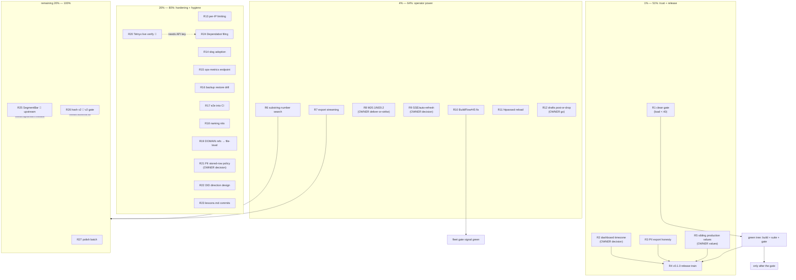

<!-- docs/planning/2026-10-12_03-43_SUPERB-pareto-open-work-plan.md
     Pareto execution plan for ALL open pbx-lens work after the 2026-10-12
     docs-health pass (21 reports annotated + archived, living docs rebuilt).
     Input: TODO_LIST.md fourth pass, ROADMAP.md 2026-10-12 rebuild, and the
     status report 2026-10-12_03-39 §f (50 items). Format: .md + mermaid per
     explicit operator demand (pareto-planning skill's HTML default overridden). -->

# SUPERB Plan — pbx-lens Open Work After the Docs-Health Pass (Pareto)

Date: 2026-10-12 03:43 CEST · Baseline: working tree clean at `48a350e`
(the 03:39 status-report commit), 13/13 test packages green, race green,
`nix build` + artifact green, `nix flake check` green, dprint clean,
machine load ~17 and falling.

## State of the world (context)

- **The 2026-10-11/12 execution era is closed.** The original SUPERB TODO list
  (T1–T25) is done, verified, and archived: 21 status reports live in
  `docs/status/archived/` with every open item resolved inline; the living
  backlog is TODO_LIST.md (6 blocked/small rows), ROADMAP.md (4 themes, 5 open
  questions), and the 03:39 status report §f (50 items). This plan consolidates
  ALL of them into one Pareto cut.
- **What is NOT on this plan** (decided doctrine, do not re-litigate):
  read-only-over-sources forever; single-module HOLD with the pre-agreed
  write/read seam (E003); ContentHash encoding frozen at v1 until the v2 gate;
  recording-proxy timeout landed (30 s default, production value deferred
  until traffic data); UI trio dependency policy; flat `internal/calls`.
- **What changed since the last plan (19:05 on 10-11):** every tier-1/2 item of
  that plan (P1–P11) shipped. What remains is exactly what this plan cuts:
  the owner-gated release/deploy chain, operator-trust gaps (timezone, PII
  export field coverage, substring search), and a long tail of polish.
- **Customer:** the operator of pbx.artmann.tech. The product promise (every
  call: who/when/how-long/AI-human/transcript) ships; what does NOT yet deliver
  fully is trust and operations: the dashboard's "today" is UTC-wrong for a
  German PBX after 22:00, `?pii=hash` exports still carry raw transcripts,
  partial phone numbers cannot be searched, and nothing is tagged for install.

## Guardrails (Verschlimmbesserung protection)

- READ-ONLY over every source, forever; the index DB stays disposable.
- Do NOT re-decide settled doctrine (module boundary, hash-v1 freeze, proxy
  timeout, UI trio). Blocked items wait on their named external dependency —
  no stubs, no workarounds.
- Every task leaves `go build ./...` + full suite green; markdown passes end
  in `dprint fmt`.
- The full gate runs only when the 15-minute load average is < ~40; casualties
  get individual verification otherwise (docs/buildflow-dev-gate.md).
- Owner gates are not self-assignable: timezone, M20.1/M20.2, release go,
  sibling values, PII storage policy, Telnyx key, RetireCallCmd.

## Pareto breakdown

| Slice    | Deliverable (against TODAY's tree)                                                                                                                                                                                                                                                                                                                                                                          | Value    |
| -------- | ----------------------------------------------------------------------------------------------------------------------------------------------------------------------------------------------------------------------------------------------------------------------------------------------------------------------------------------------------------------------------------------------------------- | -------- |
| **1%**   | Trust-and-release spine: one clean gate on this exact tree, the dashboard-timezone decision + window-math fix (a German PBX's "today" is wrong after 22:00 UTC), PII export honesty (`X-PII-Mode` header + field-coverage matrix + the raw-transcript disclosure), the v0.1.0 release train, and the sibling production-values handoff. This is what makes the thing installable and trustworthy.           | **51%**  |
| **4%**   | Operator power: substring phone-number search (FTS5 tokenizes `+1728…` as ONE token today — partial numbers silently match nothing), export streaming past `maxExportRows`, the M20.1/M20.2 dashboard completion decision (deliver or strike), the SSE/auto-refresh decision + implementation, the BuildFlow#45 fix (fleet-wide gate signal), htpasswd reload, and the post-or-drop pass over docs/drafts/. | **64%**  |
| **20%**  | Hardening + hygiene: per-IP rate limiting, slog adoption, the ops-metrics endpoint, backup restore drill, the e2e test in CI, naming-nit closure, DOMAIN_LANGUAGE file-level refs, the Telnyx live DTO verify (when a key exists), PII stored-row policy, DID-direction design, lessons.md commits, the Dependabot upstream filing.                                                                         | **80%**  |
| **100%** | The rest: SegmentBar swap (upstream release), ContentHash v2 encoding (v2 gate), and the polish batch (vulnix re-triage, art-dupl/branching passes, nix-checker, README screenshots, Sparkline a11y + week deltas, keyset e2e, `purge -json`, AGENTS load line, quarter calendar, report-format policy, RetireCallCmd decision, machine-hygiene norm).                                                      | **100%** |

Rationale for the 1%: everything left is gated on either an owner decision or a
green gate — and three of the four 1% items (gate, timezone, PII honesty) are
pure trust: the product lies to its German operator at night, leaks transcripts
in "hashed" exports, and has no installable version. That is the 51%.

## Comprehensive plan (30–100 min tasks; ALL TODOs; sorted by importance/impact/effort/customer-value)

| #   | Task                                                                                                                                                                                                                                                                                                                                          | Tier | Impact | Effort | Customer value                                              | Gate              |
| --- | --------------------------------------------------------------------------------------------------------------------------------------------------------------------------------------------------------------------------------------------------------------------------------------------------------------------------------------------- | ---- | ------ | ------ | ----------------------------------------------------------- | ----------------- |
| R1  | One clean full-gate run at low load (`BUILDFLOW_NO_RESULT_CACHE=1 buildflow --build-mode dev` in the devShell, load < 40); record the green sample in docs/buildflow-dev-gate.md                                                                                                                                                              | 1%   | High   | 30min  | Every later task stands on a verified tree                  | load < 40         |
| R2  | Dashboard timezone: owner decision (UTC vs Europe/Berlin) → implement in `DashboardStatsQuery` window math + `todayHref`, update the ROADMAP open question + tests                                                                                                                                                                            | 1%   | High   | 60min  | "Calls today" stops lying after 22:00 CET                   | OWNER decision    |
| R3  | PII export honesty: field-coverage matrix in FEATURES/README (which fields each `?pii` mode covers), `X-PII-Mode` response header, and the transcripts-still-raw disclosure — or the scrub decision if the owner wants more                                                                                                                   | 1%   | High   | 45min  | "hashed" exports stop silently carrying raw transcripts     | —                 |
| R4  | Release train v0.1.0: CHANGELOG freeze check, annotated tag, push, GitHub release with notes; verify `go install`/nix paths documented                                                                                                                                                                                                        | 1%   | High   | 60min  | The project becomes installable; `go install @latest` works | R1 + OWNER go     |
| R5  | Sibling handoff completion: `services.telephony.pbx-lens` gains `-max-age` + `-recording-timeout` options with the owner's production values; both hosts re-eval                                                                                                                                                                              | 1%   | High   | 30min  | The deployed module runs with the real retention window     | OWNER values      |
| R6  | Substring phone-number search: trigram FTS5 table or normalized-digits column over E.164, wired into `search.Query` + tests + hint update                                                                                                                                                                                                     | 4%   | High   | 90min  | "Find the call from that partial number" finally works      | —                 |
| R7  | Export streaming: keyset-pagination loop past `maxExportRows` for `/api/export.*` + tests (bounded memory)                                                                                                                                                                                                                                    | 4%   | Med    | 60min  | Full-history dumps for big indices                          | —                 |
| R8  | Dashboard M20.1/M20.2: owner deliver-or-strike decision → date-range picker and/or duration histogram (templ-components constraints respected)                                                                                                                                                                                                | 4%   | Med    | 60min  | Dashboard answers "show me last week"                       | OWNER decision    |
| R9  | Live SSE / auto-refresh: owner decision → dashboard/liveness polling via `htmx.PolledRegion` (staleness banner becomes live)                                                                                                                                                                                                                  | 4%   | Med    | 60min  | The UI stops needing manual refreshes                       | OWNER decision    |
| R10 | BuildFlow#45 fix in the BuildFlow repo: classify `tool.timeout` in the compile gate (no revert, honest framing) + a regression test                                                                                                                                                                                                           | 4%   | Med    | 60min  | Fleet-wide: starved gates stop blaming dependency bumps     | own repo          |
| R11 | htpasswd reload on SIGHUP/mtime (no restart to rotate operator credentials) + tests                                                                                                                                                                                                                                                           | 4%   | Med    | 30min  | Ops can rotate credentials without downtime                 | —                 |
| R12 | Post-or-drop pass over `docs/drafts/` (7 drafts with unchecked owner boxes): post, drop, or explicitly park each                                                                                                                                                                                                                              | 4%   | Med    | 30min  | The filings ledger stops fossilizing                        | OWNER go per item |
| R13 | Per-IP rate limiting on the auth failure path (upgrade from the shared global bucket)                                                                                                                                                                                                                                                         | 20%  | Med    | 45min  | Brute-force resistance when the UI leaves loopback          | —                 |
| R14 | `log/slog` adoption for poller/serve passes (structured, greppable ops logs)                                                                                                                                                                                                                                                                  | 20%  | Low    | 45min  | Operators can actually read the logs                        | —                 |
| R15 | Ops-metrics endpoint: per-source rejection/counters JSON (log lines only today)                                                                                                                                                                                                                                                               | 20%  | Low    | 45min  | Ingest health visible without shelling into the host        | —                 |
| R16 | Backup restore drill: end-to-end restore into a fresh DSN + verify + serve (not just `Verify`), scripted + documented                                                                                                                                                                                                                         | 20%  | Med    | 30min  | "Backups work" becomes a proven claim, not a hope           | —                 |
| R17 | Wire `TestLiveServerEndToEnd` into the CI lane (the checked-in e2e currently runs local-only)                                                                                                                                                                                                                                                 | 20%  | Low    | 15min  | Route regressions caught off-box                            | —                 |
| R18 | Naming nits: decide + fix or record permanent non-fixes (cdr `shape` local, `ReasonRetention` ordering, `CostEnrichment` tuple / `Client.Recording` getter)                                                                                                                                                                                   | 20%  | Low    | 30min  | Closes the naming review's last report-only findings        | —                 |
| R19 | DOMAIN_LANGUAGE.md: sweep remaining `file.go:NN` refs to file-level (line refs rot; two already drifted)                                                                                                                                                                                                                                      | 20%  | Low    | 15min  | The glossary stops lying about line numbers                 | —                 |
| R20 | Telnyx live DTO verification: GET-only probe of detail_records + conversations-insights, sanitized fixtures, AGENTS cluster update                                                                                                                                                                                                            | 20%  | Med    | 45min  | The alias-tolerance bet becomes a verified fact             | BLOCKED: API key  |
| R21 | PII stored-row policy: owner decision (raw-at-rest stays?) → design + implement `E164`/`ParticipantHash` enforcement or document permanent raw-at-rest                                                                                                                                                                                        | 20%  | Med    | 45min  | The PII promise is explicit, not implicit                   | OWNER decision    |
| R22 | DID-interception direction auto-detect: design note (inbound AI calls are caller-declared "outbound" today) → ROADMAP/TODO item with the interception path                                                                                                                                                                                    | 20%  | Low    | 60min  | Direction becomes true for inbound AI calls                 | —                 |
| R23 | crush-config `references/lessons.md` commits (3 candidates: re-read-before-overwrite, PIPESTATUS, sibling-repos-first) — cross-repo, by commit                                                                                                                                                                                                | 20%  | Low    | 20min  | The fleet stops re-paying these lessons                     | crush-config repo |
| R24 | Dependabot multi-module-requires-deletion bug: minimal repro + file upstream                                                                                                                                                                                                                                                                  | 20%  | Low    | 30min  | templ bumps stop mangling this go.mod                       | OWNER permission  |
| R25 | SegmentBar swap in `dashboard.templ aiHumanCard` when templ-components publishes it                                                                                                                                                                                                                                                           | rest | Low    | 10min  | Native proportion bar replaces the hand-rolled one          | BLOCKED upstream  |
| R26 | ContentHash v2 length-prefixed field encoding at the schema-v2 gate (+ one-time re-ingest wave)                                                                                                                                                                                                                                               | rest | Low    | 60min  | Craft-proof hash encoding (SCHEDULED, owner 2026-10-11)     | BLOCKED: v2 gate  |
| R27 | Polish batch: vulnix re-triage · art-dupl + branching-flow passes · nix-checker cleanup · README screenshots · Sparkline `AriaLabel` + week-over-week deltas · keyset e2e beyond page 1 · `purge -dry-run -json` · AGENTS load-doctrine line · Telnyx quarter calendar · report-format policy · RetireCallCmd decision · machine-hygiene norm | rest | Low    | 90min  | The long tail closes; nothing lingers unowned               | —                 |

27 tasks. Coverage check: TODO_LIST (6 rows → R25/R26/R20/R27-timeout/R5/R27-ingest …
timeout-tests and ingest-extraction live in R27's micro plan as 27.x), ROADMAP
(4 themes → R6/R7/R8/R9/R11/R13/R14/R15/R21/R22/R25 + webphone = sibling-side,
not this repo), status-report §f (50 items → all mapped above; the driver
fixture and gate-scheduling items were resolved-or-routed by the 03:39 pass).

## Micro plan (each ≤ 12 min; ALL TODOs; sorted within tiers)

| #     | Micro task                                                                                                                                                     | From | Min |
| ----- | -------------------------------------------------------------------------------------------------------------------------------------------------------------- | ---- | --- |
| m1.1  | Check load < 40; run `BUILDFLOW_NO_RESULT_CACHE=1 buildflow --build-mode dev` in the devShell                                                                  | R1   | 12  |
| m1.2  | Record the green run (date, step count) in docs/buildflow-dev-gate.md; retire the "pending" wording                                                            | R1   | 6   |
| m2.1  | OWNER: pick UTC vs Europe/Berlin for day buckets (recommendation: Berlin for a German PBX, UTC flag kept)                                                      | R2   | 5   |
| m2.2  | Add the zone to `DashboardStatsQuery` (injected, default from a const); keep UTC test coverage                                                                 | R2   | 12  |
| m2.3  | Rewrite window math + `todayHref` for the chosen zone; day keys stay stable across DST via zone logic                                                          | R2   | 12  |
| m2.4  | Update/extend dashboard tests (boundary: 23:30 CET call lands in the CET day)                                                                                  | R2   | 12  |
| m2.5  | Sync ROADMAP open question → resolved; README/FEATURES notes                                                                                                   | R2   | 6   |
| m3.1  | Write the field-coverage matrix (From/To, transcripts, excerpts, MOS, cost) per `?pii` mode in FEATURES                                                        | R3   | 12  |
| m3.2  | Add `X-PII-Mode: plain\|hash` response header to both export endpoints + test                                                                                  | R3   | 12  |
| m3.3  | README export section: raw-transcript disclosure under hash mode (or scrub decision rides m3.1)                                                                | R3   | 6   |
| m3.4  | CHANGELOG entry; dprint fmt                                                                                                                                    | R3   | 6   |
| m4.1  | OWNER: release go (gate precondition = m1)                                                                                                                     | R4   | 5   |
| m4.2  | CHANGELOG freeze check: Unreleased complete, dates correct                                                                                                     | R4   | 12  |
| m4.3  | Cut annotated tag v0.1.0; push with tags                                                                                                                       | R4   | 6   |
| m4.4  | GitHub release from the tag + verify README install paths (`go install`, nix) read true                                                                        | R4   | 12  |
| m5.1  | OWNER: production `-max-age` window value (e.g. 720h vs 2160h) + `-recording-timeout` preference                                                               | R5   | 5   |
| m5.2  | Add the two options to sibling `modules/telephony/lens.nix` + wire ExecStart                                                                                   | R5   | 12  |
| m5.3  | Both hosts re-eval; treefmt clean; sibling docs updated                                                                                                        | R5   | 12  |
| m6.1  | Research: FTS5 trigram tokenizer availability in modernc.org/sqlite vs normalized-digits column                                                                | R6   | 12  |
| m6.2  | Implement the chosen shape (trigram table or `search_digits` column) in `internal/search`                                                                      | R6   | 12  |
| m6.3  | Wire partial-number queries through `search.Query` (min-length guard)                                                                                          | R6   | 12  |
| m6.4  | Tests: prefix match, mid-number substring, false-positive guard, rebuild path                                                                                  | R6   | 12  |
| m6.5  | Update the search-page hint (partial numbers now match) + locking test                                                                                         | R6   | 12  |
| m6.6  | ROADMAP theme-1 item → resolved; CHANGELOG entry                                                                                                               | R6   | 6   |
| m7.1  | Design the keyset loop signature for `ExportCalls` (cursor = started_at+id, cap unchanged for list page)                                                       | R7   | 12  |
| m7.2  | Implement the streaming loop in `export.go` (JSONL + CSV share it)                                                                                             | R7   | 12  |
| m7.3  | Tests: > cap dataset streams fully, ordering stable, filters hold across pages                                                                                 | R7   | 12  |
| m7.4  | README export note (no truncation); CHANGELOG                                                                                                                  | R7   | 6   |
| m8.1  | OWNER: deliver-or-strike M20.1 (date picker) and M20.2 (duration histogram)                                                                                    | R8   | 5   |
| m8.2  | If delivered: date-range inputs on the dashboard (server-side filters already exist on the list)                                                               | R8   | 12  |
| m8.3  | If delivered: duration histogram query (bucket `DurationSecs`) + BarChart                                                                                      | R8   | 12  |
| m8.4  | Tests for whatever shipped; strike note in ROADMAP for whatever did not                                                                                        | R8   | 12  |
| m9.1  | OWNER: SSE/auto-refresh go (which surfaces: dashboard only vs list staleness too)                                                                              | R9   | 5   |
| m9.2  | Add `htmx.PolledRegion` refresh to the dashboard stat cards + charts                                                                                           | R9   | 12  |
| m9.3  | Freshness: polled liveness pill replacing the static per-load banner (keep the banner fallback)                                                                | R9   | 12  |
| m9.4  | Tests: polled-region markup present; staleness path unchanged without JS                                                                                       | R9   | 12  |
| m9.5  | FEATURES PLANNED row → FULLY_FUNCTIONAL; ROADMAP question closed; CHANGELOG                                                                                    | R9   | 6   |
| m10.1 | BuildFlow repo: reproduce the misclassification (deadline kill → "compile errors") in a test                                                                   | R10  | 12  |
| m10.2 | Implement `NewToolTimeoutError` classification in `compileGate` (before the generic wrap)                                                                      | R10  | 12  |
| m10.3 | Skip the revert for the timeout class; honest Warnf message                                                                                                    | R10  | 12  |
| m10.4 | Run BuildFlow's tests; update the issue #45 with the fix PR                                                                                                    | R10  | 12  |
| m11.1 | Choose the reload trigger (SIGHUP vs mtime watch) — SIGHUP first, stdlib-only                                                                                  | R11  | 6   |
| m11.2 | Implement signal-driven `HtpasswdMiddleware` reload (atomic swap, weak-scheme revalidation)                                                                    | R11  | 12  |
| m11.3 | Tests: reload picks up new entries; bad file keeps the old table; throttler unaffected                                                                         | R11  | 12  |
| m12.1 | Inventory the 7 drafts; OWNER: post / drop / park each (one batched answer suffices)                                                                           | R12  | 12  |
| m12.2 | Execute: post via gh (voice-checked) or delete + ledger note in docs/upstream-filings.md                                                                       | R12  | 12  |
| m12.3 | Update the filings ledger states; dprint fmt                                                                                                                   | R12  | 6   |
| m13.1 | Design: keyed bucket map with LRU cap (abuse-proof) around the existing limiter                                                                                | R13  | 12  |
| m13.2 | Implement per-IP wrapper on the auth middleware (X-Forwarded-For policy documented)                                                                            | R13  | 12  |
| m13.3 | Tests: two IPs do not share a bucket; cap eviction; global fallback intact                                                                                     | R13  | 12  |
| m14.1 | Introduce `slog` logger on `web.Options.Log` shape (keep stdlib fallback)                                                                                      | R14  | 12  |
| m14.2 | Convert poller pass logs to structured key-value records                                                                                                       | R14  | 12  |
| m14.3 | Convert serve/route error logs; keep `^cmd/` forbidigo policy aligned                                                                                          | R14  | 12  |
| m15.1 | Design the counters JSON (`{source: {offered, recorded, corrected, rejected[]}}`)                                                                              | R15  | 6   |
| m15.2 | Persist per-source counters on the poller (atomic, in-memory + snapshot)                                                                                       | R15  | 12  |
| m15.3 | Expose `/api/ops` behind auth + test                                                                                                                           | R15  | 12  |
| m16.1 | Script the drill: fresh DSN → restore from a snapshot → `backup -verify-only`-style check → serve probes                                                       | R16  | 12  |
| m16.2 | Assert row counts + FTS hits match the source index; document the drill in README backup section                                                               | R16  | 12  |
| m16.3 | Decide script home (`scripts/` vs a Go test) + wire it                                                                                                         | R16  | 6   |
| m17.1 | Add a CI job step running `go test ./internal/web -run TestLiveServerEndToEnd` (listener is local)                                                             | R17  | 6   |
| m17.2 | Verify the lane green; CHANGELOG note                                                                                                                          | R17  | 6   |
| m18.1 | Decide each nit: fix vs non-fix (cdr `shape`, `ReasonRetention` order, `CostEnrichment` shape, getter)                                                         | R18  | 12  |
| m18.2 | Apply the fixes (lsp_rename + tests)                                                                                                                           | R18  | 12  |
| m18.3 | Record non-fixes in the naming companion report (ANNOTATE-style inline)                                                                                        | R18  | 6   |
| m19.1 | Sweep DOMAIN_LANGUAGE refs to file-level; fix the two known drifts                                                                                             | R19  | 12  |
| m19.2 | dprint fmt; ROADMAP polish idea closed                                                                                                                         | R19  | 6   |
| m20.1 | OWNER: API key location/machine for the probe                                                                                                                  | R20  | 5   |
| m20.2 | GET-only probe: detail_records + conversations-insights; capture sanitized fixtures                                                                            | R20  | 12  |
| m20.3 | Reconcile fixtures vs `dto.go` aliases; update docs/telnyx-live-api.md cluster                                                                                 | R20  | 12  |
| m21.1 | OWNER: raw-at-rest policy (keep raw + export-gate [status quo] vs enforce at ingest)                                                                           | R21  | 5   |
| m21.2 | If enforce: design the ingest gate (reject unparseable E164? store hash-only?) — written decision                                                              | R21  | 12  |
| m21.3 | Implement; migration note for existing rows (disposable-DB doctrine covers it)                                                                                 | R21  | 12  |
| m21.4 | Tests + FEATURES PII row update                                                                                                                                | R21  | 12  |
| m22.1 | Read the sibling dialplan DID path; write the interception design note                                                                                         | R22  | 12  |
| m22.2 | Direction mapping rule + where it plugs in (webhook/CDR mapper) as a TODO_LIST item                                                                            | R22  | 12  |
| m23.1 | crush-config repo: commit the 3 lessons (re-read-before-overwrite, PIPESTATUS, sibling-repos-first)                                                            | R23  | 12  |
| m24.1 | Build a minimal go.mod repro for the Dependabot deletion bug                                                                                                   | R24  | 12  |
| m24.2 | OWNER: file permission → file with the repro + voice check                                                                                                     | R24  | 12  |
| m25.1 | Watch templ-components releases; bump + swap `aiHumanCard` when SegmentBar publishes                                                                           | R25  | 12  |
| m26.1 | Design the length-prefixed field encoding note (capture while fresh)                                                                                           | R26  | 12  |
| m26.2 | Implement at the v2 gate + golden hashes                                                                                                                       | R26  | 12  |
| m26.3 | Re-ingest runbook update (one-time correction wave)                                                                                                            | R26  | 12  |
| m27.1 | vulnix re-triage after the next bump; record accept/exclude                                                                                                    | R27  | 12  |
| m27.2 | art-dupl pass (commands.go mixins, Observation/CallView overlap judgment)                                                                                      | R27  | 12  |
| m27.3 | branching-flow pass (fold genuinely-complex functions only)                                                                                                    | R27  | 12  |
| m27.4 | nix-checker hash-bookkeeping cleanup                                                                                                                           | R27  | 12  |
| m27.5 | README screenshots (four surfaces, auth-safe fixture)                                                                                                          | R27  | 12  |
| m27.6 | Sparkline `AriaLabel` + week-over-week StatCard deltas                                                                                                         | R27  | 12  |
| m27.7 | Keyset-pagination e2e beyond page 1 (>page-size fixture)                                                                                                       | R27  | 12  |
| m27.8 | `purge -dry-run -json` + test                                                                                                                                  | R27  | 12  |
| m27.9 | AGENTS Commands: add the load-doctrine line; quarter calendar entry; RetireCallCmd + report-format + machine-norm decisions recorded in ROADMAP open questions | R27  | 12  |

96 micro tasks (cap 150). Sum of parent efforts ≈ 22 h of focused work.

## Execution graph

## Doctrine

- Verschlimmbesserung guard: every task leaves build + full suite green;
  markdown passes end in `dprint fmt`; no speculative rewrites; owner gates
  stay gates (decision micro-tasks are 5-minute asks, not assumptions).
- Tests run after every micro-task that touches code:
  `GOEXPERIMENT=jsonv2 go test ./... -count=1`.
- Full gate only at 15-min load < 40; otherwise verify casualties individually.
- Plans are snapshots: TODO_LIST.md stays the living backlog; when work lands,
  delete rows there + log in CHANGELOG; annotate this plan non-destructively
  (docs-health ANNOTATE), never rewrite it.
- The sibling repo (nix-international-telephony) receives only the two option
  values (R5) — no data dependency, ever.
