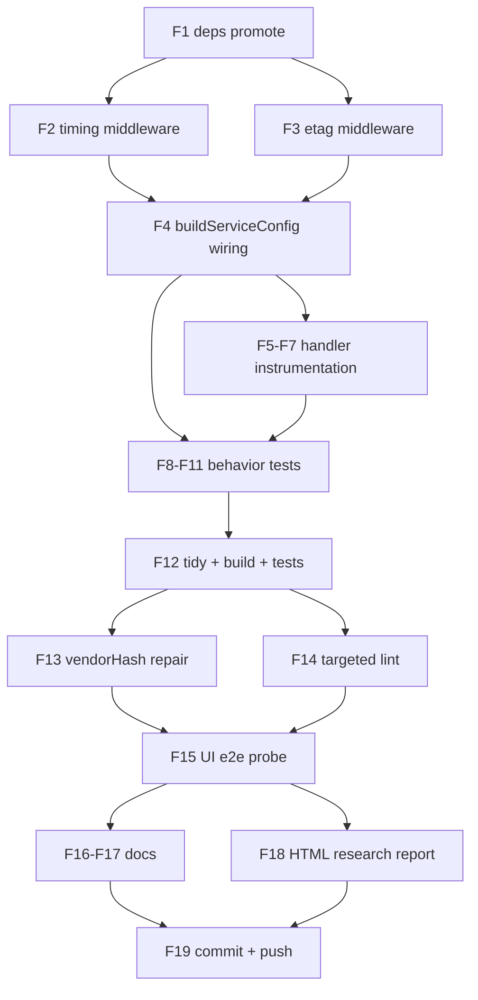

# SUPERB: httputil + go-etag + go-appkit — adopt the module graph to the max

**Date:** 2026-10-12 12:47 · **Repo:** pbx-lens · **Status:** ~~EXECUTING~~ EXECUTED — shipped as `fd0e082` (CI green since the `6bb7d17` heal); follow-ups (Cache-Control: no-cache, AGENTS extraction to docs/http-stack.md) landed later the same day
**Trigger:** "Make sure we use them superbly to the max" (library-deep-dive + pareto-planning)

## Question under audit

pbx-lens carries four HTTP-stack modules in its dependency graph. Which are
actually used, and what verified capability is left on the table?

| Module                                                     | Graph status (before)             | Used by pbx-lens code                                                                           |
| ---------------------------------------------------------- | --------------------------------- | ----------------------------------------------------------------------------------------------- |
| `github.com/larsartmann/go-appkit` v0.8.0                  | direct                            | Yes — `NewService`, `svc.Mux`, `svc.Run`, `systemd.Install`, `ExtraMiddlewares` (htpasswd auth) |
| `github.com/larsartmann/httputil` v1.4.1                   | indirect (via go-appkit)          | No — only appkit's default stack reaches it                                                     |
| `github.com/larsartmann/httputil/server_timing` v1.0.1     | go.sum only (httputil's test dep) | No                                                                                              |
| `github.com/larsartmann/go-etag/{server,entitytag}` v0.6.1 | indirect (via httputil)           | No                                                                                              |

## Verified capability map (pinned versions, module cache — not HEAD)

- **appkit v0.8.0 default stack** (middleware.go:7-25): Recovery → RequestID →
  Logging → Timeout(30s) → SecurityHeaders. Config knobs unused by pbx-lens:
  `Version` (adds `GET /version` + `appkit_build_info`), `Metrics`
  (Prometheus text at `/metrics`, auth mandatory-by-design), `WriteTimeout:
  NoTimeout` (drops the Timeout middleware for stream services — the exact
  documented case: "a WriteTimeout would cut them mid-stream").
- **httputil v1.4.1**: `Compression(cfg)` (q-value negotiation, br>zstd>gzip,
  incompressible skip list incl. `audio/*`, 512 B min, Vary stamped);
  `KeyedRateLimiterMiddleware`; `MaxBodySize`; `Chain`. ETag itself is NOT in
  the root package (moved to go-etag in v1.1.0).
- **server_timing v1.0.2** (latest; v1.0.1→v1.0.2 = flush dedup + ServeMux
  pattern propagation): NO middleware constructor at any released version —
  the released wiring primitive is `WrapServerTiming(w, r)` plus
  `MeasureServerTiming(ctx, name)` / `RecordServerTiming`. Header flushes at
  first write; metrics recorded after the first write are lost (streaming
  routes therefore instrument only pre-first-write hops).
- **go-etag/server v0.6.1**: `etag.New(cfg)` buffers GET/HEAD bodies
  (≤1 MiB), FNV-64a hash, answers `If-None-Match` with 304 (strips
  Content-Length, keeps ETag), streams through on overflow/Flush/Hijack;
  `SkipIfPresent` adopts handler-set ETags; `Skip func(*http.Request)` is the
  per-route opt-out. Ordering doctrine (README): **Compression outer, ETag
  inner** so tags hash identity bodies.

### Considered and NOT adopted (doctrine-checked, do not re-litigate casually)

| Candidate                                                 | Verdict       | Reason                                                                                                                                                |
| --------------------------------------------------------- | ------------- | ----------------------------------------------------------------------------------------------------------------------------------------------------- |
| appkit `errorpages`                                       | Not adoptable | Package does not exist in pinned appkit v0.8.0 (HEAD-only) AND needs templ-components `errorpage`, ABSENT in pinned v1.21.0 — double version conflict |
| appkit `security` (RateLimit/ExportProfile, CSRF)         | Not available | Package does not exist in v0.8.0; CSRF is N/A anyway (read-only GET surface, no writes)                                                               |
| httputil `KeyedRateLimiterMiddleware` on exports          | Hold          | No failure mode today: auth throttle (auth.go) + bounded queries cover it; revisit if /export is ever abused                                          |
| appkit `realtime` SSE hub (replace htmx polling)          | Hold          | Rewrites the shipped R9 polling architecture; high Verschlimbesserung risk for zero operator pain                                                     |
| go-etag `client` (conditional-GET cache for Telnyx)       | Hold          | Telnyx ETag emission unverified (docs/telnyx-live-api.md; next live-verify window 2027-01)                                                            |
| Handler-side data-fingerprint fast-304 on /frag/dashboard | Deferred      | Body-hash 304 already removes the transfer; the saved sqlite scan is ~ms on a 30 s poll. YAGNI at current index sizes                                 |
| httputil v1.4.2/v1.5.0, appkit >v0.8.0                    | Hold          | No needed feature in the delta; stay on the versions already vetted in the graph                                                                      |

## Pareto breakdown

- **1% → 51%:** conditional-GET (ETag) + Server-Timing + the stream-contract
  fix (`WriteTimeout: NoTimeout`). The three changes that make the hottest
  paths (30 s/60 s htmx polls, static assets, page loads) measurably better
  and fix a real latent truncation bug.
- **4% → 64%:** 1% + appkit `Version`/`Metrics` wiring (`/version`, `/metrics`
  ops surface, build_info stamp).
- **20% → 80%:** 4% + Compression + dependency promotions to direct
  (documented x/crypto/x/time precedent: all three ride the existing graph)
  - behavior tests + docs.
- **→ 100%:** the considered-NOT-adopted table above (decisions recorded),
  HTML research report (docs/research/), TODO_LIST leftovers.

### The latent bug the 1% fixes (found during audit, verify-able)

serve's `ServiceConfig{Addr}` leaves `WriteTimeout` at the appkit default
**30 s**, which puts a 30 s deadline on every request context. Two shipped
contracts violate it:

1. `/api/export.{jsonl,csv}` stream with **no row cap** — `StreamExportCalls`
   honors `r.Context()`, so a large index truncates the export at 30 s
   (logf "stream failed", client keeps a silently short file).
2. `/calls/{id}/recording` builds the upstream WAV request with
   `r.Context()` (recording.go:112) — the "body streams unbounded" contract
   dies at 30 s for any slow/large transfer.

`WriteTimeout: appkit.NoTimeout` is the library's own answer for stream
services (drops the Timeout middleware; ReadHeaderTimeout 10s/5s and the
per-route recording upstream bound stay).

## Comprehensive plan (30–100 min tasks, impact-sorted)

| #   | Task                                                                                                                                               | Tier | Impact                                      | Effort | ~min |
| --- | -------------------------------------------------------------------------------------------------------------------------------------------------- | ---- | ------------------------------------------- | ------ | ---- |
| T1  | ETag conditional-GET layer: `internal/web` middleware (SkipIfPresent + Skip policy)                                                                | 1%   | High — poll/static/page revalidation → 304  | M      | 60   |
| T2  | Server-Timing layer: `WrapServerTiming` middleware + query instrumentation (list, dashboard, fragments, search, detail, freshness, recording hops) | 1%   | High — per-request cost visible in devtools | M      | 45   |
| T3  | Stream-contract fix: `WriteTimeout: appkit.NoTimeout` + extract `buildServiceConfig`                                                               | 1%   | High — correctness                          | S      | 30   |
| T4  | appkit `Version` + `Metrics` wiring (`/version`, `/metrics`)                                                                                       | 4%   | Med — ops surface                           | S      | 25   |
| T5  | httputil `Compression` middleware (outer of ETag)                                                                                                  | 20%  | Med — wire size                             | S      | 20   |
| T6  | Dependency promotions: httputil direct, server_timing v1.0.2 direct, go-etag/server direct; tidy + vendorHash repair                               | 20%  | Med — graph honesty                         | S      | 30   |
| T7  | Behavior tests: 304 revalidation, Skip policy, timing headers, compression, /version, /metrics, config wiring                                      | 20%  | High — regression safety                    | M      | 60   |
| T8  | Verify: build + `go test ./...` + targeted lint + UI probe (load doctrine: full gate deferred, 15-min load 79 > 40)                                | 20%  | High                                        | M      | 45   |
| T9  | Docs: AGENTS.md stack/serve sections, TODO_LIST leftovers, plan file                                                                               | 20%  | Med                                         | S      | 40   |
| T10 | HTML research report (docs/research/, library-deep-dive deliverable)                                                                               | 100% | Low-Med                                     | M      | 60   |

## Fine breakdown (≤12 min tasks, execution order)

| #   | Task                                                                                                            | Parent   |
| --- | --------------------------------------------------------------------------------------------------------------- | -------- |
| F1  | `go get` httputil@v1.4.1 + server_timing@v1.0.2 + go-etag/server@v0.6.1 (promote via import)                    | T6       |
| F2  | `internal/web/timing.go`: `ServerTimingMiddleware()` via `WrapServerTiming`                                     | T2       |
| F3  | `internal/web/caching.go`: `ETagMiddleware()` (SkipIfPresent + Skip: staleness/freshness/export./recording)     | T1       |
| F4  | serve.go: extract `buildServiceConfig` (Version, NoTimeout, Metrics, extras order auth→timing→compression→etag) | T3/T4/T5 |
| F5  | Instrument server.go handlers (list, dashboard, dashboardFragment, stalenessFragment, detail)                   | T2       |
| F6  | Instrument search.go + freshness.go ("fts", "query", "count")                                                   | T2       |
| F7  | Instrument recording.go ("metadata", "headers" — both pre-first-write)                                          | T2       |
| F8  | Test: ETag 200→ETag→304 on /app.css + /frag/dashboard; Skip routes stay 200/no-ETag                             | T7       |
| F9  | Test: Server-Timing header contains `total` + route metric                                                      | T7       |
| F10 | Test: gzip negotiated on /app.css; WAV content-type untouched; Vary stamped                                     | T7       |
| F11 | Test: /version JSON + /metrics 200; buildServiceConfig wiring assertions                                        | T7       |
| F12 | `go mod tidy` + build + full test run                                                                           | T6/T8    |
| F13 | vendorHash repair (`buildflow -s nix-hash-fix --fix`)                                                           | T6       |
| F14 | Targeted golangci-lint on changed packages                                                                      | T8       |
| F15 | UI e2e probe: serve on 127.0.0.1, verify /, /dashboard, 304 revalidation, /version, /metrics                    | T8       |
| F16 | AGENTS.md: stack decisions + serve/UI sections                                                                  | T9       |
| F17 | TODO_LIST.md leftovers + FEATURES.md rows                                                                       | T9       |
| F18 | HTML research report                                                                                            | T10      |
| F19 | Detailed commit + push (explicitly requested)                                                                   | —        |

## Execution graph

## Verification contract

- `GOEXPERIMENT=jsonv2 go build ./... && GOEXPERIMENT=jsonv2 go test ./...`
- New tests prove: 304 path, Skip policy, Server-Timing presence, gzip
  negotiation, /version, /metrics, config wiring.
- Live probe of `serve` (UI e2e per AGENTS.md commands; curl banned).
- Full buildflow gate deferred under the m27.9 load doctrine (15-min load
  79 > 40 at plan time); casualties verified individually instead.
