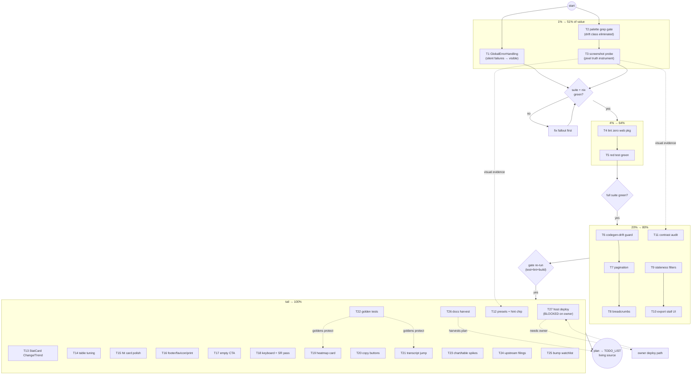

# SUPERB Plan — templ-UI Pareto Execution (post max-adoption pass)

**Created:** 2026-10-12 13:32 CEST
**Input:** status report `docs/status/2026-10-12_13-27_templ-components-max-adoption-ui-pass-status.md`
section (f) (50 items) + the web-package rows still open in `TODO_LIST.md`.
**Scope:** everything to finish, harden, and polish the templ-components UI
pass on pbx-lens's serve app — nothing else. The plan is additive; it changes
no code by itself.
**Format note:** `.md` + mermaid per explicit user instruction (the
pareto-planning skill's canonical format is styled HTML + d2; override
recorded here, not propagated back into the skill).

---

## EXECUTED — all 27 tasks done (annotated 2026-10-12 16:12 CEST; statuses appended, plan text untouched)

Two sessions. **T1–T19 + T22** in session one (report:
`docs/status/2026-10-12_15-20_templ-ui-pareto-execution-t1-t22-status.md`),
**T19-eyeball, T20, T21, T23–T27** in session two. Every task ended
build+test+lint green; `nix build` green at close.

| Task                 | Outcome / evidence                                                                                                                                                                                                                                                                                                                                                                                                                                                                                                                                                                                                                              |
| -------------------- | ----------------------------------------------------------------------------------------------------------------------------------------------------------------------------------------------------------------------------------------------------------------------------------------------------------------------------------------------------------------------------------------------------------------------------------------------------------------------------------------------------------------------------------------------------------------------------------------------------------------------------------------------- |
| T19 eyeball          | PASS — fresh 20-PNG probe run (`node scripts/screenshot-probe.js`); light/dark × desktop/mobile viewed; density card reads well (mobile clips at col 15 but the library Heatmap wraps in `overflow-x-auto`, scroll-reachable)                                                                                                                                                                                                                                                                                                                                                                                                                   |
| T20 CopyButton       | `internal/web/detail.templ` (`nativeIDCopy` PageHeader.Action + `copyableValue` DetailComponent on from/to, `copyDetail` nil-fallback keeps the dash); button variant only — Href variant deliberately unused; `copy_button_test.go` (3 buttons, anchor-variant regression scan); browser-verified: click swaps to "Copied!" (`/tmp/lens-shots/verify-t20-detail-copy.png`)                                                                                                                                                                                                                                                                     |
| T21 search jump      | `hitHref(hit, query)` carries `?q=`; detail handler redirects ONCE to `?q=…&at=N#turn-N` (the `at` param breaks the fragment-invisible redirect loop); `transcriptMatchLog` hand-rolls the Scrollback line loop (no id/class hook on `ScrollbackLine` at v1.21.0 — SegmentBar precedent), all-terms case-insensitive substring match, amber marks, tag colors via `.tc-tag-*` in app.css (palette gate bans raw blue in .templ); 6 tests in `search_jump_test.go` + `TestSearchJumpTargetSameOrigin`; browser-verified end-to-end incl. real viewport scroll (`verify-t21-detail-jump.png`); gosec nolint documented in `docs/nolint-ledger.md` |
| T23 adopt/reject     | All three REJECTED at current scale, rows in `docs/templ-components-adoption.md` with adopt triggers: LineChart (fixed-pixel SVG, no per-point tooltips, spike series renders flatline+jump vs labeled day bars), DataTable (needs server-side sort behind keyset pagination), AppShell (3 destinations don't justify a sidebar)                                                                                                                                                                                                                                                                                                                |
| T24 filings          | Verified-before-filing against the v1.21.0 cache; filed to the owner repo: **templ-components#48** (BarChart 0px bars — live before/after 0/0/0px vs 46/108/15px; the Height doc says "essential", `items-end` defeats it), **#49** (TableRow focus indicator, WCAG 2.4.7), **#50** (skill/docs vs the pin — FilterBar/SegmentedControl/utils/format absent at v1.21.0). Drafts with FILED banners in `docs/drafts/`, links in `docs/upstream-filings.md`, all voice-checked (0 FAIL/0 WARN)                                                                                                                                                    |
| T25 watchlist        | `docs/templ-components-adoption.md` §Version-bump watchlist (gen-tc-classes → map re-audit → hand-rolled re-check → filings re-read → golden `-update`); one AGENTS.md bullet wires it. Closes T22.3 (the golden `-update` flow is watchlist step 5)                                                                                                                                                                                                                                                                                                                                                                                            |
| T26 harvest          | CHANGELOG Unreleased folded (T13–T21 + T22 nets); TODO_LIST eighth pass (4 rows closed, templ-components fold-in row added); `docs/DOMAIN_LANGUAGE.md` + voice log + signal palette; `docs/nolint-ledger.md` (all 7 nolints); `docs/drafts/README.md` table                                                                                                                                                                                                                                                                                                                                                                                     |
| T27 deploy readiness | `nix build` green; the PACKAGED binary probed over HTTP: `/app.css` ships `.tc-tag-user` + teal tokens + focus ring, detail page serves Copy ID + `data-tc-copy`, dashboard renders the populated density heatmap. Remaining gaps are owner-blocked rows already in TODO_LIST: host deploy path, prod re-ingest (ContentHash v2); post-deploy spot-check = one GET of `/app.css` on the host                                                                                                                                                                                                                                                    |
| T22.4 drift proof    | ANNOTATED (was demonstrated but unrecorded, 17-17 report §b3): both golden regenerations in this plan went red→review→update — the intentional T20/T21 copy changes failed `TestGoldenPages` before each `-update`, and the regenerated diffs were read line-by-line before commit (evidence: `internal/web/testdata/*.golden` history at `f13afdc`/`03d2660`); the T1 follow-up golden (`page_detail_q`) repeated the flow. Exit criterion met.                                                                                                                                                                                                |

**Open owner questions (from the 15-20 status report §g, still unanswered):**
same-file concurrency norm; pager shape ratification (numberless Buttons vs
numbered — the numberless choice is load-bearing over keyset cursors and now
documented in `pagerRow`); corpus upstreaming (whether the regenerated
`templ-components-classes.txt` recipe should move upstream — #50's version-
stamping ask is related but narrower).

## 0. Context — where the UI stands (read first)

The 2026-10-12 UI pass adopted templ-components v1.21.0 to the hilt: teal
token re-skin, library forms/buttons/layout everywhere, Scrollback
transcripts, PieChart donut, CircularProgress MOS gauge, icons, export
button, footer, duplicate-`<main>` fix. Build, web suite, and nix are green.

What is _not_ done falls into four buckets:

1. **Truth gaps** — HTML-structure asserts cannot see ugliness (no
   screenshots), polled regions fail silently (no `GlobalErrorHandling`),
   and nothing stops raw `bg-blue-*` classes from re-drifting around the
   token chain.
2. **Gate gaps** — the full suite has one red test and five lint-dirty files
   (all from the concurrent HTTP-stack session, not the UI pass).
3. **Library affordances still unused** — Pagination, Breadcrumbs,
   StatCard Change/Trend, CellPadding, tc-content-auto, CopyButton, Heatmap,
   LineChart, DataTable, Eyebrow.
4. **Upstream/docs hygiene** — skill-docs drift vs the pinned tag, adoption
   map re-audit ritual, HARVEST of this plan into TODO_LIST.md.

Hard constraint (Verschlimmbessern guard): every task below must leave the
repo **verifiably no worse** — suite green, `nix build` green, no token-chain
bypasses, no behavior regressions in the noscript path. The noscript world
(full-page GET forms, server-rendered everything) is a contract; htmx is
progressive enhancement only.

Dependency reality: tasks **T4/T5** (lint zero, red test) sit on files owned
by the concurrent HTTP-stack session — coordinate or wait for its landing
before touching them.

---

## 1. Pareto breakdown

| Tier           | Tasks (of 27)                                                                                                                      | Cumulative value | Why these                                                                                                                                                                                                                                 |
| -------------- | ---------------------------------------------------------------------------------------------------------------------------------- | ---------------- | ----------------------------------------------------------------------------------------------------------------------------------------------------------------------------------------------------------------------------------------- |
| **1%**         | T1 GlobalErrorHandling · T2 palette-class grep gate · T3 screenshot probe harness                                                  | **51%**          | Kills silent failures (the only UX bug a user can currently hit unseen), makes the token chain permanent, and creates the truth instrument every later visual task reads from.                                                            |
| **4%**         | + T4 lint zero · T5 red test green                                                                                                 | **64%**          | A trustworthy gate: suite green + package lint-clean is the precondition for touching anything else without fear.                                                                                                                         |
| **20%**        | + T6 codegen-drift guard · T7 pagination · T8 breadcrumbs · T9 staleness filters · T10 export-stall surfacing · T11 contrast audit | **80%**          | The core operator-facing UX: honest navigation, honest staleness, honest export errors, accessible color, and protection against generated-code staleness.                                                                                |
| **80% → 100%** | the remaining 16 tasks (T12–T27)                                                                                                   | **100%**         | Polish, signature upgrades (heatmap, presets), keyboard/a11y passes, goldens, upstream filings, next-bump watchlist, docs harvest. High count, low individual risk — the long tail that makes the UI feel finished rather than re-sprued. |

Reading: 5 tasks ≈ 64% of the outcome; 11 ≈ 80%. The tail is deliberately
small-batch and mostly independent — safe to interleave or defer.

---

## 2. Comprehensive plan (medium granularity, 30–100 min each, ALL todos)

Sorted by importance/impact/effort/customer-value. "Covers" maps back to the
status report's section (f) numbering (+ `TL` = pre-existing TODO_LIST rows).

| #   | Task                                                                                                                                                                           | Tier | Impact | Effort | Customer value                                                     | Covers                  |
| --- | ------------------------------------------------------------------------------------------------------------------------------------------------------------------------------ | ---- | ------ | ------ | ------------------------------------------------------------------ | ----------------------- |
| T1  | Wire `htmx.GlobalErrorHandling` into the shell; polled-region failures become visible feedback (library toast/alert pipeline); noscript path untouched                         | 1%   | High   | 45 min | Operator sees polling breakage instead of silently stale numbers   | f5                      |
| T2  | CI grep gate: fail any raw palette class (`bg-blue-`, `text-blue-`, hand-rolled button classes) in `internal/web/**/*.templ`; AGENTS.md rule becomes enforced                  | 1%   | High   | 45 min | Theme stays one-block re-skinmable forever; drift class eliminated | f7                      |
| T3  | Screenshot probe: script capturing 5 pages × light/dark × 375/1280 px via headless browser into /tmp; eyeball + fix fallout (incl. donut center overflow, mobile nav)          | 1%   | High   | 90 min | Pixel truth; the instrument that catches "ugly" before Lars does   | f1, f2, f4, f40         |
| T4  | Lint zero `internal/web` (wsl_v5/goimports/gci in freshness/recording/search/server/timing) — **after coordinating with the HTTP-stack session**                               | 4%   | Med    | 30 min | Package is gate-clean; CI stays green                              | d-lint                  |
| T5  | Green the suite: `TestBuildServiceConfigWiring` — take over or await HTTP-stack session; do not clobber in-flight buffers                                                      | 4%   | High   | 30 min | `go test ./...` trustworthy again                                  | d-red                   |
| T6  | Codegen-drift guard: CI runs `templ generate` and fails on diff; add to ci.yml next to the existing templ step                                                                 | 20%  | Med    | 30 min | No stale `_templ.go` class of failure ever again                   | f10                     |
| T7  | Calls-list pagination via `navigation.Pagination` (keyset-compatible `before` links preserve filters); replaces the lone "Older calls" button                                  | 20%  | Med    | 60 min | Operators jump pages instead of crawling keyset steps              | f14                     |
| T8  | Breadcrumbs on detail (`Calls / {kind} / {id}`) via `navigation.Breadcrumbs` + JSON-LD                                                                                         | 20%  | Low    | 45 min | Orientation; free SEO semantics                                    | f15                     |
| T9  | Staleness fragment carries active filters so banner links stay honest on filtered pages                                                                                        | 20%  | Med    | 60 min | No lying "clear filters" hops from a filtered view                 | f30, TL                 |
| T10 | Surface `export_cursor_stalled` in the export UI path (loud server-side fail gets a user-visible signal)                                                                       | 20%  | Med    | 60 min | Export failures are seen, not swallowed                            | f31, TL                 |
| T11 | Contrast audit: teal-600/500 AA in light+dark across buttons/badges/focus rings; fix tokens in `app.css` if any pair fails                                                     | 20%  | Med    | 60 min | Accessible UI; palette stays deliberate                            | f3                      |
| T12 | Dashboard range presets (7/30-day buttons) + digits-only search hint chip                                                                                                      | 80%  | Med    | 90 min | Faster operator loops on the two hottest surfaces                  | f16, f17, TL, f48       |
| T13 | StatCard `Change`/`Trend` adoption for the week-over-week delta (replaces the plain `
`)                                                                                     | 80%  | Low    | 30 min | Trend reads at a glance, library-native                            | f6                      |
| T14 | Table tuning: `CellPadding` compact trial + `tc-content-auto` on long lists                                                                                                    | 80%  | Low    | 30 min | Denser, faster-scanning history                                    | f12, f13                |
| T15 | Search hit cards polish: hover transition, chevron-right icon, focus-visible ring                                                                                              | 80%  | Low    | 30 min | The search results stop feeling raw                                | f18                     |
| T16 | Footer version string (nix-injected) + read-only note; favicon + theme-color meta; print stylesheet for detail page                                                            | 80%  | Low    | 45 min | Finished-feeling shell                                             | f26, f27, f28, f32      |
| T17 | EmptyState ActionText on the calls page (point at ingest commands / docs)                                                                                                      | 80%  | Low    | 30 min | Empty index tells you the next action                              | f29                     |
| T18 | Keyboard + screen-reader pass: tab order, Row.Href keyboard support, transcript SR reading, visible focus                                                                      | 80%  | Med    | 60 min | Fully operable without a mouse                                     | f11, f49                |
| T19 | `display.Heatmap` hour×day density card on the dashboard                                                                                                                       | 80%  | Med    | 90 min | New signature insight (when do calls happen)                       | f21                     |
| T20 | `CopyButton` for phone numbers / native IDs on the detail page                                                                                                                 | 80%  | Low    | 30 min | One-click copy for the two values operators paste                  | f20                     |
| T21 | Transcript search-highlight jump (`?q=` flows from search into detail, matched turns marked)                                                                                   | 80%  | Med    | 90 min | Search lands you at the matched line, not the top                  | f25                     |
| T22 | Golden-HTML snapshot tests for the five pages (library-style `.golden` + `-update` flow)                                                                                       | 80%  | Med    | 90 min | Copy drift and markup regressions get caught by `go test`          | f39                     |
| T23 | Spike: `LineChart` vs BarChart volume; `DataTable` evaluation; `AppShell` evaluation (decision note, adopt only if clearly better)                                             | 80%  | Low    | 60 min | Evidence-based component choices instead of default drift          | f22, f23, f44           |
| T24 | Upstream filing: templ-components skill/docs drift vs v1.21.0 reality (verify-before-filing gate, github-voice)                                                                | 80%  | Low    | 60 min | Next consumer doesn't re-trip on false docs                        | f33, f50                |
| T25 | Next-bump watchlist: adoption-map re-audit checklist wired into AGENTS.md (SegmentBar, errorpage, utils/format, FilterChips candidates)                                        | 80%  | Low    | 30 min | Version bumps become mechanical, not archaeology                   | f34, f41, f42, f43, f47 |
| T26 | Docs harvest: plan → TODO_LIST.md (docs-health HARVEST), DOMAIN_LANGUAGE entries (observation, stream, voice log, signal palette), nolint rationale extraction, CHANGELOG fold | 80%  | Low    | 60 min | Living docs match reality; the plan outlives the session           | f35, f36, f37, f38      |
| T27 | Host-deploy readiness: verify the packaged binary ships new styles on a real host (nix-international-telephony module) — **BLOCKED on owner deploy path**                      | 80%  | Med    | 30 min | The UI reaches production intact                                   | f46, TL                 |

Total: 27 tasks ≈ 27 h of focused work; every status-report (f) item and open
web TODO_LIST row is claimed by exactly one task.

---

## 3. Fine breakdown (≤12 min each, ALL todos)

Sorted in execution order (= importance within tier). "Done when" is the
verifiable exit criterion. Tier column = the task's tier from §1.

| ID   | Task | Step                                                                                                 | Min                               | Done when                                                   |
| ---- | ---- | ---------------------------------------------------------------------------------------------------- | --------------------------------- | ----------------------------------------------------------- |
| 1.1  | T1   | Read `htmx` submod `error_handling.templ` + `DefaultErrorHandlingConfig` contract                    | 8                                 | Config semantics understood, nonce rules noted              |
| 1.2  | T1   | Render `GlobalErrorHandling` in `shell` (page.templ) with nonce from pageProps                       | 10                                | Component in every page's body, tests compile               |
| 1.3  | T1   | Probe failure path (kill server mid-poll / bad frag URL) and confirm visible feedback                | 12                                | Broken poll shows the library's error affordance            |
| 1.4  | T1   | Suite + noscript check (forms still full-page GET)                                                   | 8                                 | `go test ./internal/web/` green                             |
| 2.1  | T2   | Decide gate form: CI grep step vs tiny Go test walking .templ files                                  | 10                                | Decision note in the script header                          |
| 2.2  | T2   | Implement the check (regex: `bg-blue-`, `text-blue-`, `border-blue-` in pbx-lens .templ)             | 12                                | Script/test exists, runs locally                            |
| 2.3  | T2   | Wire into `.github/workflows/ci.yml`                                                                 | 8                                 | CI lane fails on a planted violation, passes clean tree     |
| 2.4  | T2   | Plant + remove a violation to prove the gate end-to-end                                              | 8                                 | Demonstrated red and green                                  |
| 3.1  | T3   | Choose capture tool (headless chrome via existing tooling; no new deps without a decision)           | 12                                | Tool + invocation documented in script                      |
| 3.2  | T3   | Script: seed scratch DB, `go run serve`, capture 5 pages × 2 themes × 2 widths                       | 12                                | `/tmp` tree has 20 labeled PNGs                             |
| 3.3  | T3   | Eyeball pass 1: light desktop — fix obvious defects found                                            | 12                                | Notes written, fixes committed or ticketed                  |
| 3.4  | T3   | Eyeball pass 2: dark desktop                                                                         | 12                                | Notes written, fixes committed or ticketed                  |
| 3.5  | T3   | Eyeball pass 3: mobile 375px (nav, table overflow, donut)                                            | 12                                | Notes written; donut center-label overflow verdict recorded |
| 3.6  | T3   | File follow-ups from the eyeball as TODO rows (if any)                                               | 8                                 | TODO_LIST updated, nothing silently dropped                 |
| 4.1  | T4   | Confirm HTTP-stack session state; claim or wait (owner call)                                         | 6                                 | Coordination note; no buffer clobbering                     |
| 4.2  | T4   | Fix wsl_v5 in freshness.go + recording.go                                                            | 12                                | Both files lint-clean                                       |
| 4.3  | T4   | Fix goimports/gci in search.go                                                                       | 12                                | File lint-clean                                             |
| 4.4  | T4   | Fix wsl_v5 in server.go (6 findings)                                                                 | 12                                | File lint-clean                                             |
| 4.5  | T4   | Fix wsl_v5 in timing.go; `golangci-lint run ./internal/web/...` zero                                 | 10                                | Zero findings printed                                       |
| 5.1  | T5   | Read the failing test's intent (htpasswd lazy-open contract)                                         | 8                                 | Contract understood, written down in test comment           |
| 5.2  | T5   | Implement/repair lazy-open so construction doesn't read the file                                     | 12                                | `TestBuildServiceConfigWiring` green                        |
| 5.3  | T5   | Full `go test ./...` green                                                                           | 8                                 | Suite green, no skips added                                 |
| 6.1  | T6   | Add CI step: `go tool templ generate` then `git diff --exit-code` on `*_templ.go`                    | 10                                | Step in ci.yml after the existing generate                  |
| 6.2  | T6   | Prove the guard: touch a .templ without regenerating, CI red                                         | 8                                 | Demonstrated red, restored green                            |
| 7.1  | T7   | Read `navigation.Pagination` props + keyset fit (before-cursor semantics)                            | 10                                | Wiring design note (URL shape keeps filters)                |
| 7.2  | T7   | Page-size decision + `Pagination` rendering from `NextOlder` state                                   | 12                                | Prev/next + numbers render where sensible                   |
| 7.3  | T7   | Noscript walk: page 1→2→1 with filters set                                                           | 10                                | Filters preserved across pages, URLs honest                 |
| 7.4  | T7   | Tests: pagination edge (exactly one page, deep page)                                                 | 10                                | Assertions green                                            |
| 8.1  | T8   | Breadcrumbs props + JSON-LD shape                                                                    | 8                                 | Trailing schema understood                                  |
| 8.2  | T8   | Render on detailRoute (Calls / {kind} / {id})                                                        | 10                                | Trail shows, links live                                     |
| 8.3  | T8   | Test: breadcrumb present, last crumb is current page                                                 | 8                                 | Assertion green                                             |
| 9.1  | T9   | Trace staleness fragment handler; list the filter params it must echo                                | 10                                | Param list written                                          |
| 9.2  | T9   | Thread ListCallsQuery into the fragment renderers                                                    | 12                                | Fragment links carry ?direction&ai&from&to                  |
| 9.3  | T9   | Test: filtered page → fragment links keep filters                                                    | 10                                | Assertion green                                             |
| 10.1 | T10  | Read `advanceCursor` stall path + existing alert surface                                             | 10                                | Failure shape mapped                                        |
| 10.2 | T10  | Add staleness-style alert (feedback.Alert) to export touchpoints when stalled                        | 12                                | UI renders stall notice                                     |
| 10.3 | T10  | Test the stall → alert rendering                                                                     | 10                                | Assertion green                                             |
| 11.1 | T11  | Extract rendered color pairs (btn/bg, badge/bg, ring/bg) for both themes                             | 10                                | Pair table in notes                                         |
| 11.2 | T11  | Compute WCAG ratios; list failures                                                                   | 12                                | Verdict per pair (teal-600/white, teal-500/gray-900, …)     |
| 11.3 | T11  | Adjust `app.css` tokens or dark variants where failing                                               | 10                                | All audited pairs ≥ AA                                      |
| 11.4 | T11  | Screenshot re-check (uses 3.x harness) + suite                                                       | 8                                 | Visual + tests green                                        |
| 12.1 | T12  | Preset links: `?window=7                                                                             | 30` → dashboard range computation | 12                                                          |
| 12.2 | T12  | Render preset affordance (links/checkbox pattern) above the range form                               | 10                                | One click re-queries                                        |
| 12.3 | T12  | Digits-only hint chip under search (ListNote or Badge pattern)                                       | 10                                | Chip renders, copy matches f17                              |
| 12.4 | T12  | Tests: window param honored; chip present                                                            | 10                                | Assertions green                                            |
| 13.1 | T13  | StatCardProps Change/Trend semantics read                                                            | 8                                 | Field contract noted                                        |
| 13.2 | T13  | Move weekDeltaLabel into the "Calls indexed" or volume card's StatCard Change                        | 10                                | Delta renders library-native                                |
| 13.3 | T13  | Update/copy tests                                                                                    | 8                                 | Green                                                       |
| 14.1 | T14  | `CellPadding` compact trial on the calls table (visual diff via 3.x)                                 | 10                                | Keep/keep-not decision recorded                             |
| 14.2 | T14  | `tc-content-auto` class on the table wrapper; scroll perf sanity                                     | 8                                 | No scroll jank on 200-row fixture                           |
| 14.3 | T14  | Suite + eyeball sign-off                                                                             | 8                                 | Green                                                       |
| 15.1 | T15  | Hit-card hover transition classes                                                                    | 6                                 | Smooth hover, motion-reduce safe                            |
| 15.2 | T15  | Chevron-right icon (icons.Icon) on hit rows                                                          | 6                                 | Icon renders RTL-aware (data-tc-dir-icon)                   |
| 15.3 | T15  | focus-visible ring matching library tokens                                                           | 8                                 | Keyboard focus visible on hits                              |
| 15.4 | T15  | Suite                                                                                                | 6                                 | Green                                                       |
| 16.1 | T16  | Footer version: thread build info (nix ldflags or /version data) into FooterProps BottomBar          | 12                                | Footer shows version                                        |
| 16.2 | T16  | Read-only note line in footer                                                                        | 6                                 | Copy states the contract                                    |
| 16.3 | T16  | Favicon + theme-color meta via Base head slots (or PageProps extension point)                        | 12                                | No 404 for favicon; meta present                            |
| 16.4 | T16  | Print stylesheet: detail page prints facts+transcript cleanly                                        | 10                                | `@media print` pass                                         |
| 17.1 | T17  | EmptyStateProps ActionText/ActionHref on calls empty ("How to fill this index" → docs anchor)        | 8                                 | CTA renders inside EmptyState                               |
| 17.2 | T17  | Copy review (active voice, operator vocabulary)                                                      | 6                                 | Copy final                                                  |
| 17.3 | T17  | Test: CTA present on empty index                                                                     | 8                                 | Green                                                       |
| 18.1 | T18  | Keyboard walk script: tab order across nav→filters→table→rows                                        | 12                                | Order logical, no traps                                     |
| 18.2 | T18  | Row.Href keyboard activation verified (Enter opens)                                                  | 8                                 | Documented/passing                                          |
| 18.3 | T18  | SR pass on transcript pane (Scrollback semantics)                                                    | 10                                | Turns read sensibly linearly                                |
| 18.4 | T18  | Fix findings or file them with severity                                                              | 10                                | Nothing silent                                              |
| 19.1 | T19  | Heatmap props study (rows/cols/labels/peaks)                                                         | 10                                | Data shape decided (hour×day from ByDay?)                   |
| 19.2 | T19  | Query extension: hour bucketing (Europe/Berlin, same zone discipline)                                | 12                                | Bucket data in DashboardStats                               |
| 19.3 | T19  | Heatmap card render + empty honesty                                                                  | 12                                | Card renders; quiet index explained                         |
| 19.4 | T19  | Tests: buckets, zone handling (DST case)                                                             | 10                                | Green incl. DST edge                                        |
| 20.1 | T20  | CopyButton on from/to numbers (DefinitionList DetailComponent)                                       | 10                                | Copy works, CSP-safe                                        |
| 20.2 | T20  | CopyButton on native ID in PageHeader area                                                           | 8                                 | ID copyable                                                 |
| 20.3 | T20  | Test: buttons render, href variant untouched                                                         | 8                                 | Green                                                       |
| 21.1 | T21  | Plumb `?q=` from search hit href into detail route                                                   | 10                                | Param survives the hop                                      |
| 21.2 | T21  | Match detection: highlight matching turns in transcriptLines                                         | 12                                | Matched turns visually distinct                             |
| 21.3 | T21  | Scroll-to-first-match (anchor, noscript-safe)                                                        | 10                                | Lands at match without JS                                   |
| 21.4 | T21  | Tests: highlight + anchor presence                                                                   | 10                                | Green                                                       |
| 22.1 | T22  | Pick golden harness (plain golden-file compare on rendered pages)                                    | 12                                | Harness + first golden (list)                               |
| 22.2 | T22  | Goldens for dashboard, search, detail, empty                                                         | 12                                | Five goldens committed                                      |
| 22.3 | T22  | `-update` flow documented in AGENTS.md commands                                                      | 6                                 | Doc row added                                               |
| 22.4 | T22  | Prove drift detection: intentional copy change → red → update golden                                 | 10                                | Demonstrated                                                |
| 23.1 | T23  | LineChart render on volume series (side-by-side spike)                                               | 12                                | Screenshot + note                                           |
| 23.2 | T23  | DataTable capabilities vs our read-only need                                                         | 10                                | Adopt/reject note                                           |
| 23.3 | T23  | AppShell vs SimpleNav at current nav size                                                            | 10                                | Adopt/reject note                                           |
| 23.4 | T23  | Decision rows into adoption map                                                                      | 8                                 | AGENTS.md updated                                           |
| 24.1 | T24  | Verify-before-filing: diff skill docs vs v1.21.0 cache (FilterBar/SegmentedControl/errorpage claims) | 12                                | Evidence list with file:line                                |
| 24.2 | T24  | Draft issue per drift cluster (github-voice register)                                                | 12                                | Drafts in docs/drafts/                                      |
| 24.3 | T24  | File upstream (only after local repro against the pin)                                               | 12                                | Issue links recorded in upstream-filings.md                 |
| 25.1 | T25  | Write the re-audit checklist (grep-per-package commands) into AGENTS.md                              | 10                                | Checklist copy-pasteable                                    |
| 25.2 | T25  | Add watchlist row: SegmentBar, errorpage, utils/format, FilterChips                                  | 6                                 | Watch table exists                                          |
| 25.3 | T25  | Note the trigger: "on templ-components bump, run checklist"                                          | 6                                 | AGENTS.md bump procedure updated                            |
| 26.1 | T26  | HARVEST this plan into TODO_LIST.md (docs-health mode)                                               | 12                                | TODO rows for T1–T27 (deduped vs existing)                  |
| 26.2 | T26  | DOMAIN_LANGUAGE.md: observation, stream, voice log, signal palette                                   | 10                                | Glossary entries live                                       |
| 26.3 | T26  | Move three nolint rationales to docs/ + reference them inline                                        | 10                                | nolint lines point at docs                                  |
| 26.4 | T26  | CHANGELOG tidy (fold Changed bullet if release near)                                                 | 6                                 | CHANGELOG coherent                                          |
| 27.1 | T27  | Verify module option set exposes everything the UI needs (ports, htpasswd, recording timeout)        | 10                                | Gap list (owner-facing)                                     |
| 27.2 | T27  | Smoke the packaged binary's styles path (preBuild codegen artifact present in result/)               | 10                                | result/ serves styled pages                                 |
| 27.3 | T27  | Hand the deploy checklist to the owner (BLOCKED status recorded)                                     | 10                                | TODO row updated with owner blocker                         |

~105 subtasks, every ≤12 min; every medium task fully expanded; nothing from
§2 left unexpanded.

---

## 4. Execution graph

Ordering logic: Tier-1 first because T3's harness feeds T11/T12 verdicts and
T1/T2 are the two cheapest permanent-risk eliminators. T4/T5 sit behind a
coordination wall (concurrent session ownership). The tail is parallelizable;
only T19/T21 wait for T22's goldens so their rewrites are protected.

---

## 5. Verschlimmbessern guardrails (binding)

1. Every task ends with: `GOEXPERIMENT=jsonv2 go build ./... && go test
   ./internal/web/` green; `nix build` green at task-group boundaries.
2. Noscript contract: no task may make any page require JS (htmx = enhancement
   only). Full-page GET forms stay.
3. No raw palette classes in pbx-lens templates, ever — tokens only (T2
   enforces).
4. Concurrency: T4/T5 touch the HTTP-stack session's files — explicit
   hand-off before editing; never stage another session's untracked files.
5. Tests assert structure/aria first, exact copy only for honesty contracts
   (counts, em-dashes).
6. The plan is additive; annotating it later happens via docs-health ANNOTATE,
   never rewrite.

## 6. Git

- Pre-state: tree clean (auto-daemon had swept all session work; verified
  before writing this file).
- This file is committed separately with a detailed message; push is
  explicitly user-requested.
- Later task commits follow the same contract: one logical change per commit,
  detailed body, first line < 72 chars.
