# SUPERB Plan — Verification Closure & Ops Hardening (post templ-UI close-out)

**Created:** 2026-10-12 17:31 CEST
**Input:** status report `docs/status/2026-10-12_17-17_templ-ui-pareto-closeout-t20-t27-status.md`
(§a–§f, 50 items) + the open rows in `TODO_LIST.md` (eighth pass) + the three
unanswered §g questions (defaulted below, marked where a default was taken).
**Scope:** everything left AFTER the 27-task templ-UI plan executed — close
the assurance gaps on the shipped UI, finish the upstream loop, land the ops
hardening, and harvest the docs tail. Nothing else. Additive; changes no code
by itself.
**Format note:** `.md` + mermaid per explicit user instruction (the
pareto-planning skill's canonical format is styled HTML + d2; override
recorded here, not propagated back into the skill).

---

## EXECUTED — T1–T17 done, T18 owner-gated (annotated 2026-10-12 ~20:30 CEST)

One session. Every task ended with the relevant slice green; the closing
verification ran the full matrix: `go build ./...` + `go test ./...`
(14/14 packages), `golangci-lint run ./...` (0 issues), `nix build`
(clean-tree build `b26a630`), and the full `buildflow --build-mode dev`
gate **exit 0** (the first clean full pass since the cqrs-lint flake-pin
repair).

| Task            | Outcome / evidence                                                                                                                                                                                                                                                                                                                                                                                                                                                                                                                                                              |
| --------------- | ------------------------------------------------------------------------------------------------------------------------------------------------------------------------------------------------------------------------------------------------------------------------------------------------------------------------------------------------------------------------------------------------------------------------------------------------------------------------------------------------------------------------------------------------------------------------------- |
| T1 verification | `page_detail_q.golden` + `TestGoldenDetailQueryCarriesMatchLog` (`a89adea`), `TestDetailQueryTamperedAtRendersNoJump` (at=999 AND at=abc), probe extended with a `detail-q` page from a scraped hit (24 PNGs, `b90b743`), dark/mobile eyeball PASS (amber match log + CopyButton clean), T22.4 annotated (`0ac2a82`)                                                                                                                                                                                                                                                               |
| T2 filing       | **templ-components#51** — verified at v1.21.0 AND master, no duplicates, voice-check 0 FAIL; adoption map + upstream-filings + drafts README wired (`ac027a4`)                                                                                                                                                                                                                                                                                                                                                                                                                   |
| T3 release prep | `docs/drafts/2026-10-12_v0.2.0-release-notes.md`: notes + 8-step owner tag checklist + CHANGELOG-vs-FEATURES cross-check + version-stamp facts (`f67fdd1`); the TAG stays owner-gated                                                                                                                                                                                                                                                                                                                                                                                             |
| T4 instrument   | `scripts/verify-ui-contract.js` (ALL PASS: 3 copy buttons + label swap; ?q= → 302 → #turn-N → amber → real fragment scroll), bootstrap deduped into `scripts/lib/ui-probe.js` shared with the probe (re-run green), `scripts/README.md` + AGENTS.md command row (`f306cfa`)                                                                                                                                                                                                                                                                                                       |
| T5 hygiene      | Full gate green; art-dupl pair deduplicated (`beginExportWithPII`, `e3c7db6`; remaining call+guard idiom intentional); vtsls errors adjudicated FALSE POSITIVE (`node --check` arbiter, documented in scripts/README.md); nolint-ledger ENFORCED (`scripts/check-nolint-ledger.sh`, red/green proven, ci.yml step `06384d0`); go.sum tidy trim landed; cqrs-lint flake pin hash repair landed mid-task (daemon + concurrent session)                                                                                                                                                 |
| T6 evidence     | `docs/assets/` + convention README; detail-copy + search-jump evidence regenerated fresh; two README screenshots wired (`09eb780`)                                                                                                                                                                                                                                                                                                                                                                                                                                               |
| T7 cache hooks  | Already implemented by the concurrent session (`CacheCounters`/`ETagMiddleware` + overflow warn); VERIFIED per plan criteria: ops cache section serves hit_ratio, all three caching tests green. One deviation noted: the overflow warn is not rate-limited (acceptable — overflow-prone routes are skipped by policy)                                                                                                                                                                                                                                                              |
| T8 backup CI    | Already implemented by the concurrent session (named "Backup restore drill" step in ci.yml); VERIFIED: drill test green under -race locally                                                                                                                                                                                                                                                                                                                                                                                                                                       |
| T9 docs tail    | gotchas: T21 fragment-invisible war story; FEATURES: 4 new UI rows (heatmap+presets, detail affordances, ?q= deep link, golden net); 13-32 mermaid ticks (26 nodes, T27 untouched); ROADMAP: 3 rows (multi-match nav, scroll-margin, filtered-for chip) (`8438eca`)                                                                                                                                                                                                                                                                                                                |
| T10 export UI   | Visible honesty note under the table (marker code + stall class + "no row cap"); `TestExportMemoryBudgetStreamsPastOldCap` + `TestExportHonestyNoteVisibleOnListPage`; goldens regenerated with reviewed one-line diff (`ba6ec8f`)                                                                                                                                                                                                                                                                                                                                                |
| T11 test health | 42 `time.Date` seed literals → `testCallStarted()` across 10 files (`4e246f6`); recording-proxy budget+sleep pairs verified ALREADY gone (context-blocking pattern, race-clean)                                                                                                                                                                                                                                                                                                                                                                                                   |
| T12 ingest.go   | 279 → 216 lines; `cmd/pbx-lens/indexsession.go` owns openIndexSession/finalizeIngest/gateAndFinalize (fetch-callback shape; telnyx stays bespoke by design) (`83fe566`)                                                                                                                                                                                                                                                                                                                                                                                                          |
| T13 report      | `docs/research/2026-10-12_http-stack-adoption-audit.html` (html-report-kit editorial template; structure-checked) + AGENTS.md deep-context link (`399fd50`, `44238a5` keeps the 220-line gate green)                                                                                                                                                                                                                                                                                                                                                                              |
| T14 metrics     | Sibling: `services.telephony.monitoring.scrapeJobs` pass-through + `pbx-lens.monitoring.scrape.enable` (both hosts eval; enabled path emits the pbx-lens job); pbx-lens: `/metrics` text-format smoke in `TestServeStackEndToEnd` (`7575e4b`)                                                                                                                                                                                                                                                                                                                                     |
| T15 filing      | **BuildFlow#50** — the findings gate ignores BuildFlow's own `[transient:tool.timeout]` class; five-run evidence table, source citations (cmdrun_streaming.go:86, error_registry.go:45-50), three-part ask; voice-check 0 FAIL (`a061fbb`)                                                                                                                                                                                                                                                                                                                                        |
| T16 status set  | ANNOTATE pass: 17-17 got 41 inline markers (this plan's outcomes), 15-20 got 22 + ARCHIVED; 14-30 archived as SKIP; archive manifest + the T16.3 keep-open triage for the remaining live set (two 19-20 reports left to the concurrent session)                                                                                                                                                                                                                                                                                                                                    |
| T17 trim probe  | KEEP decision recorded with numbers: 6,405-line corpus → 104,646 B minified / 17,291 B gzipped; trim would cost a second staleness axis invisible to markup-pinning goldens; revisit trigger + reachability-test requirement documented (`b26a630`)                                                                                                                                                                                                                                                                                                                               |
| T18 owner-gated | UNTOUCHED by design: deploy hosts, prod re-ingest, the v0.2.0 TAG (prepared only), fold-ins (#2/#26/#48/#49/#50/#51), dependabot watches, Telnyx live-verify, >1MiB policy, ContentHash v2, browser 304 check, R27.x residue (dispositioned in docs only)                                                                                                                                                                                                                                                                                                                          |

Residue for a future pass (tracked, not lost): 17-17 §f17 (stale-poller
warn), §f19 (e2e cache-semantics hardening: HEAD/Vary variants), §f41
(scratch-dir convention); the 13 remaining live status reports' annotate
passes (triaged in the archive README).

---

## 0. Context — where things stand (read first)

The 27-task templ-UI plan (13-32) is EXECUTED and annotated: CopyButton,
?q= search-jump with match highlighting, goldens, palette gate, three
upstream filings (templ-components#48/#49/#50), adoption-map bump watchlist,
docs harvest, packaged-binary deploy proof. Gate green across the board.

What remains falls into four classes:

1. **Assurance gaps on shipped work** (§b of the 17-17 report): the `?q=`
   match-log path has unit tests but NO golden; no dark/mobile captures of
   T20/T21; T22.4's drift-proof never explicitly annotated; evidence PNGs
   are volatile.
2. **Upstream loop tail**: the ScrollbackLine hook gap (what forced the T21
   hand-roll) is verified but unfiled; the verify script that caught two
   real bugs lives in /tmp.
3. **Ops/bounded TODO rows**: backup-drill CI lane, cache-hook observability
   into /api/ops, export-stall UI, stale-poller warning, memory-budget test,
   injected-deadline refactor, ingest.go extraction, status-report archive.
4. **Owner-gated rows**: deploy path, prod re-ingest, the v0.2.0 TAG, all
   upstream fold-ins, dependabot watches, Telnyx live-verify, >1MiB policy,
   ContentHash v2. Tracked, not executable — this plan PREPARES where legal
   (T3) and explicitly does not touch the blocked paths.

Decision defaults taken (owner may override at any task):

- §g.3 → FILE the ScrollbackLine filing (T2) rather than batch it.
- §g.2 → the numberless pager stays final; no count-query work is planned.
- §g.1 → concurrent sessions keep retry-with-fresh-read; no claim system.

---

## 1. Pareto breakdown

| Slice               | Share of remaining value                                                                                                                                                                                              | Tasks                |
| ------------------- | --------------------------------------------------------------------------------------------------------------------------------------------------------------------------------------------------------------------- | -------------------- |
| **1% → 51%**        | The shipped UI is code-complete; its UNVERIFIED surfaces are the entire remaining risk. One golden + one probe refresh + one annotation close it. And one tiny filing permanently de-risks the hand-rolled match log. | T1, T2               |
| **4% → 64%**        | The instruments that caught real bugs this week (verify script, art-dupl, nolint ledger, probe harness) become durable and enforced; the release candidate gets staged.                                               | T3, T4, T5, T6       |
| **20% → 80%**       | The Medium-impact ops rows land (observability + CI proof), and the docs tail is harvested into living files.                                                                                                         | T7, T8, T9           |
| **The rest → 100%** | The Low-impact bounded rows, refactors, cross-repo filings, and the explicitly owner-gated roster.                                                                                                                    | T10–T17, T18 (gated) |

Total ≈ 12.5 h of focused work. Every open row from TODO_LIST (eighth pass)
and status 17-17 §f is claimed by exactly one task; owner-gated rows are
claimed by T18 and marked non-executable.

---

## 2. Comprehensive plan (30–100 min each, ALL todos)

| ID  | Task                                                                                                                                                                                                                                                                                                                                                                                          | Impact | Effort | Done when                                                                   |
| --- | --------------------------------------------------------------------------------------------------------------------------------------------------------------------------------------------------------------------------------------------------------------------------------------------------------------------------------------------------------------------------------------------- | ------ | ------ | --------------------------------------------------------------------------- |
| T1  | **Verification closure** — golden variant for the `?q=` match-log path; screenshot probe extended with a `?q=` page + full re-run; dark/mobile eyeball of CopyButton + match log; T22.4 drift-proof annotated in the 13-32 plan                                                                                                                                                               | High   | 75 min | New golden committed; 20+ fresh captures reviewed; 13-32 annotation updated |
| T2  | **ScrollbackLine hook filing** — verify-before-filing against v1.21.0 + master, draft in docs/drafts/, voice-check, file as templ-components, record in upstream-filings + drafts README                                                                                                                                                                                                      | Medium | 45 min | Issue link recorded; adoption-map hand-rolled row points at it              |
| T3  | **v0.2.0 release PREP** (tag itself stays owner-gated) — CHANGELOG Unreleased review against FEATURES/plan evidence, version-stamp readiness, release-notes draft in docs/drafts/, tag checklist                                                                                                                                                                                              | High   | 30 min | Owner can cut v0.2.0 by running one checklist                               |
| T4  | **Instrument hardening** — promote `/tmp/verify-copy-jump.js` into `scripts/` as `verify-ui-contract.js`, dedup the chromium/puppeteer bootstrap with screenshot-probe.js, wire the seed-DB (incl. transcript via ingest-agent) into it                                                                                                                                                       | Medium | 45 min | One command re-proves copy + jump against a built binary                    |
| T5  | **Repo hygiene sweep** — full `buildflow --build-mode dev` run; art-dupl over internal/web (match-log pair is the suspect); investigate vtsls parse errors on screenshot-probe.js:148+; nolint-ledger CI grep test (fail when a nolint lacks a ledger row)                                                                                                                                    | Medium | 75 min | Gate green, 0 dup findings (or intentional-documented), ledger enforced     |
| T6  | **Evidence durability** — docs/assets convention decision, preserve LineChart spike + T20/T21 captures, two README screenshots                                                                                                                                                                                                                                                                | Low    | 40 min | PNGs in-repo, README references them                                        |
| T7  | **Cache-hook observability** — wire go-etag `OnETagGenerated`/`On304`/`OnBufferOverflow` into `/api/ops` counters + slog warn                                                                                                                                                                                                                                                                 | Medium | 45 min | ops JSON shows hit ratio; overflow warns                                    |
| T8  | **Backup drill as named CI step** — visible lane proving the nightly snapshot/restore path on every push                                                                                                                                                                                                                                                                                      | Medium | 30 min | New ci.yml job green                                                        |
| T9  | **Docs tail harvest** — gotchas.md T21 redirect-loop war story; FEATURES.md UI pass; 13-32 mermaid ticks; ROADMAP routing for multi-match UX, scroll-margin, search "filtered for" chip                                                                                                                                                                                                       | Low    | 60 min | All four files updated; ROADMAP rows exist                                  |
| T10 | **Export honesty UI** — surface `export_cursor_stalled` in export UI; memory-budget test pinning exportBatchSize behavior                                                                                                                                                                                                                                                                     | Low    | 60 min | Stall visible to operators; budget test green                               |
| T11 | **Test-suite refactors** — recording-proxy injected deadlines (no budget+sleep); shared `time.Date` test-seed helper across 7+ files                                                                                                                                                                                                                                                          | Low    | 60 min | Suite green; no sleep-pairs in recording tests                              |
| T12 | **ingest.go extraction** — shared open-system → age-gate → drain → rebuild sequence out of the 269-line file                                                                                                                                                                                                                                                                                  | Low    | 30 min | File < 250 lines; suite green                                               |
| T13 | **HTML research report** — render the HTTP-stack audit as the library-deep-dive report (substance exists in AGENTS/plan)                                                                                                                                                                                                                                                                      | Low    | 30 min | docs/research report exists                                                 |
| T14 | **/metrics scrape smoke** — sibling NixOS module option + a real scraper config (Prometheus/Gatus) validated locally                                                                                                                                                                                                                                                                          | Low    | 30 min | Sibling option + scrape config committed there                              |
| T15 | **BuildFlow spawn-starvation filing** — verify-before-filing from docs/buildflow-dev-gate.md evidence, draft + file                                                                                                                                                                                                                                                                           | Low    | 30 min | Issue link in upstream-filings.md                                           |
| T16 | **Status ANNOTATE + archive pass** — annotate + archive the 2026-10-11/12 status reports whose items are resolved (docs-health ANNOTATE mode)                                                                                                                                                                                                                                                 | Low    | 45 min | Old reports carry resolution pointers, archived                             |
| T17 | **gen-tc-classes trim investigation** — measure styles.css size, decide trim vs keep (bump watchlist synergy)                                                                                                                                                                                                                                                                                 | Low    | 30 min | Decision + numbers recorded in the adoption map                             |
| T18 | **OWNER-GATED roster (non-executable, tracked)** — deploy hosts; prod re-ingest (ContentHash v2); v0.2.0 TAG; fold-ins (go-etag#2, go-appkit#26, tc#48/#49/#50 — retire `!items-stretch` + focus-ring CSS on fold); dependabot watches (#16538, newly-direct deps); Telnyx DTO live-verify; >1MiB transcript policy; browser-level 304 check; ContentHash v2 encoding; R27.x advisory residue | —      | owner  | Each row flips in TODO_LIST when the gate opens                             |

---

## 3. Fine breakdown (≤12 min each, ALL todos)

| ID   | Task | Task                                                                                  | Min | Done when                                |
| ---- | ---- | ------------------------------------------------------------------------------------- | --- | ---------------------------------------- |
| 1.1  | T1   | Golden harness variant: render `detailRoute(view, "how")` into a second detail golden | 12  | New `.golden` committed                  |
| 1.2  | T1   | Match-log assertions folded into the golden test (amber + `turn-` ids present)        | 8   | Test green                               |
| 1.3  | T1   | Screenshot probe: add `detail-q` page (`?q=` URL from scraped hit) to the pages list  | 10  | Probe emits 24 PNGs                      |
| 1.4  | T1   | Full probe re-run + eyeball dark/mobile CopyButton + match log                        | 12  | Captures reviewed, no defects (or filed) |
| 1.5  | T1   | T22.4 drift-proof annotation appended to the 13-32 EXECUTED table                     | 5   | One sentence, evidence-linked            |
| 1.6  | T1   | Tampered-`at` test (`at=999` renders 200, no crash, no jump)                          | 10  | Test green                               |
| 2.1  | T2   | Verify ScrollbackLine gap against v1.21.0 AND master (hook still absent?)             | 12  | Evidence list file:line                  |
| 2.2  | T2   | Check upstream for existing issue/PR (Gate 5)                                         | 8   | None found (or fold)                     |
| 2.3  | T2   | Draft in docs/drafts/ + check-draft                                                   | 12  | 0 FAIL/0 WARN                            |
| 2.4  | T2   | File, verify landed, record in upstream-filings + drafts README + adoption map        | 10  | Link recorded                            |
| 3.1  | T3   | CHANGELOG Unreleased vs FEATURES/plan cross-check                                     | 12  | Gaps listed                              |
| 3.2  | T3   | Release-notes draft in docs/drafts/ + tag checklist                                   | 12  | Draft committed                          |
| 3.3  | T3   | Version-stamp readiness (`go version -m`, buildinfo flags)                            | 6   | Checklist row                            |
| 4.1  | T4   | Move verify script to scripts/verify-ui-contract.js; flag-parsed port/DB              | 12  | Script runs from repo                    |
| 4.2  | T4   | Factor chromium+bootstrap dedup with screenshot-probe.js                              | 12  | No duplicated bootstrap                  |
| 4.3  | T4   | Seed step: smoke + ingest-agent transcript fixture (temp dir)                         | 12  | Self-contained run                       |
| 4.4  | T4   | README/comment the contract each assertion pins                                       | 8   | Documented                               |
| 5.1  | T5   | `buildflow --build-mode dev` full run (load-permitting)                               | 12  | Green                                    |
| 5.2  | T5   | art-dupl over internal/web; judge match-log pair                                      | 12  | Findings dispositioned                   |
| 5.3  | T5   | vtsls vs node on screenshot-probe.js:148+; fix or silence with why                    | 12  | Diagnostics clean                        |
| 5.4  | T5   | nolint-ledger CI grep test (walk nolints, require ledger row)                         | 12  | Test green                               |
| 5.5  | T5   | Ledger row for any new nolint the test finds                                          | 8   | Test still green                         |
| 5.6  | T5   | Hygiene leftovers fix run                                                             | 12  | 0 new findings                           |
| 6.1  | T6   | docs/assets convention decision (write it into the adoption/gotchas docs)             | 8   | Convention documented                    |
| 6.2  | T6   | Copy spike + verify PNGs into docs/assets                                             | 8   | Files committed                          |
| 6.3  | T6   | Two README screenshots + captions                                                     | 12  | README references them                   |
| 7.1  | T7   | Read go-etag hook signatures; design counter struct                                   | 12  | Design note in code                      |
| 7.2  | T7   | Wire OnETagGenerated/On304 counters into /api/ops JSON                                | 12  | ops shows counts                         |
| 7.3  | T7   | OnBufferOverflow → slog warn (rate-limited)                                           | 10  | Warn on forced overflow                  |
| 7.4  | T7   | Tests: 304 ratio + overflow warn asserted                                             | 12  | Green                                    |
| 8.1  | T8   | Restore-drill test exists — wire as named ci.yml job                                  | 12  | Job visible                              |
| 8.2  | T8   | Job runs on push; badge/summary check                                                 | 10  | Green on push                            |
| 9.1  | T9   | gotchas.md: T21 fragment-invisible/at-param war story                                 | 12  | Entry added                              |
| 9.2  | T9   | FEATURES.md UI pass (T13–T21 features)                                                | 12  | Rows present                             |
| 9.3  | T9   | 13-32 mermaid node ticks                                                              | 5   | Cosmetic done                            |
| 9.4  | T9   | ROADMAP rows: multi-match prev/next, scroll-margin, search chip                       | 8   | Routed                                   |
| 10.1 | T10  | export_cursor_stalled surfaced in export UI (banner/footnote)                         | 12  | Visible on stall                         |
| 10.2 | T10  | Memory-budget test for exportBatchSize streaming                                      | 12  | Green                                    |
| 10.3 | T10  | Export-stall test for the UI surface                                                  | 12  | Green                                    |
| 11.1 | T11  | Shared test-seed helper (time.Date dedup across 7+ files)                             | 12  | Dedup done                               |
| 11.2 | T11  | Recording-proxy: inject deadline clock in one test                                    | 12  | One pair removed                         |
| 11.3 | T11  | Finish remaining budget+sleep pairs                                                   | 12  | None left                                |
| 12.1 | T12  | Extract open→gate→drain→rebuild helper from ingest.go                                 | 12  | Helper exists                            |
| 12.2 | T12  | Migrate the three call sites; file < 250 lines                                        | 12  | Suite green                              |
| 13.1 | T13  | Render the HTTP-stack audit HTML report                                               | 12  | Report in docs/research                  |
| 13.2 | T13  | Review + link from AGENTS/docs index                                                  | 8   | Linked                                   |
| 14.1 | T14  | Sibling module: /metrics scrape option + Gatus/Prometheus snippet                     | 12  | Committed there                          |
| 14.2 | T14  | Local smoke: scraper against a serve instance                                         | 12  | Scrape green                             |
| 15.1 | T15  | BuildFlow spawn-starvation: verify evidence chain from dev-gate doc                   | 12  | file:line list                           |
| 15.2 | T15  | Draft + voice-check + file + record                                                   | 12  | Link recorded                            |
| 16.1 | T16  | ANNOTATE resolved items onto the 2026-10-11/12 reports                                | 12  | Pointers added                           |
| 16.2 | T16  | Move resolved reports to docs/status/archived/                                        | 12  | Moves clean                              |
| 16.3 | T16  | Remaining reports triaged (keep-open list)                                            | 8   | Triage noted                             |
| 17.1 | T17  | Measure styles.css + corpus size; document trim tradeoff                              | 12  | Numbers recorded                         |
| 17.2 | T17  | Decision + adoption-map row (trim or keep)                                            | 8   | Decision recorded                        |
| 18.x | T18  | OWNER-GATED — not broken down; each flips when its gate opens                         | —   | TODO_LIST rows                           |

Total fine rows: 57 + owner roster. Every §f item from the 17-17 report and
every open TODO_LIST row is claimed exactly once.

---

## 4. Execution graph

```mermaid
flowchart TD
    subgraph ONE["1% → 51% of value"]
        T1["T1 Verification closure<br/>(golden + probe refresh + T22.4)"]
        T2["T2 ScrollbackLine filing<br/>(de-risk the hand-rolled log)"]
    end
    subgraph FOUR["4% → 64%"]
        T3["T3 v0.2.0 release prep"]
        T4["T4 instrument hardening<br/>(verify-ui-contract script)"]
        T5["T5 hygiene sweep<br/>(buildflow + art-dupl + vtsls + ledger test)"]
        T6["T6 evidence durability"]
    end
    subgraph TWENTY["20% → 80%"]
        T7["T7 cache hooks → /api/ops"]
        T8["T8 backup-drill CI lane"]
        T9["T9 docs tail harvest"]
    end
    subgraph REST["the rest → 100%"]
        T10["T10 export honesty UI"]
        T11["T11 test refactors"]
        T12["T12 ingest.go extraction"]
        T13["T13 HTML research report"]
        T14["T14 /metrics scrape smoke"]
        T15["T15 BuildFlow starvation filing"]
        T16["T16 status ANNOTATE + archive"]
        T17["T17 gen-tc-classes trim"]
        T18["T18 OWNER-GATED roster"]
    end
    T1 --> T4
    T5 --> T4
    T3 -. tag .-> T18
    T2 -. fix lands .-> T18
    T7 -. fold-in .-> T18
    T9 --> T16
```

Order within tiers = importance. T1/T2 are independent of everything; T4
depends on T1's golden variant; T18 is a standing roster, never executed by
an agent session.

---

## 5. Verschlimmbessern guardrails (binding)

1. Every task leaves the repo **verifiably no worse**: suite green, nix build
   green (load doctrine: full gate only under 15-min load 40, else per-casualty
   verification per docs/buildflow-dev-gate.md).
2. **Goldens are reviewed, never blind-updated** — a `-update` diff is read
   line-by-line before commit (watchlist step 5).
3. **Filings pass verify-before-filing + github-voice** — local repro against
   the PIN, source citations with commit-adjacent line numbers, checker 0
   FAIL, drafts in docs/drafts/ never /tmp.
4. **No raw palette classes** in pbx-lens .templ (gate enforces; do not weaken
   the gate to pass a task).
5. **Owner-gated rows stay untouched** — no deploy, no prod re-ingest, no TAG
   without the owner's explicit go; T3 PREPARES the tag but does not cut it.
6. **Concurrent-session discipline** — View-tool read immediately before every
   edit; scripted patches assert; never revert changes you didn't author.
7. **Hand-rolled pieces stay visually pinned** — the match log's golden (1.1)
   must exist BEFORE any library bump work touches Scrollback.
8. **noscript paths stay untouched** — the ?q= jump and export markers work
   without JS; no task may introduce JS-only regressions.

---

## 6. Git

- Pre-state: tree clean (auto-daemon swept the close-out work; verified
  before writing this file).
- This file is committed separately with a detailed message; push is
  explicitly user-requested (template step 8).
- Later task commits follow the standing contract: one logical change per
  commit, detailed body, first line < 72 chars.
