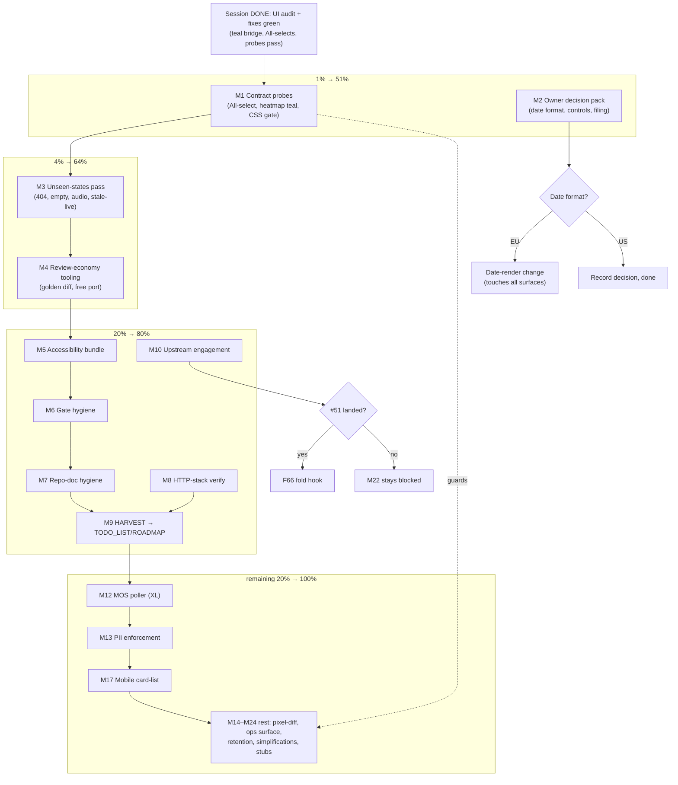

# SUPERB Plan — UI Contract Hardening & the Pareto Road Ahead

- **Created:** 2026-10-15 02:24 CEST
- **Input universe:** all 50 TODOs from
  `docs/status/2026-10-15_02-00_ui-design-audit-polish.md` (section f) —
  every item is included, mapped, and traceable (`f-<n>`).
- **Ground truth from the session:** all 5 pages are visually healthy in both
  themes; the session's fixes (teal heatmap bridge, truthful All-selects,
  clean MOS copy, badge consistency) are green in tests, lint, goldens, and
  the browser contract probe. What remains is (1) making those wins
  regression-proof, (2) closing blind spots nothing has ever eyeballed,
  (3) owner decisions that unblock downstream work, (4) the big
  data-domain items (MOS poller, PII) that predate this session.
- **Verschlimmbessern guard:** every task below touches verification or
  additive surfaces; no speculative rewrites of working UI. Each task leaves
  the repo verifiably no worse (tests + goldens + screenshots are the
  no-worse proof).

---

## Step 1 — Pareto Breakdown

### The 1% that delivers 51% (2 tasks)

The tool is good NOW. The two things that most decide whether it stays good:

| #  | Task                                                                                                                                                                    | Why it is the 1%                                                                                                                                                                                        |
| -- | ----------------------------------------------------------------------------------------------------------------------------------------------------------------------- | ------------------------------------------------------------------------------------------------------------------------------------------------------------------------------------------------------- |
| P1 | **Contract-probe the session's two fixes at browser level** (All-select first-option truth; heatmap peak-cell computed teal) + a CSS gate asserting the ds-brand bridge | The violet leak lived invisible for weeks because goldens pin markup, not pixels. These three probes turn this session's silent-rot class into a loud build failure — permanently protecting every page |
| P2 | **Owner decision pack** (date format EU/US; dashboard control rows; volume-chart quiet-week filing)                                                                     | Three yes/no answers unlock ~6 downstream tasks; zero code risk; the date-format decision alone touches every rendered date                                                                             |

### The 4% that delivers 64% (P1–P2 plus 2 more)

| #  | Task                                                                                                                           | Why                                                                                                                              |
| -- | ------------------------------------------------------------------------------------------------------------------------------ | -------------------------------------------------------------------------------------------------------------------------------- |
| P3 | **Eyeball the never-seen states**: 404 page, empty-index first run, recording-audio card, stale-banner live disappear/reappear | Four operator-visible surfaces have never been captured; any of them could be quietly broken in dark/mobile                      |
| P4 | **Review-economy tooling**: golden pretty-diff + free-port ui-probe + templ-regen bootstrap in scripts                         | Cuts the cost of every future UI session and removes the two stumbles this session actually hit (unreadable goldens, stale port) |

### The 20% that delivers 80% (P1–P4 plus 6 more)

| #   | Task                                                                                         | Why                                                                                                             |
| --- | -------------------------------------------------------------------------------------------- | --------------------------------------------------------------------------------------------------------------- |
| P5  | Accessibility bundle: keyboard walk, print check, badge-in-`<dd>` semantics                  | Focus rings and AT behavior are house quality bars (plan T18 lineage) and untested after this session's changes |
| P6  | Gate hygiene: full buildflow dev gate + drift sweep                                          | The daemon commits without the gate (serve.go lll proved it); one clean full-gate run re-baselines              |
| P7  | Repo-doc hygiene: templ pin drift, AGENTS.md budget, adoption-map bridge note, lessons entry | Cheap items that stop the next session repeating this session's stumbles                                        |
| P8  | HTTP-stack verification: ETag 304 after CSS regen, fragment Server-Timing budget             | The http-stack doctrine is documented but never exercised after a real CSS change                               |
| P9  | docs-health HARVEST of this plan into TODO_LIST/ROADMAP                                      | A plan that is not harvested entombs its value                                                                  |
| P10 | Upstream engagement: check #48/#49/#51, file the BarChart collapse candidate                 | Three local workarounds wait on upstream; filing converts waiting into progress                                 |

### The remaining 20% to reach 100%

The long tail, honest about size: T15 MOS poller (the single biggest
functional gap — UI is ready, data never arrives), PII E164/ParticipantHash
enforcement, mobile card-list for the calls table, alert-only pixel-diff,
`/api/ops` human surface, retention surfacing, conditional library
re-evals (SegmentBar/FilterBar on bumps), T23 spike re-render, quarterly
Telnyx calendar confirm. Detailed in M12–M24 below.

---

## Step 2 — Comprehensive Plan (30–100 min tasks, ALL 50 TODOs)

Sorted by importance/impact/effort/customer-value. `f-<n>` = status-report
section (f) item. Tier column shows the Pareto tier.

| #   | Task (30–100 min)                                                                                                                                      | f-items                      | Tier | Impact | Effort             | Value |
| --- | ------------------------------------------------------------------------------------------------------------------------------------------------------ | ---------------------------- | ---- | ------ | ------------------ | ----- |
| M1  | Contract-probe bundle: All-select browser probe, heatmap computed-style probe, CSS gate asserting the teal ds-brand triplets, wire into scripts/README | f-1, f-2, f-21, f-22         | 1%   | ★★★    | M                  | ★★★   |
| M2  | Owner decision pack: write memo (date format, control rows, volume-chart filing, export-note collapse), collect answers, record outcomes               | f-9, f-15, f-16, g-1..3      | 1%   | ★★★    | S (owner time)     | ★★★   |
| M3  | Unseen-states pass: add 404 + empty-index + audio-card captures to screenshot-probe; watch stale-banner live transition; eyeball light+dark            | f-4, f-5, f-6                | 4%   | ★★★    | M                  | ★★★   |
| M4  | Review-economy tooling: golden pretty-diff helper, free-port ui-probe, templ-regen bootstrap in scripts, port convention doc                           | f-23, f-24, f-28, f-30       | 4%   | ★★     | M                  | ★★    |
| M5  | Accessibility bundle: keyboard walk (table/pager/copy), print check after badges, AT semantics of badges in `<dd>`, fix findings                       | f-7, f-8, f-17               | 20%  | ★★     | M                  | ★★    |
| M6  | Gate hygiene: run `buildflow --build-mode dev` (load rule), sweep lint/tidy/vuln across packages                                                       | f-25, f-27                   | 20%  | ★★     | M                  | ★★    |
| M7  | Repo-doc hygiene: fix templ pin drift (flake or docs), AGENTS.md 220-line budget check, adoption-map bridge note, TODO_LIST entries, lessons entry     | f-26, f-45, f-46, f-47, f-48 | 20%  | ★★     | S                  | ★★    |
| M8  | HTTP-stack verification: ETag/304 after CSS regen via Go probe; fragment Server-Timing under load                                                      | f-36, f-37                   | 20%  | ★★     | S                  | ★★    |
| M9  | HARVEST: pull this plan into TODO_LIST.md (short/mid-term) and ROADMAP.md (long tail)                                                                  | f-43                         | 20%  | ★★     | S                  | ★★    |
| M10 | Upstream engagement: read #48/#49/#51 state, verify + file BarChart collapse (verify-before-filing gate), record in upstream-filings.md                | f-10, f-11, f-42             | 20%  | ★★     | M                  | ★★    |
| M11 | UI consistency spot-passes: dashboard SectionHeading trial (decide once), dark chrome check, theme-toggle post-swap aria, hit-card hover consistency   | f-12, f-13, f-19, f-20       | 20%  | ★      | M                  | ★★    |
| M12 | T15 MOS poller (UI ready, data missing): read plan, design types, implement fetch/parse/wire, fixtures, live-verify, dashboard end-to-end              | f-31                         | tail | ★★★    | XL (multi-session) | ★★★   |
| M13 | PII enforcement: read policy TODO, decide enforcement point, implement E164 normalization + ParticipantHash + tests                                    | f-32                         | tail | ★★     | L                  | ★★    |
| M14 | Alert-only pixel-diff on the 24-PNG set (tolerance report, no gate)                                                                                    | f-29                         | tail | ★      | M                  | ★     |
| M15 | `/api/ops` human surface (decide card vs page, implement, test)                                                                                        | f-35                         | tail | ★      | M                  | ★     |
| M16 | Retention surfacing (what was retired, when last purge ran)                                                                                            | f-38                         | tail | ★      | M                  | ★     |
| M17 | Mobile card-list for calls table (sketch → implement → verify)                                                                                         | f-14                         | tail | ★      | L                  | ★★    |
| M18 | Code simplification: `hasFilters`/`aiValue` after All-option; TZ vocabulary audit + doc note; long-excerpt visual fixture                              | f-33, f-34, f-18             | tail | ★      | S                  | ★     |
| M19 | Conditional library re-evals stubbed in ROADMAP: SegmentBar (AI/human), FilterBar (mobile filters), version-bump watchlist (f-39)                      | f-39, f-40, f-41             | tail | ★      | S                  | ★     |
| M20 | T23 spike re-render per docs/assets/README.md evidence convention                                                                                      | f-44                         | tail | ★      | S                  | ★     |
| M21 | Process: scripted exhaustive dark sweep after color changes; Telnyx 2027-01 calendar confirm                                                           | f-49, f-50                   | tail | ★      | S                  | ★     |
| M22 | Blocked-on-upstream: fold #51 ScrollbackLine hook, delete hand-rolled match-log classes (only when filed fix lands)                                    | f-3                          | tail | ★      | S                  | ★     |

Coverage check: f-1…f-50 all mapped (M1:1,2,21,22 · M2:9,15,16 · M3:4,5,6 ·
M4:23,24,28,30 · M5:7,8,17 · M6:25,27 · M7:26,45,46,47,48 · M8:36,37 ·
M9:43 · M10:10,11,42 · M11:12,13,19,20 · M12:31 · M13:32 · M14:29 ·
M15:35 · M16:38 · M17:14 · M18:33,34,18 · M19:39,40,41 · M20:44 ·
M21:49,50 · M22:3). **50/50.**

---

## Step 3 — Detailed Breakdown (≤12 min tasks, ALL covered)

Sorted by importance/impact/effort/customer-value. `M<n>` = parent task.

| #   | Task (≤12 min)                                                                                                                   | Parent | Impact |
| --- | -------------------------------------------------------------------------------------------------------------------------------- | ------ | ------ |
| F1  | Write heatmap probe: build+seed+serve via `scripts/lib/ui-probe.js`, read computed `background`/ring of a peak cell, assert teal | M1     | ★★★    |
| F2  | Write All-select probe: unfiltered `/` first option = All+selected; `?direction=inbound` = Inbound+selected                      | M1     | ★★★    |
| F3  | CSS gate as Go test over embedded styles.css: assert teal `--ds-brand-rgb` triplets present, violet absent                       | M1     | ★★★    |
| F4  | Wire both probes into `scripts/README.md` + decide CI lane placement                                                             | M1     | ★★     |
| F5  | Run full probe suite green; record commands                                                                                      | M1     | ★★     |
| F6  | Write decision memo (5 questions incl. export-note + dashboard grouping) with options + tradeoffs                                | M2     | ★★★    |
| F7  | Collect owner answers; record outcomes in AGENTS.md/ROADMAP (BLOCKED on owner)                                                   | M2     | ★★★    |
| F8  | Extend screenshot-probe.js: 404 route + empty-index corpus variant captures                                                      | M3     | ★★★    |
| F9  | Seed a recording file; capture the audio card (light+dark)                                                                       | M3     | ★★     |
| F10 | Eyeball the new captures (both themes, both viewports)                                                                           | M3     | ★★     |
| F11 | Watch stale-banner live: shrink poll interval in probe, assert disappear/reappear                                                | M3     | ★★     |
| F12 | Write `scripts/golden-pretty-diff.sh` (git word-diff + goldens filter)                                                           | M4     | ★★     |
| F13 | Patch `lib/ui-probe.js` to auto-pick a free port                                                                                 | M4     | ★★     |
| F14 | Add `go tool templ generate` bootstrap to screenshot + verify scripts                                                            | M4     | ★★     |
| F15 | Document port convention + probe commands in AGENTS.md Commands block                                                            | M4     | ★      |
| F16 | Keyboard walk: tab through table rows (role=link), pager, copy buttons; note focus-ring state                                    | M5     | ★★     |
| F17 | Print detail page → PDF; verify badges render, chrome drops                                                                      | M5     | ★      |
| F18 | AT check of badge inside `<dd>` (reason from spec or NVDA pass); fix if broken                                                   | M5     | ★      |
| F19 | Fix whatever F16–F18 found (bounded budget) + tests                                                                              | M5     | ★★     |
| F20 | Load check (`/proc/loadavg`) then run `buildflow --build-mode dev` full gate                                                     | M6     | ★★     |
| F21 | `govulncheck ./...` + `go mod tidy` diff check                                                                                   | M6     | ★      |
| F22 | Confirm golangci clean across cmd/ + internal/ (drift sweep)                                                                     | M6     | ★★     |
| F23 | Fix templ pin drift: bump flake templ input OR document `go tool templ` as the only regen path                                   | M7     | ★★     |
| F24 | AGENTS.md 220-line budget check after the palette-bullet growth                                                                  | M7     | ★      |
| F25 | Add ds-brand bridge note to docs/templ-components-adoption.md                                                                    | M7     | ★      |
| F26 | Add TODO_LIST entries for plan items (short/mid-term)                                                                            | M7     | ★★     |
| F27 | Add lessons entry: "UI todo is not done until the after-screenshot is eyeballed"                                                 | M7     | ★      |
| F28 | Exercise ETag/304 after a CSS regen with a Go http probe; compare to http-stack.md contract                                      | M8     | ★★     |
| F29 | Read Server-Timing on /frag/dashboard + /frag/staleness; confirm polling budget                                                  | M8     | ★      |
| F30 | HARVEST into TODO_LIST.md (docs-health mode)                                                                                     | M9     | ★★     |
| F31 | HARVEST long tail into ROADMAP.md                                                                                                | M9     | ★★     |
| F32 | `gh issue view` #48/#49/#51 (templ-components) — record current state                                                            | M10    | ★      |
| F33 | Reproduce BarChart vertical 0px collapse in isolation (verify-before-filing gate)                                                | M10    | ★★     |
| F34 | Draft + file the BarChart filing (github-voice); record in docs/upstream-filings.md                                              | M10    | ★★     |
| F35 | Dashboard SectionHeading trial on a branch; decide keep/reject                                                                   | M11    | ★      |
| F36 | Dark mobile-chrome check (devtools emulation): what theme-color does dark show                                                   | M11    | ★      |
| F37 | Theme-toggle aria-checked after an htmx swap (browser check)                                                                     | M11    | ★      |
| F38 | Search hit-card hover vs table-row hover consistency check                                                                       | M11    | ★      |
| F39 | (M12) Read SUPERB plan T15 section + related gotchas (drain-before-enrich)                                                       | M12    | ★★     |
| F40 | (M12) Design MOS types: CDR Detail-Records fetch, score extraction, idempotence                                                  | M12    | ★★     |
| F41 | (M12) Implement fetch+parse skeleton with fixtures                                                                               | M12    | ★★     |
| F42 | (M12) Wire poller into serve/ingest paths + config                                                                               | M12    | ★★     |
| F43 | (M12) Table-driven tests for parse fixtures + edge cases                                                                         | M12    | ★★     |
| F44 | (M12) Live-verify against the real source (window permitting)                                                                    | M12    | ★★     |
| F45 | (M12) Dashboard MOS card end-to-end check + goldens                                                                              | M12    | ★★     |
| F46 | (M13) Read PII policy TODO + decide enforcement point (ingest vs read)                                                           | M13    | ★★     |
| F47 | (M13) Implement E164 normalization at the chosen boundary                                                                        | M13    | ★★     |
| F48 | (M13) Implement ParticipantHash + tests                                                                                          | M13    | ★★     |
| F49 | (M13) Policy flag wiring + docs                                                                                                  | M13    | ★★     |
| F50 | (M14) Choose diff approach (no new deps if possible); implement compare + tolerance                                              | M14    | ★      |
| F51 | (M14) Wire alert-only report into screenshot-probe                                                                               | M14    | ★      |
| F52 | (M15) Decide /api/ops surface (dashboard card vs /ops page)                                                                      | M15    | ★      |
| F53 | (M15) Implement + test + screenshot                                                                                              | M15    | ★      |
| F54 | (M16) Decide retention surfacing content (last purge, counts)                                                                    | M16    | ★      |
| F55 | (M16) Implement + test                                                                                                           | M16    | ★      |
| F56 | (M17) Sketch mobile card layout vs horizontal-scroll table; decide                                                               | M17    | ★      |
| F57 | (M17) Implement responsive card rows                                                                                             | M17    | ★★     |
| F58 | (M17) Screenshot verify mobile set + goldens                                                                                     | M17    | ★★     |
| F59 | (M18) Simplify hasFilters/aiValue + tests                                                                                        | M18    | ★      |
| F60 | (M18) TZ vocabulary audit (Berlin buckets vs server-local renders) + doc note                                                    | M18    | ★      |
| F61 | (M18) Long-excerpt fixture + visual truncation check                                                                             | M18    | ★      |
| F62 | (M19) ROADMAP stubs: SegmentBar, FilterBar, watchlist-on-bump (f-39)                                                             | M19    | ★      |
| F63 | (M20) Re-render T23 LineChart-vs-BarChart spike; save per evidence convention                                                    | M20    | ★      |
| F64 | (M21) Script exhaustive dark sweep (all 24 variants) as a single command                                                         | M21    | ★      |
| F65 | (M21) Confirm Telnyx 2027-01 re-verify calendar entry exists                                                                     | M21    | ★      |
| F66 | (M22) Watch templ-components#51; on landing: fold hook, delete hand-rolled classes, goldens                                      | M22    | ★      |

Coverage: every M has ≥1 fine task; every f-item rides its M's fine tasks.
66 fine tasks ≈ 11–13 h total.

---

## Step 4 — Execution Graph

Reading the graph: the 1% tier (M1, M2) runs first and everything downstream
executes under the M1 guards (dotted line). M2's decisions gate the
date-render work; M10's upstream state gates M22; M9 (HARVEST) is the
hand-off point where the tail becomes living TODO_LIST/ROADMAP entries.

---

## Execution order (one line)

M1 → M3 → M4 → M2 (needs owner) → M5 → M6 → M7 → M8 → M10 → M9 →
tail by impact (M12 first when its window opens).

## Non-goals / guards

- No rewrite of working UI; every change lands with tests + goldens +
  screenshots (the no-worse proof).
- Stay on the published templ-components v1.21.0 (no local replace).
- Palette gate rules hold: no raw `-blue-N` in `.templ`; CSS bridges live
  only in app.css after the imports.
- Upstream filings pass verify-before-filing first; prose in github-voice.
