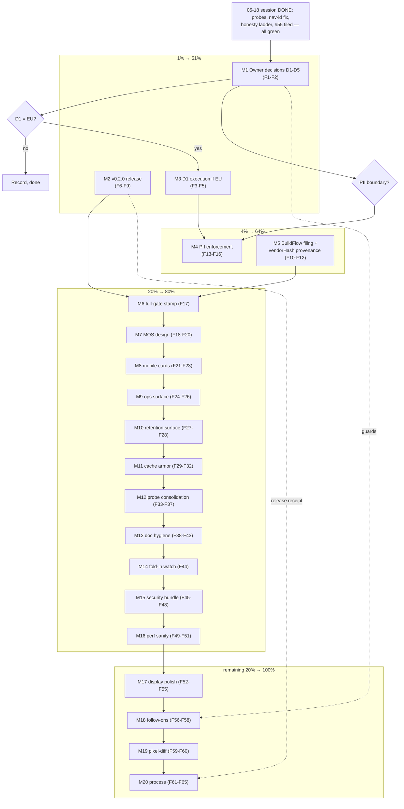

# SUPERB Plan — Owner Unlock, v0.2.0, and the Hardening Road

> **Execution annotation (2026-10-15, live):** M9 (F26 stale-pass warning,
> F24-F25 `/ops` page), M10 (retention card), M11 (F29-F30 cache-semantics
> hardening + F31 BenchmarkConcurrentPoll hash-cost probe + F32 coverage
> pass — caching.go/buildServiceConfig/nonceCSP at 100%) are DONE and
> committed. The trailing-slash pin inside F29 is deliberately left
> unpinned (canonical-redirect vs exact-404 still an open taste call).
> Owner-gated items (M1 D1-D5, M2 tag/push, M3 iff-EU, M4 PII boundary,
> M8 card-vs-scroll) remain untouched by design.

- **Created:** 2026-10-15 05:40 CEST
- **Input universe:** all 50 NEXT items from
  `docs/status/2026-10-15_05-18_superb-ui-contract-execution.md` §f plus the
  3 owner questions §g — every item is included, mapped, traceable
  (`f-<n>` / `g-<n>`). Coverage check at the end of Step 2: **53/53.**
- **Starting state (verified green at plan time):** 14/14 test packages,
  lint 0 issues, all four browser probes ALL PASS, `nix build` 0, tree
  clean. The 02-24 plan is fully executed (see its header annotation);
  M12–M17-class tail rows live in TODO_LIST.
- **Verschlimmbessern guard:** every task below is verification, release,
  owner-decision, or additive-surface work. NO rewrite of working UI, no
  dependency churn beyond dependabot, no palette-gate or read-only
  doctrine violations. Each change lands with tests + goldens + probe
  where applicable (the no-worse proof). The nav-id lesson is load-bearing:
  the ETag contract test suite must stay green through all of this.

---

## Step 1 — Pareto Breakdown

### The 1% that delivers 51% (2 workstreams)

The system is green and honest. What most decides its value NOW:

| # | Task | Why it is the 1% |
|---|------|------------------|
| P1 | **Owner decision collection (D1–D5) → recorded, and D1 executed if EU** | Five answers unblock ~8 downstream tasks; D1 (date format) alone touches every rendered date on every surface. Zero risk to collect, bounded one-helper change to execute |
| P2 | **Cut v0.2.0** — full CHANGELOG sweep (nav-id caching fix, empty-index honesty ladder, M1–M11 tooling) → tag → push | The session's biggest find (the ETag fix) is sitting unreleased on main; an unreleased fix protects nobody. The release also forces the full-gate 70/70 stamp as a side effect |

### The 4% that delivers 64% (P1–P2 plus 2 more)

| # | Task | Why |
|---|------|-----|
| P3 | **PII enforcement decision + implementation** (E164/ParticipantHash at the boundary the owner picks) | Trust-and-safety core of a public call index; primitives exist unenforced; the export gate already chose READ — storage posture is the open half (g-3) |
| P4 | **Build-pipeline protection: file the hash-fixer corruption upstream (BuildFlow) + vendorHash provenance comment** | The 2026-10-15 incident (fixer corrupted flake.nix, daemon committed it) will recur on the next dirty-tree hash drift; filing converts the scar into a fix, the comment prevents the next confusion |

### The 20% that delivers 80% (P1–P4 plus 6 more)

| # | Task | Why |
|---|------|-----|
| P5 | Gate + doc stamp: quiet-machine 70/70 gate, CHANGELOG wording, README screenshot refresh | The honest "everything is green" receipt |
| P6 | Probe tooling consolidation: `--only`, single runner, codegen content-hash, golden-NORMALIZED dead-check | Cuts every future UI session's cost; removes known dead weight |
| P7 | `/api/ops` human surface + stale-pass warning | The poller is invisible when it silently stops; operators need one glanceable answer |
| P8 | Retention surfacing (what retired, last purge) | The retention machinery runs dark today |
| P9 | Mobile card-list decide + implement | The one real responsive gap left (375px hides "Opening line") |
| P10 | Cache-semantics hardening + coverage pass + hash-cost probe | The HTTP-stack doctrine deserves armor after the nav-id find |
| P11 | Security & hygiene bundle: favicon dark variant, robots/noindex, CSP report-only dry run, explicit proxy rate-limit | Cheap, bounded, closes the public-surface checklist |
| P12 | MOS poller design phase (types + fixtures plan, no live calls) | Pre-stages the XL so the 2027-01 window is execution-only |

### The remaining 20% to reach 100%

MOS poller live execution (window-gated), mobile card-list follow-through,
pixel-diff alerting, cost panel, backup rotation opinion, direction
auto-detection follow-through, library re-evals on bumps, i18n/display
polish (phone grouping, export headers, tablet audit, print page-breaks),
performance sanity (10k rows, 500-turn transcripts), ingest property test,
process items (dependabot, >1MiB policy, production re-ingest, host
deploys, Telnyx calendar). All detailed in M13–M20 below.

---

## Step 2 — Comprehensive Plan (30–100 min tasks, ALL 53 items)

Sorted by importance/impact/effort/customer-value. Tier column shows the
Pareto tier. `f-<n>`/`g-<n>` = 05-18 status-report items.

| # | Task (30–100 min) | f-items | Tier | Impact | Effort | Value |
|---|-------------------|---------|------|--------|--------|-------|
| M1 | Owner decisions: send D1–D5 pack, collect answers, record in AGENTS.md/TODO_LIST (F7 closure) | f-1, g-1..3 | 1% | ★★★ | S (owner time) | ★★★ |
| M2 | v0.2.0 release: CHANGELOG Unreleased sweep (nav-id fix, honesty ladder, tooling) → full gate → tag → push → verify pkg | f-11, f-40 | 1% | ★★★ | M | ★★★ |
| M3 | D1 execution (iff EU): central time-format helper, all surfaces, goldens + probes | f-29*, f-33* | 1% | ★★★ | M | ★★★ |
| M4 | PII enforcement: read policy TODO, owner boundary decision, implement E164/ParticipantHash at the chosen point, tests + docs | f-5, g-3 | 4% | ★★★ | L | ★★ |
| M5 | Build-pipeline protection: verify + file BuildFlow hash-fixer dirty-tree corruption; add vendorHash.nix provenance comment | f-3, f-49 | 4% | ★★ | M | ★★ |
| M6 | Quiet-machine full-gate stamp: load check → `buildflow --build-mode dev` 70/70 → record in buildflow-dev-gate.md | f-2 | 20% | ★★ | S | ★★ |
| M7 | MOS poller design (no live calls): types, fetch/parse/idempotence plan, fixture shapes, wire points — doc for the 2027-01 window | f-4 | 20% | ★★★ | M | ★★ |
| M8 | Mobile card-list: decide card vs scroll (owner taste), implement, screenshot verify + goldens | f-6 | 20% | ★★ | L | ★★ |
| M9 | `/api/ops` human surface: decide card vs page, implement + test + screenshot; stale-pass age warning | f-8, f-19 | 20% | ★★ | M | ★★ |
| M10 | Retention surfacing: what was retired, last purge age — implement + test | f-9 | 20% | ★ | M | ★ |
| M11 | Cache armor: Vary/HEAD/query-string 304 variants test, buffered Content-Length assert, concurrent-poll hash-cost probe, caching/serve coverage pass | f-16, f-17, f-18 | 20% | ★★ | M | ★★ |
| M12 | Probe tooling consolidation: `--only <surface>` filter, `verify-all.sh` runner, probe-merge decision, content-hash ensureCodegen, golden-NORMALIZED dead audit | f-25, f-26, f-27, f-30, f-31, f-32 | 20% | ★★ | M | ★★ |
| M13 | Doc hygiene: AGENTS PNG-count wording, README screenshots refresh, README heatmap-ring mention, smoke help wording, long-excerpt fixture disposition, hint-tripwire decision | f-41, f-42, f-43, f-46, f-47, f-48 | 20% | ★ | S | ★ |
| M14 | Upstream fold-in watch: quarterly check note for #48/#49/#51/#55 (+ BuildFlow#2/#26, go-etag), checklist in upstream-filings.md | f-10, f-23 | 20% | ★ | S | ★ |
| M15 | Security & hygiene bundle: favicon dark media variant, robots.txt + noindex, CSP report-only dry run, explicit recording-proxy rate-limit | f-36, f-37, f-38, f-39 | 20% | ★★ | M | ★★ |
| M16 | Performance sanity: ListCalls 10k-row benchmark, 500-turn `?q=` transcript check, ingest malformed-JSONL property test | f-44, f-28, f-45 | 20% | ★ | M | ★ |
| M17 | Display polish: phone-number grouping (post-D1), export CSV header review, 768px excerpt audit, transcript print page-breaks | f-33, f-29, f-34, f-35 | tail | ★ | M | ★ |
| M18 | Feature follow-ons: dashboard cost panel, backup rotation opinion doc, direction auto-detection follow-through | f-20, f-21, f-22 | tail | ★ | M | ★ |
| M19 | Alert-only pixel-diff on the 39-PNG corpus (tolerance report, never a gate) | f-7 | tail | ★ | M | ★ |
| M20 | Process: dependabot confirm, >1MiB transcript policy decision doc, production re-ingest prep, host deploy prep, Telnyx 2027-01 calendar nudge | f-12, f-13, f-14, f-15, f-50 | tail | ★ | S | ★ |

Coverage check: f-1→M1 · f-2→M6 · f-3→M5 · f-4→M7 · f-5→M4 · f-6→M8 ·
f-7→M19 · f-8→M9 · f-9→M10 · f-10→M14 · f-11→M2 · f-12→M20 · f-13→M20 ·
f-14→M20 · f-15→M20 · f-16/17/18→M11 · f-19→M9 · f-20→M18 · f-21→M18 ·
f-22→M18 · f-23→M14 · f-24(none — covered by M8 verify) · f-25/26/27→M12 ·
f-28→M16 · f-29→M3/M17 · f-30/31/32→M12 · f-33→M3/M17 · f-34→M17 ·
f-35→M17 · f-36/37/38/39→M15 · f-40→M2 · f-41/42/43→M13 · f-44/45→M16 ·
f-46/47/48→M13 · f-49→M5 · f-50→M20 · g-1..3→M1/M3/M4.
**53/53.** (f-24 was a status-report note resolved by M8's own verify —
carried as an M8 regression check inside M11.)

## Step 3 — Detailed Breakdown (≤12 min tasks, ALL covered)

Sorted by importance/impact/effort/customer-value. `M<n>` = parent task.

| # | Task (≤12 min) | Parent | Impact |
|---|----------------|--------|--------|
| F1 | Send D1–D5 pack to owner (paste + link), set answer-recording location | M1 | ★★★ |
| F2 | Record D1–D5 outcomes in AGENTS.md + TODO_LIST (F7 closure) | M1 | ★★★ |
| F3 | If D1=EU: add the central format helper + unit tests | M3 | ★★★ |
| F4 | If D1=EU: swap RelativeTime/search/detail/tooltips onto the helper | M3 | ★★★ |
| F5 | If D1=EU: goldens + probes + dark sweep, eyeball | M3 | ★★ |
| F6 | CHANGELOG: fold M1–M11 session work into Unreleased (user-facing phrasing) | M2 | ★★★ |
| F7 | Full gate on a quiet machine, record 70/70 receipt | M2 | ★★ |
| F8 | Tag v0.2.0 + push + verify CI lane green | M2 | ★★★ |
| F9 | Verify `go get`/pkg.go.dev visibility of the new tag | M2 | ★★ |
| F10 | Reproduce the hash-fixer corruption in a scratch repo (verify-before-filing) | M5 | ★★ |
| F11 | Draft + file the BuildFlow filing (checker + voice); record in upstream-filings.md | M5 | ★★ |
| F12 | vendorHash.nix provenance comment (commit, command, date) | M5 | ★ |
| F13 | Read PII TODO + policy docs; write the ingest-vs-read one-pager | M4 | ★★ |
| F14 | Owner PII boundary decision (g-3) | M4 | ★★ |
| F15 | Implement E164 normalization at the chosen boundary + table tests | M4 | ★★ |
| F16 | Implement ParticipantHash + tests + docs | M4 | ★★ |
| F17 | Load check + gate attempt when load < 40 (f-2 stamp) | M6 | ★★ |
| F18 | Read T15 plan section + drain-before-enrich gotcha | M7 | ★★ |
| F19 | Design MOS types: fetch, score extraction, idempotence (doc) | M7 | ★★ |
| F20 | Define fixture shapes + wire points for the poller | M7 | ★★ |
| F21 | Decide mobile card vs horizontal scroll (owner taste call) | M8 | ★★ |
| F22 | Implement responsive card rows (if card wins) | M8 | ★★ |
| F23 | Mobile screenshot verify (375px, light+dark) + goldens | M8 | ★★ |
| F24 | Decide /api/ops surface: dashboard card vs /ops page | M9 | ★★ |
| F25 | Implement the surface + test | M9 | ★★ |
| F26 | Add stale-pass age warning (lastPass older than N passes) + test | M9 | ★★ |
| F27 | Decide retention surfacing content (counts, last purge) | M10 | ★ |
| F28 | Implement retention surface + test + screenshot | M10 | ★★ |
| F29 | `Vary` + HEAD + query-string 304 skip-policy tests | M11 | ★★ |
| F30 | Buffered-render Content-Length assert | M11 | ★ |
| F31 | Concurrent-poll hash-cost probe (CPU ceiling numbers) | M11 | ★★ |
| F32 | Coverage pass on caching_test/serve_test hot paths | M11 | ★★ |
| F33 | `--only <surface>` filter in screenshot-probe | M12 | ★★ |
| F34 | `scripts/verify-all.sh` runner (all probes, sequential, free ports) | M12 | ★★ |
| F35 | Probe-merge decision (verify-ui + staleness-live runner shapes) | M12 | ★ |
| F36 | Content-hash check in ensureCodegen (mtime fallback) | M12 | ★★ |
| F37 | Audit: is golden `tc-mobile-menu-NORMALIZED` normalization dead? Remove if so | M12 | ★ |
| F38 | AGENTS.md PNG-count wording fix (say "the probe set") | M13 | ★ |
| F39 | README screenshots refresh (post theme-color/hover fixes) | M13 | ★★ |
| F40 | README quality section: reference the heatmap teal evidence | M13 | ★ |
| F41 | smoke `-age`/`-with-recording` help-wording pass | M13 | ★ |
| F42 | Fold long-excerpt fixture into screenshot-probe or delete /tmp script | M13 | ★ |
| F43 | Decide TestSearchHintProse tripwire (keep as tripwire = recommendation) | M13 | ★ |
| F44 | Quarterly fold-in checklist into upstream-filings.md (dates + links) | M14 | ★ |
| F45 | favicon.svg dark variant (`media` attr in Base head) | M15 | ★ |
| F46 | robots.txt + noindex meta on public pages | M15 | ★ |
| F47 | CSP report-only dry run on / + detail (collect violations) | M15 | ★★ |
| F48 | Explicit recording-proxy rate-limit (loopback-safe) | M15 | ★★ |
| F49 | ListCalls 10k-row benchmark (seeded, p95 budget note) | M16 | ★★ |
| F50 | 500-turn transcript `?q=` render check | M16 | ★ |
| F51 | Ingest malformed-JSONL property test (never panic, skips counted) | M16 | ★★ |
| F52 | Phone-number display grouping behind D1 | M17 | ★ |
| F53 | Export CSV header review against D1 | M17 | ★ |
| F54 | 768px excerpt/tablet audit + fix if broken | M17 | ★ |
| F55 | Transcript print page-break rules (break inside turns avoided) | M17 | ★ |
| F56 | Dashboard cost panel sketch → implement if data supports | M18 | ★★ |
| F57 | Backup rotation opinion doc (host-tool boundary) | M18 | ★ |
| F58 | Direction auto-detection: revisit did-direction-design.md open items | M18 | ★ |
| F59 | Pixel-diff tool choice + tolerance report (no new deps if possible) | M19 | ★★ |
| F60 | Wire alert-only diff into screenshot-probe | M19 | ★ |
| F61 | Dependabot: confirm the weekly run proposes newly-direct dep bumps | M20 | ★ |
| F62 | >1MiB transcript policy one-pager (accept untagged vs raise buffer) | M20 | ★ |
| F63 | Production re-ingest prep checklist (ContentHash v2 runbook) | M20 | ★ |
| F64 | Host deploy prep checklist (aiDids + current module options) | M20 | ★ |
| F65 | Telnyx 2027-01 re-verify: confirm calendar entry exists (owner calendar) | M20 | ★ |

Coverage: every M has ≥1 fine task; every f-item rides its M's fine tasks.
65 fine tasks ≈ 11–13 h total.

---

## Step 4 — Execution Graph

Reading the graph: M1 (answers) and M2 (release) run first and are
independent — M2 does NOT wait on the owner. D1=EU gates M3; the PII
boundary answer gates M4; everything in the 20% tier is sequential-safe
and daemon-commits cleanly. The dotted guards carry the Verschlimmbessern
rules into the tail.

---

## Execution order (one line)

M2 (release now) ∥ M1 (owner pack) → M3 (iff EU) → M4 → M5 → M6 →
M7–M16 in table order → M17–M20 tail.

## Non-goals / guards

- No rewrite of working UI; every change lands with tests + goldens +
  screenshots where visual (the no-worse proof).
- Stay on published templ-components v1.21.0 (no local replace); the
  bump watchlist runs on every future bump.
- Palette gate holds (no raw `-blue-N` in `.templ`); CSS bridges only in
  app.css after the imports; the ETag/no-cache contract tests are
  load-bearing — never knowingly broken, even temporarily.
- Read-only over sources, forever; the index DB stays disposable.
- Upstream filings pass verify-before-filing first; prose in github-voice.
- Release only from a green full gate (F7 receipt before F8 tag).
