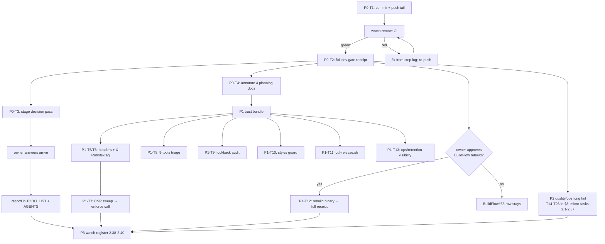

<!-- docs/planning/2026-10-17_05-07_SUPERB-pareto-plan-post-corpus-archive.md
     Pareto plan over the post-archive TODO_LIST (rebuilt 2026-10-17 03:37).
     Every row verified open against CHANGELOG + code during the corpus sweep;
     errata in §5. Snapshot: TODO_LIST 90 lines, 26 open rows, 27 reports archived. -->

# SUPERB Pareto Plan — post-corpus-archive execution (2026-10-17 05:07)

> Input state: the 2026-10-17 corpus sweep closed the 2026-10-11→15 status-report era
> (27 reports annotated + archived, 1,373 inline verdicts), rebuilt TODO_LIST to open-work-only,
> and left local main ahead of a red remote. This plan ranks EVERYTHING still open.
>
> Reading order: §2 is the Pareto answer, §3 the comprehensive plan (30–100 min tasks),
> §4 the fine breakdown (≤12 min tasks), §6 the execution graph, §7 the not-schedulable rest.

## 1. Step-0 verification (errata)

The backlog was rebuilt THIS session and every row re-verified against CHANGELOG/code during
the sweep — no stale rows found, nothing to drop. Two rows were ADDED by the sweep itself
(buildflow tooling triage; recordings lookback audit) and are ranked below. One row is added
by THIS plan: the planning-doc annotation decision (P0-T4) — it enters TODO_LIST with the
plan. No other corrections.

## 2. The Pareto answer

| Tier     | Share of work         | Share of result | What it is                                                                                                                                                                                                                                                                                                                                                                                                                                                                                                                                                                                                                                                                                                     |
| -------- | --------------------- | --------------- | -------------------------------------------------------------------------------------------------------------------------------------------------------------------------------------------------------------------------------------------------------------------------------------------------------------------------------------------------------------------------------------------------------------------------------------------------------------------------------------------------------------------------------------------------------------------------------------------------------------------------------------------------------------------------------------------------------------- |
| **1%**   | ~2 h (2 tasks)        | **51%**         | **PUSH the tail + a green full-gate receipt on the settled tree.** Remote main has been red for 2 days while every fix sits local; one push publishes the statix revival, the phantom-linter fix, and the archived corpus, and turns public CI green. The gate receipt proves the revival holds and is the repo's release gate (owner doctrine R4). Nothing else on the list is visible until this lands. — **UPDATE 2026-10-17 05:1x:** the remote went green at the 01:53 daemon push (run 38992729791 success) before this plan executed; the tail (archive + plan) is now pushed on top (9e4f811), so P0-T1 closes as done-by-events and P0-T2 (the settled-tree gate receipt) carries the 1%'s remainder. |
| **4%**   | ~6 h (adds 8 tasks)   | **64%**         | The 1% **plus the trust bundle**: the D1-D5/PII/mobile decision staging (unblocks ~10 rows with one owner pass), the security completion (headers, X-Robots-Tag, CSP sweep), the two new sweep rows (9-tools triage, lookback audit), the planning-doc closure, and the two anti-recurrence guards (styles freshness, cut-release runbook).                                                                                                                                                                                                                                                                                                                                                                    |
| **20%**  | ~16 h (adds 15 tasks) | **80%**         | All of the above **plus the quality/ops long tail**: FTS pass, export-lane tests, recording negative paths, verify-all --fast, pixel-diff practice, /ops hardening, ops visibility, coverage floor, the small UX/hygiene bundles, timeout-test refactor, R27.x advisories.                                                                                                                                                                                                                                                                                                                                                                                                                                     |
| **100%** | the rest              | **100%**        | Everything externally blocked or window-gated: fold-ins (7 upstream issues), 2027-01 Telnyx/MOS window, host deploys, prod re-ingest, schema-v2, mobile cards, sibling fold, dependabot items. Scheduled/watch — listed in §7, not fake-scheduled here.                                                                                                                                                                                                                                                                                                                                                                                                                                                        |

## 3. Comprehensive plan (30–100 min tasks, ALL open TODOs)

Sorted by importance × impact × effort × customer-value. `Src` = TODO_LIST row / session residue.

| #      | Tier | Task (30–100 min each)                                                                                                                                                                                                                                                                                           | Effort | Impact | Value | Src                                                                      |
| ------ | ---- | ---------------------------------------------------------------------------------------------------------------------------------------------------------------------------------------------------------------------------------------------------------------------------------------------------------------- | ------ | ------ | ----- | ------------------------------------------------------------------------ |
| P0-T1  | 1%   | Commit the staged report + PUSH the local main tail; watch the remote CI run to green (statix + gohumanize fixes turn it)                                                                                                                                                                                        | 30 min | H      | H     | Blocked row "Push the local main tail"; 01-45 postscript                 |
| P0-T2  | 1%   | Full buildflow dev gate on the settled tree (warm nix derivations first); bank the 58+/0 receipt; update buildflow-dev-gate                                                                                                                                                                                      | 45 min | H      | H     | BuildFlow#56 row; 01-45 §a8 follow-on                                    |
| P0-T3  | 1%   | Stage the owner decision pass: render D1-D5 + PII-boundary + mobile-card questions into ONE answerable checklist (gh issue or doc top-note); record answers into TODO_LIST/AGENTS on arrival                                                                                                                     | 40 min | H      | H     | D1-D5 row; PII row; mobile row                                           |
| P0-T4  | 1%   | Close the planning-doc question: annotate the four executed plans (00-09, 01-32, 19-05, 03-43) with EXECUTED headers + pointers to the archived execution reports (in-place; no moves — live docs cite their paths)                                                                                              | 45 min | M      | M     | 05-01 report §b1 (this plan adds the row)                                |
| P1-T5  | 4%   | Security headers middleware (`Referrer-Policy: no-referrer`, `X-Content-Type-Options: nosniff`) in the ExtraMiddlewares chain + tests + http-stack.md ordering note                                                                                                                                              | 60 min | H      | M     | Low row "Security headers middleware"                                    |
| P1-T6  | 4%   | `X-Robots-Tag: noindex` response header + test (covers non-HTML endpoints uniformly)                                                                                                                                                                                                                             | 30 min | M      | M     | Low row "X-Robots-Tag"                                                   |
| P1-T7  | 4%   | CSP report-only browser sweep: probe all surfaces under `CSP_REPORT_ONLY=1`, collect violations, make the enforce/adjust call, record it                                                                                                                                                                         | 60 min | M      | M     | Low row "CSP report-only dry run"                                        |
| P1-T8  | 4%   | Buildflow tooling triage: `buildflow doctor --verbose`, enumerate the 9 unavailable tools, disposition each (install/exclude/accept); triage nix-build-verify + nix-hash-fix failure records; decide devShell gap + lychee policy; write into buildflow-dev-gate + close the TODO row                            | 90 min | M      | M     | Low row "Buildflow tooling triage bundle" (new)                          |
| P1-T9  | 4%   | Recordings lookback audit: read the correlation path against the 300 cap, decide page-deeper vs document-the-bound, implement + test                                                                                                                                                                             | 45 min | M      | M     | Low row "Recordings lookback audit" (new)                                |
| P1-T10 | 4%   | styles.css freshness guard: prove nixpkgs-pin byte-determinism, add the CI regen + `git diff --exit-code` step                                                                                                                                                                                                   | 60 min | M      | M     | Low row "styles.css freshness guard"                                     |
| P1-T11 | 4%   | `scripts/cut-release.sh`: quiesce check → build → test → probes → CHANGELOG sweep → tag → `go list -m` proxy check (encodes the tag-red lesson + the #55 dirty-tree guard)                                                                                                                                       | 60 min | M      | M     | Low row "Release runbook as a script"                                    |
| P1-T12 | 4%   | BuildFlow binary rebuild from its repo (cross-repo; on owner approval) → re-run the gate for the literal full receipt; close the #56 workaround note                                                                                                                                                             | 60 min | M      | M     | BuildFlow#56 row; §g3 of the 05-01 report                                |
| P1-T13 | 4%   | Ops/retention visibility: README alerting recipe for `last_pass_age_seconds` + surface deploy `-max-age`/purge-timer state and last-purge age on the /ops card                                                                                                                                                   | 60 min | M      | M     | Low row "Ops/retention visibility"                                       |
| P2-T14 | 20%  | FTS quality pass: multi-word queries + ranking spot checks (untouched since the digits-shadow work)                                                                                                                                                                                                              | 60 min | M      | M     | Low row "FTS quality pass"                                               |
| P2-T15 | 20%  | Export lane tests: consumer-side CSV/JSONL parse asserting the EXPORT_INCOMPLETE contract + 10k-row streaming memory benchmark                                                                                                                                                                                   | 60 min | M      | L     | Low row "Export lane tests"                                              |
| P2-T16 | 20%  | Recording-proxy negative paths: upstream 403 → honest error, not a hang; decide throttle flags (only if ops asks)                                                                                                                                                                                                | 60 min | M      | L     | Low row "Recording-proxy negative paths"                                 |
| P2-T17 | 20%  | verify-all `--fast` (contracts-only) + screenshot-probe polish (surface drift guard, skip detail discovery)                                                                                                                                                                                                      | 45 min | L      | M     | Low row "verify-all --fast"                                              |
| P2-T18 | 20%  | Pixel-diff practice: first baseline corpus, footer-stamp mask, tolerance evaluation, wire `--diff` alert-only into verify-all                                                                                                                                                                                    | 45 min | L      | M     | Low row "Pixel-diff practice"                                            |
| P2-T19 | 20%  | /ops hardening leftovers: auth-gated lane membership, stale-verdict browser probe, a11y sweep (heading order, focus path, chip contrast)                                                                                                                                                                         | 45 min | L      | M     | Low row "/ops page hardening leftovers"                                  |
| P2-T20 | 20%  | Coverage floor 80% in CI + cmd/pbx-lens httptest wiring test                                                                                                                                                                                                                                                     | 60 min | M      | L     | Low row "Coverage floor 80%"                                             |
| P2-T21 | 20%  | Timeout-test hardening: injected deadlines replacing budget+sleep for any NEW timing test + audit remaining `time.Sleep`                                                                                                                                                                                         | 45 min | L      | L     | Blocked row "Harden the recording-proxy timeout tests"                   |
| P2-T22 | 20%  | Docs bundle: DOMAIN_LANGUAGE MOS/cost rows + Telnyx quarterly re-verify checklist file (date + commands, 2027-01)                                                                                                                                                                                                | 30 min | L      | M     | Low rows "DOMAIN_LANGUAGE MOS rows" + "Telnyx quarterly checklist"       |
| P2-T23 | 20%  | Small UX bundle: search hint example query, RelativeTime day-precision tooltip, ops-page print breaks                                                                                                                                                                                                            | 45 min | L      | M     | Low rows "Search-page hint", "RelativeTime tooltip", "Print page-breaks" |
| P2-T24 | 20%  | Hygiene bundle: pre-commit AGENTS.md 220-line check + `ingest-cdr -dry-run` flag                                                                                                                                                                                                                                 | 45 min | L      | L     | Low rows "Pre-commit hook", "Ingest -dry-run"                            |
| P2-T25 | 20%  | Verification hygiene: dark-theme eyeball pass over the 41-PNG corpus + true clean-clone ensureCodegen rehearsal                                                                                                                                                                                                  | 45 min | L      | L     | Low rows "Dark-theme eyeball pass", "True clean-clone rehearsal"         |
| P2-T26 | 20%  | R27.x advisory residue: art-dupl / branching-flow / file-size triage (accept-or-split server.go 617, search.go 443, telnyx_test.go 835)                                                                                                                                                                          | 60 min | L      | L     | Blocked row "R27.x advisory residue pass"                                |
| P3-T27 | rest | Watch/schedule register: fold-ins (#48/#49/#50/#51/#55, go-etag#2, go-appkit#26, BuildFlow#55), 2027-01 Telnyx+MOS window, host deploys, prod re-ingest, schema-v2, mobile cards, sibling fold, dependabot items, >1MiB, browser 304 check — each already a TODO_LIST row; this plan only fixes their ORDER (§7) | 30 min | —      | —     | TODO_LIST Blocked section                                                |

## 4. Fine breakdown (≤12 min tasks, ALL TODOs)

Same sort order. `T#` references §3. Blocked/watch rows appear as their prep micro-tasks
(prep now, execute when the gate opens).

| #    | Tier | Task (≤12 min)                                                                                                            | Eff | Value | Src    |
| ---- | ---- | ------------------------------------------------------------------------------------------------------------------------- | --- | ----- | ------ |
| 1.1  | 1%   | `git add` the staged status report; draft the detailed commit for the corpus sweep                                        | 8   | H     | P0-T1  |
| 1.2  | 1%   | Commit + push main; capture the push output (the tail = statix fix, gohumanize fix, 59-file docs sweep, this plan)        | 10  | H     | P0-T1  |
| 1.3  | 1%   | `gh run watch` the remote CI run to conclusion; verify ALL jobs green (Build & Test, Lint, govulncheck, e2e, drill)       | 12  | H     | P0-T1  |
| 1.4  | 1%   | If red: read the failed step log, fix, re-push (the fix classes are already shipped; expect green)                        | 12  | H     | P0-T1  |
| 1.5  | 1%   | Flip the TODO_LIST "Push the local main tail" row to DONE (delete; it lives in CHANGELOG with the CI-green receipt)       | 5   | H     | P0-T1  |
| 1.6  | 1%   | Warm the nix derivations (`nix build` once) so the gate's nix lane is not cold                                            | 10  | H     | P0-T2  |
| 1.7  | 1%   | Pre-flight: `cat /proc/loadavg` < 40 check + clean-tree confirm (the documented gate policy)                              | 5   | H     | P0-T2  |
| 1.8  | 1%   | Run `nix develop -c env BUILDFLOW_NO_RESULT_CACHE=1 buildflow --build-mode dev`                                           | 12  | H     | P0-T2  |
| 1.9  | 1%   | Read the gate summary; bank the receipt (step count, duration) into docs/buildflow-dev-gate.md                            | 8   | H     | P0-T2  |
| 1.10 | 1%   | If any step failed: scoped rerun + individual verification per doctrine; fix or file                                      | 12  | H     | P0-T2  |
| 1.11 | 1%   | Close the BuildFlow#56 workaround sentence IF the gate ran full-green; else keep the row with current evidence            | 6   | M     | P0-T2  |
| 1.12 | 1%   | Decision-pack staging: re-read docs/decisions/2026-10-15_ui-owner-decision-pack.md + the PII one-pager                    | 8   | H     | P0-T3  |
| 1.13 | 1%   | Draft the one-pass answer sheet: D1-D5 + PII boundary + mobile taste, each with options + recommendation + "answer here"  | 12  | H     | P0-T3  |
| 1.14 | 1%   | Land the answer sheet (doc top-note or gh issue) + link it from the TODO_LIST D1-D5 row                                   | 8   | H     | P0-T3  |
| 1.15 | 1%   | On answers arriving: record outcomes in TODO_LIST + AGENTS.md per the plan-F7 contract (owner-gated; prep only now)       | 12  | H     | P0-T3  |
| 1.16 | 1%   | Planning docs: grep live docs for every `docs/planning/2026-10-11_*/2026-10-12_03-43` citation (the must-keep-paths list) | 8   | M     | P0-T4  |
| 1.17 | 1%   | Planning doc 00-09: append the ANNOTATE header (EXECUTED; pointer to archived 19-37 + CHANGELOG R-entries)                | 8   | M     | P0-T4  |
| 1.18 | 1%   | Planning doc 01-32: append the EXECUTED header (pointer to archived 09-35 + the UI-trio CHANGELOG entries)                | 8   | M     | P0-T4  |
| 1.19 | 1%   | Planning doc 19-05: append the EXECUTED header (pointer to archived 19-37)                                                | 6   | M     | P0-T4  |
| 1.20 | 1%   | Planning doc 03-43: append the EXECUTED header (pointer to archived 07-13 + the R-series CHANGELOG entries)               | 8   | M     | P0-T4  |
| 1.21 | 1%   | dprint the four touched plans; spot-check the headers render                                                              | 6   | M     | P0-T4  |
| 1.22 | 4%   | Security headers: read docs/http-stack.md ordering doctrine + locate the ExtraMiddlewares chain                           | 8   | H     | P1-T5  |
| 1.23 | 4%   | Implement the headers middleware (two constants, one wrapper)                                                             | 10  | H     | P1-T5  |
| 1.24 | 4%   | Tests: assert both headers on a page + a 304 + a static asset                                                             | 12  | H     | P1-T5  |
| 1.25 | 4%   | http-stack.md: add the middleware to the chain diagram + ordering rationale; goldens regen if markup changed              | 10  | H     | P1-T5  |
| 1.26 | 4%   | X-Robots-Tag: implement on the shared writer (pages + JSON/CSV exports)                                                   | 10  | M     | P1-T6  |
| 1.27 | 4%   | X-Robots-Tag: test (HTML + export endpoints) + CHANGELOG entry                                                            | 10  | M     | P1-T6  |
| 1.28 | 4%   | CSP sweep: launch serve with CSP_REPORT_ONLY=1, drive all surfaces via the probe scripts, collect console reports         | 12  | M     | P1-T7  |
| 1.29 | 4%   | CSP sweep: triage violations (none expected — nonce-aware policy); write the enforce/adjust verdict into http-stack.md    | 12  | M     | P1-T7  |
| 1.30 | 4%   | CSP: flip to enforcing OR document the stay-on-report-only decision + close/keep the TODO row accordingly                 | 10  | M     | P1-T7  |
| 1.31 | 4%   | 9-tools: `buildflow doctor` + one verbose gate step; capture the unavailable-tools list                                   | 12  | M     | P1-T8  |
| 1.32 | 4%   | 9-tools: disposition table per tool (install into devShell / exclude with rationale / accept)                             | 12  | M     | P1-T8  |
| 1.33 | 4%   | 9-tools: apply the dispositions (flake.nix devShell edits or .buildflow.yml excludes)                                     | 12  | M     | P1-T8  |
| 1.34 | 4%   | nix-build-verify + nix-hash-fix failure records: read the gate ledger numbers post-#56; triage or accept                  | 10  | M     | P1-T8  |
| 1.35 | 4%   | Lychee fleet policy: draft the GITHUB_TOKEN-vs-exclude decision line; record it in buildflow-dev-gate                     | 8   | M     | P1-T8  |
| 1.36 | 4%   | Close the tooling-triage TODO row with the receipt; devShell change → `nix run .#update-vendor-hash` if inputs moved      | 10  | M     | P1-T8  |
| 1.37 | 4%   | Lookback audit: read `internal/cli/telnyx.go` correlation + the recordings pager window                                   | 10  | M     | P1-T9  |
| 1.38 | 4%   | Lookback audit: write the decision (page deeper OR document the bound as a contract in telnyx-live-api.md)                | 10  | M     | P1-T9  |
| 1.39 | 4%   | Lookback: implement (bump constant / doc note) + a fixture test if code changed; close the row                            | 12  | M     | P1-T9  |
| 1.40 | 4%   | styles guard: run the pinned tailwind twice on a scratch copy, byte-compare (determinism proof)                           | 10  | M     | P1-T10 |
| 1.41 | 4%   | styles guard: add the CI step (regenerate via the pinned builder + `git diff --exit-code`)                                | 12  | M     | P1-T10 |
| 1.42 | 4%   | styles guard: point the css gate error message at `nix run .#update-styles`; close the row                                | 8   | M     | P1-T10 |
| 1.43 | 4%   | cut-release.sh: scaffold the script (quiesce check → build → test → probes → CHANGELOG sweep → tag → proxy check)         | 12  | M     | P1-T11 |
| 1.44 | 4%   | cut-release.sh: dry-run against the current tree (no tag); fix what the dry run catches                                   | 12  | M     | P1-T11 |
| 1.45 | 4%   | cut-release.sh: README/scripts README entry + the never-on-a-dirty-tree #55 guard comment; close the row                  | 10  | M     | P1-T11 |
| 1.46 | 4%   | BuildFlow#56 (on approval): build the binary in ~/projects/BuildFlow from a clean checkout                                | 12  | M     | P1-T12 |
| 1.47 | 4%   | BuildFlow#56: reinstall + `buildflow doctor` shows current; re-run the full gate; close the TODO row + the ledger note    | 12  | M     | P1-T12 |
| 1.48 | 4%   | Ops visibility: write the README alerting recipe for `last_pass_age_seconds` (example jq/alerter snippet)                 | 12  | M     | P1-T13 |
| 1.49 | 4%   | Ops visibility: extend the /ops retention card with deploy `-max-age` + purge-timer state + last-purge age                | 12  | M     | P1-T13 |
| 1.50 | 4%   | Ops visibility: tests + golden regen for the card; close the row                                                          | 12  | M     | P1-T13 |
| 2.1  | 20%  | FTS pass: build a multi-word query fixture set (names, places, digits+words)                                              | 10  | M     | P2-T14 |
| 2.2  | 20%  | FTS pass: run the set through search; record ranking surprises                                                            | 10  | M     | P2-T14 |
| 2.3  | 20%  | FTS pass: fix or file what the set catches; close the row                                                                 | 12  | M     | P2-T14 |
| 2.4  | 20%  | Export tests: consumer-side CSV parse asserting EXPORT_INCOMPLETE + header integrity                                      | 12  | L     | P2-T15 |
| 2.5  | 20%  | Export tests: JSONL parse twin; both endpoints                                                                            | 12  | L     | P2-T15 |
| 2.6  | 20%  | Export tests: 10k-row streaming memory benchmark (bGet) + assertion; close the row                                        | 12  | L     | P2-T15 |
| 2.7  | 20%  | Recording negative path: upstream 403 fixture → assert honest 502/404 body, no hang                                       | 12  | L     | P2-T16 |
| 2.8  | 20%  | Recording negative path: metadata-500 + malformed-signed-URL fixtures                                                     | 12  | L     | P2-T16 |
| 2.9  | 20%  | Recording throttle flags: decide (defaults stay hardcoded unless ops asks) + note in README; close the row                | 10  | L     | P2-T16 |
| 2.10 | 20%  | verify-all --fast: add the contracts-only flag (skip the 41-PNG sweep)                                                    | 12  | M     | P2-T17 |
| 2.11 | 20%  | screenshot-probe: KNOWN_SURFACES single-source drift guard                                                                | 12  | M     | P2-T17 |
| 2.12 | 20%  | screenshot-probe: skip detail discovery when no detail-* surface selected; close the row                                  | 10  | M     | P2-T17 |
| 2.13 | 20%  | Pixel-diff: save the first baseline corpus (`--save-baseline`), record the storage decision reference                     | 12  | M     | P2-T18 |
| 2.14 | 20%  | Pixel-diff: mask the dashboard footer stamp region; evaluate tolerance 0.5% → tighten if clean                            | 12  | M     | P2-T18 |
| 2.15 | 20%  | Pixel-diff: wire `--diff` into verify-all as alert-only; close the row                                                    | 10  | M     | P2-T18 |
| 2.16 | 20%  | /ops: add ops to the auth-gated e2e lane (fifth surface)                                                                  | 12  | M     | P2-T19 |
| 2.17 | 20%  | /ops: stale-verdict browser probe (staleness-live twin for the ops verdict chip)                                          | 12  | M     | P2-T19 |
| 2.18 | 20%  | /ops: a11y sweep (heading order, focus path, verdict-chip contrast) + fixes; close the row                                | 12  | M     | P2-T19 |
| 2.19 | 20%  | Coverage: cmd/pbx-lens httptest wiring test (resolveKey/parseSince paths)                                                 | 12  | L     | P2-T20 |
| 2.20 | 20%  | Coverage: raise the ci.yml floor to 80; watch the run; close the row                                                      | 12  | L     | P2-T20 |
| 2.21 | 20%  | Timeout tests: audit remaining `time.Sleep` in tests; list candidates                                                     | 8   | L     | P2-T21 |
| 2.22 | 20%  | Timeout tests: convert one candidate to the cancellation-driven pattern; generalize the helper                            | 12  | L     | P2-T21 |
| 2.23 | 20%  | Timeout tests: finish the set + race-shuffle verify; close the row                                                        | 12  | L     | P2-T21 |
| 2.24 | 20%  | DOMAIN_LANGUAGE: add MOS/cost vocabulary rows                                                                             | 10  | M     | P2-T22 |
| 2.25 | 20%  | Telnyx checklist file: date + commands + expected shapes (the 2027-01 bundle) + calendar-confirm bullet                   | 12  | M     | P2-T22 |
| 2.26 | 20%  | Search hint: add the example query to the hint copy + test touch                                                          | 8   | M     | P2-T23 |
| 2.27 | 20%  | RelativeTime: day-precision fallback text when age > 7 days + test                                                        | 12  | M     | P2-T23 |
| 2.28 | 20%  | Ops print breaks: `break-inside: avoid` on the ops cards + probe capture                                                  | 10  | M     | P2-T23 |
| 2.29 | 20%  | Pre-commit hook: AGENTS.md ≤219 wc check (the linter counts +1) at commit time                                            | 12  | L     | P2-T24 |
| 2.30 | 20%  | `ingest-cdr -dry-run`: parse-report-without-writes flag + test (F63 rehearsal prep)                                       | 12  | L     | P2-T24 |
| 2.31 | 20%  | Dark eyeball: `--themes dark` corpus run; view the changed surfaces (M15/M17 visuals); note defects                       | 12  | L     | P2-T25 |
| 2.32 | 20%  | Dark eyeball: fix or file what the pass catches; close the row                                                            | 12  | L     | P2-T25 |
| 2.33 | 20%  | Clean-clone: scratch worktree, `git clean -xfd`, run the probe bootstrap end-to-end                                       | 12  | L     | P2-T25 |
| 2.34 | 20%  | Clean-clone: record the receipt; close the row                                                                            | 8   | L     | P2-T25 |
| 2.35 | 20%  | R27.x: run art-dupl + branching-flow; judge the top findings (accept-with-rationale or fix)                               | 12  | L     | P2-T26 |
| 2.36 | 20%  | R27.x: file-size triage verdicts for server.go/search.go/telnyx_test.go (accept-and-document or split)                    | 12  | L     | P2-T26 |
| 2.37 | 20%  | R27.x: vulnix re-triage note + nix-checker cleanup; close the row                                                         | 12  | L     | P2-T26 |
| 2.38 | rest | Watch register: verify each Blocked row's external gate state (fold-ins OPEN? window date? deploy path?) — one pass       | 12  | M     | P3-T27 |
| 2.39 | rest | Watch register: update the fold-in watch table dates + the 2027-01 calendar-confirm bullet                                | 10  | M     | P3-T27 |
| 2.40 | rest | Watch register: re-rank TODO_LIST after P0/P1 land (the freshness loop)                                                   | 12  | M     | P3-T27 |

## 5. Execution graph

## 6. Not schedulable here (the rest to 100% — externally gated, each already a TODO_LIST row)

Fold-ins (templ-components #48/#49/#50/#51/#55, go-etag#2, go-appkit#26, BuildFlow#55/#56
fold-in, go-cqrs-lite#62/#63/#64, go-nix-helpers#7, treefmt-nix#545, dependabot-core#16538) ·
2027-01 Telnyx live-verify + MOS poller execution · host deploys (`aiDids`) · production
re-ingest (ContentHash v2) · schema-v2 hash encoding · mobile card-list (taste call) · sibling
backup-rotation fold · >1MiB transcript policy · browser-level 304 check · SegmentBar/FilterBar
bump re-evals · i18n/corpus-webp/CSP-report-uri ROADMAP ideas.

## 7. Verschlimmbesserung guards (what this plan must NOT do)

- No dependency additions; the fold-ins wait for upstream, no vendored workarounds.
- No gate runs above the documented load policy (1-min < 15 AND 15-min < 40).
- No edits to `internal/web` markup without the goldens + palette-gate + CSS-gate trio re-run.
- No re-annotation of archived files (closed history); the planning-doc headers are ADDITIONS.
- hash repairs ONLY via `nix run .#update-vendor-hash` on a clean tree (BuildFlow#55).
