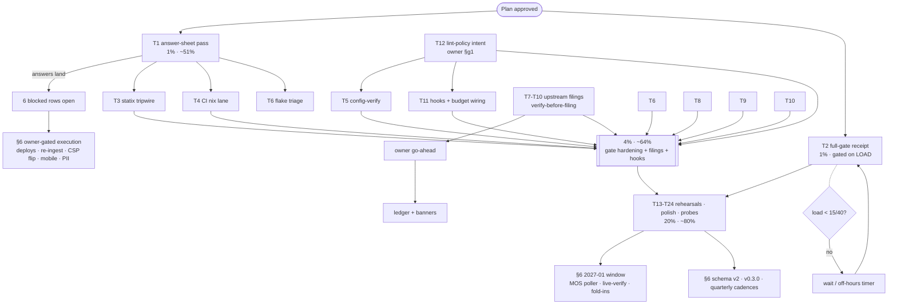

<!-- docs/planning/2026-10-18_01-01_SUPERB-pareto-plan-post-liveset-closeout.md
     Pareto plan over the post-live-set-closeout TODO_LIST (rebuilt 2026-10-17
     second docs-health pass). Every row verified open against CHANGELOG + code
     during that pass (247 verdicts) and re-checked at plan time. Format note:
     .md + mermaid per explicit operator demand (the pareto-planning skill's
     canonical styled-HTML output overridden; same override as every prior
     SUPERB plan in this repo). Supersedes 2026-10-17_05-07 (archived). -->

# SUPERB Pareto Plan — post-live-set-closeout execution (2026-10-18 01:01)

> Input state: the second docs-health pass emptied the status live set (54
> archived reports), archived the 8 executed plans, re-synced the upstream
> ledgers with gh-verified states, and pushed remote CI to GREEN on the
> repaired styles.css (run 39076978166). TODO_LIST: 30 open rows (1
> unblocked + 17 blocked + 12 low). Machine: load 414/251/113 at plan time —
> the full-gate receipt stays policy-gated (1-min < 15 AND 15-min < 40).

## 1. Step-0 verification (errata)

- Every TODO_LIST row was re-verified against code + CHANGELOG during the
  2026-10-17→18 docs-health pass; zero stale rows found at plan time.
- Corrections already applied this pass (recorded so no plan re-finds them):
  the phantom "task 26" in the 01-45 report; the never-landed c25 gate-doc
  note; the styles.css foreign rebuild (f91f3f4, repaired, CI green);
  the drafts-ledger drift (7 stale states, 2 missing rows).
- The 05-07 plan is ARCHIVED (`docs/planning/archived/`) — its only
  survivor, the load-gated gate receipt, is T2 here.

## 2. The Pareto answer

| Tier     | Share of tasks             | Cumulative value | What it is                                                                                                                                                                    | Why it carries the value                                                                                                                                                            |
| -------- | -------------------------- | ---------------- | ----------------------------------------------------------------------------------------------------------------------------------------------------------------------------- | ----------------------------------------------------------------------------------------------------------------------------------------------------------------------------------- |
| **1%**   | T1 (one file, ~11 answers) | **~51%**         | The owner answer sheet §1-§11, recorded into TODO_LIST + AGENTS on arrival                                                                                                    | SIX blocked High/Medium rows (D1-D5, PII, mobile, CSP, coverage, baseline home) gate on nothing else. One 30-minute pass converts the entire blocked surface into schedulable work  |
| **4%**   | T2-T12 (11 tasks)          | **~64%**         | + the 70/70 gate receipt, the gate-hardening bundle (tripwire, CI nix lane, config-verify, flake triage), the upstream filings queue, hooks/budget wiring, lint-policy intent | Trust: the 5-day-silent-linting class becomes structurally impossible; four fresh findings get filed while verifiable; the budget guard covers every committer, not just humans     |
| **20%**  | T13-T24 (12 tasks)         | **~80%**         | + release/tooling rehearsals, probe polish bundle, AGENTS extraction, stale-verdict probe, FTS ranking, timing asserts, tooling-triage remainder, re-ingest rehearsal         | Hygiene + external leverage: the release runbook gets exercised before it is needed, the probe stack stops bleeding known rough edges, the index stays honest under a larger corpus |
| **Rest** | §6 (not schedulable here)  | **100%**         | 2027-01 window (MOS poller, Telnyx live-verify, fold-ins), schema v2, host deploys, v0.3.0, quarterly cadences                                                                | Externally gated by calendar (Telnyx window), owner (deploys, answers), or upstream (issues still open)                                                                             |

## 3. Comprehensive plan (30–100 min tasks, ALL open TODOs)

| #   | Tier | Task                                                                                                                         | Impact | Effort | Gates on                              | Evidence                                                                  |
| --- | ---- | ---------------------------------------------------------------------------------------------------------------------------- | ------ | ------ | ------------------------------------- | ------------------------------------------------------------------------- |
| T1  | 1%   | Owner answer-sheet pass: record §1-§11 answers, update TODO_LIST + AGENTS per the F7 contract, open the unblocked rows       | High   | 30min  | owner answers (staging doc ready)     | `docs/decisions/2026-10-17_owner-answer-sheet.md`; TODO_LIST Blocked rows |
| T2  | 1%   | Full buildflow gate from a clean checkout at load < 15/40 → bank the literal 70/70 receipt; close the v0.2.0 workaround note | High   | 45min  | load policy (quiet machine)           | BuildFlow#56 CLOSED; docs/buildflow-dev-gate.md; CHANGELOG v0.2.0 receipt |
| T3  | 4%   | Statix no-op tripwire in scripts/verify-all.sh (fail on stderr "config error") + fixture                                     | High   | 30min  | —                                     | 01-45 §c2/§f3; the 5-day outage receipt                                   |
| T4  | 4%   | CI nix lane: statix + deadnix + `nix fmt --ci` job in `.github/workflows/ci.yml`                                             | High   | 60min  | —                                     | 01-45 §c1/§f4; ci.yml job pattern                                         |
| T5  | 4%   | `golangci-lint config verify` wired into pre-commit or CI (phantom-linter class)                                             | High   | 30min  | T12 (pin the policy first)            | 01-45 §f8; 3d93fdf precedent                                              |
| T6  | 4%   | `TestCacheSemanticsHardening` flake triage: reproduce, inject clock/deadline or justify                                      | High   | 60min  | —                                     | `cmd/pbx-lens/serve_test.go:366`; 01-45 postscript                        |
| T7  | 4%   | File CopyButton singleton-script nonce gap upstream (verify-before-filing, dupe search)                                      | High   | 45min  | owner go-ahead (public act)           | 10-28 §f28; `internal/web` CopyButton usage                               |
| T8  | 4%   | File Card TitleTag h3 level-skip default upstream (DX suggestion, 12 call sites)                                             | Medium | 30min  | owner go-ahead                        | 10-28 §f29; adoption map TitleTag row                                     |
| T9  | 4%   | File statix exit-0-on-config-error footgun upstream (dupe search first)                                                      | Medium | 30min  | owner go-ahead                        | 01-45 §f17; docs/gotchas.md statix contract                               |
| T10 | 4%   | cqrs-lint F009 inline-suppression question: check upstream support → file or document                                        | Low    | 30min  | owner go-ahead if filing              | docs/cqrs-lint-policy.md; 08-02 §f.23                                     |
| T11 | 4%   | Hooks + budget wiring: daemon-path budget check + optional AGENTS-budget CI job                                              | Medium | 45min  | T12 for the CI variant                | 10-28 §f21-22; `.githooks/pre-commit`                                     |
| T12 | 4%   | Lint-policy intent: formalize-or-revert the 3d93fdf edits (lll, run.go, tagliatelle)                                         | Medium | 30min  | owner answer (§g1 of the self-review) | 01-45 §b2/§g1; `.golangci.yml`                                            |
| T13 | 20%  | cut-release.sh full-body dry-run on a quiet machine (+ `go list -m` retry loop if flaky)                                     | High   | 60min  | load policy + no release pending      | 08-02 §f23/45; `scripts/cut-release.sh`                                   |
| T14 | 20%  | `ingest-telnyx -dry-run` parity with ingest-cdr (report-only fetch)                                                          | Medium | 45min  | —                                     | 10-28 §f47; `internal/cli/ingest.go` AgeGate pattern                      |
| T15 | 20%  | csp-sweep per-surface console attribution (reset console buffer per navigation)                                              | Medium | 45min  | —                                     | 08-02 §d5; `scripts/csp-sweep.js`                                         |
| T16 | 20%  | `verify-all --baseline` wrapper + print-probe `break-inside` computed-style assert                                           | Low    | 45min  | —                                     | 10-28 §f38/40; `scripts/verify-all.sh`                                    |
| T17 | 20%  | art-dupl verdict baseline file + baseline-freshness warning (v3 re-save as markup DoD)                                       | Medium | 60min  | —                                     | 10-28 §f25/27/45; ci.yml duplication job                                  |
| T18 | 20%  | Golden-scrubber stamp-format robustness check + scripts/README codegen-paragraph merge                                       | Low    | 30min  | —                                     | 08-02 §f44/47                                                             |
| T19 | 20%  | AGENTS.md extraction: move recording-proxy details → docs/http-stack.md, keep 219 budget                                     | Low    | 30min  | —                                     | 10-28 §f41; `scripts/check-agents-budget.sh`                              |
| T20 | 20%  | Stale-verdict browser probe: poller-wired serve composition (`-wired-ops` dev flag) + probe                                  | Low    | 60min  | —                                     | TODO row; `internal/web/ops.go`; ui-probe.js                              |
| T21 | 20%  | FTS ranking spot checks on a larger corpus + digits-shadow corners                                                           | Low    | 45min  | —                                     | `internal/search/search_test.go`; TODO row                                |
| T22 | 20%  | Recording-proxy timing-hop budget asserts (Server-Timing vs upstream timeouts)                                               | Low    | 45min  | —                                     | `cmd/pbx-lens/serve_test.go`; recording_test.go                           |
| T23 | 20%  | Buildflow tooling-triage remainder (doctor entries: markdown-lint/gitleaks/codespell)                                        | Low    | 45min  | T2 (BF#56 binary settled)             | TODO row; `buildflow doctor --verbose`                                    |
| T24 | 20%  | Production re-ingest REHEARSAL (`ingest-cdr -dry-run` on the prod Master.csv) + deploy-prep handoff to owner                 | High   | 30min  | owner provides the Master.csv path    | F63 runbook (docs/process-prep-2026-10-15.md); TODO blocked rows          |

Not schedulable here (externally gated — see §6): host deploys, the real
ContentHash v2 re-ingest, MOS poller + Telnyx live-verify + fold-ins (2027-01
window), schema v2, CSP flip, mobile implementation, PII implementation,
v0.3.0 cut, vulnix/nix-checker pass, the ROADMAP process items.

## 4. Fine breakdown (≤12 min tasks, ALL TODOs)

| #   | Task                                                                                                                                           | Impact | min | Tier |
| --- | ---------------------------------------------------------------------------------------------------------------------------------------------- | ------ | --- | ---- |
| F1  | Collect owner answers §1-§11 into the sheet's ANSWER slots                                                                                     | High   | 10  | 1%   |
| F2  | Record D1-D5 outcomes in TODO_LIST + AGENTS (plan-F7 contract)                                                                                 | High   | 10  | 1%   |
| F3  | Open/rewrite the unblocked rows the answers unlock (date vocab, controls, filings, export note, AI tone, mobile, PII, CSP, coverage, baseline) | High   | 12  | 1%   |
| F4  | Flip BLOCKED → TODO for the answered rows; drop answered questions                                                                             | High   | 8   | 1%   |
| F5  | Check load; if < 15/40 start the clean-checkout full gate (T2)                                                                                 | High   | 5   | 1%   |
| F6  | Bank the receipt in docs/buildflow-dev-gate.md (exit code, counts)                                                                             | High   | 10  | 1%   |
| F7  | Close the v0.2.0 workaround note in CHANGELOG's release section pointer docs                                                                   | Medium | 8   | 1%   |
| F8  | `git status` + push the receipt commit; watch CI green                                                                                         | High   | 8   | 1%   |
| F9  | Add the statix tripwire function to scripts/verify-all.sh                                                                                      | High   | 12  | 4%   |
| F10 | Fixture: a fake config-error run must turn the lane red                                                                                        | High   | 10  | 4%   |
| F11 | Run verify-all --fast; commit                                                                                                                  | High   | 8   | 4%   |
| F12 | Draft the CI nix-lane job (statix, deadnix, `nix fmt --ci`)                                                                                    | High   | 12  | 4%   |
| F13 | Wire the job into `.github/workflows/ci.yml` (needs field)                                                                                     | High   | 10  | 4%   |
| F14 | Prove it fails on a seeded nix error, then remove the seed                                                                                     | High   | 12  | 4%   |
| F15 | Push; watch the nix lane green on CI                                                                                                           | High   | 8   | 4%   |
| F16 | Add a `lint-config` step: `golangci-lint config verify`                                                                                        | High   | 10  | 4%   |
| F17 | Choose the surface (pre-commit vs CI) per the T12 answer                                                                                       | Medium | 6   | 4%   |
| F18 | Prove it rejects the gohumanize config (historical repro, reverted)                                                                            | High   | 12  | 4%   |
| F19 | Reproduce the flake: loop TestCacheSemanticsHardening 50x with -count                                                                          | High   | 12  | 4%   |
| F20 | Read the 5.06s path; identify the wall-clock dependency                                                                                        | High   | 10  | 4%   |
| F21 | Inject the clock/deadline (existing injectable-clock pattern)                                                                                  | High   | 12  | 4%   |
| F22 | Re-loop 50x green; document the bound in the test comment                                                                                      | High   | 10  | 4%   |
| F23 | Full web package + commit                                                                                                                      | High   | 8   | 4%   |
| F24 | verify-before-filing: read CopyButton's script/nonce path in templ-components at the pin                                                       | High   | 12  | 4%   |
| F25 | Repro locally: un-nonced script under the CSP sweep                                                                                            | High   | 10  | 4%   |
| F26 | Search templ-components issues for dupes                                                                                                       | High   | 8   | 4%   |
| F27 | Draft the issue body (repro + ask + pin version) in docs/drafts/                                                                               | Medium | 12  | 4%   |
| F28 | File after owner go-ahead; ledger + FILED banner                                                                                               | Medium | 8   | 4%   |
| F29 | Verify Card's h3 default at the pin (nav/card source)                                                                                          | Medium | 10  | 4%   |
| F30 | Collect the 12 TitleTag call sites as evidence                                                                                                 | Medium | 8   | 4%   |
| F31 | Dupe search + draft in docs/drafts/                                                                                                            | Medium | 12  | 4%   |
| F32 | File after go-ahead; ledger row + banner                                                                                                       | Medium | 6   | 4%   |
| F33 | Repro: statix with a broken toml prints "config error" + exit 0                                                                                | Medium | 8   | 4%   |
| F34 | Search statix issues for the fail-open class                                                                                                   | Medium | 10  | 4%   |
| F35 | Draft + file after go-ahead; ledger row                                                                                                        | Medium | 12  | 4%   |
| F36 | Update docs/gotchas.md statix entry with the issue link                                                                                        | Low    | 6   | 4%   |
| F37 | Check cqrs-lint source for an inline-suppression mechanism                                                                                     | Low    | 12  | 4%   |
| F38 | If supported: draft the F009 suppression filing; else document the gap in cqrs-lint-policy.md                                                  | Low    | 10  | 4%   |
| F39 | Update the policy doc + ledger                                                                                                                 | Low    | 6   | 4%   |
| F40 | Route the daemon through the budget check (wrapper or config)                                                                                  | Medium | 12  | 4%   |
| F41 | Add the AGENTS-budget CI job (wc -l gate, mirrors the hook)                                                                                    | Medium | 10  | 4%   |
| F42 | Prove the job fails on a 220-line seed (reverted)                                                                                              | Medium | 10  | 4%   |
| F43 | Owner one-liner documented: `git config core.hooksPath .githooks`                                                                              | Low    | 5   | 4%   |
| F44 | Push; watch both guards green                                                                                                                  | Medium | 8   | 4%   |
| F45 | Owner answer on 3d93fdf intent (self-review §g1)                                                                                               | Medium | 5   | 4%   |
| F46 | If deliberate: comment each edit in .golangci.yml with the why                                                                                 | Medium | 12  | 4%   |
| F47 | If accidental: revert, run the lint, commit with the policy note                                                                               | High   | 12  | 4%   |
| F48 | Quiesce check: load < 15/40, clean tree, pushed HEAD, CI green                                                                                 | High   | 8   | 20%  |
| F49 | Dry-run cut-release.sh against a non-release commit (script `--dry-run` if present, else scratch tag name aborted before push)                 | High   | 12  | 20%  |
| F50 | Verify each guard rail fires (dirty tree, unpushed HEAD, CI red)                                                                               | High   | 12  | 20%  |
| F51 | Fix whatever the dry-run surfaces (likely the `go list -m` sleep-10 → retry loop)                                                              | Medium | 12  | 20%  |
| F52 | Record the runbook receipt in scripts/README                                                                                                   | Medium | 8   | 20%  |
| F53 | Add `-dry-run` to ingest-telnyx (parse+age-gate report, no index)                                                                              | Medium | 12  | 20%  |
| F54 | Reuse the ingest-cdr dry-run report shape (one format, two sources)                                                                            | Medium | 10  | 20%  |
| F55 | Test: dry-run writes nothing, reports would-fetch counts                                                                                       | Medium | 12  | 20%  |
| F56 | README ingest section one-liner; commit                                                                                                        | Low    | 8   | 20%  |
| F57 | csp-sweep: reset the console buffer per navigation                                                                                             | Medium | 12  | 20%  |
| F58 | Attribute violations per surface in the report                                                                                                 | Medium | 10  | 20%  |
| F59 | Re-run the 6-surface sweep; expect the same zero                                                                                               | Medium | 8   | 20%  |
| F60 | Commit                                                                                                                                         | Low    | 5   | 20%  |
| F61 | `verify-all --baseline <dir>` argument parsing + pass-through                                                                                  | Low    | 10  | 20%  |
| F62 | Docs one-liner in scripts/README (LENS_DIFF_BASELINE alternative)                                                                              | Low    | 6   | 20%  |
| F63 | Print probe: assert computed break-inside on `.lens-ops-card`                                                                                  | Low    | 12  | 20%  |
| F64 | Run the print capture; confirm the assert passes live                                                                                          | Low    | 8   | 20%  |
| F65 | Commit                                                                                                                                         | Low    | 4   | 20%  |
| F66 | Check in the art-dupl verdict baseline (36 groups, accept-rationale)                                                                           | Medium | 12  | 20%  |
| F67 | Wire the CI duplication job to diff against the baseline                                                                                       | Medium | 12  | 20%  |
| F68 | Prove a new clone stands out (seed + revert)                                                                                                   | Medium | 10  | 20%  |
| F69 | Baseline-freshness warning in verify-all (markup newer than baseline gen)                                                                      | Medium | 12  | 20%  |
| F70 | Commit; full browser lane green                                                                                                                | Medium | 10  | 20%  |
| F71 | Golden-scrubber: assert the `Updated HH:MM:SS` pattern still matches the footer copy                                                           | Low    | 10  | 20%  |
| F72 | Merge the two scripts/README codegen paragraphs (hash-primary wins)                                                                            | Low    | 10  | 20%  |
| F73 | Commit                                                                                                                                         | Low    | 4   | 20%  |
| F74 | Extract the serve/UI paragraph's recording-proxy details → docs/http-stack.md                                                                  | Low    | 12  | 20%  |
| F75 | Compress the AGENTS serve/UI bullet to a pointer; verify 219 budget                                                                            | Low    | 10  | 20%  |
| F76 | Budget check + commit                                                                                                                          | Low    | 6   | 20%  |
| F77 | Add the poller-wired serve composition (`serve -wired-ops` or serveProbe option)                                                               | Low    | 12  | 20%  |
| F78 | Point the composition's /api/ops at a canned SnapshotAny                                                                                       | Low    | 12  | 20%  |
| F79 | Extend ui-probe serveProbe: assert the stale-verdict alert renders                                                                             | Low    | 12  | 20%  |
| F80 | Run verify-all --fast (ops surface included)                                                                                                   | Low    | 10  | 20%  |
| F81 | Commit; close the TODO row                                                                                                                     | Low    | 6   | 20%  |
| F82 | Build a larger synthetic corpus (100+ transcripts, number-heavy)                                                                               | Low    | 12  | 20%  |
| F83 | Ranking spot checks: bm25 expectations on multi-word queries                                                                                   | Low    | 12  | 20%  |
| F84 | Digits-shadow corners: 4-digit runs inside long numbers, overlaps                                                                              | Low    | 12  | 20%  |
| F85 | Pin the agreed ordering in a test; commit                                                                                                      | Low    | 10  | 20%  |
| F86 | Read the recording proxy's two hops vs the 30s budget                                                                                          | Low    | 10  | 20%  |
| F87 | Assert metadata hop + headers hop ≤ budget in Server-Timing                                                                                    | Low    | 12  | 20%  |
| F88 | Assert a slow upstream never perturbs the header budget                                                                                        | Low    | 12  | 20%  |
| F89 | Commit                                                                                                                                         | Low    | 6   | 20%  |
| F90 | `buildflow doctor --verbose`: enumerate the failing entries                                                                                    | Low    | 10  | 20%  |
| F91 | Disposition each (install vs on-demand vs skip-with-why)                                                                                       | Low    | 12  | 20%  |
| F92 | Update the gate doc triage entry; commit                                                                                                       | Low    | 8   | 20%  |
| F93 | Ask owner for the prod Master.csv path; run `ingest-cdr -dry-run`                                                                              | High   | 8   | 20%  |
| F94 | Record would-record/would-reject counts in the F63 runbook copy                                                                                | High   | 8   | 20%  |
| F95 | Hand the deploy-prep checklist (F64) to the owner with aiDids set                                                                              | High   | 6   | 20%  |
| F96 | Schedule the real re-ingest for the maintenance window (owner)                                                                                 | High   | 6   | 20%  |

## 5. Execution graph

## 6. Not schedulable here (externally gated — each already a TODO_LIST row)

| Item                                                                                    | Gate                      | Landing place                      |
| --------------------------------------------------------------------------------------- | ------------------------- | ---------------------------------- |
| Host deploys (`aiDids`)                                                                 | owner                     | TODO Blocked + F64 runbook         |
| Production re-ingest for ContentHash v2                                                 | owner window              | TODO Blocked + F63 runbook         |
| T15 MOS poller execution                                                                | Telnyx window 2027-01     | mos-poller-design                  |
| Telnyx DTO live-verify + Range check                                                    | Telnyx window 2027-01     | docs/telnyx-quarterly-checklist.md |
| Fold-ins: templ-components#48/49/50/51/55, go-etag#2, go-nix-helpers#7, treefmt-nix#545 | upstream                  | upstream-filings watch table       |
| PII enforcement implementation                                                          | owner §6 answer           | one-pager (recommendation B)       |
| Mobile card-list implementation                                                         | owner §7 answer           | 02-24 M17 sketch                   |
| CSP enforce-mode flip                                                                   | owner §11 answer + deploy | answer-sheet §11                   |
| Coverage chase to 80                                                                    | owner §8 answer           | ci.yml floor row                   |
| Pixel-baseline durable home                                                             | owner §10 answer          | scripts/README doctrine            |
| Browser-level 304 check                                                                 | owner manual              | TODO Blocked                       |
| >1MiB transcript policy                                                                 | owner (default stands)    | process-prep F62                   |
| Schema v2 ContentHash encoding                                                          | the v2 gate               | TODO Low row                       |
| dependabot confirm + #16538 watch                                                       | weekly cycle / upstream   | TODO rows                          |
| Sibling backup-rotation fold                                                            | sibling repo session      | TODO row                           |
| v0.3.0 cut + CHANGELOG split                                                            | release decision          | ROADMAP + cut-release.sh           |
| vulnix + nix-checker pass                                                               | next flake bump           | ROADMAP                            |
| Gate timer, drift guard, branch protection, dprint policy                               | owner/machine             | ROADMAP process ideas              |

## 7. Verschlimmbesserung guards (what this plan must NOT do)

1. **No archived-corpus edits.** `docs/status/archived/` and
   `docs/planning/archived/` are closed history; the dprint policy question
   stays a question until the owner answers — do not "fix" formatting there.
2. **No policy flips without the owner:** CSP enforce-mode, the 3d93fdf
   lint rules, coverage floor 70→80, PII boundary — all wait for §g answers.
3. **No styles.css regeneration outside `nix run .#update-styles`** (the
   f91f3f4 incident is the receipt).
4. **Gate order is load-bearing:** check-rows BEFORE `git mv`; tests before
   the daemon can commit a red state; `git status` as its own command
   before any push (the bafd463 lesson).
5. **AGENTS.md stays ≤219 lines** — extraction (T19) precedes addition.
6. **Filings are verify-before-filing, owner-go-ahead acts** — never file
   straight from a plan line.
7. **The index DB stays disposable and read-only over sources** — the
   re-ingest rehearsal is `-dry-run` until the owner opens the window.
