<!-- docs/planning/2026-10-23_17-01_SUPERB-truth-first-analytics-and-refresh-surface.md
     Pareto plan over the post-docs-health backlog (TODO_LIST rebuilt 2026-10-23).
     Format: .md + mermaid (the standing repo policy; the pareto-planning skill's
     HTML default is overridden by explicit owner demand and by AGENTS.md).
     Every TODO row was re-verified against code/CHANGELOG at plan time; the
     errata in §1 record what the list had wrong. -->

# SUPERB Plan — truth first, then the analytics surface, plus the refresh/schema-v2 paperwork

**Created:** 2026-10-23 17:01 CEST · **Head:** `cc319fa` (+ a concurrent
web-layer session active; load 53/73/70, so the FULL-gate window is closed).
**Input:** the 42 open TODO_LIST rows after the 2026-10-23 docs-health AUDIT,
plus two same-day code landings discovered during Step 0.
**Product north star:** the most superb insights and analytics platform over
this PBX's call history (ROADMAP theme 0). This plan deliberately puts
**number correctness before new analytics**.

---

## 1. Step-0 verification — errata (read this first)

Every row was checked against code, CHANGELOG, and the two 2026-10-23 status
reports. Four corrections matter:

1. **`ObservationSchemaVersion = 2` shipped today.** `internal/calls/events.go`
   now hashes a named, length-prefixed pre-image with a schema token; the old
   TODO row ("At schema v2: length-prefixed ContentHash encoding", Low/60min)
   is **DONE** and was removed from TODO_LIST. The hash of every observation
   moved, so the live DB is half-migrated until the correction wave runs.
2. **`refresh` shipped today.** `cmd/pbx-lens/refresh.go` +
   `internal/cli/refresh.go`: fetch → classify every stream (new / stale /
   additive-only / unchanged / unbuildable) → only `-apply` writes. Default
   look-back is unbounded, unlike `ingest-telnyx`'s 48 h. This _is_ the
   ContentHash-v2 / additive-field backfill mechanism; the old "prod re-ingest"
   row was reframed to name it. It is **undocumented in README, FEATURES,
   AGENTS, and CHANGELOG** → new row, task T3.
3. **The `siblingKinds` behavior table test already exists**
   (`internal/web/detail_join_test.go:248` pins every join pair). The row was
   **DONE** and removed.
4. **The 2026-10-23 16-21 gate report is the live harvest source.** Its five
   bounded items (full sweep, `siblingKinds`, JS lint, detect-only triage,
   nine unnamed tools) are already TODO rows; the rest of its §f is brainstorm
   and stays out of the backlog by design.

Also recorded: `docs/DOMAIN_LANGUAGE.md` carries an uncommitted, coherent
addition from the concurrent session (signal thresholds + additive-field
doctrine). It must be committed, never reverted — this plan treats it as the
canonical home the README/FEATURES/AGENTS entries point to.

**Live addendum (17:10, while this plan was being written):** the concurrent
same-day session is landing this documentation itself — `FEATURES.md` gained
the `refresh` row and `docs/DOMAIN_LANGUAGE.md` grew the additive-field
doctrine during the planning window. **Re-check T3 before starting it:** the
row may already be partly DONE; at 17:10 README, AGENTS, and CHANGELOG still
lacked the surface, so T3 shrinks to those three plus a verification pass.

---

## 2. The Pareto answer

| Tier     | Share                  | Cumulative value | What it is                                                                                                                                                                                     | Why it carries the value                                                                                                                                                                                                                                                                                             |
| -------- | ---------------------- | ---------------- | ---------------------------------------------------------------------------------------------------------------------------------------------------------------------------------------------- | -------------------------------------------------------------------------------------------------------------------------------------------------------------------------------------------------------------------------------------------------------------------------------------------------------------------- |
| **1%**   | 2 tasks + 1 owner pass | **~51%**         | Make the numbers TRUE: collapse one call that appears as two source rows, and derive CDR direction correctly; then collect the owner answers                                                   | Every chart, rollup, and export inherits these two facts. A dashboard that double-counts AI calls and labels inbound DIDs "outbound" is not an analytics platform — it is a plausible-looking lie. Fix them before adding a single new chart. The owner answers convert the whole blocked half into schedulable work |
| **4%**   | 12 tasks               | **~64–80%**      | Paperwork for the new surface (T3), the production correction wave (T5), the three analytics slices (T6–T8), receipt integrity (T9), and the quality gates that keep the repo honest (T10–T14) | T3 stops the docs from lying about a shipped command; T5 completes a migration whose first half already moved every hash; T6–T8 are the product itself; T9–T14 are the machinery that makes every future receipt trustworthy                                                                                         |
| **20%**  | 13 tasks               | **~80–95%**      | The owner-decision follow-through batch, filings, release, fold-ins, doc audit, tooling polish, and the 2027-01 window prep                                                                    | Real value, but each is either gated on an owner answer, a calendar window, or an upstream release — scheduling them is useful; executing them early is not                                                                                                                                                          |
| **Rest** | §6                     | **100%**         | Everything that cannot be scheduled now: prod deploys, the real re-ingest, MOS execution, schema work already done, quarterly cadences                                                         | External gates. Each maps to a TODO row; none is lost                                                                                                                                                                                                                                                                |

**The 1% argument, stated plainly:** if the operator learns that "Calls today"
counts AI calls twice, every insight in this repo becomes suspect. Correctness
is not a phase before analytics — it is the first analytics feature.

---

## 3. Comprehensive plan (30–100 min per task, all 42 TODO rows covered)

Sorted by tier, then impact, then effort. `Value` is operator value.

| #       | Tier | Task                                                                                                                                                                                                                                                                                                                                                                                   | Impact   | Effort | Value  | Gates on                        | Evidence / TODO row                                                                                            |
| ------- | ---- | -------------------------------------------------------------------------------------------------------------------------------------------------------------------------------------------------------------------------------------------------------------------------------------------------------------------------------------------------------------------------------------- | -------- | ------ | ------ | ------------------------------- | -------------------------------------------------------------------------------------------------------------- |
| **T1**  | 1%   | **Collapse per-source rows on LIST + DASHBOARD**: one real call is two rows (CDR + agent transcript), so the list shows it twice and the dashboard counts its volume twice. Pick the representative row (CDR; transcript only as fallback), collapse in the list query and the stats aggregation, pin both with tests + goldens                                                        | Critical | 90min  | High   | — (design call inside the task) | TODO row 2; `ListCalls`/`DashboardStatsQuery`; `CallDetailPage` already joins at read time                     |
| **T2**  | 1%   | **CDR direction derivation**: `cdr.direction()` reads only `context`, but every inbound DID is transferred into `default`, so the a-leg indexes OUTBOUND (live example: an inbound AI call labeled outbound). Ship the custom `call_direction` column path in the sibling template, or the documented heuristic (internal-extension destination + external caller); fixtures both ways | Critical | 60min  | High   | —                               | TODO row 3; `internal/ingest/cdr/cdr.go:245`; sibling `freeswitch.nix`                                         |
| **T3**  | 4%   | **Document the 2026-10-23 surface**: README `refresh` usage + schema note; FEATURES rows for `refresh` and `ObservationSchemaVersion`; AGENTS subcommand list + additive-field pointer; CHANGELOG entries for schema v2, `refresh`, the signal thresholds                                                                                                                              | High     | 45min  | Medium | —                               | New TODO row; `cmd/pbx-lens/refresh.go`; `internal/calls/events.go`; docs/DOMAIN_LANGUAGE.md § Additive fields |
| **T4**  | 4%   | **Owner answer pass**: put §1–§11 plus the three 2026-10-23 questions (vulnix policy, first analytics slice, concurrent-session norm) in front of the owner; record answers into TODO_LIST + AGENTS per the F7 contract                                                                                                                                                                | Critical | 30min  | High   | owner time                      | TODO rows 15, 18, 19, 20, 21, 24, 27, 28, 34; answer sheet                                                     |
| **T5**  | 4%   | **Production correction wave**: `refresh -db <prod> --since 0` (classify-only) → record counts → `-apply` → verify views/search/detail → CHANGELOG. The schema bump already moved every hash, so this is the scheduled healing pass, not an optional backfill                                                                                                                          | High     | 60min  | High   | owner prod path                 | TODO row 13; `refresh`; `ObservationSchemaVersion`                                                             |
| **T6**  | 4%   | **Dashboard cost card (north-star slice 1)**: spend over the selected window + cost/minute, honest "no cost data" state, aggregate in `DashboardStatsQuery`, goldens                                                                                                                                                                                                                   | High     | 90min  | High   | —                               | TODO row 4; `Enrichment.CostMicros`; ROADMAP theme 0                                                           |
| **T7**  | 4%   | **Segmented analytics (slice 2)**: top DIDs + top counterpart numbers with volume/AI share/avg duration/cost and drill-through into the filtered list; read-only route or dashboard section                                                                                                                                                                                            | High     | 90min  | High   | T1 (deduped counts)             | TODO row 5; `ListCalls` filters; ROADMAP theme 0                                                               |
| **T8**  | 4%   | **Quality rollup (slice 3)**: aggregate hangup causes + `no user turn` / `self-dial` / `Recording tail` into standing rates                                                                                                                                                                                                                                                            | Medium   | 75min  | High   | T1 (deduped counts)             | TODO row 6; docs/DOMAIN_LANGUAGE.md § Transcript truth; ROADMAP theme 0                                        |
| **T9**  | 4%   | **Full 41-PNG sweep + golden diff**: the probe bootstrap was rewritten 2026-10-23 and the full lane was never re-run; restore receipt integrity                                                                                                                                                                                                                                        | High     | 30min  | Low    | —                               | TODO row 7; `scripts/verify-all.sh`                                                                            |
| **T10** | 4%   | **Poll-exec gate wrapper**: the load poll execs the strict-window gate so the START LOAD in a receipt is the load the loop verified                                                                                                                                                                                                                                                    | High     | 45min  | Low    | —                               | TODO row 1; 06-55 §e2; `scripts/`                                                                              |
| **T11** | 4%   | **JS lint for probe scripts**: oxlint/eslint (`no-undef`, unused) over `scripts/*.js`; the `bin is not defined` class shipped today and nothing caught it                                                                                                                                                                                                                              | Medium   | 45min  | Low    | —                               | TODO row 8; `.buildflow.yml`; 16-21 §c11                                                                       |
| **T12** | 4%   | **Docs drift gates**: `check-docs-counts.sh` (re-derive archived counts + TODO rows) and `check-doc-links.sh` (relative links), wired into pre-commit/verify-all with red/green proofs                                                                                                                                                                                                 | Medium   | 90min  | Medium | —                               | New TODO row; the ad-hoc link check found 0 broken                                                             |
| **T13** | 4%   | **Detect-only findings triage**: art-dupl 107, branching-flow 100, file-size 12, cqrs-lint 20 vs the policy doc — fix, document, or accept in one pass                                                                                                                                                                                                                                 | Medium   | 60min  | Medium | —                               | TODO row 9; 16-21 §c1-4                                                                                        |
| **T14** | 4%   | **Name the nine "tools unavailable"**: one `buildflow --verbose`, nine dispositions into the gate doc                                                                                                                                                                                                                                                                                  | Low      | 30min  | Low    | —                               | TODO row 10; 16-21 §c5                                                                                         |
| **T15** | 20%  | **Probe residue bundle**: static-asset 304 first-try assert; `verify-all --baseline` parses early; seed-clone pattern documented                                                                                                                                                                                                                                                       | Medium   | 60min  | Low    | —                               | TODO row 40; 04-25 §f32/§e9/§e6                                                                                |
| **T16** | 20%  | **Read-model rebuild**: `rebuild` subcommand (`ProjectionHost.Reset` + replay) or the documented host procedure, then retire the legacy key fallback                                                                                                                                                                                                                                   | Medium   | 90min  | Medium | owner deploy                    | TODO row 12; `viewkey.go`; CHANGELOG 2026-10-23                                                                |
| **T17** | 20%  | **Lint-policy + gate/hooks residue**: answer 3d93fdf intent, comment the config, wire `golangci-lint config verify`, add the CI AGENTS-budget job with a 220-line seed proof, close the BF#56 bookkeeping                                                                                                                                                                              | Medium   | 60min  | Low    | owner answer                    | TODO rows 29, 30, 31, 28                                                                                       |
| **T18** | 20%  | **Upstream filings**: FILE the four staged drafts + the two 2026-10-23 BuildFlow candidates, flip ledger rows and banners in the same commit                                                                                                                                                                                                                                           | Medium   | 60min  | Medium | owner go-ahead                  | TODO rows 32, 33; docs/drafts/README.md                                                                        |
| **T19** | 20%  | **Release decision + cut**: patch vs minor, run the rehearsed `cut-release.sh`, verify the `go list -m` tail                                                                                                                                                                                                                                                                           | Medium   | 60min  | Medium | owner call                      | TODO rows 35, 39; scripts/cut-release.sh                                                                       |
| **T20** | 20%  | **Stamp-churn doctrine**: measure the `/frag/dashboard` 304-hit rate, decide, render the stamp/RelativeTime client-side if chosen                                                                                                                                                                                                                                                      | High     | 60min  | Medium | owner product call              | TODO row 34; docs/http-stack.md                                                                                |
| **T21** | 20%  | **Owner-decision follow-through batch**: host deploys (`aiDids`), D1–D5, coverage floor, PII boundary, CSP flip, mobile cards, >1MiB policy, pixel-baseline home, browser 304 check — execute whichever the answers unlock                                                                                                                                                             | High     | 90min  | High   | T4                              | TODO rows 14, 15, 16, 18, 19, 20, 21, 24, 27, 28                                                               |
| **T22** | 20%  | **Dependabot confirms**: weekly new-direct-dep proposal + dependabot-core#16538 follow-up                                                                                                                                                                                                                                                                                              | Low      | 30min  | Low    | weekly cycle                    | TODO rows 25, 38                                                                                               |
| **T23** | 20%  | **Fold-ins**: go-appkit#26, go-etag#2, templ-components #48/#49/#50/#51/#55 when they land; run the bump watchlist                                                                                                                                                                                                                                                                     | Low      | 90min  | Medium | upstream                        | TODO rows 22, 23                                                                                               |
| **T24** | 20%  | **Sibling backup-rotation fold** into `lens.nix` timer descriptions                                                                                                                                                                                                                                                                                                                    | Low      | 30min  | Low    | sibling session                 | TODO row 26                                                                                                    |
| **T25** | 20%  | **Audit the five unaudited living docs** (followons, process-prep, did-direction-design, backup-rotation-opinion, telnyx-live-api); correct or archive                                                                                                                                                                                                                                 | Low      | 90min  | Medium | —                               | New TODO row; 2026-10-23 report §b5                                                                            |
| **T26** | 20%  | **prettier devShell + dprint archived policy**: kill the nix-fallback warning; decide the archived-docs formatting rule once                                                                                                                                                                                                                                                           | Low      | 45min  | Low    | fleet config                    | TODO row 36; ROADMAP dprint question                                                                           |
| **T27** | 20%  | **2027-01 Telnyx window**: run the quarterly checklist top to bottom, then the MOS poller execution + fixtures                                                                                                                                                                                                                                                                         | High     | 100min | High   | 2027-01 window                  | TODO rows 17, 37; docs/telnyx-quarterly-checklist.md                                                           |

---

## 4. Fine breakdown (≤12 min per step; 130 steps covering all 27 tasks)

Sorted by tier, then task order. `min` is the step budget.

### Tier 1% — the numbers must be true

| ID   | Step                                                                                                                   | min | Depends on |
| ---- | ---------------------------------------------------------------------------------------------------------------------- | --- | ---------- |
| T1.1 | Read `ListCalls` + its keyset SQL; write down exactly where a second source row enters the result                      | 10  | —          |
| T1.2 | Read `DashboardStatsQuery`; confirm the double count is in `ByDay`/`Total` (not only the list)                         | 8   | —          |
| T1.3 | Decide the representative-row rule (CDR first, transcript fallback) and write it as a comment + FEATURES note draft    | 8   | T1.1       |
| T1.4 | Write the failing list test: seed CDR + transcript for one call, assert ONE row                                        | 12  | T1.3       |
| T1.5 | Implement the list collapse (aggregate preference in SQL or a post-pass over the page)                                 | 12  | T1.4       |
| T1.6 | Prove pagination: a page boundary between the two source rows must not drop or duplicate the call                      | 10  | T1.5       |
| T1.7 | Write the failing dashboard test: same seed, volume must be 1                                                          | 10  | T1.2       |
| T1.8 | Implement the dashboard dedupe and re-run `internal/web` tests                                                         | 12  | T1.7       |
| T1.9 | Refresh the six goldens (`-update`), review the diff, commit                                                           | 10  | T1.8       |
| T2.1 | Read `cdr.direction()` + the 13/18-column parser paths                                                                 | 8   | —          |
| T2.2 | Reproduce the mislabel with a fixture (inbound DID → transfer → `default` context)                                     | 10  | T2.1       |
| T2.3 | Choose the fix: custom `call_direction` column (sibling template) vs the documented heuristic; write the decision down | 8   | T2.2       |
| T2.4 | Implement the chosen path in the parser/resolver                                                                       | 12  | T2.3       |
| T2.5 | Fixtures: inbound transfer, outbound a-leg, unknown context                                                            | 12  | T2.4       |
| T2.6 | Run `internal/ingest/cdr` + the full suite; record how existing rows heal (file re-parse)                              | 10  | T2.5       |
| T2.7 | Document the rule in FEATURES/AGENTS (one line) and the CDR gotcha                                                     | 6   | T2.6       |

### Tier 4% — the surface, the paperwork, the machinery

| ID    | Step                                                                                       | min | Depends on |
| ----- | ------------------------------------------------------------------------------------------ | --- | ---------- |
| T3.1  | README: add the `refresh` usage block (classify vs `-apply`, unbounded `since`)            | 10  | —          |
| T3.2  | FEATURES: add `refresh` + schema-version rows with evidence                                | 10  | —          |
| T3.3  | AGENTS: add `refresh` to the subcommand list + the additive-field pointer (budget-checked) | 8   | —          |
| T3.4  | CHANGELOG: entries for schema v2, `refresh`, signal thresholds                             | 10  | —          |
| T3.5  | dprint + AGENTS budget + link check                                                        | 6   | T3.1-4     |
| T4.1  | Send the answer sheet + the three new questions; note the date                             | 8   | —          |
| T4.2  | On answers: record into TODO_LIST, flip statuses                                           | 12  | T4.1       |
| T4.3  | On answers: update AGENTS decisions and the answer sheet's "answered on"                   | 10  | T4.2       |
| T4.4  | Re-derive the unblocked set; confirm each new row has evidence                             | 8   | T4.3       |
| T5.1  | Get the prod DSN + key path; record them in the runbook (never the repo)                   | 6   | owner      |
| T5.2  | Run `refresh -db <prod> --since 0` (classify-only) and capture the counts                  | 12  | T5.1       |
| T5.3  | Inspect the `additive-only` + `stale` buckets; confirm they match the schema bump          | 10  | T5.2       |
| T5.4  | Run `refresh -apply`                                                                       | 10  | T5.3       |
| T5.5  | Verify: detail page, FTS search, dashboard totals, `/api/ops`                              | 12  | T5.4       |
| T5.6  | CHANGELOG + ops note with the counts                                                       | 8   | T5.5       |
| T6.1  | Add cost fields to `DashboardStats` + a windowed cost query                                | 12  | —          |
| T6.2  | Unit-test micros→display + missing-cost handling                                           | 10  | T6.1       |
| T6.3  | Add the cost card (spend + cost/min) with the honest empty state                           | 12  | T6.2       |
| T6.4  | Golden update + review                                                                     | 10  | T6.3       |
| T6.5  | FEATURES row flip + README mention                                                         | 6   | T6.4       |
| T6.6  | Full `internal/web` tests + lint                                                           | 10  | T6.5       |
| T7.1  | Define the two segment queries (top DIDs, top counterparts) + limits                       | 10  | T1         |
| T7.2  | Implement + unit-test the aggregation                                                      | 12  | T7.1       |
| T7.3  | Render the table with drill-through links into the filtered list                           | 12  | T7.2       |
| T7.4  | Empty state + honest "no DID data" path                                                    | 8   | T7.3       |
| T7.5  | Goldens + review                                                                           | 10  | T7.4       |
| T7.6  | FEATURES + tests + lint                                                                    | 10  | T7.5       |
| T8.1  | Define the rate denominators (per window, per deduped call)                                | 8   | T1         |
| T8.2  | Aggregate hangup causes + the three signal counts                                          | 12  | T8.1       |
| T8.3  | Render the rollup (bars or a compact table)                                                | 12  | T8.2       |
| T8.4  | Tests for each signal (fixture per badge)                                                  | 12  | T8.3       |
| T8.5  | Goldens + FEATURES + lint                                                                  | 12  | T8.4       |
| T9.1  | Run the full screenshot sweep (all surfaces, both themes)                                  | 12  | —          |
| T9.2  | Eyeball the diff against the v2 baseline; classify alerts                                  | 10  | T9.1       |
| T9.3  | Re-save the baseline if the change is intended; commit the receipt                         | 8   | T9.2       |
| T10.1 | Write `scripts/poll-gate.sh` (poll → exec the gate)                                        | 12  | —          |
| T10.2 | Guard: refuse when 15-min load ≥ 40; print the verified START LOAD                         | 10  | T10.1      |
| T10.3 | Prove it with a stub builder (no real gate run)                                            | 10  | T10.2      |
| T10.4 | scripts/README row + AGENTS command line                                                   | 8   | T10.3      |
| T11.1 | Add the lint config (oxlint or eslint) for `scripts/*.js`                                  | 10  | —          |
| T11.2 | Wire it into pre-commit/buildflow                                                          | 8   | T11.1      |
| T11.3 | Fix the findings it surfaces                                                               | 12  | T11.2      |
| T11.4 | Prove it catches a seeded `bin`-undefined reference                                        | 10  | T11.3      |
| T11.5 | Document the lane                                                                          | 5   | T11.4      |
| T12.1 | Write `check-docs-counts.sh` (archived count, TODO rows)                                   | 12  | —          |
| T12.2 | Prove it red on a seeded count change, green on the tree                                   | 10  | T12.1      |
| T12.3 | Write `check-doc-links.sh`                                                                 | 12  | —          |
| T12.4 | Prove red/green; wire into verify-all                                                      | 10  | T12.3      |
| T12.5 | Wire the count gate into the pre-commit chain                                              | 8   | T12.2      |
| T12.6 | scripts/README rows + AGENTS budget                                                        | 8   | T12.5      |
| T13.1 | Pull the four reports into one table                                                       | 10  | —          |
| T13.2 | Classify every finding: fix / document / accept                                            | 12  | T13.1      |
| T13.3 | Apply the accepted-baseline updates + policy notes                                         | 12  | T13.2      |
| T13.4 | Fix the real ones (timeboxed to this step; the rest become rows)                           | 12  | T13.3      |
| T13.5 | Re-run the lanes + record the verdict                                                      | 10  | T13.4      |
| T14.1 | `buildflow --verbose`, capture the nine names                                              | 8   | —          |
| T14.2 | Write each disposition into the gate doc                                                   | 10  | T14.1      |
| T14.3 | Re-run doctor; confirm no new class                                                        | 6   | T14.2      |

### Tier 20% — gated, polished, or scheduled

| ID    | Step                                                                   | min | Depends on |
| ----- | ---------------------------------------------------------------------- | --- | ---------- |
| T15.1 | Static-asset conditional GET: assert 304 first-try                     | 12  | —          |
| T15.2 | `verify-all --baseline` argument parse before the probes               | 10  | —          |
| T15.3 | Seed-clone pattern → scripts/README paragraph                          | 10  | —          |
| T15.4 | Re-run the three probes                                                | 10  | T15.1-3    |
| T16.1 | Design the `rebuild` verb on `ProjectionHost.Reset` + replay           | 12  | —          |
| T16.2 | Implement + classify counts                                            | 12  | T16.1      |
| T16.3 | Dry-run against a prod snapshot                                        | 12  | T16.2      |
| T16.4 | Run in prod (owner window)                                             | 10  | T16.3      |
| T16.5 | Retire the legacy fallback + test                                      | 12  | T16.4      |
| T17.1 | Answer the lint-policy intent; comment `.golangci.yml`                 | 10  | owner      |
| T17.2 | Wire `golangci-lint config verify` + gohumanize proof                  | 12  | T17.1      |
| T17.3 | CI AGENTS-budget job + 220-line seed proof                             | 12  | T17.1      |
| T17.4 | BF#56 bookkeeping confirmation                                         | 6   | owner      |
| T18.1 | File the four staged drafts                                            | 12  | owner      |
| T18.2 | File the two BuildFlow candidates                                      | 10  | owner      |
| T18.3 | Flip ledger rows + FILED banners in the same commit                    | 10  | T18.1-2    |
| T18.4 | gotchas issue links + upstream doc re-sync                             | 10  | T18.3      |
| T19.1 | Decide patch vs minor                                                  | 6   | owner      |
| T19.2 | CHANGELOG sweep for the release                                        | 12  | T19.1      |
| T19.3 | Run `cut-release.sh`                                                   | 12  | T19.2      |
| T19.4 | Verify tag/proxy/CI + `go list -m` tail                                | 12  | T19.3      |
| T20.1 | Measure the 304-hit rate on `/frag/dashboard`                          | 10  | —          |
| T20.2 | Decide build vs accept; record the doctrine                            | 8   | owner      |
| T20.3 | If build: client-side stamp + RelativeTime chips                       | 12  | T20.2      |
| T20.4 | CSP-safe wiring + tests                                                | 12  | T20.3      |
| T20.5 | Measure after; update http-stack contract                              | 10  | T20.4      |
| T21.1 | D1–D5 execution (one central date helper, all surfaces)                | 12  | T4         |
| T21.2 | Coverage: chase or accept the floor                                    | 12  | T4         |
| T21.3 | PII boundary implementation (read-side per recommendation)             | 12  | T4         |
| T21.4 | CSP enforce flip + deploy bundle                                       | 10  | T4         |
| T21.5 | Mobile card-list                                                       | 12  | T4         |
| T21.6 | >1MiB + pixel home + browser 304 checks                                | 12  | T4         |
| T21.7 | Deploy both hosts with `aiDids`; bundle the CSP flip after the answers | 12  | T21.4      |
| T22.1 | Confirm the weekly dependabot deps                                     | 8   | cycle      |
| T22.2 | dependabot-core#16538 maintainer follow-up                             | 10  | upstream   |
| T23.1 | Re-check each upstream state with `gh`                                 | 10  | —          |
| T23.2 | Fold go-appkit#26 + go-etag#2                                          | 12  | T23.1      |
| T23.3 | Fold templ-components when closed; run the bump watchlist              | 12  | T23.1      |
| T23.4 | Re-run tests + goldens after each fold                                 | 12  | T23.2-3    |
| T24.1 | Draft the `lens.nix` timer-description wording                         | 10  | —          |
| T24.2 | Land it in the sibling repo; note the version                          | 10  | T24.1      |
| T25.1 | Audit `followons-2026-10-15.md`                                        | 12  | —          |
| T25.2 | Audit `process-prep-2026-10-15.md`                                     | 12  | —          |
| T25.3 | Audit `did-direction-design.md` (ties to T2)                           | 12  | —          |
| T25.4 | Audit `backup-rotation-opinion.md`                                     | 10  | —          |
| T25.5 | Audit `telnyx-live-api.md` claims + dates                              | 12  | —          |
| T25.6 | Fix drift, annotate/archive what is fully executed                     | 12  | T25.1-5    |
| T26.1 | Add prettier to the devShell; verify the warning is gone               | 12  | —          |
| T26.2 | Decide the archived-docs dprint rule                                   | 8   | owner      |
| T26.3 | Encode it in dprint.json + prove check is green                        | 10  | T26.2      |
| T27.1 | Run the quarterly checklist top to bottom                              | 12  | window     |
| T27.2 | Live-verify the Detail Records + insights DTOs                         | 12  | T27.1      |
| T27.3 | MP3 Range check                                                        | 10  | T27.1      |
| T27.4 | MOS poller fixtures + wire-in                                          | 12  | T27.2      |
| T27.5 | Dashboard end-to-end + honest placeholder removal                      | 12  | T27.4      |
| T27.6 | Record the window receipt                                              | 8   | T27.5      |

---

## 5. Execution graph

```mermaid
flowchart TD
    START([Plan approved]) --> T1[T1 collapse per-source rows<br/>1% · truth]
    START --> T2[T2 CDR direction<br/>1% · truth]
    T1 --> T7[T7 segmentation]
    T1 --> T8[T8 quality rollup]
    T2 --> T7
    T2 --> T8
    T1 --> T6[T6 cost card]
    T3[T3 document refresh/schema-v2<br/>4%] --> T5[T5 prod correction wave]
    T4[T4 owner answers<br/>4% · unblocks the gated half] --> T5
    T4 --> T17[T17 lint-policy + gate residue]
    T4 --> T18[T18 filings]
    T4 --> T19[T19 release]
    T4 --> T20[T20 stamp churn]
    T4 --> T21[T21 owner follow-through batch]
    T4 --> T26[T26 dprint archived policy]
    T6 --> DONE1[[Analytics slice 1 shipped]]
    T7 --> DONE2[[Slice 2 shipped]]
    T8 --> DONE3[[Slice 3 shipped]]
    T9[T9 full 41-PNG sweep] --> RECEIPT[[receipt integrity restored]]
    T10[T10 poll-exec wrapper] --> RECEIPT
    T11[T11 JS lint] --> RECEIPT
    T12[T12 docs gates] --> RECEIPT
    T13[T13 detect-only triage] --> RECEIPT
    T14[T14 name nine tools] --> RECEIPT
    T15[T15 probe residue] --> T9
    T16[T16 read-model rebuild] --> DONE4[[legacy key fallback retired]]
    T22[T22 dependabot] --> WATCH[[upstream watch]]
    T23[T23 fold-ins] --> WATCH
    T24[T24 sibling backup fold] --> SIBLING[[sibling repo]]
    T25[T25 audit 5 living docs] --> DOCS[[docs honest]]
    T27[T27 2027-01 window] --> WINDOW[[Telnyx live-verify + MOS]]
    T5 --> LIVE[[live DB healed to schema v2]]
    DONE1 --> NORTHSTAR([North star: superb analytics])
    DONE2 --> NORTHSTAR
    DONE3 --> NORTHSTAR
    LIVE --> NORTHSTAR
```

---

## 6. Not schedulable here (owner / calendar / upstream — each already a TODO row)

| Item                                                                          | Gate                 | Landing place                                      |
| ----------------------------------------------------------------------------- | -------------------- | -------------------------------------------------- |
| Host deploys (`aiDids`)                                                       | owner                | TODO row 14                                        |
| Real ContentHash-v2 correction wave on prod                                   | owner + prod path    | TODO row 13, task T5                               |
| Read-model rebuild on prod                                                    | owner                | TODO row 12, task T16                              |
| MOS poller + Telnyx DTO live-verify + MP3 Range                               | 2027-01 window       | TODO rows 17, 37, task T27                         |
| PII boundary, CSP flip, coverage, mobile, >1MiB, pixel home, browser 304      | owner answers        | TODO rows 15, 16, 18, 19, 20, 21, 24, 27; task T21 |
| Lint-policy intent (3d93fdf)                                                  | owner                | TODO rows 29-31; task T17                          |
| Filings + buildflow advisory decision                                         | owner go-ahead       | TODO rows 32-33; task T18                          |
| Release cut                                                                   | owner call           | TODO row 35; task T19                              |
| Stamp-churn product call                                                      | owner                | TODO row 34; task T20                              |
| Upstream fold-ins (go-appkit#26, go-etag#2, templ-components #48/49/50/51/55) | upstream             | TODO rows 22-23; task T23                          |
| Dependabot weekly confirm + #16538                                            | calendar/upstream    | TODO rows 25, 38; task T22                         |
| Sibling backup-rotation fold                                                  | sibling repo session | TODO row 26; task T24                              |
| prettier devShell                                                             | fleet config         | TODO row 36; task T26                              |
| Quarterly cadences (Telnyx, long-excerpt, upstream ledger)                    | calendar             | ROADMAP                                            |

---

## 7. Verschlimmbesserung guards (what this plan must NOT do)

1. **No new chart before the counts are true.** T1/T2 ship first; T6-T8 may not
   land on top of a double-counting/direction-wrong read model.
2. **No schema bump without the correction run.** `ObservationSchemaVersion`
   moves every hash; bumping again before T5 will stack correction waves.
3. **No inventing analytics data.** A missing cost/MOS/DID renders as an honest
   placeholder, never as zero in an average.
4. **No rewriting the archived corpus.** `docs/status/archived/` and
   `docs/planning/archived/` stay closed history; the dprint policy is a
   separate, owner-gated decision.
5. **No reverting the concurrent session's work.** Its `refresh`, schema-v2,
   signal-threshold, and domain-doctrine changes are authoritative; this plan
   documents them, never re-litigates them.
6. **AGENTS stays ≤219 lines.** Every addition is an extraction first.
7. **The gate receipt rule holds.** No "green gate" claim from a run with
   golangci findings; `vulnix` red is disclosed, not hidden.
8. **No 100% claim.** The 20% tier is real work, and §6 is honestly owned by
   someone else or by the calendar.
