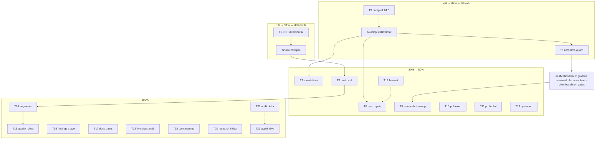

<!-- Pareto execution plan 2026-10-24 19:32 — Status: EXECUTED through the 4% tier
     (2026-10-25; the 20% tier landed piecemeal across the 05-49/06-51/08-08/08-53
     sessions — execution reports under docs/status/, archived set in
     docs/status/archived/README.md). -->

# SUPERB plan — data truth, UI debt, and the full backlog (2026-10-24 19:32)

**Driver:** the templ-components deep-dive (docs/research/2026-10-24_*, 91/100) plus
the morning dedup session — but the plan covers ALL open TODOs (TODO_LIST.md verified
2026-10-23 + this week's session findings), Pareto-ranked. Execution graph at the
bottom (mermaid). Non-negotiable guard: **no verschlimmbessern** — the goldens
ritual, browser lane, art-dupl zero-group gate, no-local-replace rule, and the
auto-daemon contract all hold inside this plan.

## Errata / corrections (Step 0 findings)

- The morning status report (docs/status/2026-10-24_18-59) and docs/art-dupl-baseline.md
  accept the clockDuration/compactDuration signature pair as intentional — **superseded**
  by deep-dive finding F1 (utils/format ships both at the pin). Annotation is task T7.
- TODO_LIST's upstream-watch line is still accurate but incomplete: today's audit adds
  #52/#59/#60/#61/#63 (all OPEN) to the watch set — harvested by T12.
- No other stale rows found: all 13 unblocked TODO_LIST rows re-verified open.

## Pareto tiers (what delivers what)

| Tier          | Delivers                                                                                                                                                                                                                                            | Tasks      |
| ------------- | --------------------------------------------------------------------------------------------------------------------------------------------------------------------------------------------------------------------------------------------------- | ---------- |
| **1% → 51%**  | The analytics stop lying: CDR direction is derived wrong today (live example 4084757593 labeled outbound), and AI calls double-count in list + dashboard. Every insight downstream of these is wrong; fixing them is most of the product's _truth_. | T1, T2     |
| **4% → 64%**  | UI truth + proven wins from today's audit: v1.24.0 bump (ARIA fixes for two rendered components), utils/format adoption (deletes ~40 lines, kills the two-dialect split brain), ops zero-time guard ("never" instead of Jan 1 0001).                | T3, T4, T5 |
| **20% → 80%** | + operator value (cost card), gate/tool integrity, docs truth, upstream engagement.                                                                                                                                                                 | T6–T13     |
| **→ 100%**    | The remaining product slices, hygiene, deep-dives — plus the owner-gated blocked rows and event-driven watches (tables below; planned but not scheduled).                                                                                           | T14–T22    |

## Comprehensive plan (30–100 min tasks, sorted by importance/impact/effort/customer-value)

| #   | Tier | Task                                                                                                                                                                                 | Est    | Why it matters (value)                                            | Effort |
| --- | ---- | ------------------------------------------------------------------------------------------------------------------------------------------------------------------------------------ | ------ | ----------------------------------------------------------------- | ------ |
| T1  | 1%   | CDR direction derivation: fix `cdr.direction()` (context-only) so transfer-into-default inbound calls stop indexing OUTBOUND; sibling `mod_cdr_csv` template or documented heuristic | 90min  | Wrong direction corrupts every number the platform shows          | M      |
| T2  | 1%   | Representative-row collapse: one AI call = CDR + transcript rows today; dedupe in list + dashboard counts, pin with tests, decide export semantics                                   | 90min  | Volumes/segments double-count today                               | M      |
| T3  | 4%   | templ-components bump v1.23.0→v1.24.0 via the 6-step watchlist                                                                                                                       | 60min  | ARIA fixes for Heatmap + CopyButton (both rendered); pin parity   | M      |
| T4  | 4%   | Adopt utils/format wholesale; delete clockDuration/compactDuration/stringOrDash/percent; keep mosGaugePercent; goldens + browser lane                                                | 60min  | Kills the split brain ("1m" vs "1m00s"), NaN hardening, −40 lines | M      |
| T5  | 4%   | Ops "Last pass" zero-time guard → "never" (#52)                                                                                                                                      | 30min  | Removes date-noise in a reachable state                           | S      |
| T6  | 20%  | Repair adoption map: re-table 12 orphaned rows, split format row adopted/remaining                                                                                                   | 30min  | The bump ritual reads this map; it currently renders broken       | S      |
| T7  | 20%  | Annotate superseded dedup verdict (baseline doc + 18-59 report)                                                                                                                      | 30min  | Two docs currently contradict the audit                           | S      |
| T8  | 20%  | Full 41-PNG screenshot sweep + golden diff (post shared-bootstrap refactor)                                                                                                          | 60min  | Doctrine: full sweep after shared-bootstrap edits                 | M      |
| T9  | 20%  | Cost analytics slice (north-star 1): cost card + spend trend + cost/min                                                                                                              | 100min | First real operator-facing insight; data already ingested         | M      |
| T10 | 20%  | Poll-exec wrapper: load poll execs the strict-window gate                                                                                                                            | 60min  | Gate integrity: START LOAD receipt = verified load                | M      |
| T11 | 20%  | Lint probe scripts (oxlint no-undef/unused) + fix findings                                                                                                                           | 30min  | Prevents the `bin is not defined` bug class                       | S      |
| T12 | 20%  | HARVEST: upsert TODO_LIST from both 2026-10-24 status reports + annotate them                                                                                                        | 30min  | Today's findings must not be entombed in snapshots                | S      |
| T13 | 20%  | Upstream: comment #52 with the ops use case; verify #54/#61 immunity at call sites                                                                                                   | 30min  | Cheap upstream leverage; closes inferred claims                   | S      |
| T14 | rest | Segmented analytics slice (north-star 2): top DIDs/counterparts + drill-through                                                                                                      | 100min | "Who calls what" — most-asked operator question                   | M      |
| T15 | rest | Quality rollup slice (north-star 3): hangup causes, no-user-turn, self-dial rates                                                                                                    | 100min | Forensic findings become standing metrics                         | M      |
| T16 | rest | Detect-only findings triage: art-dupl 107 / branching 100 / file-size 12 / cqrs 20                                                                                                   | 90min  | Stops the warning lane drifting                                   | M      |
| T17 | rest | Docs drift gates: check-docs-counts.sh + check-doc-links.sh wired into verify                                                                                                        | 60min  | Counts/links stop rotting silently                                | M      |
| T18 | rest | Audit the five living docs (followons, process-prep, did-direction, backup-rotation, telnyx-live-api)                                                                                | 90min  | Cited docs verified or archived                                   | M      |
| T19 | rest | Name the 9 "tools unavailable" buildflow warnings (verbose pull + dispositions)                                                                                                      | 30min  | Warning with no named cause = ignored warning                     | S      |
| T20 | rest | docs/research/README.md index (3 reports) + CHANGELOG policy for docs-only sessions                                                                                                  | 30min  | Next audit's Phase 0 depends on it                                | S      |
| T21 | rest | Re-run templ audit delta after T3+T4 (expect 91→~94)                                                                                                                                 | 30min  | Proves the actions moved the score                                | S      |
| T22 | rest | Deep-dive go-appkit (unaudited third of the UI trio; appkit#26 fold-in ready)                                                                                                        | 90min  | Completes the dependency-truth picture                            | M      |

**Blocked (owner-gated — planned, not scheduled):** catalog infra push (needs push path),
one-time read-model rebuild (needs prod deploy), ContentHash v2 prod re-ingest
(60min, needs prod deploy). Each unblocks the moment its gate opens.
**Event-driven watches (not scheduled):** #48/#49/#51 folds, #59/#60/#63 tracking,
Telnyx re-verify window 2027-01, E003 triggers, retention/auth/stream invariants,
PII enforcement, webphone deep link, SUPERB progress review.

## Micro plan (≤12 min each — the full fine breakdown)

| Task | Micro-steps (each ≤12min)                                                                                                                                                                                                                                                                                                                   |
| ---- | ------------------------------------------------------------------------------------------------------------------------------------------------------------------------------------------------------------------------------------------------------------------------------------------------------------------------------------------- |
| T1   | 1.1 evidence pass (cdr.go:245 + sibling template + live example) · 1.2 decision note: heuristic vs custom template (frame owner input) · 1.3 implement derivation · 1.4 transfer/default + internal-ext cases · 1.5 table tests (in/out/transfer/unknown) · 1.6 re-ingest smoke on the live example, verify flip                            |
| T2   | 2.1 decide representative rule + layer · 2.2 representative key in read model · 2.3 collapse in ListCalls · 2.4 collapse in DashboardStats · 2.5 tests: dual-source renders once, counts once · 2.6 export-semantics decision, documented · 2.7 goldens + probes                                                                            |
| T3   | 3.1 gen-tc-classes corpus regen · 3.2 CSS rebuild via update-styles · 3.3 map re-audit vs v1.24.0 · 3.4 hand-rolled re-check · 3.5 filings re-read (#48–#52,#59–#63) · 3.6 go.mod bump + tidy + update-vendor-hash (clean tree) · 3.7 goldens -update + review · 3.8 art-dupl baseline refresh if clone set shifted · 3.9 full tests + lint |
| T4   | 4.1 import format pkg · 4.2 swap ClockDuration · 4.3 swap CompactDuration · 4.4 swap StringOrDash · 4.5 swap Percent, keep mosGaugePercent · 4.6 delete locals + templ generate · 4.7 goldens -update + review copy diff · 4.8 browser lane + pixel baseline                                                                                |
| T5   | 5.1 IsZero branch → "never" · 5.2 test never-ran state · 5.3 ops goldens                                                                                                                                                                                                                                                                    |
| T6   | 6.1 re-table 12 orphaned rows · 6.2 split format row, re-date                                                                                                                                                                                                                                                                               |
| T7   | 7.1 baseline doc annotation · 7.2 18-59 report appendix note                                                                                                                                                                                                                                                                                |
| T8   | 8.1 run sweep · 8.2 triage + record verdict                                                                                                                                                                                                                                                                                                 |
| T9   | 9.1 aggregate design on DashboardStats · 9.2 window sum of CostMicros · 9.3 cost/min + zero-guard · 9.4 card UI + trend · 9.5 tests + goldens                                                                                                                                                                                               |
| T10  | 10.1 read poll contract, design exec handoff · 10.2 implement · 10.3 verify receipt = verified load                                                                                                                                                                                                                                         |
| T11  | 11.1 add oxlint to toolchain for scripts · 11.2 fix findings                                                                                                                                                                                                                                                                                |
| T12  | 12.1 upsert TODO_LIST rows · 12.2 annotate both reports harvested                                                                                                                                                                                                                                                                           |
| T13  | 13.1 comment #52 · 13.2 verify #54/#61 at call sites, record                                                                                                                                                                                                                                                                                |
| T14  | 14.1 query design (group by DID/counterpart) · 14.2 aggregation impl · 14.3 table UI + drill-through hrefs · 14.4 tests · 14.5 goldens                                                                                                                                                                                                      |
| T15  | 15.1 signal taxonomy from DOMAIN_LANGUAGE §Transcript truth · 15.2 rollup query · 15.3 card UI · 15.4 tests + goldens                                                                                                                                                                                                                       |
| T16  | 16.1 art-dupl 107 review vs baseline doctrine · 16.2 branching/file-size dispositions · 16.3 cqrs-lint 20 vs policy                                                                                                                                                                                                                         |
| T17  | 17.1 check-docs-counts.sh + red/green proof · 17.2 check-doc-links.sh · 17.3 wire into verify-all                                                                                                                                                                                                                                           |
| T18  | 18.1 followons + process-prep · 18.2 did-direction + backup-rotation · 18.3 telnyx-live-api claims                                                                                                                                                                                                                                          |
| T19  | 19.1 verbose pull, name causes · 19.2 write dispositions into gate doc                                                                                                                                                                                                                                                                      |
| T20  | 20.1 README index with 3 rows · 20.2 CHANGELOG policy line                                                                                                                                                                                                                                                                                  |
| T21  | 21.1 re-run census + score · 21.2 delta note in the audit report appendix                                                                                                                                                                                                                                                                   |
| T22  | 22.1 scope + capability inventory · 22.2 usage census · 22.3 gap analysis · 22.4 score + findings · 22.5 report                                                                                                                                                                                                                             |

## Execution graph

Order rationale: the bump precedes format adoption so goldens churn once per batch;
T6/T7 (docs) ride the same UI batch they describe; T8 verifies everything visual in
one sweep; product slices build on data truth (T1→T2→T9→T14→T15).

## Verification doctrine

- Every UI-touching task ends inside a verification batch: goldens reviewed (never
  blind `-update`), `bash scripts/verify-all.sh`, pixel baseline refresh when the
  dashboard's pixels move, art-dupl gate green.
- Every code task ends with `GOEXPERIMENT=jsonv2 go test ./...` + scoped lint;
  the session closes with `buildflow --build-mode dev`.
- Docs tasks end with the link/count conventions they enforce.
