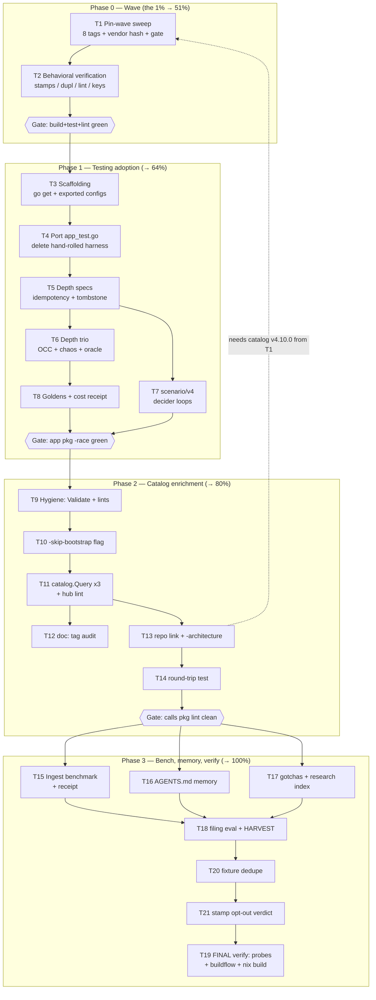

<!-- Pareto execution plan 2026-10-25 04:11 CEST — input: docs/status/2026-10-24_18-30_gocqrs-lite-module-audit-session.md
     Status: PLANNED (not started). Operator decisions recorded in the status report §g. -->

# SUPERB Plan — go-cqrs-lite pin wave, systemscenario adoption, catalog enrichment

**Generated:** 2026-10-25 04:11 CEST
**Input:** the 2026-10-24 library deep dive (`docs/research/2026-10-24_go-cqrs-lite-catalog-testing-modules-deep-dive.html`, commit `aa422ea`) and its 50-item follow-up list (status report §f), plus the operator's three same-day decisions (status report §g).
**North star alignment:** the superb call-insights platform — this plan closes the testing-depth gap (the audit's one structural finding) and feeds the federation hub a complete catalog, without touching any write path.

## 1. Context and constraints

**Where we stand.** The audit scored go-cqrs-lite module adoption at 58/100 (moderate): the catalog core is fleet-reference quality, but the testing modules are unused (`internal/app/app_test.go` hand-rolls systemscenario's exact job), eight modules are one release wave behind (the 2026-10-24 "disk-truth tail wave"), and the metaengine pin (v4.19.0) lacks the layout-stamp drift WARN that v4.20.0 turns on by default — so a silent `call_views` column-type drift is a live exposure today.

**Operator decisions (2026-10-24, status report §g):**

1. systemscenario/v4 + scenario/v4 **approved as test-only imports** (policy gate cleared).
2. **Declare the read surface** via `catalog.Query` in the federation catalog.
3. **Bump the pins now** — the one-wave lag was not a deliberate settle policy.

**Guardrails — how we avoid Verschlimmbessern (each is a verified repo law, not a preference):**

- ADR-0123: `app.New` / `system.New` stays the only composition root. Never hand-wire event/command/decider/storage in new code — including tests. systemscenario exists precisely so we don't.
- `calls.RecordKey` = bare `StreamID.Get()`. The 2026-10-17/23 upstream waves made keys bare with sticky legacy resolution; after the bump, re-verify lookups (task T2) instead of "fixing" anything pre-emptively.
- `vendorHash.nix`: repair ONLY via `nix run .#update-vendor-hash` on a CLEAN tree, never by hand-pasting hashes.
- styles.css changes only through `nix run .#update-styles` (not planned here, but the rule stands if a golden shifts).
- The serve middleware chain (auth → SecurityHeaders → Server-Timing → Compression → ETag) is doctrine (docs/http-stack.md) — no task in this plan touches it.
- No writes to source systems ever; the index DB stays disposable. Every T2/T19 verification runs against temp DBs or the verify probes.
- Every phase ends at a green gate: `GOEXPERIMENT=jsonv2 go build ./... && go test ./...`, then `buildflow --build-mode dev`, then `nix develop -c cqrs-lint .` where listed.
- Commit receipts per repo law: `git add … && git commit …` in ONE call; amend only unpushed.

**Sequencing logic.** The wave (T1-T2) comes first because finding F7 (architecture exporter) is _impossible_ on catalog v4.9.0 and the drift WARN (F2's payoff) is _invisible_ on metaengine v4.19.0. Testing adoption (T3-T8) is next: it is the audit's top-impact finding and now unblocked. Catalog enrichment (T9-T14) follows, then docs/benchmarks (T15-T21). Item #37 (templ-components adoption-map re-read) was checked: the wave does not touch templ-components, so it is a conditional no-op — dropped with errata. Item #47 (Server-Timing for exports) was never audited this session — deferred to ROADMAP, not planned blind.

## 2. Pareto breakdown

| Tier          | Share of list | Delivers                                                                                                                                                                                                                                                                       | Tasks               |
| ------------- | ------------- | ------------------------------------------------------------------------------------------------------------------------------------------------------------------------------------------------------------------------------------------------------------------------------ | ------------------- |
| **1% → 51%**  | T1 (+T2)      | The wave sweep alone: unlocks the architecture exporter, switches ON schema-drift WARNs for `call_views`, lands the sticky-stream-key + typed-decoder fixes, and re-anchors every later task on current pins. Highest ease×impact on the board; two live exposures close here. | T1, T2              |
| **4% → 64%**  | T1-T5         | + the systemscenario adoption core: production-shared domain fixtures, the hand-rolled harness deleted, idempotent-reingest and tombstone specs — the audit's top finding (F1) closed at the behavior level.                                                                   | T3, T4, T5          |
| **20% → 80%** | T1-T10        | + OCC/chaos/property-oracle depth, scenario/v4 decider loops, payload goldens, the test-hygiene batch (Validate swap + both lint fixes), and the `-skip-bootstrap` fleet-norm flag.                                                                                            | T6, T7, T8, T9, T10 |
| **→ 100%**    | T11-T21       | + hub query declarations, doc tags, hub-card enrichment, architecture export, catalog round-trip test, ingest benchmark, all memory/doc writes, upstream filing eval, fixture dedupe, final full verify.                                                                       | T11 through T21     |

## 3. Comprehensive plan — 21 tasks, 30-100 min each (ALL 50 items mapped)

Sort: importance/impact first, effort as tiebreak. `Src` = item numbers in status report §f (proof of full coverage).

| ID  | Task                                                                                                                                                                                                                                                                | Src               | Impact   | Effort | Phase |
| --- | ------------------------------------------------------------------------------------------------------------------------------------------------------------------------------------------------------------------------------------------------------------------- | ----------------- | -------- | ------ | ----- |
| T1  | Ride the 2026-10-24 pin wave: `go get` the 8 tags (catalog v4.10.0, system v4.15.4, metaengine v4.20.0, sqliteengine v4.6.0, event v4.15.2, id v4.7.3, schema v4.7.1, projectionadapter v4.6.2), `nix run .#update-vendor-hash` on clean tree, build+test+lint gate | 1,2,3             | Critical | 60-90m | 0     |
| T2  | Post-wave behavioral verification: boot real DSN (layout-stamp quiet), `art-dupl --show-suppressed`, `cqrs-lint` (E003/E005/C044), `RecordKey` lookups vs new adapter, no `stack/*`/v1-tier imports, refresh `BenchmarkConcurrentPoll` receipt                      | 4,5,7,44,45,6,49  | High     | 60m    | 0     |
| T3  | Testing scaffolding: `go get systemscenario/v4 scenario/v4` (test-only), lift DomainConfig/DeploymentConfig literals out of `app.New` into exported helpers, prove both binaries and tests compile                                                                  | 8,9               | High     | 45m    | 1     |
| T4  | Port app_test.go onto the harness: `systemscenario.System` + `SQLite(t)`, delete `startProjections`/`awaitView`/manual reboot, keep replay-leg semantics                                                                                                            | 10                | High     | 60m    | 1     |
| T5  | Headline depth specs: idempotent re-ingest (`ThenNoEvents`) and retire-tombstone (`Then` + `ThenQueryEventuallyFails`)                                                                                                                                              | 11,12             | High     | 60m    | 1     |
| T6  | Depth trio: OCC spec (`ThenErrorFamily` + `event.ErrVersionConflict`), `DelayedDriver` chaos over sqlite journal, property oracle (read-model row == pure fold)                                                                                                     | 13,24,23          | Medium   | 90m    | 1     |
| T7  | scenario/v4 decider loops: corrected/supersede matrix in `Given[RecordCallCmd, CallState]` style, vacuous guard on                                                                                                                                                  | 22                | Medium   | 60m    | 1     |
| T8  | Golden payload-hash spec (`TrailWithPayloads`) + suite-cost receipt (ms/scenario) into the report appendix                                                                                                                                                          | 25,40             | Low      | 45m    | 1     |
| T9  | Test hygiene batch: `cat.Validate()` swap (del 113-119), `lars` const, split `testService` under gocognit 25, re-check catalog test shape post-swap, decide `-plain`×bootstrap question                                                                             | 14,15,16,42,43    | Medium   | 60m    | 2     |
| T10 | CLI: `-skip-bootstrap` on `catalogCmd`, threading `eventcatalog.WithSkipBootstrapFiles()` through `RenderCatalog`, flag help text                                                                                                                                   | 17                | Medium   | 30m    | 2     |
| T11 | `catalog.Query` declarations for call.search/dashboard/detail (id parity with queries.go/lookup names), re-export `-plain` tree, hub lint verify                                                                                                                    | 18,39             | Medium   | 60m    | 2     |
| T12 | Domain-struct doc-tag audit: walk Observation/Enrichment/events for `doc:`/`format:` coverage, add where EventCatalog pages should describe fields                                                                                                                  | 20                | Medium   | 45m    | 2     |
| T13 | Hub-card enrichment + reference export: `ServiceRepository`, then (on v4.10.0) `-architecture` switch writing self-contained HTML via `architecture.NewExporter`                                                                                                    | 19,21             | Low      | 45m    | 2     |
| T14 | Catalog round-trip test: export → LoadExport/frontmatter re-import asserts, so exporter regressions surface in pbx-lens CI                                                                                                                                          | 41                | Medium   | 60m    | 2     |
| T15 | Ingest throughput benchmark: `go test -bench` cdr.Parse → Record dispatch on memory engine; record ns/row + allocs beside the poll receipts in docs/http-stack.md                                                                                                   | 26,27             | Medium   | 60m    | 3     |
| T16 | Memory writes: AGENTS.md (new pins, dependency-policy decision, hub bootstrap norm, bench routing rule, upstream deletions watchlist, v5 rename watch)                                                                                                              | 29,30,31,34,35,46 | Medium   | 45m    | 3     |
| T17 | Docs: gotchas entries (versions.json vs git tags; catalog/architecture ≥ v4.10.0) + create docs/research/README.md index                                                                                                                                            | 32,33,36          | Low      | 30m    | 3     |
| T18 | Upstream filing eval (versions.json staleness, verify-before-filing first) + HARVEST this plan into TODO_LIST.md/ROADMAP.md                                                                                                                                         | 38,28             | Medium   | 45m    | 3     |
| T19 | Final full verify: `scripts/verify-all.sh`, telnyx-live-api quarterly tick note if due, CHANGELOG entry for the wave                                                                                                                                                | 6,50              | High     | 45m    | 3     |
| T20 | Fixture dedupe: unify view-building setup across cli ingest/enrich/refresh tests post-port (art-dupl clean)                                                                                                                                                         | 48                | Low      | 45m    | 3     |
| T21 | Stamp opt-out decision: only if T2 surfaced a legitimate drift WARN needing a transition window (`WithLayoutStampsDisabled`), else record "not needed"                                                                                                              | 49                | Low      | 30m    | 3     |

Deferred (not planned blind): #37 (conditional no-op — wave doesn't touch templ-components), #47 (Server-Timing for exports — never audited; ROADMAP fuel). Coverage proof: 48 planned + 2 deferred = all 50.

## 4. Fine breakdown — every task at ≤12 minutes (97 micro-tasks)

Execution order = importance order. `T→` maps to the medium task above.

| ID  | Micro-task                                                                                                                                                                       | T→  | Min |
| --- | -------------------------------------------------------------------------------------------------------------------------------------------------------------------------------- | --- | --- |
| M01 | `git status` clean check; record starting go.mod pins for the receipt                                                                                                            | T1  | 5   |
| M02 | `go get` catalog/v4@v4.10.0 system/v4@v4.15.4 metaengine/v4@v4.20.0 sqliteengine/v4@v4.6.0 event/v4@v4.15.2 id/v4@v4.7.3 schema/v4@v4.7.1 metaengine/projectionadapter/v4@v4.6.2 | T1  | 10  |
| M03 | `GOEXPERIMENT=jsonv2 go build ./...` — fix any compile fallout (expect none; all non-breaking)                                                                                   | T1  | 12  |
| M04 | `GOEXPERIMENT=jsonv2 go test ./...` — triage failures, if any, against wave changelog before touching code                                                                       | T1  | 12  |
| M05 | Clean-tree check (`git status` empty) → `nix run .#update-vendor-hash`                                                                                                           | T1  | 10  |
| M06 | `nix build` green; `golangci-lint run ./...` green                                                                                                                               | T1  | 12  |
| M07 | Commit T1 with receipt message (old→new pins in body)                                                                                                                            | T1  | 5   |
| M08 | Boot serve against a COPY of a real DSN in /tmp; confirm NO layout-stamp WARN in logs; record verdict                                                                            | T2  | 10  |
| M09 | Intentionally prove the WARN fires: temp layout-plan type drift on a scratch collection in a temp DB, then revert                                                                | T2  | 12  |
| M10 | `art-dupl check -t 4 --min-lines 2 --show-suppressed .` vs baseline; adjudicate any new suppressed bucket                                                                        | T2  | 12  |
| M11 | `nix develop -c cqrs-lint .` — diff findings vs pre-wave; expect E003 repositioning, E005 registration capture; C044 must be silent                                              | T2  | 10  |
| M12 | Grep-verify zero `stack/` and v1-tier imports; confirm `calls.RecordKey` path untouched                                                                                          | T2  | 5   |
| M13 | Re-run `BenchmarkConcurrentPoll -benchmem`; compare vs docs/http-stack.md ≈82µs/304 ≈101µs/200; update receipt if drifted                                                        | T2  | 12  |
| M14 | Commit T2 verification receipt                                                                                                                                                   | T2  | 5   |
| M15 | `go get go-cqrs-lite/systemscenario/v4@latest go-cqrs-lite/scenario/v4@latest` (test deps)                                                                                       | T3  | 5   |
| M16 | Extract `app.DomainConfig()` returning the `system.DomainConfig` literal; `app.New` refactored to call it; both callers compile                                                  | T3  | 12  |
| M17 | Extract `app.DeploymentConfig(dsn)` the same way; `app.New(ctx, dsn)` = thin join of the two                                                                                     | T3  | 12  |
| M18 | `go vet ./internal/app/...` + package tests green                                                                                                                                | T3  | 5   |
| M19 | Commit T3                                                                                                                                                                        | T3  | 5   |
| M20 | Rewrite `TestSqliteEndToEndAndReplay` as scenario: `systemscenario.System(t, ctx, app.DomainConfig(), systemscenario.SQLite(t))`                                                 | T4  | 12  |
| M21 | Replace dispatch+awaitView with `Given().Command(...)` + `ThenQuery(viewQuery…)`; delete `awaitView`                                                                             | T4  | 12  |
| M22 | Replace `startProjections` with harness-owned lifecycle; delete the helper                                                                                                       | T4  | 10  |
| M23 | Replay leg: fresh `System` on same DSN asserts identical view (harness reopen semantics); delete manual reboot block                                                             | T4  | 12  |
| M24 | Full package test run; confirm the 20ms-poll flake class is gone (run -count=3)                                                                                                  | T4  | 10  |
| M25 | Commit T4                                                                                                                                                                        | T4  | 5   |
| M26 | Spec: idempotent re-ingest — Given record → When same snapshot → `ThenNoEvents()`                                                                                                | T5  | 10  |
| M27 | Spec: retire — record → retire("retention:age") → `Then("call.retired")`                                                                                                         | T5  | 10  |
| M28 | Add `ThenQueryEventuallyFails` for the vanished view row                                                                                                                         | T5  | 10  |
| M29 | `go test ./internal/app/ -count=1` green; commit T5                                                                                                                              | T5  | 8   |
| M30 | OCC spec: out-of-band writer takes the version slot → `ThenErrorFamily(Conflict)` + `errors.Is(event.ErrVersionConflict)` asserts                                                | T6  | 12  |
| M31 | Wire `systemscenario.DelayedDriver(t, "sqlite", 2ms)` variant deployment; concurrent-save race stays serialized                                                                  | T6  | 12  |
| M32 | Property oracle: random record/correct/retire sequence via rapid; projected row == pure fold                                                                                     | T6  | 12  |
| M33 | Property oracle part 2: journal ordering pin under adversarial dispatch                                                                                                          | T6  | 12  |
| M34 | Full suite + `-race` on the app package                                                                                                                                          | T6  | 10  |
| M35 | Commit T6                                                                                                                                                                        | T6  | 5   |
| M36 | scenario/v4: `Given[EnrichCallCmd, CallState]` loops for enrich-already-enriched / enrich-after-retire rejections                                                                | T7  | 12  |
| M37 | scenario/v4: corrected/supersede matrix (observed → corrected with enrichment riding along)                                                                                      | T7  | 12  |
| M38 | scenario/v4: retire-idempotence + unknown-source-kind rejection loops                                                                                                            | T7  | 10  |
| M39 | Delete now-redundant hand-rolled decide cases from commands_test/domain_test (keep pure-function asserts)                                                                        | T7  | 10  |
| M40 | Suite green; commit T7                                                                                                                                                           | T7  | 8   |
| M41 | Golden: `ThenGoldenWithPayloads` for a record scenario (stream-ID masking on)                                                                                                    | T8  | 12  |
| M42 | Measure suite cost: `-bench BenchmarkScenarioBoot` equivalent or wall-time delta; append receipt to deep-dive appendix errata                                                    | T8  | 10  |
| M43 | Commit T8                                                                                                                                                                        | T8  | 5   |
| M44 | Swap catalog_test.go:113-119 for `if v := cat.Validate(); len(v) > 0 { t.Fatalf… }`                                                                                              | T9  | 10  |
| M45 | Hoist `ownerOfRecord = "lars"` const; replace 6 literals in catalog.go                                                                                                           | T9  | 5   |
| M46 | Split `testService` into `testServiceMessages` + `testServiceEdges` (gocognit < 25)                                                                                              | T9  | 12  |
| M47 | Decide: should `-plain` lint exports also skip bootstrap? (options doc: lint tree doesn't build) — record answer in T10 impl                                                     | T9  | 5   |
| M48 | `golangci-lint run ./internal/calls/...` clean; commit T9                                                                                                                        | T9  | 8   |
| M49 | Add `-skip-bootstrap` flag to `catalogCmd` (default: true for hub exports per M47 decision); thread option into `RenderCatalog`                                                  | T10 | 12  |
| M50 | Update flag help + AGENTS.md CLI mention; export tree diff shows config/package.json absent with flag on                                                                         | T10 | 10  |
| M51 | Commit T10                                                                                                                                                                       | T10 | 5   |
| M52 | Pick canonical query ids: match names in internal/web/queries.go + calls.LookupView (`call.search`, `call.dashboard`, `call.detail`)                                             | T11 | 10  |
| M53 | Declare `catalog.Query[T]` messages with MessageID/summary in BuildCatalog                                                                                                       | T11 | 12  |
| M54 | Regenerate `-plain` tree; hub lint gate passes with queries present                                                                                                              | T11 | 12  |
| M55 | Extend catalog_test: 3 queries declared, directions Receives, ids unique                                                                                                         | T11 | 10  |
| M56 | Commit T11                                                                                                                                                                       | T11 | 5   |
| M57 | Grep audit: which Observation/Enrichment/event fields lack `doc:` tags; list gaps                                                                                                | T12 | 10  |
| M58 | Add `doc:` tags to the gaps (user-facing fields first: cost, insight, transcript)                                                                                                | T12 | 12  |
| M59 | Re-export; spot-check EventCatalog message pages render descriptions                                                                                                             | T12 | 10  |
| M60 | Commit T12                                                                                                                                                                       | T12 | 5   |
| M61 | Add `catalog.ServiceRepository("go", repo URL)` to ConfigureService                                                                                                              | T13 | 5   |
| M62 | Add `-architecture` switch: `architecture.NewExporter(WithTitle("PBX-Lens")).ExportFile(cat, out/architecture.html)`                                                             | T13 | 12  |
| M63 | Verify the HTML opens standalone (grep for inlined assets; open in browser probe via Go http)                                                                                    | T13 | 10  |
| M64 | Commit T13                                                                                                                                                                       | T13 | 5   |
| M65 | Write round-trip test: `eventcatalog.NewExporter(tmp).Export(cat)` → re-read frontmatter via LoadExport path; ids/refs resolve                                                   | T14 | 12  |
| M66 | Negative: corrupt a ref → test fails loudly (mutation check)                                                                                                                     | T14 | 10  |
| M67 | Wire into `go test ./internal/calls/` (fast, no network); commit T14                                                                                                             | T14 | 10  |
| M68 | Benchmark skeleton: `BenchmarkIngestCDR` over the fixture CDR corpus → Record dispatch, memory engine                                                                            | T15 | 12  |
| M69 | Add allocs/row report; run -benchmem -count=5, record median                                                                                                                     | T15 | 12  |
| M70 | Append receipt row to docs/http-stack.md bench inventory                                                                                                                         | T15 | 10  |
| M71 | Commit T15                                                                                                                                                                       | T15 | 5   |
| M72 | AGENTS.md: update pins line + wave date                                                                                                                                          | T16 | 5   |
| M73 | AGENTS.md: dependency-policy decision (test-only systemscenario/scenario approved)                                                                                               | T16 | 5   |
| M74 | AGENTS.md: hub bootstrap norm + bench routing rule                                                                                                                               | T16 | 10  |
| M75 | AGENTS.md: upstream deletions watchlist (transport/http, idempotency/kvstore) + v5 rename watch                                                                                  | T16 | 10  |
| M76 | Commit T16 (docs-only)                                                                                                                                                           | T16 | 5   |
| M77 | gotchas: "versions.json lies — verify with git tags" entry                                                                                                                       | T17 | 10  |
| M78 | gotchas: "catalog/architecture ships ≥ v4.10.0" entry                                                                                                                            | T17 | 5   |
| M79 | Create docs/research/README.md index with both report rows                                                                                                                       | T17 | 10  |
| M80 | Commit T17                                                                                                                                                                       | T17 | 5   |
| M81 | Verify-before-filing pass on the versions.json staleness claim (repro steps, latest tag cross-check)                                                                             | T18 | 12  |
| M82 | Draft + file the upstream filing (github-voice); record in docs/upstream-filings.md                                                                                              | T18 | 12  |
| M83 | HARVEST: move tier table + remaining tasks into TODO_LIST.md rows; ROADMAP fuel for deferred items                                                                               | T18 | 12  |
| M84 | Commit T18                                                                                                                                                                       | T18 | 5   |
| M85 | `bash scripts/verify-all.sh` — four probe suites, first-red-wins                                                                                                                 | T19 | 12  |
| M86 | Screenshot probe: `node scripts/screenshot-probe.js --only dashboard` sanity (footer stamp absorbed)                                                                             | T19 | 10  |
| M87 | telnyx-live-api.md: check quarterly tick date; add note if due                                                                                                                   | T19 | 5   |
| M88 | CHANGELOG.md entry: wave bump + testing adoption + catalog enrichment                                                                                                            | T19 | 10  |
| M89 | Commit T19                                                                                                                                                                       | T19 | 5   |
| M90 | Extract shared view-builder helper from cli ingest/enrich/refresh tests                                                                                                          | T20 | 12  |
| M91 | Re-run `art-dupl check` — no new groups; commit T20                                                                                                                              | T20 | 10  |
| M92 | T21 verdict: layout-stamp opt-out needed? Record "not needed" unless M08/M09 say otherwise                                                                                       | T21 | 5   |
| M93 | Final: `GOEXPERIMENT=jsonv2 go build ./... && go test ./...`                                                                                                                     | T19 | 12  |
| M94 | Final: `buildflow --build-mode dev` (the quality gate)                                                                                                                           | T19 | 12  |
| M95 | Final: `nix build` + `nix run . -- version`                                                                                                                                      | T19 | 10  |
| M96 | Final: `nix develop -c cqrs-lint .` zero unexplained findings                                                                                                                    | T19 | 10  |
| M97 | Final commit: push, verify CI lane kicks off                                                                                                                                     | —   | 10  |

Total micro-effort ≈ 14-15 h across 97 steps; every step independently verifiable.

## 5. Execution graph

Parallelization: T6 ∥ T7 (both post-T5); T15 ∥ T16 ∥ T17 (all post-G2); T20/T21 are leaf cleanup. T13 hard-depends on T1 (architecture exporter ships in v4.10.0).

## 6. Verification contract

- **Per task:** the owning package's tests + targeted lint must pass before its commit (M-steps embed the commands).
- **Per phase:** G0/G1/G2 gate nodes above; G0 additionally re-runs `cqrs-lint` and the art-dupl gate (zero-group policy).
- **Final:** M93-M97 — build, full tests, buildflow dev gate, `nix build`, probes, push.
- **Rollback rule:** any red at a gate stops the phase; fix-forward on the wave (no pin reverts without a recorded upstream issue), revert own code if the wave exposed a genuine pbx-lens bug.

## 7. Errata (corrections vs the input list)

- Item #37 dropped as conditional no-op: the 2026-10-24 wave touches no templ-components surface; the adoption-map watchlist re-read remains bound to the next templ-components bump (AGENTS.md order preserved).
- Item #47 deferred to ROADMAP unaudited: Server-Timing on the export stream was never studied this session; planning it blind would be the Verschlimmbesser the dispatch warns about.
- The status report's "HARVEST not run" note resolves via T18/M83 — deliberately after execution so TODO_LIST.md receives verdicts, not intentions.
- versions.json staleness (systemscenario v4.2.0 vs tag v4.2.1) re-verified 2026-10-25 before planning; filing candidate survives verify-before-filing at M81.
