<!-- docs/planning/2026-10-25_10-46_SUPERB-gate-truth-analytics-depth-and-backlog-closeout.md
     Pareto plan over the post-analytics backlog (TODO_LIST at 2026-10-25 10:46).
     Format: .md + mermaid (repo policy; the pareto-planning skill's HTML default
     is overridden by AGENTS.md and by explicit owner demand).
     Every row below was re-verified against code/CI/gh at plan time; the errata
     in §1 record what the TODO_LIST and the three live status reports had wrong,
     because a plan built on a stale backlog is just organized waste. -->

# SUPERB Plan — make the gates real, finish the analytics surface, close the backlog's lies

**Created:** 2026-10-25 10:46 CET · **Head:** `3a37ecb` (= `origin/main`, CI **green**,
nothing unpushed) · **Load at plan time:** 15-min ≈ 100 (the FULL-gate window is
closed today; see §6) · **Concurrent sessions:** active (shared tree, auto-commit
daemon). Local clone: **`core.hooksPath = .git/hooks`, i.e. the repo's own gates are
DORMANT here** (see errata 5 — this is the plan's first task).

**Input:** TODO_LIST.md (18 blocked + 4 unblocked rows, one broken table), the three
live 2026-10-25 status reports (05-49, 06-51, 07-25 — each carries a 50-item §f),
ROADMAP themes 0–4, FEATURES' PARTIALLY/PLANNED rows, and the executed plans.

**Product north star:** the most superb insights and analytics platform over this
PBX's call history (ROADMAP theme 0). The three first slices shipped 2026-10-25;
this plan finishes their honest edges, then buys its next capability with data the
index already holds (anomaly baselines), and pays down the backlog debt that makes
every later plan unreliable.

---

## 1. Step-0 verification — errata (read this first)

Eleven checks changed the plan. Six of them delete phantom work:

1. **`call.corrected.after_retired` and `call.enrich.after_retired` guards ALREADY
   exist** (`internal/calls/decider.go:101`, `:158`) with scenario specs
   (`internal/calls/scenario_test.go`). The 06-51 §f6 "decide: guard or declare the
   age gate the contract" is **DONE** — the retention-resurrection class is closed
   at the decide level. No task.
2. **go-appkit#26's fold-in is DONE** — `testkit.NewService` is adopted at all three
   stack-test sites (2026-10-25), `cmd/pbx-lens` 10.5 s → 0.81 s. TODO row 87 is a
   ledger note, not work.
3. **"Probe residue bundle" (TODO row 110) is DONE**: `assertFirstTryRevalidation`
   covers the static assets, `verify-all` parses `--baseline` before any probe, and
   the seeded-clone technique is recorded in `docs/art-dupl-baseline.md`.
4. **"prettier in the devShell" (TODO row 101) is DONE for this repo**: the devShell
   ships `prettier` + `oxlint`; `prettier-format` runs in 777 ms in-shell instead of
   the 2.3 s `nix run` fallback. The residue is fleet config (bare-`buildflow` PATH).
5. **The local gates are DORMANT in this clone.** `git config core.hooksPath` =
   `.git/hooks` and `.git/hooks/pre-commit` does not exist, so the AGENTS budget
   gate, the JS `no-undef` gate and both docs gates have never run on a commit here
   — while AGENTS.md states the hooksPath is SET. That memory is wrong in this
   clone; fixing it is the plan's 1% tier.
6. **TODO_LIST is structurally broken**: a blank line at row 86 splits the BLOCKED
   table, orphaning rows 87–88 into a second table, and four 🔴 `TODO` rows
   (re-measure benches, green receipt, versions.json, Server-Timing) sit inside the
   BLOCKED section. A backlog whose tables do not parse cannot be harvested.
7. **CI is green on HEAD** (`3a37ecb`, run list: success; `origin/main` == HEAD,
   zero unpushed commits). The 06-51 "main CI red" line is history, not state.
8. **`docs/catalog` does not exist** in the repo; `catalog -o docs/catalog` is a
   documented operator command, so "commit the exported tree" is a deploy choice,
   not a repo task.
9. **There is no `SubscribeSSE` usage in this repo** (htmx polling is the only
   transport), so 06-51 §f14 "SSE coverage" is not applicable — not a gap.
10. **The cqrs-lint `vendorHash` in `flake.nix` was stale** after a Go toolchain
    bump; the devShell was broken (`nix develop -c true` → hash mismatch) until
    2026-10-25, when it was re-derived in one atomic edit and proven. Any plan that
    says "run the gate" must first assume the devShell exists — it now does.
11. **Load is the binding constraint, not work.** 15-min average ≈ 100, 1-min ≈ 160
    (concurrent agent jobs on the box). Per `docs/buildflow-dev-gate.md` a FULL run
    needs 15-min < 40; three 2026-10-25 attempts starved. Gate receipts and bench
    numbers are therefore **calendar-gated**, and every step that needs them says so.

Also verified and kept as real work: the analytics cards' two PARTIALLY rows
(per-segment cost/min, cost coverage), the JSONL/CSV export staying per-source (a
deliberate choice, not a bug), and the ten upstream filings still OPEN (`gh`,
2026-10-24).

---

## 2. The Pareto answer

| Tier     | Share    | Cumulative  | What it is                                                                                                                                                                                                                                                                                                                                           | Why it carries the value                                                                                                                                                                                                                                                                                  |
| -------- | -------- | ----------- | ---------------------------------------------------------------------------------------------------------------------------------------------------------------------------------------------------------------------------------------------------------------------------------------------------------------------------------------------------- | --------------------------------------------------------------------------------------------------------------------------------------------------------------------------------------------------------------------------------------------------------------------------------------------------------- |
| **1%**   | 3 tasks  | **≈51%**    | **Make the guard rails real**: activate `.githooks` and correct the AGENTS claim; agree the concurrent-session norm; repair the backlog's own truth (broken table, orphan rows, three stale rows).                                                                                                                                                   | Every later gate, plan and harvest inherits these. A repo whose hooks are dormant and whose TODO table does not parse cannot enforce anything it promises — that is how a stale `vendorHash` and a 5 s drain delay survived a week of "green" claims. Correctness of the MAP comes before more territory. |
| **4%**   | 10 tasks | **≈64–80%** | Finish the analytics surface honestly (cost coverage, per-segment rates, quality trends, the detail-page counterpart join), buy the next capability with existing data (anomaly bands), and restore verification integrity (green receipt at a calm window, bench re-measure, two test-integrity guards, CI self-test gates, domain scenario depth). | The three shipped slices are 90% done and visibly so; the last 10% is where trust lives ("N of M priced", the trend arrow, the drill from a segment into its history). Anomaly bands are the only remaining question the index can answer TODAY with no new source.                                       |
| **20%**  | 11 tasks | **≈80–95%** | Saved views, transcript search depth, per-DID pages, ingest-coverage analytics, answer-rate analysis, testing depth batch 2, docs hygiene batch, `versions.json`, sibling-repo folds, lint/gate residue, analytics documentation.                                                                                                                    | Real value, each gated on either the prior tier, a calendar window, or an owner taste call; scheduling them is useful, executing them early is not.                                                                                                                                                       |
| **Rest** | §6       | **100%**    | Everything owner/calendar-gated: prod `refresh -apply`, read-model rebuild, host deploys + CSP, D1–D5, PII, coverage floor, pixel-baseline home, browser 304 check, MOS poller (2027-01), mobile cards, release cut, stamp-churn, filings, fold-ins, `>1 MiB`, dependabot confirm, BuildFlow#56, lint-policy intent.                                 | External gates. Each stays a TODO row; none is lost.                                                                                                                                                                                                                                                      |

**The 1% argument, stated plainly:** this week produced three red gates, one dormant
hook chain, one broken devShell and one stale backlog table — none of which was a
domain bug. The system's _feedback loop_ is the weak part, not its features. Three
small tasks restore the loop; everything else is easier afterwards.

---

## 3. Comprehensive plan (30–100 min per task, all backlog rows covered)

Sorted by tier, then impact, then effort. `Value` is operator value.

| #       | Tier | Task                                                                                                                                                                                                                                                            | Impact   | Effort | Value  | Gates on           | Evidence / row                                                                                        |
| ------- | ---- | --------------------------------------------------------------------------------------------------------------------------------------------------------------------------------------------------------------------------------------------------------------- | -------- | ------ | ------ | ------------------ | ----------------------------------------------------------------------------------------------------- |
| **P1**  | 1%   | **Activate the local gates + correct the memory**: `git config core.hooksPath .githooks`, prove all four hook checks fire on a seeded commit, fix AGENTS's "hooksPath SET" claim (and the stale devShell package list if the swap fits the budget)              | Critical | 30min  | Low    | —                  | errata 5; `.githooks/pre-commit`; `git config core.hooksPath`                                         |
| **P2**  | 1%   | **Concurrent-session norm**: a tracked `docs/concurrency.md` (or an AGENTS clause) stating the rules this week proved — claim files for shared files, no receipt from a tree another session is editing, daemon sweep expectations, "a flaky test is a finding" | Critical | 45min  | Low    | owner nod          | 06-51 §f13, 05-49 §f13; the week's three fake-red gates                                               |
| **P3**  | 1%   | **Backlog truth pass**: re-join the broken BLOCKED table, move the four 🔴 rows into Unblocked, delete the three stale rows (probe residue, go-appkit#26, prettier), add the missing evidence links, re-run the docs gate                                       | Critical | 45min  | Medium | —                  | errata 3/4/6; `scripts/check-docs-counts.sh`                                                          |
| **P4**  | 4%   | **Cost coverage + per-segment rates**: a "priced share" metric on the Spend card (`CostKnown/Total`) and cost-per-minute per segment row (the two FEATURES PARTIALLY rows)                                                                                      | High     | 75min  | High   | P3                 | FEATURES § Insights rows 3/5; `segments.go`                                                           |
| **P5**  | 4%   | **Quality trends + narrative**: week-over-week arrows on the quality card (reuse `WeekDelta`) and one sentence of volume narrative ("volume up 40% vs the prior week")                                                                                          | High     | 60min  | High   | P3                 | ROADMAP theme 0 "Quality"; `weekDelta`                                                                |
| **P6**  | 4%   | **"Who called this number before?"**: counterpart call-count + last-seen on the call detail page, joining the segment aggregation the dashboard already computes                                                                                                | High     | 90min  | High   | P3                 | 05-49 §f10; `DetailPage`, `segments.go`                                                               |
| **P7**  | 4%   | **Test-integrity guards**: corpus freshness test (non-empty, pin-matches go.mod, covers the rendered-class census) + consolidate the golden runners so `-run TestGoldenPages` cannot skip `TestGoldenOpsPage`; both must prove red on a seeded break            | High     | 90min  | Medium | —                  | 05-49 §f5/§f6                                                                                         |
| **P8**  | 4%   | **Domain scenario depth**: golden for the retire path, property-oracle coverage for corrected/enriched sequences, property test for `LookupView`'s legacy-marker fallback                                                                                       | Medium   | 90min  | Medium | —                  | 06-51 §f11/§f13/§f18                                                                                  |
| **P9**  | 4%   | **CI hardening**: pin the art-dupl fork to a tag, triage the dependabot sqlite PR, add a CI job that runs the four `--self-test` gates + the two docs gates                                                                                                     | High     | 90min  | Medium | P1                 | 06-51 §f3/§f4; TODO "art-dupl pin"                                                                    |
| **P10** | 4%   | **Verification receipt at a calm window**: run `scripts/poll-gate.sh` → `buildflow --build-mode dev`, then the quiet-box bench re-measure (poll 304/200 + ingest parse/dispatch); update `docs/http-stack.md` only if numbers move                              | High     | 60min  | Low    | 15-min load < 40   | TODO rows "green receipt" + "re-measure benches"; docs/buildflow-dev-gate.md                          |
| **P11** | 4%   | **Document the gate entry point**: `poll-gate.sh` in AGENTS Commands (budget-neutral swap) + the FULL-gate section of the gate doc                                                                                                                              | Medium   | 30min  | Low    | —                  | TODO "dev-gate receipt" row (3a37ecb); `scripts/poll-gate.sh`; docs/buildflow-dev-gate.md; 05-49 §f14 |
| **P12** | 4%   | **Anomaly baseline v1**: expected-volume bands from the weekday×hour history (the heatmap data already exists) with a quiet-hours "unusual day" note on the dashboard — read-only, no new source                                                                | High     | 100min | High   | P3                 | ROADMAP theme 0 "Anomaly and baseline"                                                                |
| **P13** | 4%   | **Server-Timing for the export + recording streams**: design against docs/http-stack.md's two-hop budget first, then wire and test; do not bolt on blind                                                                                                        | Medium   | 90min  | Medium | —                  | TODO row (45min) #47; docs/http-stack.md                                                              |
| **P14** | 20%  | **Saved views**: filter state is URL-only today — add a "recent views" client-side list + one canonical share link per card                                                                                                                                     | Medium   | 75min  | High   | P3                 | ROADMAP theme 0 "Delivery"                                                                            |
| **P15** | 20%  | **Search beyond the opening line**: FTS already indexes turns; expose a transcript-mode result view (gt;docs/gotchas.md FTS5 section first)                                                                                                                     | Medium   | 90min  | High   | —                  | 05-49 §f11                                                                                            |
| **P16** | 20%  | **Per-DID page**: a segment row opens its own trend card (volume/AI/quality) instead of a flat filtered list                                                                                                                                                    | Medium   | 90min  | High   | P4                 | ROADMAP theme 0 "Segmentation"                                                                        |
| **P17** | 20%  | **Ingest-coverage analytics**: per-source rows/day, gaps, staleness SLO — the "is the index healthy" question `/api/ops` half-answers                                                                                                                           | Medium   | 90min  | Medium | —                  | ROADMAP theme 0 "Anomaly"; `/api/ops`                                                                 |
| **P18** | 20%  | **Answer-rate / short-call analysis** where the source supports it (CDR billsec 0 + hangup cause); honest "not reported" for the rest                                                                                                                           | Medium   | 75min  | Medium | —                  | ROADMAP theme 0 "Quality"                                                                             |
| **P19** | 20%  | **Testing depth batch 2**: memory↔sqlite projection equivalence, idempotent-replay cost bench as a receipt row, parser fuzz/property tests                                                                                                                      | Low      | 90min  | Medium | —                  | 06-51 §f15/§f19; 05-49 §f41                                                                           |
| **P20** | 20%  | **Docs hygiene batch**: gotchas entries from 06-51 (systemscenario multi-act, out-of-band `AppendBatch` rollback), plan status headers, harvest the three §f lists into TODO/ROADMAP                                                                            | Medium   | 90min  | Medium | P3                 | 06-51 §f28/§f29/§f30; 05-49 §f31                                                                      |
| **P21** | 20%  | **`versions.json` regeneration** in the sibling go-cqrs-lite checkout (own repo, no external filing)                                                                                                                                                            | Low      | 45min  | Low    | sibling checkout   | TODO row; docs/upstream-filings.md                                                                    |
| **P22** | 20%  | **Sibling-repo folds**: `call_direction` in the CDR template (parser ready), backup-rotation wording in `lens.nix`, webphone deep link                                                                                                                          | Medium   | 90min  | Medium | sibling window     | TODO row; docs/backup-rotation-opinion.md                                                             |
| **P23** | 20%  | **Lint/gate residue**: `golangci-lint config verify` surface + gohumanize proof, AGENTS-budget CI job with a 220-line seed, gofumpt/v2.14 parity check, unknown-`//nolint` grep                                                                                 | Low      | 75min  | Low    | lint-policy answer | TODO rows 94–96; 06-51 §f36–§f38                                                                      |
| **P24** | 20%  | **Analytics documentation pass**: README section for the three cards + `?number=`, a "denominators" subsection in DOMAIN_LANGUAGE, FEATURES sync                                                                                                                | Medium   | 60min  | Medium | P4–P6              | FEATURES; README                                                                                      |
| **P25** | 20%  | **Release decision follow-through**: prepare BOTH release bodies (patch v0.2.1 vs minor v0.3.0 + Unreleased split) so the owner's call is a 5-minute choice, not a 30-minute job                                                                                | Medium   | 60min  | Medium | owner call         | TODO row; `scripts/cut-release.sh`                                                                    |

---

## 4. Fine breakdown (≤12 min per step; 118 steps covering P1–P25)

### Tier 1% — the feedback loop must be real

| ID   | Step                                                                                                                 | min | Depends on |
| ---- | -------------------------------------------------------------------------------------------------------------------- | --- | ---------- |
| P1.1 | `git config core.hooksPath .githooks`; confirm with `git config --get`                                               | 3   | —          |
| P1.2 | Seed a 220-line AGENTS copy in a scratch clone and prove the budget hook refuses the commit                          | 10  | P1.1       |
| P1.3 | Prove the JS gate blocks a commit with an undefined reference seeded in `scripts/lib/ui-probe.js`                    | 10  | P1.1       |
| P1.4 | Prove the docs-count gate blocks a commit with a drifted claim (999)                                                 | 8   | P1.1       |
| P1.5 | Correct AGENTS's hooksPath sentence + record the dormant-clone incident in `docs/gotchas.md`                         | 10  | P1.4       |
| P2.1 | Draft `docs/concurrency.md`: claim files, no-receipt-from-a-moving-tree, daemon sweep, flaky-test rule               | 12  | —          |
| P2.2 | Link it from AGENTS (budget-neutral) and from the top of `scripts/README.md`                                         | 10  | P2.1       |
| P2.3 | Add the claim-file convention to the plan template + a `.claims/` gitignore rule                                     | 8   | P2.1       |
| P2.4 | Ask the owner to confirm the norm (one question, not a gate)                                                         | 5   | P2.3       |
| P3.1 | Re-join the TODO BLOCKED table (remove the row-86 blank line, fix rows 87–88)                                        | 8   | —          |
| P3.2 | Move the four 🔴 rows into Unblocked and sort the blocked rows by impact                                             | 10  | P3.1       |
| P3.3 | Delete the three stale rows (probe residue, go-appkit#26, prettier-devShell) with the evidence recorded in CHANGELOG | 10  | P3.2       |
| P3.4 | Add evidence links to every remaining row that lacks one                                                             | 10  | P3.3       |
| P3.5 | `bash scripts/check-docs-counts.sh && bash scripts/check-doc-links.sh` + dprint                                      | 5   | P3.4       |

### Tier 4% — the surface, the data, the verification

| ID    | Step                                                                                 | min | Depends on |
| ----- | ------------------------------------------------------------------------------------ | --- | ---------- |
| P4.1  | Add `PricedShare()` to `DashboardStats` + unit test (0 priced → dash, not 0%)        | 10  | —          |
| P4.2  | Render the priced share on the Spend card (one line, honest pluralization)           | 10  | P4.1       |
| P4.3  | Add `CostPerMinute()` to `Segment` + test                                            | 10  | —          |
| P4.4  | Render the per-segment rate in the segments table (keep the total column)            | 10  | P4.3       |
| P4.5  | Golden `-update` + review + `internal/web` tests                                     | 10  | P4.4       |
| P4.6  | FEATURES flip for both rows                                                          | 6   | P4.5       |
| P5.1  | `qualityWeekDelta` over the quality counts (reuse the `WeekDelta` shape)             | 10  | —          |
| P5.2  | Test: no baseline renders no arrow; a doubling renders +100%                         | 10  | P5.1       |
| P5.3  | Trend arrows in the quality card header                                              | 10  | P5.2       |
| P5.4  | Volume narrative line from `stats.Week` (one sentence, honest sign)                  | 10  | —          |
| P5.5  | Golden + tests + FEATURES note                                                       | 10  | P5.4       |
| P6.1  | Read `CallDetailPage` + the segment aggregation; decide the join key (raw number)    | 10  | —          |
| P6.2  | Query: count + last-seen for a number across both sides (one scan, bounded)          | 12  | P6.1       |
| P6.3  | Unit test with 3 calls the same number, one outside the window                       | 10  | P6.2       |
| P6.4  | Render a "History" definition item on the detail page + link into `?number=`         | 12  | P6.3       |
| P6.5  | Golden + full `internal/web` tests                                                   | 10  | P6.4       |
| P7.1  | Corpus freshness test: assert non-empty + `go.mod` pin match + census non-empty      | 12  | —          |
| P7.2  | Prove it red by pinning a wrong version in a scratch copy                            | 8   | P7.1       |
| P7.3  | Consolidate goldens onto one runner (one `TestGolden` entry point)                   | 12  | —          |
| P7.4  | Prove the Ops golden still runs under `-run 'TestGolden'`                            | 8   | P7.3       |
| P7.5  | Wire both into CI's test job + document                                              | 10  | P7.4       |
| P8.1  | Golden for the retire path (scenario + `ThenGoldenWithPayloads`)                     | 12  | —          |
| P8.2  | Property oracle over corrected/enriched sequences (given/act/then)                   | 12  | P8.1       |
| P8.3  | Property test: `LookupView` finds both key generations                               | 10  | —          |
| P8.4  | Run `-race` on the package; record the receipt                                       | 10  | P8.3       |
| P9.1  | Verify the art-dupl fork tag exists; pin CI to the tag                               | 10  | —          |
| P9.2  | Triage the dependabot sqlite PR's CI failure (read the run log, classify)            | 12  | —          |
| P9.3  | Add a CI job running the four `--self-test` gates                                    | 12  | P1.1       |
| P9.4  | Add the two docs gates to the same job (red/green proof in a branch)                 | 10  | P9.3       |
| P9.5  | Watch the run; record the receipt                                                    | 8   | P9.4       |
| P10.1 | Poll the load (or wait for the window); record the START LOAD                        | 6   | load       |
| P10.2 | Run the dev gate; capture the receipt (or the starvation class)                      | 12  | P10.1      |
| P10.3 | Re-run `BenchmarkConcurrentPoll` + the two ingest benches                            | 12  | P10.2      |
| P10.4 | Update `docs/http-stack.md` caveats only if numbers moved                            | 8   | P10.3      |
| P10.5 | Record both receipts in the next status report                                       | 6   | P10.4      |
| P11.1 | Swap the AGENTS `buildflow` command line for `scripts/poll-gate.sh` (budget-neutral) | 8   | —          |
| P11.2 | Document the FULL-gate section of `docs/buildflow-dev-gate.md` around the wrapper    | 10  | P11.1      |
| P11.3 | `check-agents-budget.sh` green                                                       | 3   | P11.2      |
| P12.1 | Derive per-weekday×hour expected bands from `HourDay` (mean + a simple band)         | 12  | —          |
| P12.2 | Unit test the band math on a synthetic 4-week matrix                                 | 12  | P12.1      |
| P12.3 | Compare today's count against the band; emit a "usual/unusual" verdict               | 10  | P12.2      |
| P12.4 | Render the verdict as a quiet note on the heatmap card (no new chart)                | 12  | P12.3      |
| P12.5 | Honest empty state: < 2 weeks of data → "not enough history"                         | 8   | P12.4      |
| P12.6 | Tests + golden + FEATURES row                                                        | 12  | P12.5      |
| P13.1 | Read the recording proxy + export paths and the two-hop budget doctrine              | 10  | —          |
| P13.2 | Design note: which hop gets a `Server-Timing` metric and what it must not leak       | 10  | P13.1      |
| P13.3 | Wire `servertiming` into the streaming paths without buffering                       | 12  | P13.2      |
| P13.4 | Test: header present on the first byte, no body buffering                            | 10  | P13.3      |
| P13.5 | Document in `docs/http-stack.md`                                                     | 8   | P13.4      |

### Tier 20% — the earning tasks

| ID    | Step                                                                         | min | Depends on  |
| ----- | ---------------------------------------------------------------------------- | --- | ----------- |
| P14.1 | Define the share-link format (extend `?number=` + range) and canonicalize it | 10  | P3          |
| P14.2 | Client-side "recent views" (localStorage, ≤5, no server write)               | 12  | P14.1       |
| P14.3 | CSP-safe wiring (nonce) + test the render                                    | 12  | P14.2       |
| P14.4 | Document the read-only doctrine in the feature row                           | 8   | P14.3       |
| P15.1 | Read the FTS5 gotchas + current search path                                  | 10  | —           |
| P15.2 | Decide the result shape (turn-level hits with context)                       | 10  | P15.1       |
| P15.3 | Implement the query + highlight + deep link to the turn                      | 12  | P15.2       |
| P15.4 | Tests + golden                                                               | 12  | P15.3       |
| P16.1 | Route design: `/numbers/{number}` (read-only, same auth)                     | 10  | P4          |
| P16.2 | Aggregates: volume/AI/quality/cost for that number over the window           | 12  | P16.1       |
| P16.3 | Render: header + trend card + recent calls table                             | 12  | P16.2       |
| P16.4 | Link from the segment rows; keep `?number=` as the fallback                  | 8   | P16.3       |
| P16.5 | Tests + golden                                                               | 12  | P16.4       |
| P17.1 | Define the SLO numbers (rows/day per source, max gap)                        | 10  | —           |
| P17.2 | Query: per-source day buckets from the views (no new source)                 | 12  | P17.1       |
| P17.3 | Render on `/ops` next to the counters                                        | 12  | P17.2       |
| P17.4 | Tests + the honest "no data" path                                            | 10  | P17.3       |
| P18.1 | Verify which sources carry billsec/hangup (CDR yes, Telnyx partial)          | 10  | —           |
| P18.2 | Define "short call" + "answer rate" honestly per source                      | 10  | P18.1       |
| P18.3 | Aggregate + render on the quality card (or a sub-card)                       | 12  | P18.2       |
| P18.4 | Tests with a mixed corpus; label the unavailable sources                     | 12  | P18.3       |
| P19.1 | Equivalence check memory↔sqlite projections                                  | 12  | —           |
| P19.2 | Idempotent-replay cost bench + receipt row                                   | 12  | P19.1       |
| P19.3 | Parser fuzz seeds for cdr/webhook/agent                                      | 12  | —           |
| P19.4 | Run `-race` + record                                                         | 8   | P19.3       |
| P20.1 | Gotchas: systemscenario multi-act Adopt                                      | 10  | —           |
| P20.2 | Gotchas: out-of-band `AppendBatch` rollback                                  | 10  | P20.1       |
| P20.3 | Plan status headers (04-11 executed, 19-32 executed 4%-tier)                 | 10  | —           |
| P20.4 | Harvest the three §f lists into TODO/ROADMAP with provenance                 | 12  | P20.3       |
| P20.5 | dprint + docs gates                                                          | 5   | P20.4       |
| P21.1 | Regenerate `versions.json` in the go-cqrs-lite checkout                      | 12  | checkout    |
| P21.2 | Verify the tags match; note the receipt in upstream-filings                  | 8   | P21.1       |
| P22.1 | Add `call_direction` to the sibling CDR template + a fixture                 | 12  | sibling     |
| P22.2 | Verify the parser reads it (existing tests + one live-shape fixture)         | 10  | P22.1       |
| P22.3 | Fold the corrected backup-rotation wording into `lens.nix` comments          | 10  | sibling     |
| P22.4 | Webphone deep link (read-only href into `/calls/{kind}/{id}`)                | 12  | sibling     |
| P23.1 | `golangci-lint config verify` — pick the surface, wire it                    | 12  | lint-policy |
| P23.2 | Prove it rejects the historical gohumanize config                            | 10  | P23.1       |
| P23.3 | AGENTS-budget CI job + 220-line seed proof                                   | 12  | lint-policy |
| P23.4 | gofumpt/gci parity check local vs CI pin                                     | 10  | —           |
| P23.5 | Grep + triage unknown-`//nolint` warnings                                    | 10  | P23.4       |
| P24.1 | README analytics section (three cards + `?number=`)                          | 12  | P4          |
| P24.2 | DOMAIN_LANGUAGE "denominators" subsection                                    | 10  | P24.1       |
| P24.3 | FEATURES sync + the PARTIALLY rows re-read                                   | 10  | P24.2       |
| P24.4 | dprint + docs gates                                                          | 5   | P24.3       |
| P25.1 | Draft the v0.2.1 body from CHANGELOG                                         | 12  | —           |
| P25.2 | Draft the v0.3.0 body including the Unreleased split                         | 12  | P25.1       |
| P25.3 | Rehearse `cut-release.sh --dry-run` against both bodies                      | 10  | P25.2       |
| P25.4 | Put both in front of the owner as a one-line choice                          | 6   | P25.3       |

---

## 5. Execution graph

```mermaid
flowchart TD
    START([Plan approved]) --> P1[P1 activate .githooks<br/>1% · real feedback loop]
    START --> P2[P2 concurrent-session norm<br/>1%]
    START --> P3[P3 backlog truth pass<br/>1% · the map must be right]

    P1 --> P9[P9 CI self-test gates]
    P1 --> P23[P23 lint/gate residue]

    P3 --> P4[P4 cost coverage + segment rates]
    P3 --> P5[P5 quality trends + narrative]
    P3 --> P6[P6 counterpart history on detail]
    P3 --> P12[P12 anomaly bands v1]
    P3 --> P14[P14 saved views]
    P3 --> P24[P24 analytics docs]

    P4 --> P16[P16 per-DID page]
    P5 --> P18[P18 answer-rate / short calls]
    P6 --> P16

    P7[P7 test-integrity guards] --> P19[P19 testing depth batch 2]
    P8[P8 domain scenario depth] --> P19

    LOAD{{15-min load < 40}} --> P10[P10 green gate receipt + bench re-measure]
    P10 --> RECEIPT[[verification integrity restored]]
    P11[P11 document poll-gate.sh] --> P10

    P13[P13 Server-Timing for streams] --> DOCS1[[http-stack budget visible]]

    P9 --> CI[[CI runs the local gates]]
    P20[P20 docs hygiene] --> DOCS2[[docs honest]]
    P21[P21 versions.json] --> SIB[[sibling truthful]]
    P22[P22 sibling folds] --> SIB
    P25[P25 release bodies] --> OWNER[Owner: patch vs minor]
    P17[P17 ingest-coverage analytics] --> OPS[[/ops answers index health]]

    P4 --> NORTHSTAR
    P6 --> NORTHSTAR
    P12 --> NORTHSTAR
    P16 --> NORTHSTAR
    NORTHSTAR([North star: superb analytics])
    RECEIPT --> NORTHSTAR
    CI --> NORTHSTAR
```

---

## 6. Not schedulable by an agent (owner / calendar / external — each already a TODO row)

| Item                                                            | Gate                            | Landing place                                      |
| --------------------------------------------------------------- | ------------------------------- | -------------------------------------------------- |
| Production `refresh -apply` correction wave (ContentHash v2)    | owner prod path                 | TODO "Production re-ingest"                        |
| One-time read-model rebuild (legacy keyed rows)                 | owner deploy                    | TODO "read-model rebuild"                          |
| Host deploys with `aiDids` + CSP enforce flip                   | owner                           | TODO "Deploy both hosts" / "CSP enforce-mode flip" |
| Owner decision pack D1–D5                                       | owner                           | TODO "Owner decision pack"                         |
| PII boundary (E164/ParticipantHash)                             | owner                           | TODO "PII enforcement"                             |
| Coverage floor (70 accepted vs chase 80)                        | owner                           | TODO "Coverage floor"                              |
| Pixel-baseline durable home (v4 machine-local)                  | owner                           | TODO "Pixel-baseline STRATEGY"                     |
| Browser-level 304/DOM-churn check                               | owner (needs a browser session) | TODO "Browser-level check"                         |
| MOS poller + Telnyx DTO live-verify + MP3 Range                 | 2027-01 window                  | TODO "T15 MOS poller" / quarterly checklist        |
| Mobile card-list for the calls table                            | owner taste call                | TODO "Mobile card-list"                            |
| Release cut                                                     | owner call                      | TODO "Next release decision" (P25 prepares it)     |
| Stamp-churn doctrine (client-side stamps)                       | owner product call              | TODO "Stamp-churn doctrine"                        |
| Staged upstream filings + buildflow advisory decision           | owner go-ahead                  | TODO "Upstream filings queue"                      |
| templ-components #48/#49/#51/#52/#55/#59/#60/#61/#63, go-etag#2 | upstream                        | TODO "Fold in …"                                   |
| `>1 MiB` transcript policy                                      | owner policy                    | TODO row                                           |
| Weekly dependabot confirmation                                  | calendar                        | TODO row                                           |
| BuildFlow#56 rebuild bookkeeping                                | owner                           | TODO row                                           |
| Lint-policy intent (3d93fdf)                                    | owner answer                    | TODO row (gates P23)                               |

---

## 7. Verschlimmbesserung guards (what this plan must NOT do)

1. **No new analytics on counts that are not true.** P4–P6 and P12 build on the
   2026-10-25 collapse + direction fixes; if a later change breaks those, the
   analytics waits.
2. **No "fix" for the export's per-source behaviour.** The export is a forensic
   dump by contract; collapsing it would be data loss dressed as consistency.
3. **No gate receipt from a starving box.** A red run at load 100 is evidence about
   the machine; claiming it as a repo defect (or worse, a pass) is the exact
   misdiagnosis the gate doc forbids.
4. **No half-edited pinned hashes.** Any `vendorHash`/FOD change happens in ONE
   atomic edit with the derived value, then verified — never a fake-hash
   placeholder left for a daemon to commit (the 2026-10-25 placeholder incident).
5. **No hook activation without a seeded proof.** Enabling `.githooks` is only real
   once a bad commit has actually been refused (P1.2–P1.4).
6. **No rewriting concurrent sessions' in-flight work.** Formatting and re-indexing
   are fine; changing their content is not (P2 makes this explicit).
7. **No bumping a schema version.** `ObservationSchemaVersion` moved 2026-10-23; a
   second bump before the production correction wave stacks waves.
8. **No "documented" finding left without a decision.** Every detect-only finding
   must end fix / document / accept — the policy docs already model this.
9. **AGENTS stays ≤219 lines.** Every addition is an extraction first.
10. **No 100% claim.** §6 is honestly owned by the owner or the calendar, and the
    plan says so out loud.
