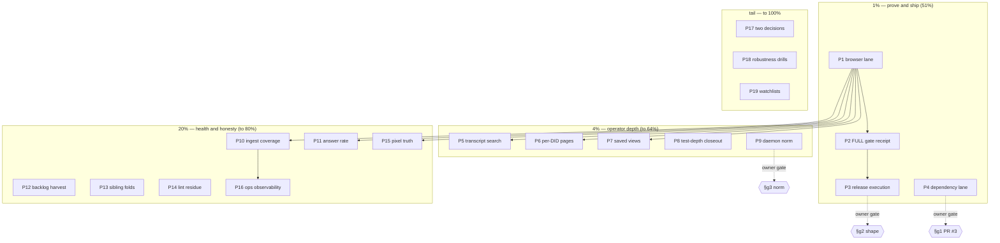

<!-- Pareto plan 2026-10-25 17:24 — input: the 15-39 + 16-58 + 17-12 reports'
     §f lists, the 10-46 plan's open 20% tier, TODO_LIST (31 open rows), and
     ROADMAP theme 0. Status: IN EXECUTION — 8/19 coarse tasks done
     (P1, P2, P5, P6, P7, P8, P10, plus P3+P9 executed 2026-10-26 after
     the owner answered §g2 = v0.3.0 and §g3 = squash-while-unpushed;
     §g1 resolved de facto: PR #3 closed, sqlite v1.61.0 landed by hand).
     P3 receipt: tag v0.3.0 cut via cut-release.sh (dev gate, four
     browser suites, remote CI green, module proxy serves the tag); gh
     release notes pending an owner token refresh — body in
     docs/drafts/2026-10-26_v0.3.0-release-notes-shipped.md.
     Guard: NO VERSCHLIMMBESSERUNG — the browser-lane ritual, the art-dupl
     zero-group gate, no-local-replace, AGENTS budget 219/219, and the
     receipt-grade-commit contract all hold inside this plan.
     Erratum (2026-10-25 evening): the P5–P10 pushes went red on CI's
     art-dupl gate — it had run nowhere locally (the P2 FULL receipt
     predated the features, and golangci-lint sees none of it). Fixed same
     evening: the two clone pairs extracted (search normalizedQuery;
     firstMatchedTurn via slices.IndexFunc, CI run 40221643859 green), and
     the gate moved left into .githooks/pre-commit via pin-enforcing
     check-dedup-gate.sh (315587e, self-tested in Guard Self-Tests).
     The fresh FULL receipt landed 2026-10-26 11:20 on the post-feature
     tree (3cdc5b2, run 20261026-101959-8b3301e0) — see
     docs/buildflow-dev-gate.md's third receipt for the two void runs
     (poll-gate string-compare arm; the doubled hash corruption) it
     paid for first. -->

# SUPERB plan — release, trust, and operator depth (2026-10-25 17:24)

**Generated:** 2026-10-25 17:24 CET
**Input:** the three live reports' §f lists (15-39: 30 items; 16-58: 30; 17-12: 25 — deduplicated below), the 10-46 plan's open 20% tier (P14–P18, P19 remainder, P20.4, P22, P23, P25-execution), TODO_LIST's 31 open rows, ROADMAP theme 0.
**North star alignment:** the superb call-insights platform. This plan ships what two days built (the release), proves it in the browser (the lane), then buys the operator's next three questions (what was SAID, who is this number, where did I browse before).
**Non-negotiables:** owner gates stay owner gates (release shape, PR #3, daemon norm — the plan PREPARES, the owner DECIDES); every gate keeps its seeded-red proof; the receipt rule (a gate's START LOAD is the load it verified) holds.

## 1. Context and constraints

- The 4% tier of the 10-46 plan is COMPLETE and CI-green; the analytics
  surface (spend, segments, quality, anomaly baseline, firstpage timing) is
  committed but NOT browser-proven and NOT released (last tag: v0.2.0,
  2026-10-15 — two days of work untagged).
- Three owner questions block exactly three items (release shape, PR #3
  disposition, daemon norm). The plan sequences everything else around them
  and prepares each decision's execution so an answer converts to a
  landing within minutes.
- The doc-claims gate's first day proved the class: docs drift toward
  claiming things that were never built. Every item below that touches docs
  keeps the annotate-don't-rewrite rule; every new surface lands with its
  test + golden in the same commit.

## 2. The Pareto tiers (coarse: 30–100 min tasks, ALL open todos)

| Tier | ID      | Task                                                                                                                                                                                                                                                        | Impact | Effort | Risk   | Depends        | Provenance                     |
| ---- | ------- | ----------------------------------------------------------------------------------------------------------------------------------------------------------------------------------------------------------------------------------------------------------- | ------ | ------ | ------ | -------------- | ------------------------------ |
| 1%   | **P1**  | **Browser-lane proof of everything shipped this week**: `scripts/verify-all.sh` green (3 docs gates + 4 probe suites), then the screenshot sweep vs a refreshed baseline covering anomaly note, segments, spend                                             | High   | 45min  | Medium | calm load      | 15-39 §f3; 17-12 §f1           |
| 1%   | **P2**  | **FULL gate receipt** at the calm window (`poll-gate.sh` → `buildflow --build-mode full`), receipt into docs/buildflow-dev-gate.md                                                                                                                          | High   | 40min  | Low    | 15-min < 40    | 15-39 §f2                      |
| 1%   | **P3**  | **Release execution** (owner picks shape; bodies are drafted): CHANGELOG split per the drafted mechanics → `cut-release.sh v0.2.1\|v0.3.0` → GitHub release body → `go list -m` proxy check                                                                 | High   | 60min  | Medium | owner §g2      | 10-46 P25; docs/drafts bodies  |
| 1%   | **P4**  | **Dependency lane unblocked** (owner picks PR #3 disposition): rebase-and-watch or close + hand-rolled sqlite bump (tidy, vendorHash re-derive, gates); then dependabot github-actions-only grouping                                                        | High   | 45min  | Medium | owner §g1      | PR #3; 13-44 §a6               |
| 4%   | **P5**  | **Transcript-mode search (P15)**: the FTS index already carries turns — a `?mode=transcript` result view answers "what was SAID". docs/gotchas.md FTS5 section FIRST                                                                                        | High   | 90min  | Medium | P1             | 10-46 P15; 05-49 §f11          |
| 4%   | **P6**  | **Per-DID segment pages (P16)**: a segment row opens its own trend card (volume/AI/quality) instead of a flat filtered list                                                                                                                                 | High   | 90min  | Medium | P4–P6 stable   | 10-46 P16                      |
| 4%   | **P7**  | **Saved views (P14)**: recent-views client-side list + one canonical share link per card (filter state is URL-only today)                                                                                                                                   | Medium | 75min  | Medium | P1             | 10-46 P14                      |
| 4%   | **P8**  | **Test-depth closeout (P19 remainder)**: P19.2 idempotent-replay bench + receipt row; P19.4 `-race ./internal/ingest` receipt                                                                                                                               | Medium | 40min  | Low    | —              | 10-46 P19.2/P19.4              |
| 4%   | **P9**  | **Daemon norm implemented** (owner picks §g3): claim-file protocol (daemon refuses under an active claim) or never-reset (sessions amend forward); codified in docs/concurrency.md + daemon side                                                            | High   | 60min  | Medium | owner §g3      | 17-12 §g3; 16-58 §e3           |
| 20%  | **P10** | **Ingest-coverage analytics (P17)**: per-source rows/day, gaps, staleness SLO on `/api/ops` — the "is the index healthy" answer                                                                                                                             | Medium | 90min  | Medium | P1             | 10-46 P17                      |
| 20%  | **P11** | **Answer-rate / short-call analysis (P18)**: CDR billsec 0 + hangup cause; honest "not reported" for sources that cannot know                                                                                                                               | Medium | 75min  | Medium | P1             | 10-46 P18                      |
| 20%  | **P12** | **Backlog harvest (P20.4)**: the three live reports' §f lists → TODO_LIST/ROADMAP with provenance; the 15-39/16-58/17-12 reports annotated inline where items resolved                                                                                      | Medium | 60min  | Low    | —              | 10-46 P20.4                    |
| 20%  | **P13** | **Sibling folds (P22)**: call_direction into the CDR template (parser ready), backup-rotation wording in lens.nix, webphone deep link                                                                                                                       | Medium | 90min  | Medium | sibling window | 10-46 P22                      |
| 20%  | **P14** | **Lint residue (P23)**: gofumpt/v2.14 parity check, unknown-`//nolint` grep, AGENTS-budget CI job (220-line seed)                                                                                                                                           | Low    | 75min  | Low    | —              | 10-46 P23                      |
| 20%  | **P15** | **Pixel truth refresh**: screenshot-probe baselines for the new cards (anomaly note, segments, spend) + print-stylesheet audit                                                                                                                              | Medium | 45min  | Low    | P1             | 15-39 §f28                     |
| 20%  | **P16** | **Ops observability**: etag hook counters (`OnETagGenerated`/`On304`, pinned v0.6.1) + retention SLO surface on /api/ops                                                                                                                                    | Medium | 60min  | Medium | P10            | TODO rows; docs/http-stack.md  |
| 100% | **P17** | **Two decisions documented**: PII enforcement (E164/ParticipantHash exist, stored fields stay raw) and export streaming compression — each a short ADR-style note for the owner                                                                             | Medium | 45min  | Low    | —              | 15-39 §f24; 17-12 §f20         |
| 100% | **P18** | **Robustness drills**: FTS tokenizer coverage table test (gotchas traps) + backup restore drill (VACUUM INTO under the current schema)                                                                                                                      | Medium | 60min  | Low    | —              | 17-12 §f18; 15-39 §f27         |
| 100% | **P19** | **Watchlists honored**: MOS poller prep (T15, 2027-01), Telnyx live-API quarterly re-verify scheduling (m27.9), art-dupl suppressed-bucket audit after the next templ bump, versions.json re-check after the next tag wave, CSP enforce flip at next deploy | Low    | 45min  | Low    | windows        | AGENTS deep-context; TODO rows |

The remaining 20%-to-100% tail beyond P17–P19 is the ROADMAP raw-idea pool
(spend trend per week/month, cost intelligence grouping, retention SLO
dashboards beyond /api/ops) — those graduate to TODO_LIST only when
triggered; this plan does not commit them.

## 3. Fine breakdown (≤12 min per step)

### Tier 1% — prove and ship

| ID   | Step                                                                                        | min | Depends |
| ---- | ------------------------------------------------------------------------------------------- | --- | ------- |
| P1.1 | Re-read scripts/README verify-all row; confirm port + baseline flags                        | 5   | —       |
| P1.2 | Run `bash scripts/verify-all.sh` (3 docs gates + 4 probe suites); triage first red if any   | 12  | P1.1    |
| P1.3 | Screenshot sweep `--save-baseline /tmp/pd-<date>`; record PNG count receipt                 | 12  | P1.2    |
| P1.4 | Refresh committed baselines for the new cards; review the diff PNG-by-PNG                   | 12  | P1.3    |
| P1.5 | Record the lane receipt (surfaces, PNG count, first-red-wins history) in the session report | 5   | P1.4    |
| P2.1 | Check load policy; if busy, launch `poll-gate.sh` in background with max-wait               | 5   | —       |
| P2.2 | Run FULL gate via poll-gate; capture the START LOAD triple + exit + duration                | 12  | P2.1    |
| P2.3 | Append the receipt run to docs/buildflow-dev-gate.md (same table format)                    | 8   | P2.2    |
| P3.1 | Ask the owner: v0.2.1 or v0.3.0 (bodies drafted; one-line answer needed)                    | 5   | owner   |
| P3.2 | Apply the CHANGELOG split mechanics for the chosen shape; docs gates + dprint               | 12  | P3.1    |
| P3.3 | Commit the CHANGELOG split (receipt-grade); push; watch CI green                            | 8   | P3.2    |
| P3.4 | `bash scripts/cut-release.sh vX.Y.Z` (script enforces clean/calm/green)                     | 12  | P3.3    |
| P3.5 | Paste the drafted body into the GitHub release; verify the assets                           | 5   | P3.4    |
| P3.6 | Module-proxy check `go list -m github.com/LarsArtmann/pbx-lens@vX.Y.Z`; record receipt      | 8   | P3.5    |
| P4.1 | Ask the owner: PR #3 rebase or close-and-hand-roll                                          | 5   | owner   |
| P4.2 | Execute the answer (rebase command, or close + fresh branch with tidy + vendorHash + gates) | 12  | P4.1    |
| P4.3 | Land the sqlite bump through the full local gate + CI watch                                 | 12  | P4.2    |
| P4.4 | Dependabot config → github-actions-only grouping; commit + push                             | 8   | P4.3    |
| P4.5 | Verify dependabot's next pass no longer groups Go modules; note the receipt                 | 8   | P4.4    |

### Tier 4% — the operator's next three questions + receipts

| ID   | Step                                                                                       | min | Depends |
| ---- | ------------------------------------------------------------------------------------------ | --- | ------- |
| P5.1 | Read docs/gotchas.md FTS5 section END-TO-END (tokenization traps, the no-second-ASR rule)  | 10  | P1      |
| P5.2 | Design note: `?mode=transcript` result shape (turn hits, per-turn anchors, ranking)        | 12  | P5.1    |
| P5.3 | Query layer: transcript-mode FTS query + result type                                       | 12  | P5.2    |
| P5.4 | Handler + search.templ result variant                                                      | 12  | P5.3    |
| P5.5 | Match-log anchors per TURN hit (reuse the detail `?q=` anchoring)                          | 12  | P5.4    |
| P5.6 | Unit tests: tokenizer edges from the gotchas list                                          | 12  | P5.5    |
| P5.7 | Golden for the transcript-mode result page                                                 | 10  | P5.6    |
| P5.8 | FEATURES row + CHANGELOG entry; lane probe addition                                        | 10  | P5.7    |
| P6.1 | Design: per-segment trend card route (`/segments/<kind>/<id>`) + which aggregates          | 12  | P1      |
| P6.2 | Query: segment-window aggregates (volume/AI/quality) reusing DashboardStatsQuery shapes    | 12  | P6.1    |
| P6.3 | Page templ + card composition                                                              | 12  | P6.2    |
| P6.4 | Segment rows link to the page (href swap)                                                  | 8   | P6.3    |
| P6.5 | Tests + golden + FEATURES row                                                              | 12  | P6.4    |
| P7.1 | Design: recent-views storage (localStorage keys, cap, shape) + share-link canonicalization | 12  | P1      |
| P7.2 | Client script (CSP-safe singleton) + list rendering                                        | 12  | P7.1    |
| P7.3 | Card affordance + empty state                                                              | 10  | P7.2    |
| P7.4 | Browser probe addition (ui-contract) + unit test for the canonicalizer                     | 12  | P7.3    |
| P8.1 | P19.2: write BenchmarkReplayNoOp (same batch re-dispatch)                                  | 12  | —       |
| P8.2 | Run + record the receipt row in docs/http-stack.md (next to the dispatch numbers)          | 10  | P8.1    |
| P8.3 | P19.4: `go test -race ./internal/ingest/` receipt + CHANGELOG line                         | 8   | —       |
| P9.1 | Ask the owner: claim-file protocol or never-reset (§g3)                                    | 5   | owner   |
| P9.2 | Codify the answer in docs/concurrency.md (the norm, the failure modes, the receipts)       | 12  | P9.1    |
| P9.3 | Implement the daemon side OR the session-side rule; seed-red proof                         | 12  | P9.2    |
| P9.4 | Verify against a live session (claim blocks / no-reset observed); record receipt           | 12  | P9.3    |

### Tier 20% — health, honesty, siblings

| ID    | Step                                                                                     | min | Depends |
| ----- | ---------------------------------------------------------------------------------------- | --- | ------- |
| P10.1 | Design: per-source rows/day + gap detection shape on /api/ops                            | 12  | P1      |
| P10.2 | Poller counters extension (last-success, rows/day EMA, gap flag)                         | 12  | P10.1   |
| P10.3 | /api/ops JSON + ops.templ rows                                                           | 12  | P10.2   |
| P10.4 | SLO thresholds (stale-after per source) + tests + golden                                 | 12  | P10.3   |
| P11.1 | Design: answer-rate definition (billsec 0 × hangup cause), honest denominators table row | 12  | P1      |
| P11.2 | QualityRollup extension + accumulator                                                    | 12  | P11.1   |
| P11.3 | Dashboard card section + templ                                                           | 12  | P11.2   |
| P11.4 | Tests + golden + FEATURES + denominators table                                           | 12  | P11.3   |
| P12.1 | Extract 05-49 §f unresolved items → TODO_LIST (provenance column)                        | 12  | —       |
| P12.2 | Extract 12-55 §f likewise                                                                | 12  | P12.1   |
| P12.3 | Extract 15-39 + 16-58 + 17-12 §f likewise; dedupe against 10-46's open tier              | 12  | P12.2   |
| P12.4 | ROADMAP: promote/demote raw ideas; annotate resolved §f items inline in the reports      | 12  | P12.3   |
| P12.5 | Docs gates + dprint; commit                                                              | 8   | P12.4   |
| P13.1 | Sibling window check (pbx-artmann + nix-international-telephony state)                   | 10  | —       |
| P13.2 | call_direction into the CDR template (parser ready); template test                       | 12  | P13.1   |
| P13.3 | lens.nix backup-rotation wording per docs/backup-rotation-opinion.md                     | 12  | P13.1   |
| P13.4 | Webphone read-only deep link (no data dependency)                                        | 12  | P13.1   |
| P13.5 | Sibling commits + receipts in this repo's docs                                           | 10  | P13.2-4 |
| P14.1 | gofumpt vs golangci-lint v2.14 formatter parity check (scratch clone, seeded diff)       | 12  | —       |
| P14.2 | Unknown-`//nolint` grep script + run                                                     | 10  | —       |
| P14.3 | AGENTS-budget CI job (seed: a 220-line AGENTS copy must fail)                            | 12  | —       |
| P14.4 | Wire findings into the lint policy doc; fix what falls out                               | 12  | P14.1-3 |
| P15.1 | Print-stylesheet audit against the new cards; fix breaks                                 | 12  | P1      |
| P15.2 | Screenshot baselines: new cards into the committed set; diff review                      | 12  | P15.1   |
| P16.1 | ETag hook counters into /api/ops (pinned v0.6.1 hooks)                                   | 12  | P10     |
| P16.2 | Retention SLO fields (oldest unretired view, purge lag) + tests                          | 12  | P16.1   |
| P16.3 | Docs + CHANGELOG + golden                                                                | 10  | P16.2   |

### The 100% tail

| ID    | Step                                                                                     | min | Depends |
| ----- | ---------------------------------------------------------------------------------------- | --- | ------- |
| P17.1 | PII enforcement decision note (options, recommendation, owner question)                  | 12  | —       |
| P17.2 | Export compression decision note (q-negotiated gzip on streams: yes/no + why)            | 12  | —       |
| P17.3 | Present both notes to the owner (one message, two questions)                             | 8   | P17.1-2 |
| P18.1 | FTS tokenizer coverage table test (gotchas traps as cases)                               | 12  | —       |
| P18.2 | Backup restore drill: restore a VACUUM INTO snapshot into a fresh serve; verify + record | 12  | —       |
| P18.3 | Write both receipts (gotchas/README as fitting)                                          | 10  | P18.1-2 |
| P19.1 | MOS poller prep: fixture + client surface sketch (2027-01 window)                        | 12  | —       |
| P19.2 | Telnyx quarterly re-verify: schedule + checklist update (m27.9)                          | 10  | —       |
| P19.3 | Watchlist sweep: art-dupl suppressed bucket (`--show-suppressed`), versions.json drift   | 12  | —       |
| P19.4 | CSP enforce flip checklist for the next host deploy                                      | 8   | —       |

## 4. Execution graph

## 5. Errata (what the sources had wrong at plan time)

- The 17-12 §f list still carries "browser lane" and "FULL receipt" as
  items 1–2 from the 15-39 list — they remain OPEN (no lane pass has run
  since the anomaly note landed); everything else in this plan's 1% tier is
  NEW sequencing, not stale carry-over.
- P25 (release bodies) is DRAFTED, not open — the 10-46 wording predates
  docs/drafts/2026-10-25_release-bodies-v0.2.1-vs-v0.3.0.md; this plan's P3
  is execution-only.
- P24 (analytics docs) is fully done (16-58 §a) and does not appear here.
- The three owner questions (15-39 §g, re-asked twice) gate exactly P3, P4,
  P9 — every other item is executable without a single answer.
