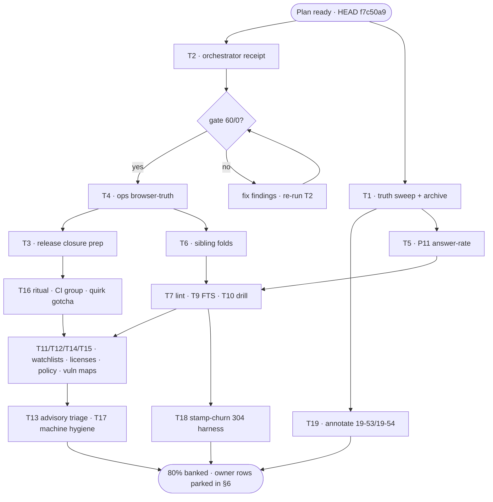

<!-- docs/planning/2026-10-26_20-10_SUPERB-post-v030-execution-and-truth-closeout.md
     Pareto plan over the post-v0.3.0 backlog (TODO_LIST after the 19-53 pass
     emptied Unblocked; inputs: the 19-53/19-54 reports' §f lists, the 16-00/
     17-29 live tails, TODO_LIST Blocked+Low rows, ROADMAP raw ideas).
     Format: .md + mermaid (the standing repo policy; the pareto-planning
     skill's HTML default is overridden by AGENTS.md and explicit demand).
     Status: READY — execution not started. -->

# SUPERB plan — post-v0.3.0 truth close-out, ops proof, and the next analytics slice

**Created:** 2026-10-26 20:10 CET · **Input head:** `f7c50a9` (= origin/main,
clean) · **Author:** docs-health/planning session (same evening as the
19-53/19-54 reports; this plan MERGES their §f lists after Step-0 dedup).

**Step-0 verification (ran before ranking; errata against the inputs):**

| Input row claimed                                           | Verified state                                                                                                                                                | Disposition                                   |
| ----------------------------------------------------------- | ------------------------------------------------------------------------------------------------------------------------------------------------------------- | --------------------------------------------- |
| The five Unblocked TODO rows (17-29 f22/f9/f36/f4/f15)      | LANDED `cf6e393` + `69b9d27` (tag CI `ci.yml:9`, dedup gate in verify-all, cut-release poll-gate reuse, `.fail` policy in gotchas, retention SLO on /api/ops) | DONE — struck in this plan, never re-executed |
| 17-29 f18 (AGENTS additions) + f5-carryover (templ KV note) | LANDED in the 19-54 pass (`f5631f2` batch: FOD minimum + dedup doctrine + version guard; adoption-map KV row)                                                 | DONE                                          |
| 19-53 §b2 (annotate 16-00/17-29)                            | NOT done — verified (no strikes in either report)                                                                                                             | OPEN → T1                                     |
| 19-53 §b3 (no BuildFlow orchestrator receipt)               | NOT done — verified (no poll-gate receipt over `cf6e393`…`f7c50a9`)                                                                                           | OPEN → T2                                     |
| 19-53 §f4 (retention assertion in verify-ops-verdict.js)    | NOT done — verified (no `retention` in the script)                                                                                                            | OPEN → T4                                     |
| 19-53 §f8 (/ops screenshot corpus)                          | NOT done — verified (probe README lists no ops surface)                                                                                                       | OPEN → T4                                     |
| TODO_LIST Unblocked table                                   | EMPTY (refresh note cites cf6e393)                                                                                                                            | planned-around                                |
| gh token                                                    | STILL DEAD (`gh auth status` fails)                                                                                                                           | owner-gated steps keep their gates            |

---

## §1 The Pareto cut (what delivers what)

**The 1% that delivers 51% — the truth layer:**

1. **T1 — annotate the executed rows and archive what becomes fully
   dispositioned.** The 19-53 pass deleted TODO rows and wrote CHANGELOG but
   never struck the source reports that REQUESTED the work (its own §d7);
   the ten 10-25 reports carry unmarked resolutions too. Every future session
   harvests from these files — an unannotated corpus re-dispatches done work
   and hides live work. This is the single highest-leverage act available.
2. **T2 — the BuildFlow orchestrator receipt** over the current tree. The
   19-53 session's green is an assembled lane list; house law says "gate
   green" means `poll-gate → buildflow`. One command converts "probably fine"
   into a bankable receipt that every later task in this plan may cite.

**The 4% that delivers 64% — the truth layer, plus:**

3. **T3 — release closure** (owner-gated execution, mechanical prep now):
   paste-ready v0.3.0 notes, the v0.3.1-vs-wait one-pager for the
   misprinted-const tag, and the tag-CI live proof plan.
4. **T4 — ops browser-truth**: assert the retention section in
   `verify-ops-verdict.js`, add /ops to the screenshot corpus, and fix the
   "Purge lag: unknown" wording. Yesterday's feature has a Go-tested,
   golden-pinned, but live-unasserted surface.
5. **T5 — P11 answer-rate analytics**: the next north-star slice
   (billsec-0 × hangup-cause over honest denominators), same shape as the
   three shipped slices.
6. **T6 — P13 sibling folds**: the three cross-repo one-liners (lens.nix
   backup wording, CDR call_direction template, webphone deep link) — the
   only integration work executable without an owner window.

**The 20% that delivers 80% — everything above, plus:**

7. **T7** — P14 lint residue (gofumpt/v2.14 parity, unknown-`//nolint` grep).
8. **T8** — P17 decision notes (PII boundary + export compression) bundled
   into one owner message.
9. **T9/T10** — P18 drills: FTS tokenizer coverage table test; VACUUM INTO
   restore drill re-run on the current schema.
10. **T11** — P19 upstream watchlists refresh + dependabot github-actions-only
    grouping.
11. **T12** — go-licenses disposition (17 error lines per FULL run).
12. **T13/T14** — the advisory-lane triage: branching-flow hotspots +
    file-size split decisions + jsonv2 risk ordering; the cqrs-lint policy
    pass (19 findings).
13. **T15** — the vuln window maps (govulncheck 13 stdlib, vulnix 22
    advisories).
14. **T16** — process hardening: the written pre-push ritual, a CI
    concurrency group, and the `-update` invocation quirk gotcha.
15. **T17** — machine hygiene: BuildFlow binary rebuild + cache.db VACUUM.
16. **T18** — stamp-churn measurement prep (the 304-hit-rate harness) so the
    owner product call has data.

**The rest (to 100%):** the advisory deep-dives that stay advisory (file-size
splits, jsonv2 boundary ordering), the owner-gated Blocked table (correctly
parked until answers/windows), the 2027-01 Telnyx window cluster, the
demand-gated outcome analytics, and the next docs-health cadence pass (which
re-runs after this plan's own reports accrete). §6 carries them so nothing is
lost — they are unranked because an owner answer or a calendar window, not
effort, is the binding constraint.

---

## §2 Medium tasks (30–100 min, sorted by impact/effort/value)

| #   | Task                                                                                                                                                                                                                                        | Tier | Impact | Effort | Covers (source rows)                                   |
| --- | ------------------------------------------------------------------------------------------------------------------------------------------------------------------------------------------------------------------------------------------- | ---- | ------ | ------ | ------------------------------------------------------ |
| T1  | **Truth sweep**: partial-inline annotate 16-00/17-29 executed rows (19-53 §b2 list) + the ten 10-25 live reports (the 19-09 §b4 pattern); archive any report that becomes fully dispositioned (check-rows → git mv → manifest); counts gate | 1%   | High   | 90min  | 19-53 §b2/§d7; 19-54 §f9; 19-09 §b4; docs-health cycle |
| T2  | **The orchestrator receipt**: `poll-gate.sh -- buildflow --build-mode dev` over HEAD; record beside the 1b5208a receipt (doc + report row)                                                                                                  | 1%   | High   | 30min  | 19-53 §b3/§f2; 17-29 §e                                |
| T3  | **Release closure prep**: strip the drafts header → paste-ready notes; the v0.3.1-vs-wait one-pager (misprinted const); the tag-CI watch checklist; owner executes publish (5min with token)                                                | 4%   | High   | 30min  | 19-53 §f1/§f6/§f28; 19-54 §f1; 17-29 §g1/§f1           |
| T4  | **Ops browser-truth**: retention keys asserted in `verify-ops-verdict.js`; /ops light/dark × desktop/mobile (+empty+wired) into screenshot-probe; "nothing is due" wording fix; goldens + lane green                                        | 4%   | High   | 60min  | 19-53 §f4/§f5/§f23; §e4/§e6                            |
| T5  | **P11 answer-rate**: definition (billsec-0 × hangup-cause), denominators row in DOMAIN_LANGUAGE, `QualityRollup` extension, dashboard section, tests + golden + CHANGELOG                                                                   | 4%   | High   | 90min  | 17-24 P11; 19-53 §f9; 16-00 §c2                        |
| T6  | **P13 sibling folds**: lens.nix backup-rotation wording; call_direction into the CDR template; webphone deep-link handoff note — after the sibling-window check                                                                             | 4%   | Medium | 60min  | 17-24 P13; 19-53 §f11; TODO Blocked sibling row        |
| T7  | **P14 lint residue**: gofumpt vs golangci-lint v2.14 formatter parity probe; unknown-`//nolint` grep → ledger or fix; the AGENTS-budget CI job stays lint-policy-gated (§6)                                                                 | 20%  | Medium | 45min  | 17-24 P14; 19-53 §f12                                  |
| T8  | **P17 decision notes**: PII boundary + export compression as ONE owner message (§g-style, choice IDs)                                                                                                                                       | 20%  | Medium | 30min  | 17-24 P17; 19-53 §f13                                  |
| T9  | **P18a**: FTS tokenizer coverage table test (gotchas traps as cases)                                                                                                                                                                        | 20%  | Medium | 45min  | 17-24 P18; 19-53 §f13                                  |
| T10 | **P18b**: VACUUM INTO restore drill re-run on the current schema; record beside R16                                                                                                                                                         | 20%  | Medium | 30min  | 17-24 P18; 19-53 §f13                                  |
| T11 | **P19 + dependabot**: upstream watchlist refresh (go-cqrs-lite v5 budget; versions.json via `git tag --contains`); dependabot github-actions-only grouping proposal                                                                         | 20%  | Low    | 30min  | 17-24 P19; 19-53 §f13/§f14                             |
| T12 | **go-licenses**: LICENSEs upstream vs suppression — decide per module, implement the quieting                                                                                                                                               | 20%  | Low    | 45min  | 17-29 §f25; 19-53 §f15                                 |
| T13 | **Advisory triage**: branching-flow hotspots (projection.go 18 fields, dashboard.go 24), file-size split decisions (server/dashboard/search/telnyx_test), jsonv2 39 findings ordered by risk                                                | rest | Low    | 90min  | 19-54 §f32; 17-29 §f26–f28; TODO detect-only row       |
| T14 | **cqrs-lint policy pass**: the 19 findings re-dispositioned in docs/cqrs-lint-policy.md (CBOR time.Time is real)                                                                                                                            | rest | Low    | 45min  | 17-29 §f29; 19-53 §f19                                 |
| T15 | **Vuln window maps**: govulncheck 13 stdlib → toolchain-bump windows; vulnix 22 advisories → nixpkgs bump windows (docs table)                                                                                                              | rest | Low    | 45min  | 17-29 §f30/§f31; 19-53 §f20                            |
| T16 | **Process hardening**: the pre-push ritual written down (17-29 §f37); CI concurrency group (cancel superseded runs); the `-update` invocation quirk gotcha (19-53 §d3)                                                                      | 20%  | Medium | 45min  | 19-53 §f29/§f27/§f22                                   |
| T17 | **Machine hygiene**: BuildFlow binary rebuild (freshness warning) + `cache.db` VACUUM (0.18 GB, 87% free) + the state DB eyeball                                                                                                            | rest | Low    | 30min  | 17-29 §f23/§f24; 19-53 §f21                            |
| T18 | **Stamp-churn prep**: 304-hit-rate measurement harness for /frag/dashboard (before/after numbers for the owner call)                                                                                                                        | 20%  | Medium | 45min  | TODO stamp-churn row; 19-53 §f31                       |
| T19 | **Next docs-health cycle**: annotate 19-53/19-54 as their items drain; re-run the pass after this plan's reports accrete (schedule, not execute)                                                                                            | rest | Low    | 30min  | 19-53 §f30; my 19-54 §f50                              |

## §3 Fine steps (≤12 min each; every task covered)

| #    | Step                                                                                                                               | Task | Min |
| ---- | ---------------------------------------------------------------------------------------------------------------------------------- | ---- | --- |
| 1.1  | Grep 16-00/17-29 for the executed-row line numbers (19-53 §b2 list: 17-29 f22/f9/f36/f4/f15, 16-00 §e6/§f4/§f7/§f10/§f11)          | T1   | 10  |
| 1.2  | Annotate 16-00 (prose specs, receipts cf6e393/69b9d27/f5631f2)                                                                     | T1   | 12  |
| 1.3  | Annotate 17-29 (rows f4/f5/f7/f9/f15/f22/f36 + §g answers where owned)                                                             | T1   | 12  |
| 1.4  | Annotate the 10-25 reports 1–5 partial-inline (05-49, 06-51, 07-25, 08-08, 08-53): resolved §b/§f leads only                       | T1   | 12  |
| 1.5  | Annotate the 10-25 reports 6–10 partial-inline (12-55, 13-44, 15-39, 16-58, 17-12)                                                 | T1   | 12  |
| 1.6  | Re-run 19-53's own §f1–f5 strikes (its items landed/owed)                                                                          | T1   | 10  |
| 1.7  | check-rows every touched file; archive any fully-dispositioned report (gate BEFORE git mv); manifest + counts gate                 | T1   | 12  |
| 1.8  | Update docs/status/README.md live table + archive count; commit receipt-grade                                                      | T1   | 10  |
| 2.1  | Check load; arm `nix develop -c bash scripts/poll-gate.sh -- env BUILDFLOW_NO_RESULT_CACHE=1 buildflow --build-mode dev`           | T2   | 5   |
| 2.2  | Read the receipt triple against policy (15m < 40; 60/0); capture run id                                                            | T2   | 5   |
| 2.3  | Record the receipt beside 1b5208a's (docs/buildflow-dev-gate.md + the session report)                                              | T2   | 10  |
| 3.1  | Copy the v0.3.0 notes draft; strip the comment header; verify against the CHANGELOG section                                        | T3   | 10  |
| 3.2  | Draft the v0.3.1-vs-wait one-pager (tag binary prints 0.2.0; proxy serves v0.3.0; guard active for next)                           | T3   | 12  |
| 3.3  | Write the tag-CI watch checklist (what to watch on the first `v*` push)                                                            | T3   | 8   |
| 4.1  | Extend `scripts/verify-ops-verdict.js`: assert `retention.active`, `oldest_age_seconds` presence (null-tolerant)                   | T4   | 12  |
| 4.2  | Add /ops to screenshot-probe surfaces (light+dark, desktop+mobile)                                                                 | T4   | 12  |
| 4.3  | Seed empty + wired fixtures for the ops capture; run the sweep                                                                     | T4   | 12  |
| 4.4  | Fix the retention-card wording ("nothing is due" for the empty/active case) + golden `-update` + review                            | T4   | 12  |
| 4.5  | Run `verify-all.sh` green; commit receipt-grade                                                                                    | T4   | 12  |
| 5.1  | Define answer-rate (billsec-0 × hangup-cause) in DOMAIN_LANGUAGE + the denominators row                                            | T5   | 12  |
| 5.2  | Extend `QualityRollup` (answer-rate + short-call fields, own denominators) + unit tests                                            | T5   | 12  |
| 5.3  | Dashboard section templ + styles (reuse the rate-row pattern)                                                                      | T5   | 12  |
| 5.4  | Golden update + the new rollup tests (answer-rate/short-call cases, beside the existing quality-trend tests); honest no-data state | T5   | 12  |
| 5.5  | `golangci-lint run` + full package tests; CHANGELOG entry; commit                                                                  | T5   | 12  |
| 6.1  | Check the sibling repo's window (git status/recent commits in nix-international-telephony)                                         | T6   | 10  |
| 6.2  | lens.nix: fold the backup-rotation opinion wording into timer descriptions                                                         | T6   | 12  |
| 6.3  | CDR template: add the call_direction column comment/fixture (only if the fleet template changed upstream)                          | T6   | 12  |
| 6.4  | Webphone deep-link handoff note in the sibling repo's docs (read-only, no data dependency)                                         | T6   | 12  |
| 6.5  | Sibling flake check green; record receipts; commit                                                                                 | T6   | 12  |
| 7.1  | Probe gofumpt output vs golangci-lint v2.14's formatter on a scratch file                                                          | T7   | 12  |
| 7.2  | `grep -rn '//nolint' --include='*.go'` → classify unknowns (ledger row or fix)                                                     | T7   | 12  |
| 7.3  | Apply fixes/ledger rows; lint 0; commit                                                                                            | T7   | 12  |
| 8.1  | Draft the PII + export-compression owner message (choice IDs, 2-minute read)                                                       | T8   | 12  |
| 8.2  | Land it in docs/decisions/ + link from TODO_LIST's PII row; send                                                                   | T8   | 10  |
| 9.1  | Enumerate the FTS5 tokenizer traps from docs/gotchas.md                                                                            | T9   | 10  |
| 9.2  | Write the tokenizer coverage table test (per-trap cases)                                                                           | T9   | 12  |
| 9.3  | Run + commit                                                                                                                       | T9   | 5   |
| 10.1 | Re-run the VACUUM INTO restore drill on the current schema (R16 test)                                                              | T10  | 12  |
| 10.2 | Record the receipt beside R16; refresh the drill doc if the shape changed                                                          | T10  | 10  |
| 11.1 | `gh` state check per the ledger (or cite the dead-token date)                                                                      | T11  | 10  |
| 11.2 | versions.json vs `git tag --contains` re-check; go-cqrs-lite v5 budget note                                                        | T11  | 12  |
| 11.3 | Draft the dependabot github-actions-only grouping config proposal                                                                  | T11  | 8   |
| 12.1 | List the larsartmann modules go-licenses flags; decide LICENSE-vs-suppress per module                                              | T12  | 12  |
| 12.2 | Implement (upstream LICENSE PRs are filings → suppress repo-side meanwhile)                                                        | T12  | 12  |
| 13.1 | Run branching-flow on projection.go/dashboard.go; read the two hotspots                                                            | T13  | 12  |
| 13.2 | File-size: split-or-accept decision per the four files (cohesion argument, 15-09 audit)                                            | T13  | 12  |
| 13.3 | jsonv2: extract the 39 boundary findings, order by risk, park the table in docs/drafts                                             | T13  | 12  |
| 13.4 | Write the disposition rows (accepted-with-reason or TODO); commit                                                                  | T13  | 12  |
| 14.1 | Re-run `nix develop -c cqrs-lint .`; diff against docs/cqrs-lint-policy.md                                                         | T14  | 12  |
| 14.2 | Disposition drift (new findings) + the CBOR time.Time decision                                                                     | T14  | 12  |
| 14.3 | Update the policy doc; commit                                                                                                      | T14  | 10  |
| 15.1 | Pull the govulncheck 13 findings; map each to a toolchain-bump window                                                              | T15  | 12  |
| 15.2 | Pull vulnix 22 advisories; map to nixpkgs bump windows                                                                             | T15  | 12  |
| 15.3 | Land the maps in docs (gotchas or a vuln-windows.md); commit                                                                       | T15  | 10  |
| 16.1 | Write the pre-push ritual (the FULL-receipt command sequence) into CONTRIBUTING/scripts README                                     | T16  | 12  |
| 16.2 | Add the CI concurrency group to ci.yml (cancel-in-progress)                                                                        | T16  | 10  |
| 16.3 | Diagnose the `go test -update` quirk (flag parsing) + one-line gotcha                                                              | T16  | 12  |
| 16.4 | Commit + push; watch CI (or cite the dead-token date)                                                                              | T16  | 10  |
| 17.1 | Rebuild the BuildFlow binary from its repo HEAD; reinstall; doctor clean                                                           | T17  | 12  |
| 17.2 | `sqlite3 ~/.cache/buildflow/cache.db 'VACUUM;'`; eyeball the state DB                                                              | T17  | 12  |
| 18.1 | Add a 304-hit-rate counter/log to the poll probe (or read appkit metrics)                                                          | T18  | 12  |
| 18.2 | Measure before/after with a client-side stamp prototype on a branch                                                                | T18  | 12  |
| 18.3 | Write the numbers into the stamp-churn TODO row (the owner decides with data)                                                      | T18  | 10  |
| 19.1 | Annotate 19-53 (§f1–f5 landed; §b2/§b3 route to T1/T2)                                                                             | T19  | 12  |
| 19.2 | Annotate 19-54 (its §f1–f12 route to this plan's tasks)                                                                            | T19  | 12  |
| 19.3 | Schedule the next cycle (after this plan's session reports accrete)                                                                | T19  | 5   |

## §4 Execution graph

## §5 Verschlimmbesserung guards (read before executing ANY task)

1. **Never re-execute the five landed rows** (`cf6e393`/`69b9d27`): T1
   STRIKES their source lines; if a verification seems to demand redoing
   them, re-read the receipts first.
2. **Archived directories are closed**: no formatting, no editing, no
   harvesting from `docs/status/archived/` or `docs/planning/archived/`;
   `check-rows` BEFORE any `git mv`; a bulk archive without a manifest row
   is invisible history.
3. **Live reports get partial-inline annotation only** (owed items, whole-line
   strikes, cited receipts) — never a wholesale rewrite, never a §-appendix.
4. **The version-const guard must not be loosened**: `cut-release.sh` fails
   on const lag BY DESIGN (the v0.3.0 lesson); fix the const, never the
   guard.
5. **gh-gated claims cite their date**: with the token dead, every
   upstream/CI statement names its last verified date instead of implying
   liveness; no `gh run watch` fabrications.
6. **UI-visible ⇒ `verify-all.sh`; /api-visible ⇒ probe assertion in the
   same session** (the 19-53 §e4 gap must not recur for T5's dashboard
   section).
7. **AGENTS.md is budget-neutral**: additions extract or reflow, never append
   past 219/219.
8. **No force-push; squash-while-unpushed per docs/concurrency.md; claim
   markers before editing shared surfaces** (scripts/, gate docs).
9. **Reports annotate; TODO rows die into CHANGELOG** — never delete history
   to make a gate pass.
10. **No probe tag without the owner's §g1 answer** (the tag namespace and
    the module-proxy path are owner territory).
11. **Owner-gated rows stay parked** — executing them without the answer is
    the Verschlimmbesserung this plan most fears (§6 is the wall).

## §6 Not schedulable now (owner answers / calendar windows — the wall)

| Row                                                                                                                                                                                                                                                                                                                                                                                                                                    | Blocking answer/window                                   |
| -------------------------------------------------------------------------------------------------------------------------------------------------------------------------------------------------------------------------------------------------------------------------------------------------------------------------------------------------------------------------------------------------------------------------------------- | -------------------------------------------------------- |
| Publish the v0.3.0 release object; watch tag CI                                                                                                                                                                                                                                                                                                                                                                                        | gh token (`gh auth login`)                               |
| v0.3.1 vs wait (misprinted tag)                                                                                                                                                                                                                                                                                                                                                                                                        | owner release call (T3 prepares it)                      |
| Probe tag `v0.0.0-ci-probe` vs wait for v0.4.0                                                                                                                                                                                                                                                                                                                                                                                         | 19-53 §g1                                                |
| nix-hash-fix exclusion from buildflow                                                                                                                                                                                                                                                                                                                                                                                                  | 17-29 §g2                                                |
| Lane split for P11–P19                                                                                                                                                                                                                                                                                                                                                                                                                 | 17-29 §g3                                                |
| Answer sheet D1–D5; lint-policy intent; coverage floor; pixel-baseline home; mobile card-list; >1MiB buffer; CSP enforce flip; PII boundary (T8 prepares); stamp-churn doctrine (T18 prepares); purge-lag alert threshold (19-53 §g2); filings go-ahead (four staged drafts); catalog infra push; host deploys; ContentHash-v2 re-ingest; read-model rebuild RUN; browser-level 304 check; BuildFlow#56 confirm; dependabot-core#16538 | TODO_LIST Blocked table (re-verified unchanged 19-53 §c) |
| T15 MOS poller; Telnyx quarterly re-verify; MP3 Range check                                                                                                                                                                                                                                                                                                                                                                            | 2027-01 window (m27.9)                                   |
| Outcome/disposition analytics                                                                                                                                                                                                                                                                                                                                                                                                          | demand-gated (no source carries outcome)                 |
| Warehouse-grade Parquet/duckdb export; scheduled report exports                                                                                                                                                                                                                                                                                                                                                                        | ROADMAP raw ideas (need a real consumer)                 |
| Webphone link UI                                                                                                                                                                                                                                                                                                                                                                                                                       | sibling repo (lens side done)                            |

## §7 Coverage map (every open source row → where it lives)

| Source                         | Rows              | Covered by                                                                                                                                                                                                                                   |
| ------------------------------ | ----------------- | -------------------------------------------------------------------------------------------------------------------------------------------------------------------------------------------------------------------------------------------- |
| TODO_LIST Unblocked            | 0 (emptied 19-53) | — (T1 strikes the sources)                                                                                                                                                                                                                   |
| TODO_LIST Blocked (24 rows)    | all               | §6 (owner wall) + T3/T8/T18/T6 prep legs                                                                                                                                                                                                     |
| TODO_LIST Low (3 rows)         | 3                 | T11 (quarterly, dependabot), §6                                                                                                                                                                                                              |
| 19-53 §f 1–50                  | 50                | T2 (f2), T3 (f1/f6/f28), T4 (f4/f5/f23), T5 (f9), T6 (f11), T7 (f12), T8 (f13), T9/T10 (f13), T11 (f13/f14), T12 (f15), T13 (f16–f18), T14 (f19), T15 (f20), T16 (f22/f27/f29), T17 (f21), T18 (f31), T19 (f30), §6 (f24/f32–f50 owner/rest) |
| 19-54 §f 1–50                  | 50                | T1 (f1–f10), T2 (f2), T3 (f3), T4 (f4/f5), T5–T19 as above; the remainder = §6                                                                                                                                                               |
| 17-29 §f 13–37 + 16-00 §f 9–32 | merged            | already deduped INTO the two lists above (same items, three namings)                                                                                                                                                                         |
| 15-09 §f remainder             | merged            | T13/T15 + §6 (owner-gated marks carried)                                                                                                                                                                                                     |
| ROADMAP raw ideas              | all               | §6 rest-tier + T5/T18 graduate on landing                                                                                                                                                                                                    |
| Next docs-health cadence       | —                 | T19                                                                                                                                                                                                                                          |

**Errata provenance:** Step-0 ran `git log`, the five-row greps (ci.yml:9,
cut-release poll-gate arming, gotchas `.fail` policy + WithSort entry, the
adoption-map KV row, the empty Unblocked table), and `verify-ops-verdict.js`
(absence of retention) before this plan was ranked. The plan supersede-nothing:
it merges, it does not renumber, history.
