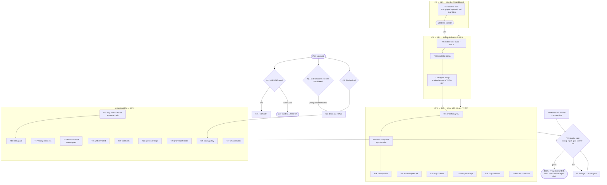

# SUPERB PLAN — Fleet-audit closeout: from "docs tell the truth" to "all 50 items landed"

**Created:** 2026-11-04 18:41 CET · **Source:** the 2026-11-04 fleet library audit
(docs/review/libs/, 19 reports + index) and its status report
(docs/status/2026-11-04_18-32_fleet-library-audit-status.md, section f = 50 items).
**Method:** pareto-planning skill; Step 0 cross-checked TODO_LIST.md (row 113 =
Reset rebuild, owner-blocked — referenced, not duplicated; row 124 = templ folds,
its #52 status is STALE — closed upstream 2026-10-29, this plan executes the fold
and the row edit).

## Context — why this plan exists

The audit found the fleet deeply leveraged (mean 71/100 across 7 used libs) but
left every fix as documentation. The one **live defect** is a split brain *I*
created by half-fixing the false server_timing doctrine: AGENTS.md now tells the
truth ("constructor exists since v1.0.1") while `internal/web/timing.go:16-17`
and `docs/http-stack.md:33-34` still claim the opposite — and a duplicate
middleware was already built on that lie. Everything else is ranked opportunity.

**Verschlimmbessern guards (non-negotiable, from docs/gotchas.md + AGENTS.md):**
- NEVER commit the sandbox's pre-commit drift on templ alignment (CI lane is the
  truth; docs/gotchas.md 2026-10-28).
- Run `scripts/poll-gate.sh` SOLO (parallel jobs starve test-coverage → exit 75).
- go.mod/go.sum changes ONLY via the established flow; vendor hash via
  `nix run .#update-vendor-hash` on a CLEAN tree, verify root AND devShell.
- templ pins are manual-only (dependabot banned); templ-components ≥v1.27 will
  require templ ≥ v0.3.1100 — do not mix that bump into these fixes.
- Never hand-build a projection record key; read through `calls.LookupView`.
- The gate's zero-findings receipt rule (docs/buildflow-dev-gate.md) applies to
  every task that runs it.

## Pareto breakdown (impact-weighted, hours in parentheses of ≈22.5 h total)

| Tier | Tasks (comprehensive IDs) | Effort | Cumulative result |
|---|---|---|---|
| **1% → 51%** | T02 (doctrine truth: timing.go comment + http-stack.md ¶ + AGENTS.md pointer + guard test) | 45 min ≈ 3% | The repo stops lying to itself: split brain closed, every future session reads truthful doctrine, audit's #1 finding's *root cause* documented. Highest per-minute value in the plan. |
| **4% → 64%** | T02 + T01 (middleware swap) + T09 (templ #52 fold-in) + T10 (filings/adoption-map truth) | ≈3.3 h ≈ 15% | The duplicate middleware is deleted (library-owned path), the obsolete zero-guard workaround is deleted, upstream ledgers record reality. All four "known wrongs" in code/docs resolved. |
| **20% → 80%** | + T04–T08 (error-family CLI + web + tests + markers), T11 (etag OnError), T06, T03 (errata), T14 (fresh pin receipt), T18 (stop-order test) | ≈7.7 h ≈ 34% | All 9 missed opportunities in used libs closed; error-family 45→~80, server_timing 33→~83; fleet mean 71→~85; zero known split brains; inherited-claim caveats shrink. |
| **Remaining 20% → 100%** | T12–T17, T19–T27 (metrics adoption, readiness, Reset runbook, watchlists, upstream filings, HARVEST, process decisions, cosmetics) | ≈11.5 h ≈ 51% | Everything else: adoption depth (metrics, Reset, /ready), watchlist hygiene, cross-project records, gated process decisions. No known defects remain after this tier. |

Reading: the first 5 tasks (~1/6 of the hours) carry ~2/3 of the value because
they delete *falsehoods and duplicates*; everything after is adoption depth and
hygiene.

## Comprehensive plan — 27 tasks, 30–100 min each, ALL 50 items covered

Sort key: **I**mpact / **E**ffort (S/M/L) / **V**alue (operator-observable) —
ordered by Pareto tier, then I×E. "Src" = status-report item numbers covered.

| # | Task | Src | Min | I | E | V | Gate |
|---|---|---|---|---|---|---|---|
| T02 | Doctrine truth: fix timing.go:16-17 comment, rewrite http-stack.md:33-34, shrink AGENTS.md note to pointer, add Server-Timing-header guard test, sweep for remaining false-claim carriers | 2,3,44 | 45 | H | S | docs truthful | — |
| T01 | Swap `web.ServerTimingMiddleware` → `servertiming.ServerTimingMiddleware()` (+ `When()` gating decision), delete duplicate, run bench, update bench numbers | 1 | 75 | H | M | lower leak surface, maintained path | — |
| T09 | templ #52 fold-in: `RelativeTimeProps.EmptyText: "never"`, delete ops guard, slim tests, regen goldens if bytes change | 7 | 45 | M | S | workaround deleted | — |
| T10 | Truth ledgers: filings ledger #52-closure row, adoption-map rows (EmptyText + amber), TODO_LIST row 124 re-verify | 8,22 | 30 | M | S | ledgers honest | — |
| T04 | error-family CLI: `HandleError`/`ExitCode` (EX_TEMPFAIL for projection timeouts), keep non-family fallback, fix exit-1 tests | 4 | 60 | H | M | scriptable exits | — |
| T03 | Errata appendix on the 2026-10-12 HTML (finding #2 wrong at its own pin) + server_timing report re-score + index row | 19,18 | 30 | M | S | history corrected | after T01 |
| T05 | error-family web: `HTTPHandler` across ~14 status-mapping sites, message-leak check, full probe suite | 5 | 100 | H | L | no raw err.Error() leaks | after T04 |
| T06 | Classify 3 bare 503s (`search.go`, `server.go` ×2) with `WrapInfrastructure` + tests | 6 | 30 | M | S | consistent 503 semantics | with T05 |
| T07 | Swap 3 hand-rolled assertions to `errorfamilytest` (telnyx, poller, depth_trio) | 12 | 30 | L | S | test parity, zero new modules | — |
| T11 | go-etag `OnError` knob → counter + log + ops exposure + http-stack row | 9 | 45 | M | S | write failures visible | — |
| T14 | Fresh cqrs-lite receipt: `git tag --contains` sweep over all 13 direct pins vs versions.json, record in gotchas | 23 | 30 | M | S | inherited claim → fresh fact | — |
| T18 | Pin the `ops.go:147` stop-before-first-write ordering with comment + test | 20 | 30 | M | S | metric survives refactors | — |
| T17 | `/ready` projection-worker readiness (503 until workers live) + probes + http-stack health section + attribution note | 17 | 75 | H | M | honest readiness | — |
| T08 | Export marker → `WithContext`+`JSON`; `LogError` at hand-log sites | 13,14 | 60 | M | M | canonical markers | after T05 |
| T25 | Quality gate post-code-changes: art-dupl via check script, poll-gate SOLO, golangci-lint, receipts | 43 | 60 | H | S | gate green | after T01–T12 code |
| T12 | go-etag `metrics.Attach` adoption, delete `CacheCounters`, tidy, vendor-hash on CLEAN tree, root+devShell verify | 10 | 100 | M | L | ~40 lines deleted | after T11 |
| T13 | ETag hit-ratio >1 guard (display + test) — needed before any handler-set tag | 11 | 30 | L | S | future-proof ratio | with T12 |
| T19 | Watchlist rows: templ v1.27/templ-gate (two-module bump plan), appkit v0.10 (default Server-Timing + testkit), bump-checklist filings step | 21,29,30,31 | 30 | M | S | triggers named | — |
| T15 | Reset rebuild runbook design (memory-engine dry run, rollback) aligned to TODO_LIST row 113's owner gate | 15 | 45 | M | S | rebuild ready | owner-gated |
| T16 | `projectionhost.WithOnFailed` wiring in drain path + tests + gotchas note | 16 | 45 | L | S | mid-drain alerts | — |
| T20 | Upstream filings: go-atomic-write commit-primitive ask (verify API absence first, github-voice), versions.json-lies evidence + file | 26,27 | 60 | M | M | upstream asks live | — |
| T24 | Fleet index refresh: recompute mean/cards after fixes, delta appendix, re-render screenshot | 40,42 | 45 | M | S | report matches repo | after T01–T12 |
| T23 | Full-read the 4 prior deep-dive HTMLs; retire inherited-claim caveats in fleet report | 24 | 60 | L | M | caveats → facts | — |
| T21 | HARVEST (f) → TODO_LIST.md/ROADMAP.md with backlog rigor | 37 | 45 | H | S | backlog is living | **Q2** |
| T22 | Process decisions recorded: audit-execution policy (**Q1**), PNG policy (**Q3**) + implement (compress/keep) | 38,39,41 | 30 | L | S | policy set | **Q1,Q3** |
| T26 | Cross-project: check + record verdicts in library-policy home; refresh-rule pointers in report headers; AGENTS trim note post-landing | 45,46,47 | 45 | L | S | fleet knowledge shared | — |
| T27 | Leftover batch: RecordServerTiming N/A note, README table cosmetics, curated-commit close-out, rate-limit abuse-evidence definition, Pragmas/schema/retry N/A confirmations | 28,32–36,48–50 | 60 | L | S | zero open N/A-without-reason | — |

Total ≈ 22.5 h. Coverage check: all 50 items in section (f) map to exactly one
task (listed above); nothing dropped, nothing duplicated (row 113/124 overlaps
handled by reference).

## Detailed breakdown — 109 micro-tasks, max 12 min each (ALL TODOs)

Sorted in execution order within the same Pareto tiers. "→ Src n" = status item.

| ID | Micro-task (≤12 min) | Min |
|---|---|---|
| **T02 — doctrine truth (the 1%)** |||
| M2.1 | Fix the false comment at internal/web/timing.go:16-17 (2 sentences) | 5 |
| M2.2 | Rewrite docs/http-stack.md:32-34 paragraph to the verified truth | 10 |
| M2.3 | Add guard test: route responds with Server-Timing header via library middleware | 12 |
| M2.4 | `rg -in "middleware constructor"` sweep — confirm zero false carriers remain | 5 |
| M2.5 | Shrink AGENTS.md server_timing note to a pointer at docs/http-stack.md | 10 |
| **T01 — middleware swap (the 4%)** |||
| M1.1 | Read servertiming middleware + When() semantics at pin; note r.Pattern delta | 10 |
| M1.2 | Swap cmd/pbx-lens/serve.go wiring to servertiming.ServerTimingMiddleware() | 10 |
| M1.3 | Delete web.ServerTimingMiddleware (timing.go) + fix references | 10 |
| M1.4 | Decide When() predicate (gate unauthenticated runs?) — record decision | 10 |
| M1.5 | Update tests asserting header presence/wiring | 12 |
| M1.6 | Run internal/web + cmd test suites | 10 |
| M1.7 | Run BenchmarkConcurrentPoll; compare ≈82 µs/304, ≈101 µs/200; update docs | 12 |
| **T09 — templ #52 fold (the 4%)** |||
| M9.1 | Set `EmptyText: "never"` in the ops RelativeTime path | 10 |
| M9.2 | Delete guard branch ops.go:296-298 + ops.templ:205-206 comment-guard | 8 |
| M9.3 | Slim ops_page_test.go:172-189 + relative_time_test.go:173 to a pin test | 12 |
| M9.4 | Regenerate goldens if rendered bytes change; eyeball diff | 12 |
| **T10 — truth ledgers (the 4%)** |||
| M10.1 | filings ledger: add #52-closed row (closed 2026-10-29 upstream) | 10 |
| M10.2 | adoption map: EmptyText folded + amber-re-skin semantics row | 12 |
| M10.3 | TODO_LIST row 124: annotate #52 now closed (local fold executing) | 8 |
| **T04 — error-family CLI (the 20%)** |||
| M4.1 | Read HandleError/ExitCode/message-template APIs at the v0.12.0 pin | 10 |
| M4.2 | main.go fatal → errorfamily.HandleError (What/Why/Fix + family exit) | 12 |
| M4.3 | Decide + record fallback for non-family errors (default exit 1 stays) | 8 |
| M4.4 | Update tests asserting os.Exit(1) behavior | 12 |
| M4.5 | Run cmd/pbx-lens tests; verify projection timeout path exits 75 | 8 |
| **T03 — errata + re-score (the 20%)** |||
| M3.1 | Append errata to 2026-10-12 HTML: finding #2 wrong at its own pin | 12 |
| M3.2 | server_timing report: swap finding marked DONE, score 33→re-derive | 10 |
| M3.3 | index.html: server_timing row + fleet mean recompute | 8 |
| **T05 — error-family web (the 20%)** |||
| M5.1 | Inventory all 14 inline status sites into a checklist (file:line) | 12 |
| M5.2 | Adopt HTTPHandler on the JSON error cluster (server.go) | 12 |
| M5.3 | Adopt on export.go:176,192 | 12 |
| M5.4 | Adopt on search.go:67, freshness.go:31,43, segment_page.go:31 | 12 |
| M5.5 | Adopt on recording.go:111,235 + server.go remaining 500/404 sites | 12 |
| M5.6 | Decide HTML-page path: keep page rendering, gate message via family | 10 |
| M5.7 | Leak check: confirm non-family errors gate their message body | 10 |
| M5.8 | Run internal/web tests | 12 |
| M5.9 | Run scripts/verify-all.sh (browser lane, first-red-wins) | 12 |
| **T06 — classify 503s (the 20%)** |||
| M6.1 | WrapInfrastructure on search.go:50-55 ("needs a sqlite index") | 10 |
| M6.2 | Classify server.go:618-626 ("no ops counters") + server.go:632 (marshal) | 12 |
| M6.3 | Test: family → 503 mapping + code in body | 8 |
| **T07 — errorfamilytest (the 20%)** |||
| M7.1 | telnyx_test.go:238-249 → AssertFamily/AssertCode | 10 |
| M7.2 | poller_test.go:478 swap | 10 |
| M7.3 | depth_trio_test.go:83-85 swap | 8 |
| **T11 — etag OnError (the 20%)** |||
| M11.1 | Wire ETagConfig.OnError → new counter + log line | 12 |
| M11.2 | Expose counter on /api/ops + ops page row | 12 |
| M11.3 | Test: write-failure path increments | 10 |
| M11.4 | http-stack.md: update hook table (OnError wired) | 8 |
| **T14 — fresh cqrs-lite receipt (the 20%)** |||
| M14.1 | Loop 13 direct pins: `git tag --contains <module-prefixed-tag>` | 12 |
| M14.2 | Diff result vs versions.json; record dated receipt in gotchas | 10 |
| M14.3 | Note any pseudo-version/untagged-master findings for the watchlist | 8 |
| **T18 — stop-order contract (the 20%)** |||
| M18.1 | Add ordering-contract comment at ops.go:147 (stop before ops JSON write) | 8 |
| M18.2 | Test pinning: retention metric present when ops JSON written after snapshot | 12 |
| M18.3 | Re-read collectRetention for other reorder hazards | 8 |
| **T17 — /ready projection readiness (the 20%)** |||
| M17.1 | Design: readiness payload from ProjectionHost.Status() worker states | 10 |
| M17.2 | Wire the check into appkit /ready path | 12 |
| M17.3 | 503-until-live semantics + tests (workers drained vs live) | 12 |
| M17.4 | Update docs/http-stack.md health section | 10 |
| M17.5 | Extend scripts/verify-all.sh probe for the new semantics | 12 |
| M17.6 | Attribution note: cqrs-htmx health-bridge idea (docs/review/libs/cqrs-htmx.md) | 8 |
| **T08 — markers + LogError (the 20%)** |||
| M8.1 | exportError → errorfamily.WithContext("call_id",…)+JSON in export.go | 12 |
| M8.2 | Confirm Code(err) consumers (export.go:157,162) stay green | 8 |
| M8.3 | export.go:144 hand-log → LogErrorContext | 10 |
| M8.4 | Sweep internal/web for other hand-logged family errors; adopt LogError | 12 |
| M8.5 | Tests for marker shape + log fields | 10 |
| **T25 — quality gate (post-code)** |||
| M25.1 | `nix develop -c bash scripts/check-dedup-gate.sh` (pin binary only) | 10 |
| M25.2 | poll-gate.sh SOLO run (BUILDFLOW_NO_RESULT_CACHE=1) | 12 |
| M25.3 | `golangci-lint run ./...` (repo config enables mnd) | 12 |
| M25.4 | Fix or annotate any finding (zero-findings receipt rule) | 12 |
| M25.5 | Receipt note: gate green at plan-execution HEAD | 8 |
| **T12 — etag metrics adoption (remaining 20%)** |||
| M12.1 | `go get github.com/larsartmann/go-etag/metrics@v0.6.1` (match server pin) | 8 |
| M12.2 | metrics.Attach into caching.go (preserve-and-append with overflow hook) | 12 |
| M12.3 | Delete CacheCounters/CacheStats; rewire ops page counters | 12 |
| M12.4 | Verify Attach preserve-append contract vs existing hooks (tests green) | 10 |
| M12.5 | Update caching/ops tests to metrics types | 12 |
| M12.6 | go mod tidy | 8 |
| M12.7 | `nix run .#update-vendor-hash` on CLEAN tree | 12 |
| M12.8 | `nix build` + `nix develop -c echo ok` (root AND devShell) | 12 |
| **T13 — ratio guard (remaining 20%)** |||
| M13.1 | Ratio display clamp/note when NotModified>Generated possible | 10 |
| M13.2 | Test the adopted-tag scenario (SkipIfPresent 304 without Generated) | 10 |
| M13.3 | Ops page wording: "n/a until a handler sets tags" | 8 |
| **T19 — watchlist rows (remaining 20%)** |||
| M19.1 | templ ≥v1.27 ⇒ templ ≥v0.3.1100 two-module bump row (+ check-templ-gate.sh watch) | 10 |
| M19.2 | appkit v0.10 row: default Server-Timing (delete serve.go wiring), testkit upgrades | 10 |
| M19.3 | Add "filings-ledger state check" step to the templ bump checklist | 10 |
| **T15 — Reset runbook (owner-gated)** |||
| M15.1 | Write runbook: ProjectionHost.Reset + replay steps for the legacy-key retirement | 12 |
| M15.2 | Align with TODO_LIST row 113 (owner deploy path; keep BLOCKED) | 8 |
| M15.3 | Dry-run Reset+replay on the memory engine in a test | 12 |
| M15.4 | Document rollback (checkpoint re-create, re-drain) | 10 |
| **T16 — WithOnFailed (remaining 20%)** |||
| M16.1 | Wire WithOnFailed into DrainProjections' host options | 12 |
| M16.2 | Decide serve-poller surfacing (log + ops counter) | 10 |
| M16.3 | Tests: WorkerFailed triggers callback | 12 |
| M16.4 | gotchas note | 8 |
| **T20 — upstream filings** |||
| M20.1 | Verify go-atomic-write API absence at latest tag (go doc sweep) | 10 |
| M20.2 | Draft issue in github-voice (repro + constraint + ask) | 12 |
| M20.3 | File + ledger row in docs/upstream-filings.md | 8 |
| M20.4 | Gather versions.json-lies evidence (specific lies + git-tag truth) | 10 |
| M20.5 | File + ledger row | 12 |
| **T24 — fleet index refresh** |||
| M24.1 | Recompute per-lib scores affected by fixes (server_timing, error-family, templ) | 12 |
| M24.2 | Update index cards/tables + mean | 12 |
| M24.3 | Re-render index-screenshot.png (rule: after final content) | 10 |
| M24.4 | Delta appendix entries in the affected per-lib reports | 8 |
| **T23 — prior-report reads** |||
| M23.1 | Read 2026-10-12 HTML in full; log deltas vs my findings | 12 |
| M23.2 | Read 2026-10-24 cqrs-lite HTML; confirm 58/100 scope + closures | 12 |
| M23.3 | Read 2026-10-24 templ HTML; confirm 91/100 + appendix | 12 |
| M23.4 | Read 2026-10-25 appkit/templ HTML; confirm 73/86 attribution | 12 |
| M23.5 | Retire inheritance caveats in the status report + fleet report | 12 |
| **T21 — HARVEST (gated Q2)** |||
| M21.1 | Route the 50 items: TODO_LIST vs ROADMAP vs close | 12 |
| M21.2 | TODO_LIST upserts (bounded rows, status verified) | 12 |
| M21.3 | ROADMAP raw-idea routing | 10 |
| M21.4 | Link this plan from the refreshed TODO_LIST header | 8 |
| **T22 — process decisions (gated Q1/Q3)** |||
| M22.1 | Record audit-execution policy answer in AGENTS.md | 10 |
| M22.2 | PNG policy: implement (compress / keep / out-of-git) | 12 |
| M22.3 | Annotate the status report's question section with decisions | 8 |
| **T26 — cross-project + pointers** |||
| M26.1 | Check /home/lars/projects/library-policy exists + format | 8 |
| M26.2 | Record the 19 verdicts there (if it fits its schema) | 12 |
| M26.3 | Add refresh-rule pointer line to each per-lib report header | 10 |
| M26.4 | AGENTS.md server_timing note trim draft (apply post-T01 landing) | 8 |
| **T27 — leftover batch** |||
| M27.1 | gotchas: RecordServerTiming/MeasureWithDesc N/A rationale | 8 |
| M27.2 | docs/research/README.md table column cosmetics | 10 |
| M27.3 | Close curated-commit note (history exists as-is; no action possible) | 5 |
| M27.4 | Define rate-limit "abuse" evidence that reopens the Hold | 12 |
| M27.5 | N/A confirmations batch: Pragmas, schema-v2, retry, daemon, credentials-store | 12 |
| M27.6 | go-retry trigger row (Telnyx client work) in watchlist | 8 |

Micro total = 109 tasks; sum ≈ the 27 medium tasks ≈ 22.5 h.

## Execution graph

Rules the graph encodes: T02 strictly first (nothing else until the split brain
is closed); TIER3's error-family web work (T05) waits for the CLI pattern (T04)
so the boundary convention lands in one shape; T25 gates the end state — no
"done" without a green solo gate run; the three decision nodes (D1–D3) block
only their own tasks, never the tiers.

## Coverage ledger (plan ↔ status items)

T01←1 · T02←2,3,44 · T03←19,18 · T04←4 · T05←5 · T06←6 · T07←12 · T08←13,14 ·
T09←7 · T10←8,22 · T11←9 · T12←10 · T13←11 · T14←23 · T15←15 · T16←16 · T17←17 ·
T18←20 · T19←21,29,30,31 · T20←26,27 · T21←37 · T22←38,39,41 · T23←24 · T24←40,42 ·
T25←43 · T26←45,46,47 · T27←28,32,33,34,35,36,48,49,50 — **50/50 covered.**
