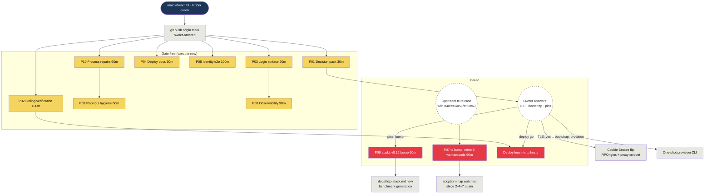

# SUPERB plan — identity hardening & fleet currency (2026-11-12 05:44)

**Session order:** Pareto the remaining work after the cqrs-htmx identity
adoption + the 22-lib fleet audit refresh both landed green; break it into
30–100min packages and ≤12min tasks; execute gate-free work; commit and
push with detailed messages.

**EXECUTION STATUS (2026-11-12 07:4X):** P01–P05 + P08–P10 executed
and verified (see docs/status/2026-11-12_07-43_identity-hardening-execution-pass-status.md);
P06 executed by the concurrent session (appkit v0.12, its nix legs
verified here); P01.3 + P06 residual docs + P07 stay on their named
gates. Both repos pushed.

**Companion docs:**
[status 05-33](../status/2026-11-12_05-33_fleet-audit-refresh-continuation-pass-status.md) ·
[status 05-26 (interleaved lane)](../status/2026-11-12_05-26_fleet-audit-refresh-22-libs_session-status.md) ·
[status 04-43 (adoption session)](../status/2026-11-12_04-43_usermgmt-adoption-and-fleet-audit-session-status.md) ·
[TODO_LIST](../../TODO_LIST.md) · [AGENTS.md](../../AGENTS.md)

---

## 0) Where we stand (context for every task below)

The identity stack is LANDED and green end-to-end: native login
(`internal/web/userauth.go`, 376 lines) replaced the htpasswd file over one
SQLite identity DB (`MaxUsers: 1`, WebAuthn wired but dormant on LAN http,
lockout 5/15min, per-IP rate limits, gate 303/401); the coordinated
templ v0.3.1100 + templ-components v1.27.0 bump is absorbed; the nix chain
is repaired; ALL 22 fleet reports are current with fetched-tag receipts;
the whole ladder is green (build/vet/test · golangci 0 · cqrs-lint 0 ·
dedup 0 · `nix flake check` 0 · nix build + devshell 0 · `verify-all.sh`
all probes passed). `main` is **ahead 29** of origin — this plan's step 8
pushes that backlog (explicit owner order).

What is NOT done: the auth surface's browser-level contract (no rendered
/login check, no logout button, no gate probe suite), the sibling NixOS
module's own gate, deployment-facing docs (SECURITY.md/README still say
htpasswd), the owner's three posture decisions, two dependency bumps with
documented migration steps, identity observability, and a set of small
process/receipt debts.

**Nicht verschlimmbessern guards (read before touching anything):**

1. `identityMaxOpenConns = 1` is DELIBERATE (serializes the identity
   journal) — never "fix" it without measuring lock contention.
2. The tc workarounds (`!items-stretch`, focus CSS, hand-rolled match log,
   pinned nav id, no-CopyButton-in-fragment rule) STAY until the NEXT
   templ-components release after v1.27.0 carries #48/#49/#51/#55/#63 —
   verified closed upstream 2026-11-06/07, post-tag.
3. `checks.pre-commit` templ-alignment false positive: the sandbox formats
   without module resolution; NEVER commit its drift; the CI lane is truth.
4. Every UI route stays a query or proxy except the identity surface —
   the gate law (AGENTS.md serve/UI) is not up for reinterpretation.
5. Never hand-build a projection record key; read through `LookupView`.
6. Receipt-grade commits: `git add … && git commit …` in ONE call; amend
   only UNPUSHED; a guard proof asserts the guard's MESSAGE, not exit code.

---

## 1) The Pareto cut

**The goal:** the identity stack SAFELY in production, with its UI
complete, its receipts banked, and the dependency wave current — without
regressing a single green gate.

### The 1% → 51% of the result (≈2h of work)

**Make the production path real and trustworthy.** The stack exists; its
value is zero until it deploys safely:

- **P01 (30min):** the three owner decisions prepped as an answer sheet
  (TLS/bootstrap/pins) — every gated row below hangs on this.
- **P02 (100min):** sibling module verification (`nix-international-telephony`:
  flake check, eval-test of `auth.enable`/`auth.publicOrigin`, backup
  staging of identity.db) — the deploy path's missing receipt.
- **P04.1–P04.3 (36min of P04):** SECURITY.md/README first-run truth —
  "the first person to complete /login OWNS the instance" cannot live
  only in a status report.

### The 4% → 64% (add ≈1.5h)

**Make the login surface complete and proven:** P03 (90min) — logout
button, rendered-/login check, goldens, and the gate contract probe in the
browser lane. This is the customer-visible half: the operator can END a
session, and the gate's behavior is guarded by the lane, not just Go tests.

### The 20% → 80% (add ≈3.5h)

**Prove the identity flow and start the currency work:** P05 (100min,
e2e smoke + WebAuthn ceremony + lockout UX + CSP/cache assertions),
P10 (60min, process repairs incl. the four executable TODO_LIST Unblocked
rows), P06 preflight (12min) so the appkit bump is one decision away.

### The remaining 20% → 100% (≈5h, none urgent)

P08 identity observability · P06/P07 execution once their gates open ·
P09 receipts & residue hygiene · the carried owner-gated rows (§3 gates
table) · annotations.

---

## 2) Level 1 — work packages (30–100min each, sorted by importance × impact ÷ effort)

| ID  | Package (30–100min)                                                                                                                                                                                                             | Why it matters (impact / customer value)                                                           | Effort | Gate                                                | Contains     |
| --- | ------------------------------------------------------------------------------------------------------------------------------------------------------------------------------------------------------------------------------- | -------------------------------------------------------------------------------------------------- | ------ | --------------------------------------------------- | ------------ |
| P01 | **Identity decision pack** — answer-sheet doc for the 3 owner questions (TLS/bootstrap/pins) with defaults + consequences, linked from TODO_LIST                                                                                | Unblocks 6 downstream rows; the deploy path's shape depends on it                                  | 30min  | answers = operator                                  | P01.1–P01.3  |
| P02 | **Sibling module verification** — run nix-international-telephony's own gate, eval-test `auth.enable`/`auth.publicOrigin`, verify identity.db backup staging, fold the backup-rotation opinion                                  | The production login path's missing receipt; deploy confidence                                     | 100min | none (own repo)                                     | P02.1–P02.8  |
| P03 | **Login surface completeness** — rendered /login (light+dark), logout nav form, goldens, browser-lane gate probe                                                                                                                | The auth UX becomes usable (operator can END a session) and lane-guarded                           | 90min  | none                                                | P03.1–P03.8  |
| P04 | **Deployment-facing docs** — SECURITY.md, README quick-start (new flags replace htpasswd recipe), first-run-owns-instance warning, threat-model note, session-lifetime semantics                                                | Deploys without surprises; the most surprising property (first visitor = operator) is written down | 60min  | none                                                | P04.1–P04.5  |
| P05 | **Identity e2e verification** — fresh-DB smoke (register→gate→logout→relogin), WebAuthn CDP ceremony, lockout UX, CSP + cache-header assertions, wire into lane                                                                 | The identity chain proven beyond unit tests; auth surfaces' headers/CSP pinned                     | 100min | none                                                | P05.1–P05.11 |
| P10 | **Process repairs & TODO_LIST execution** — concurrency interleave protocol, verify-all verdict line, docs-gates-in-loop, plus U1–U5 (skipBodyCaching guard, drain comment, ready-parity probe, pin receipts, plan annotations) | Cheap, prevents the exact fuckup classes this session paid for; clears 5 carried rows              | 60min  | none                                                | P10.1–P10.7  |
| P09 | **Fleet receipts & residue hygiene** — T14-style pin receipts (cqrs-htmx family/storage/templ/tc), htpasswd residue grep, 3 report refresh lines, #60 check, go-datastar delta diff, FEATURES/ROADMAP entries                   | Audit truth stays verifiable; no stale claims in live docs                                         | 60min  | none                                                | P09.1–P09.6  |
| P08 | **Identity observability** — /api/ops counters (sessions/lockouts/auth failures/rate-limit rejects), ops rendering, coverage receipt, benchmark generation with identity middleware                                             | Operational honesty for the new surface; the numbers the ops page deserves                         | 90min  | none                                                | P08.1–P08.7  |
| P06 | **appkit v0.12 bump** — de-dup Server-Timing wiring (D4 shipped), testkit helper adoption, benchmark generations, vendor hash                                                                                                   | Deletes redundant middleware; new testkit receipts; docs/http-stack.md truth                       | 60min  | **P01 answer 3** (default: hold 1 week post-deploy) | P06.1–P06.6  |
| P07 | **Next tc coordinated bump** — templ+tc together; retire #48/#49/#51/#55/#63 workarounds + duplicate `</script>` fold; watchlist again                                                                                          | Five workarounds retire; markup wart gone                                                          | 60min  | **upstream release** containing 41321644/2e16bcaf   | P07.1–P07.8  |

**Owner/external-gated rows NOT scheduled here (kept visible, per "ALL
TODOS"):** CSP enforce flip · MOS poller (window 2027-01) · PII enforcement
· coverage-floor decision · pixel-baseline strategy · mobile card-list ·
lint-policy intent · ContentHash v2 production re-ingest · read-model
rebuild execution (runbook ready) · catalog infra push · browser-level
304 manual check · >1MiB transcript policy · dependabot new-direct-deps
confirm · D1–D5 UI decision pack. Each already has its TODO_LIST row with
its gate named; none is forgotten — they fire when their gate opens.

---

## 3) Level 2 — every task at ≤12min, sorted within packages

| Task   | ≤12min action + receipt                                                                                                                                                                      | Pkg |
| ------ | -------------------------------------------------------------------------------------------------------------------------------------------------------------------------------------------- | --- |
| P01.1  | Draft `docs/decisions/2026-11-12_identity-posture-answer-sheet.md`: the 3 questions (TLS/bootstrap/pins), current default, consequence matrix, recommendation (hold pins 1 week post-deploy) | P01 |
| P01.2  | Link the sheet from TODO_LIST's identity-posture row + ROADMAP (passkey activation, bootstrap CLI alternatives)                                                                              | P01 |
| P01.3  | On answers: flip the gated rows, record outcomes in the sheet + AGENTS.md stack decisions                                                                                                    | P01 |
| P02.1  | `nix flake check` in ../nix-international-telephony → receipt (exit code + eval errors if any)                                                                                               | P02 |
| P02.2  | Eval-test lens.nix: assert `auth.enable`/`auth.publicOrigin` produce the expected `-auth-db`/`-auth-origin` ExecStart args                                                                   | P02 |
| P02.3  | Assert eval FAILS when `auth.enable` is set without `auth.publicOrigin` (the eval-time assertion works)                                                                                      | P02 |
| P02.4  | Verify the backup timer stages identity.db beside index.db (paths, ownership, mode)                                                                                                          | P02 |
| P02.5  | Verify the purge timer's file set EXCLUDES identity.db (pin in a comment or test)                                                                                                            | P02 |
| P02.6  | Fold the backup-rotation opinion into timer descriptions (⏵ TODO_LIST sibling row)                                                                                                           | P02 |
| P02.7  | Sibling repo: receipt-grade commit + its gate receipt                                                                                                                                        | P02 |
| P02.8  | Record deploy-prep runbook note (docs/runbooks or the host flow) + annotate the carried row                                                                                                  | P02 |
| P03.1  | Render /login via ui-probe chromium (light+dark) → docs/assets PNGs                                                                                                                          | P03 |
| P03.2  | Inspect: tc classes present, teal theme, no broken layout; fix drift if found                                                                                                                | P03 |
| P03.3  | Add `login` surface to scripts/screenshot-probe.js (light/dark × mobile/desktop)                                                                                                             | P03 |
| P03.4  | Implement the logout nav form: templ snippet in the shell nav, CSRF token, POST /auth/logout                                                                                                 | P03 |
| P03.5  | Test: session invalidated server-side; redirect to /login; logged-out nav renders                                                                                                            | P03 |
| P03.6  | Goldens for the nav change (`TestGolden -update`, REVIEW diff, suite green without -update)                                                                                                  | P03 |
| P03.7  | Contract probe: /login 303 (browser) / 401 (non-browser), public paths, logout flow → verify-ui-contract                                                                                     | P03 |
| P03.8  | Full `verify-all.sh` lane green; receipts in the plan table                                                                                                                                  | P03 |
| P04.1  | SECURITY.md identity section: flags, lockout 5/15min, rate limits, secure-context truth for passkeys, first-run warning                                                                      | P04 |
| P04.2  | README quick-start: replace any htpasswd recipe with `-auth-db/-auth-rpid/-auth-origin`; document IP/localhost → RPID localhost derivation                                                   | P04 |
| P04.3  | Threat-model note (docs/ or SECURITY.md section): registration-open-while-empty on a trusted LAN, door closes at MaxUsers:1, boot-log witness                                                | P04 |
| P04.4  | DOMAIN_LANGUAGE: session-lifetime semantics paragraph (upstream defaults, recorded as chosen-for-now)                                                                                        | P04 |
| P04.5  | Cross-check AGENTS.md serve/UI section vs the new docs — zero contradictions                                                                                                                 | P04 |
| P05.1  | e2e smoke script skeleton: fresh identity DB in /tmp, serve boot, probe client                                                                                                               | P05 |
| P05.2  | Register flow with the full CSRF dance; assert 201 + session cookie                                                                                                                          | P05 |
| P05.3  | Second registration WITHOUT session refused (door closed)                                                                                                                                    | P05 |
| P05.4  | Gate assertions on real serve: browsers 303→/login, non-browsers 401, public paths pass                                                                                                      | P05 |
| P05.5  | Logout → relogin roundtrip; old session dead after logout                                                                                                                                    | P05 |
| P05.6  | WebAuthn CDP virtual authenticator: enrollment ceremony on localhost posture                                                                                                                 | P05 |
| P05.7  | WebAuthn login ceremony + password fallback path                                                                                                                                             | P05 |
| P05.8  | Lockout UX: 5 bad passwords → inspect what renders; fix the message if it blames the user                                                                                                    | P05 |
| P05.9  | CSP sweep against /login (scripts/csp-sweep.js) — enforce-clean in the probe browser                                                                                                         | P05 |
| P05.10 | Header assertions: Cache-Control/ETag on /login + /auth/* (auth pages never 304-replay across accounts)                                                                                      | P05 |
| P05.11 | Wire the suite as a verify-all optional lane; scripts/README.md entry                                                                                                                        | P05 |
| P10.1  | docs/concurrency.md: the interleave pattern + re-stat-before-write rule (this session's §d1)                                                                                                 | P10 |
| P10.2  | verify-all: machine-readable verdict line (`verify-all: PASS/FAIL <gate>`)                                                                                                                   | P10 |
| P10.3  | Document the docs-gates-in-writing-loop convention (scripts/README.md + AGENTS.md pointer)                                                                                                   | P10 |
| P10.4  | U2: guard test pinning `skipBodyCaching` against route-table drift (internal/web/caching.go)                                                                                                 | P10 |
| P10.5  | U3: comment the `drain → rebuild → Run` ordering contract in serve.go PollLoop                                                                                                               | P10 |
| P10.6  | U4: /health/ready parity in the staleness-live probe                                                                                                                                         | P10 |
| P10.7  | U1: annotate executed plan rows (T01–T19, T24) with receipts + line refs                                                                                                                     | P10 |
| P09.1  | U5/T14 receipts: annotated-tag + proxy-hash spot receipts for cqrs-htmx family, storage, templ, tc pins                                                                                      | P09 |
| P09.2  | htpasswd residue grep over LIVE docs (archived excluded); fix stragglers                                                                                                                     | P09 |
| P09.3  | Refreshed-2026-11-12 lines for go-datastar/cmdguard/httputil-endpoints reports (stamp completeness)                                                                                          | P09 |
| P09.4  | Filing #60 (Sparkline fixed-size) state check + ledger row                                                                                                                                   | P09 |
| P09.5  | Diff the unexamined go-datastar.md delta; record verdict in the status report                                                                                                                | P09 |
| P09.6  | FEATURES.md native-login entry; ROADMAP passkey-activation + bootstrap-CLI entries                                                                                                           | P09 |
| P08.1  | Counter design: which usermgmt signals surface (active sessions, lockouts, auth failures, rate-limit rejects)                                                                                | P08 |
| P08.2  | Wire counters from the identity service into the ops provider                                                                                                                                | P08 |
| P08.3  | /api/ops JSON shape + test                                                                                                                                                                   | P08 |
| P08.4  | Ops page rendering + golden                                                                                                                                                                  | P08 |
| P08.5  | Coverage run scoped to the identity stack; record vs MIN_COVERAGE=70                                                                                                                         | P08 |
| P08.6  | Fill the cheapest coverage gap (≤2 tests) if under floor                                                                                                                                     | P08 |
| P08.7  | BenchmarkConcurrentPoll with identity middleware active; add the generation to docs/http-stack.md                                                                                            | P08 |
| P06.1  | Preflight: re-read appkit v0.10–v0.12 CHANGELOGs for ReadyCheck/drain semantics deltas                                                                                                       | P06 |
| P06.2  | Bump go.mod (appkit v0.12.0, systemd v0.2.0); `nix run .#update-vendor-hash` on clean tree                                                                                                   | P06 |
| P06.3  | Delete `web.ServerTimingMiddleware()` from serve.go ExtraMiddlewares; update docs/http-stack.md ordering doctrine                                                                            | P06 |
| P06.4  | Adopt testkit `WaitForRunning`/`FreeAddr`/`HTTPGetURL` in serve_test.go                                                                                                                      | P06 |
| P06.5  | Both benchmark generations; update docs/http-stack.md                                                                                                                                        | P06 |
| P06.6  | Full ladder + goldens green; bump receipt                                                                                                                                                    | P06 |
| P07.1  | Watch: `gh release list` for the tc release containing the five fixes (trigger note in the adoption map)                                                                                     | P07 |
| P07.2  | Coordinated bump: templ + tc together; `go tool templ generate`; update-vendor-hash                                                                                                          | P07 |
| P07.3  | Retire `!items-stretch` (#48); re-verify dashboard render (pixel probe)                                                                                                                      | P07 |
| P07.4  | Retire the focus-visible CSS workaround (#49)                                                                                                                                                | P07 |
| P07.5  | Fold ScrollbackLine ID/Class hook into transcriptMatchLog (#51); delete hand-rolled classes                                                                                                  | P07 |
| P07.6  | Retire the pinned nav id + TestNavIDIsDeterministic (#55)                                                                                                                                    | P07 |
| P07.7  | Assert the duplicate `</script>` is gone in goldens (ScriptComponent fold)                                                                                                                   | P07 |
| P07.8  | Adoption-map watchlist steps 2-4+7 again + filings ledger update                                                                                                                             | P07 |

Count: **59 twelve-minute tasks** across 10 packages — every TODO from
TODO_LIST's executable rows, both status reports' §b/§c/§f, and the fleet
reports' recommendations is mapped; the 14 owner/external-gated rows are
named in §2 and stay in TODO_LIST with their gates.

---

## 4) Execution graph

Reading the graph: everything left of the owners fires now, in parallel
where lanes don't collide (docs lanes P01/P04/P09/P10 vs code lanes
P03/P05/P08 — never two code lanes at once, per the concurrency doctrine).
The dashed owner nodes are the only blocking states.

---

## 5) Verification gates (every package's definition of done)

- Code lanes (P03/P05/P06/P07/P08/P10): `GOEXPERIMENT=jsonv2 go build ./... &&
  go vet ./... && go test ./...`, golangci-lint 0, cqrs-lint 0, dedup gate 0,
  `verify-all.sh` all probes passed; goldens reviewed then green without
  `-update`.
- Nix touches: `nix run .#update-vendor-hash` on a CLEAN tree only, then
  package build AND `nix develop -c echo ok` both green (`nix flake check`
  never builds devshells).
- Docs lanes (P01/P04/P09/P10-docs): `check-docs-counts.sh` +
  `check-doc-links.sh` green after every batch.
- Sibling lane (P02): nix-international-telephony's own gate green; its
  receipts live in ITS repo.

**Execution order:** P01+P02 first (unblock + trust), then P03+P04+P05
(the auth surface), then P10+P09 (debt), then P08, then the gated pair on
their triggers. Report table views at each level live in this file (§2,
§3) — the session report repeats them on completion.
