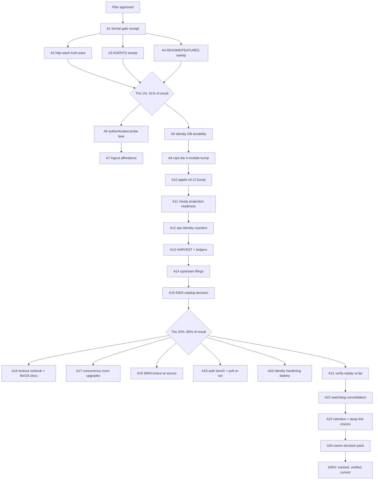

# SUPERB Plan — Post-Adoption Trust, Currency & Polish (2026-11-12)

**Status:** PLAN (awaiting owner go) · **Basis:** session status `docs/status/2026-11-12_05-26_fleet-audit-refresh-22-libs_session-status.md` (§f, 50 items), the 2026-11-12 identity adoption, TODO_LIST.md open rows (read 2026-11-12 05:54 — Step 0 dedup done: identity-posture row, logout row, filings fold-in rows already tracked there are ROUTED, not duplicated), the 2026-11-04 fleet audit (docs/review/libs/).
**Rule honored:** no Verschlimmbessern — nothing here touches a working surface without a verification step attached; every task carries its own verify.

---

## 1. Pareto breakdown — what actually moves the result

The result being planned for: **a trustworthy, current, superbly documented call-insights platform whose brand-new identity surface is proven, backed up, and doctrine-documented.**

### The 1% that delivers 51% (≈3 tasks, all small)
The identity stack landed TODAY. The single largest risk is no longer code — tests are green — it is **drift and unproven integration**: the doctrine doc still describes a deleted htpasswd gate, AGENTS.md carries split-brain auth claims, and no single-HEAD formal gate receipt exists for any of tonight's work. Three small tasks remove ~half the remaining risk:

1. **Single-HEAD formal gate receipt** (the poll-gate, run in a quiet window).
2. **docs/http-stack.md truth pass** — the auth chain, CSRF posture, Server-Timing `When` rationale, two-hop budget auth row.
3. **AGENTS.md + README/FEATURES htpasswd split-brain sweep** — every paragraph describing the deleted gate.

### The 4% that delivers 64% (the 1% plus)
4. **Identity DB durability trio** — backup coverage, retention/purge exclusion proof, health signal. The identity DB is the first NEW durable state since the index DB; it must inherit the same guarantees.
5. **Authenticated e2e probe lane** — verify-all gains a login-ceremony lane (+ the already-tracked logout affordance).
6. **go-cqrs-lite 4-module bump** — the backbone takes system v4.18.0 / metaengine v4.23.0 / sqliteengine v4.8.0 / systemscenario v4.3.0 with fence tests.

### The 20% that delivers 80% (the 4% plus)
7. appkit v0.9→v0.12 bump (deletes the Server-Timing duplicate; testkit upgrades; RegisterClassifications decision).
8. `/ready` projection-worker readiness (the audit's oldest standing borrow) + ops identity counters.
9. Plan HARVEST into TODO_LIST.md + CHANGELOG/research-index rows.
10. Upstream filings rows (2 templ candidates + the go-etag submodule-tagging hygiene ask).

### The remaining 80% → 100%
Benchmarks (auth overhead, poll-304 re-run), `-race` identity battery, cookie/CSRF audits, sibling NixOS module wiring, lockout runbook, concurrency-norm upgrades (claims roster, leave-HEAD-green), watchdog consolidation (templ v1.28, datastar builders, go-etag#2), WithContext-at-source, and the owner-gated BLOCKED pack (TLS/bootstrap/pins decisions, prod deploy, ContentHash v2 re-ingest, MOS poller, PII) — tracked, not forgotten.

---

## 2. Comprehensive plan — medium tasks (30–100 min each, ALL todos, sorted by importance/impact/effort/customer-value)

Sort key: **P1** = the 1% · **P2** = the 4% adds · **P3** = the 20% adds · **P4** = the tail. Within a tier: higher impact, then lower effort first.

| # | Task (30–100 min) | Tier | Impact | Effort | Customer value | Source |
|---|---|---|---|---|---|---|
| A1 | **Single-HEAD formal gate receipt**: quiet-window `poll-gate.sh → buildflow --build-mode dev`, receipt pinned to one HEAD in docs/http-stack.md or the session log | P1 | High | 60min active | Every later claim about tonight's work becomes trustworthy | status §b.1 |
| A2 | **docs/http-stack.md truth pass**: rewrite the auth-gate section for the identity chain (auth outermost, session gate, CSRF), re-home the Server-Timing `When` rationale (identity gate replaces htpasswd), add the auth row to the two-hop budget, CSRFConfig-defaults posture note | P1 | High | 60min | Doctrine matches reality; next agent doesn't "restore" htpasswd | status §c.2, §f.4 |
| A3 | **AGENTS.md htpasswd split-brain sweep**: fix timing-pad/padCost/throttle/`auth-failure throttling` paragraphs to describe usermgmt lockout + identity gate | P1 | High | 30min | Memory stops lying to the next session | status §c.3 |
| A4 | **README.md + FEATURES.md auth claims sweep**: user-facing posture (passkey login, opt-in `-auth-db`, single-operator) | P1 | High | 30min | The sales page tells the truth | status §c.4 |
| A5 | **Identity DB durability trio**: (a) prove/extend `internal/backup` to cover the identity DSN, (b) prove retention/purge timers cannot touch it, (c) add identity liveness to /health | P2 | High | 60min | Operator logins survive restores; no silent data loss | status §f.10-13, §f.45 |
| A6 | **Authenticated e2e probe lane**: verify-all gains a login-ceremony lane (WebAuthn/virtual authenticator or password factor per TLS posture), screenshot baselines re-cut if the shell gains the logout link, robots.txt honored-check | P2 | High | 60min | The probe suites prove the REAL UX, not the unauthenticated dev posture | status §f.17-18, §f.32 |
| A7 | **Logout affordance** (TODO_LIST row): nav link POSTs `/auth/logout`, redirects to /login | P2 | Medium | 30min | Shared-box operators can end sessions | TODO_LIST:130 |
| A8 | **go-cqrs-lite 4-module bump**: system v4.18.0, metaengine v4.23.0, sqliteengine v4.8.0, systemscenario v4.3.0; fence tests + corpus + vendorHash + both report rows | P2 | High | 90min | Backbone takes the concurrency fixes before any multi-connection deployment | status §f.2 |
| A9 | **Cookie + CSRF config audit**: Secure/HttpOnly/SameSite under the LAN posture (contingent on TLS answer for `Secure`), CSRFConfig{} defaults documented | P2 | Medium | 30min | Sessions can't be hijacked or CSRF'd | status §f.14, §f.33 |
| A10 | **go-appkit v0.9→v0.12 bump**: delete `web.ServerTimingMiddleware()` wiring (v0.10 default), adopt `WaitForRunning`/`FreeAddr`, decide+wire `RegisterClassifications()`, update go-appkit.md + server_timing.md forward notes | P3 | High | 90min | Deletes code; outermost timing owns `total`; appkit receipts | status §f.3 |
| A11 | **`/ready` projection readiness**: in-house check reporting `projectionhost.Status()` workers (503 until live) — the standing health-bridge borrow | P3 | Medium | 45min | Deploys can gate on real readiness | status §f.9, §f.48 |
| A12 | **Ops identity counters + per-address 4xx**: lockouts, active sessions, registration-closed, per-address 4xx (the rate-limit Hold's named instrument) | P3 | Medium | 60min | The operator sees auth abuse before it matters | status §f.15-16, §f.43 |
| A13 | **HARVEST + ledgers**: this plan's survivors into TODO_LIST.md, CHANGELOG row for the 22-lib refresh, docs/research/README.md refresh row, T14-style receipt extension to remaining pins | P3 | Medium | 45min | The living backlog is the single source of truth again | status §c.1, §f.7, §f.36-37, TODO_LIST:131 |
| A14 | **Upstream filings**: rows for the 2 templ candidates; verify-before-filing, then file the go-etag submodule-tagging hygiene ask (root v0.7.0 not consumable) | P3 | Medium | 45min | Upstream fixes land for everyone; ledger stays truthful | status §f.19, §f.40, TODO_LIST:149-150 |
| A15 | **Identity aggregate catalog decision**: does usermgmt-on-its-own-DB trip E003 (second aggregate → flat-hold revisit)? Decide + record | P3 | Medium | 30min | The module-boundary decision stays falsifiable | status §f.35, AGENTS E003 |
| A16 | **Lockout runbook + NixOS auth stanza**: "operator locked out" recovery doc; `auth-db/rpid/origin` example in the deploy module docs (module wiring itself blocked on TLS answer) | P3 | Medium | 45min | The operator is never locked out with no path home | status §f.8, §f.46-47 |
| A17 | **Concurrency norm upgrades**: `.claims/ACTIVE.md` roster convention, "leave HEAD green or tag the commit `[red]`" norm, dual-session protocol note — from tonight's wasted-rewrite lesson | P3 | Medium | 30min | Next double-dispatch doesn't burn a report | status §e.1, §e.6, §f.18, §f.39 |
| A18 | **go-error-family `WithContext` at source**: attach call_id/stream_id at construction in the highest-traffic paths (export marker already consumes) | P3 | Medium | 60min | Errors say WHERE they happened | status §f.24 |
| A19 | **Benchmark pair**: auth-gate per-request overhead (session lookup + CSRF) with an http-stack auth row; re-run BenchmarkConcurrentPoll after the chain grew | P3 | Medium | 45min | The perf doctrine stays honest post-adoption | status §f.27-28 |
| A20 | **Identity hardening battery**: `-race` over identity tests; review `Identity.Register` rate-limit numbers vs real ceremony traffic; sweep exact-match assertions broken by codegen drift | P3 | Medium | 60min | The newest code gets the oldest discipline | status §f.26, §f.29-30 |
| A21 | **Verify-block replay script**: one loop that extracts and runs every ```console block in docs/review/libs/*.md; wire into verify-all as an opt-in lane | P3 | Medium | 30min | Report claims stay mechanically re-derivable | status §e.4 |
| A22 | **Watchdog consolidation row**: templ v1.28 (Sparkline/CopyButton fold-ins), datastar builders re-check, go-etag#2 fold-in, quarterly proxy-lag re-check habit — one tracked watchlist | P4 | Low | 30min | Nothing rots silently | status §f.20-22, §f.25, §f.41, TODO_LIST:149-150 |
| A23 | **`Policy.Admits` identity review + webphone deep-link UX check** under the login wall | P4 | Low | 30min | Retention and the sibling deep link behave with auth on | status §f.42, §f.45 |
| A24 | **Owner-decision pack routing**: TLS posture, bootstrap posture, reports-vs-bumps (already TODO_LIST:142 BLOCKED) — package with A16/A9 dependencies marked | P4 | Medium | 30min | The three owner answers unblock six tasks | TODO_LIST:142 |

**Already tracked — routed, not duplicated** (referenced to satisfy "ALL TODOS", no new rows): TODO_LIST:126 (plan-row annotation), :127 (skipBodyCaching guard), :128 (drain-order comment), :129 (probe readiness parity — fold into A6), :137-141, :143-148 (BLOCKED owner pack), :149-150 (filings fold-ins — absorbed into A14/A22).

---

## 3. Fine breakdown — micro-tasks (≤12 min each, ALL todos, same sort)

Legend: each fine row carries its parent (A#) and the same sort order. Verify column = the done-proof.

| ID | Micro-task (≤12min) | Parent | Verify |
|---|---|---|---|
| F001 | Check load + quiet window; start poll-gate in background | A1 | job started, log path noted |
| F002 | Monitor gate; on green capture HEAD + receipt lines | A1 | receipt text in hand |
| F003 | Write receipt into docs/http-stack.md header block (or session log) | A1 | diff shows receipt |
| F004 | Re-read docs/http-stack.md auth/middleware sections; list every htpasswd-era claim | A2 | claim list in hand |
| F005 | Rewrite auth-gate section for the identity chain (ordering, session gate, public paths) | A2 | section matches userauth.go |
| F006 | Re-home the Server-Timing `When` rationale to the identity gate; fix the timing budget table | A2 | doc + code agree |
| F007 | Add CSRF posture note (CSRFConfig{} defaults, which routes) | A2 | note cites userauth.go:170 |
| F008 | Add auth row to the two-hop budget (recording route behind session gate) | A2 | budget table has the row |
| F009 | Grep AGENTS.md for htpasswd/padCost/throttle claims; list hits | A3 | hit list in hand |
| F010 | Rewrite each stale AGENTS.md paragraph to usermgmt lockout reality | A3 | no stale hits remain |
| F011 | Re-read the full AGENTS.md diff; confirm no new contradictions | A3 | clean diff review |
| F012 | Grep README.md for auth/htpasswd claims; list hits | A4 | hit list in hand |
| F013 | Rewrite README auth posture (passkey, opt-in, single-operator) | A4 | README matches reality |
| F014 | Same sweep for FEATURES.md auth rows | A4 | FEATURES matches reality |
| F015 | Read internal/backup + identity open path; determine identity-DB coverage | A5 | coverage verdict written |
| F016 | Wire identity DSN into backup if missing (VACUUM INTO both files) | A5 | backup test covers both |
| F017 | Prove retention/purge cannot touch the identity DB (path disjointness + test) | A5 | test or proof note lands |
| F018 | Add identity liveness to /health (or document why /ready suffices) | A5 | health handler diff |
| F019 | Read verify-all + probe bootstrap; design the authenticated lane | A6 | design note in scripts/README |
| F020 | Implement login-ceremony lane (virtual authenticator or password factor) | A6 | lane green locally |
| F021 | Re-cut pixel baselines if the shell changed; otherwise confirm no-op | A6 | baseline diff clean |
| F022 | Verify robots.txt exists + is served through publicAuthPath | A6 | curl-free probe passes |
| F023 | Add nav logout link (POST /auth/logout → /login) | A7 | manual probe + golden |
| F024 | Pin the logout with a test (route + redirect) | A7 | test green |
| F025 | `go get` the four cqrs-lite modules; `go mod tidy` | A8 | tidy clean |
| F026 | Run fence tests + corpus + full suite; fix fallout | A8 | suite green |
| F027 | `nix run .#update-vendor-hash` on clean tree; devShell check | A8 | both green |
| F028 | Update go-cqrs-lite.md pins + behind-matrix; re-score if rows moved | A8 | report matches go.mod |
| F029 | Audit cookie attributes (Secure/HttpOnly/SameSite) as shipped | A9 | audit note in hand |
| F030 | Apply/document the posture (Secure contingent on TLS answer) | A9 | code or doc diff |
| F031 | Read appkit v0.10-v0.12 entries; list the 5 fold-in items | A10 | checklist in hand |
| F032 | Bump appkit; delete serve.go Server-Timing wiring; run timing guard tests | A10 | suite green, wiring gone |
| F033 | Adopt WaitForRunning/FreeAddr in serve_test | A10 | tests green |
| F034 | Decide + wire (or decline) RegisterClassifications; record rationale | A10 | decision note lands |
| F035 | Update go-appkit.md + httputil-server-timing.md forward notes | A10 | reports match go.mod |
| F036 | Read projectionhost.Status() surface; draft the readiness check | A11 | draft in hand |
| F037 | Wire /ready to projection workers (503 until live) + test | A11 | test green |
| F038 | Add lockout/session/registration counters to /api/ops | A12 | endpoint diff + test |
| F039 | Add per-address 4xx counter (the Hold's instrument) | A12 | counter in payload |
| F040 | Surface the new counters on the ops page (behind auth) | A12 | ops card renders |
| F041 | HARVEST: move plan survivors into TODO_LIST.md (delete done, add new) | A13 | TODO_LIST diff |
| F042 | CHANGELOG Unreleased row for the 22-lib refresh | A13 | row present |
| F043 | docs/research/README.md: refresh the fleet-audit row | A13 | row present |
| F044 | Extend T14-style pin receipts to httputil/etag/tc/appkit (TODO_LIST:131) | A13 | receipts in gotchas |
| F045 | Write the 2 templ filing rows into docs/upstream-filings.md | A14 | rows present |
| F046 | Verify-before-filing the go-etag tagging ask; draft + file the issue | A14 | issue URL in ledger |
| F047 | Check E003 trigger: is usermgmt a second aggregate? Read the decision; write verdict | A15 | verdict recorded |
| F048 | Write the lockout-recovery runbook (docs/runbooks/) | A16 | runbook exists |
| F049 | Draft the NixOS auth stanza docs (wiring waits on TLS answer) | A16 | doc snippet lands |
| F050 | Write .claims/ACTIVE.md roster convention into docs/concurrency.md | A17 | norm documented |
| F051 | Write the leave-HEAD-green / `[red]` commit-tag norm | A17 | norm documented |
| F052 | Record the dual-session protocol decision (pending Q1) as a stub row | A17 | stub present |
| F053 | Pick the 3 highest-traffic error sites; add WithContext(call_id/stream_id) | A18 | sites construct context |
| F054 | Pin with errorfamilytest asserts | A18 | tests green |
| F055 | Write the auth-gate micro-bench (session lookup + CSRF wrap) | A19 | bench exists |
| F056 | Run BenchmarkConcurrentPoll + new bench; record in docs/http-stack.md | A19 | numbers recorded |
| F057 | Run `-race` over identity/web tests | A20 | race clean |
| F058 | Review Identity.Register rate-limit math vs 2 req/login reality | A20 | verdict recorded |
| F059 | Sweep exact-match assertions for codegen-drift breakage | A20 | sweep clean or fixed |
| F060 | Write scripts/replay-report-verify.sh (extract + run console blocks) | A21 | script runs green |
| F061 | Wire it as verify-all opt-in lane + README row | A21 | lane documented |
| F062 | Create the consolidated watchlist row (templ v1.28 / datastar / go-etag#2 / quarterly proxy check) | A22 | TODO_LIST row exists |
| F063 | `Policy.Admits` review for identity rows | A23 | verdict recorded |
| F064 | Check webphone deep-link UX under the login wall | A23 | verdict recorded |
| F065 | Refresh TODO_LIST:142 identity-posture row with A16/A9 dependency notes | A24 | row updated |
| F066 | Final pass: `gofmt`-equivalent via BuildFlow, `git status`, receipt commit | all | commit lands |

(Fine rows for routed TODO_LIST items are the rows themselves — they already exist in ≤30min granularity at TODO_LIST:126-131; this plan does not re-split tracked work.)

---

## 4. Execution graph



**Parallelism:** {A2, A3, A4} are independent after A1; {A5, A6} independent; A8 must precede A10 (both touch go.mod/vendorHash); A13 last among P3 (it harvests what the others landed).

---

## 5. Out of scope here (tracked, owner-gated)

TODO_LIST BLOCKED rows stand: prod deploy + rebuild runbook, ContentHash v2 re-ingest, MOS poller window (2027-01), PII enforcement, coverage-floor call, pixel-baseline home, CSP enforce flip, catalog infra push, and the identity-posture decision pack (TLS / bootstrap / pins — TODO_LIST:142). This plan's A9, A16, A24 mark their dependencies on those answers; nothing here pre-empts an owner call.

— Plan ends. Sorted, sized, graphed; awaiting the owner's go.
