<!-- docs/planning/2026-11-20_10-44_SUPERB-pareto-execution-plan.md — the
     consolidated Pareto plan over the FULL open backlog (TODO_LIST.md live
     rows + docs/status/2026-11-20_10-21_mega-review-twenty-skills.md §F).
     Point-in-time snapshot: TODO_LIST.md stays the living source. -->

# SUPERB — Pareto Execution Plan (2026-11-20 10:44)

**Inputs:** TODO_LIST.md (72 rows; live/open subset), the mega-review status
report §F (50 ranked items), ROADMAP.md themes (0–4), CHANGELOG `[Unreleased]`
(verified: NO entries for the 2026-11-19/20 session — the plan's #1 hygiene
gap). **Verification pass done:** every task below greps open against code +
CHANGELOG; nothing already-shipped is re-dispatched. **Errata:** none — the
TODO_LIST was harvested by the same session that produced §F, so the two
sources are already reconciled.

**Sorting rule:** importance (blocks-other-work × doctrine weight) → customer
value (operator-facing) → impact → effort (ascending within equal rank).
Owner-gated tasks are marked 🔵 and sorted by "unblock value" — several
30-second owner answers gate hours of work.

## Step 1 — Pareto breakdown

### The 1% that delivers 51%

1. **Publish the session** — push the 18 daemon commits, watch CI prove the
   two new lanes (gitleaks first run; cqrs-lint aligned to the flake rev).
   Everything downstream (release, deps, coverage deltas) is blocked on a
   green, current origin/main.
2. **CHANGELOG the mega-review fixes** — a crash-class OIDC fix, a High
   misclassification fix, a vendorHash repair and ~12 more changes are
   invisible to the release flow until `[Unreleased]` carries them.
3. **Run the repo's OWN gate once, SOLO** (BuildFlow dev gate + `-race`
   suite) — the session verified everything around it; the receipt-grade
   gate is the one lane never run.
4. **Cut v0.4.0** — 81 substantive commits incl. breaking changes sit
   unreleased; downstream (NixOS module) already assumes the new surface.
   🔵 (tag needs owner go; push already ordered).
5. **templ-components v1.27.1 retirement act** — ONE coordinated bump
   retires five workaround classes + ~60 lines of local CSS/code. The single
   highest debt-per-minute item in the backlog.

### The 4% that deliver 64%

6. cqrs family pin wave (4 modules, verified zero used-surface change).
7. GO-2026-6859 posture call + follow-through (the only red gate).
8. loginpage NoRegistration fix (a register form that always fails is the
   worst visible UX wart) + AccentColor + ThemeFromRequest.
9. PC-1 CallView embed refactor (deletes the 34-assignment hand-mirror;
   makes PC-2/PC-3 natural follow-ups).
10. Recording-correlation move (kills the only web→ingest edge — the one
    seam a future module split would fail on).
11. Owner FM#11 answer (split-or-accept internal/web) — gates T13/T14/T15.

### The 20% that deliver 80%

12. httputil v1.9.0 + appkit/systemd v0.2.0 solos.
13. govulncheck pin + gitleaks local baseline.
14. Hygiene batch (nolint ledger row, coverage-row reconcile, ROADMAP
    harvest from the ideal-state diagram).
15. Render+vision pass over the 6 unverified HTML reports + a sanctioned
    render script.
16. Identity extraction → internal/identity (after FM#11 answer).
17. Web read-side split → internal/query.
18. Serve composition move out of cmd.
19. Deepening candidate #1 (typed poller-health snapshot). 🔵 pick
20. ScanPage + compound-cursor prototype.
21. Upstream filings staging (fsnotify / pkg-errors / charm-v1 / erraudit gap).
22. templCliPackage adoption (rides go-nix-helpers bump) + art-dupl
    suppressed-bucket surface (rides its pin bump).

### The other 80% (to 100%)

PC-2/PC-3 type work; coverage decision / cmd uplift; identity logical backup

- session-TTL decision; owner-decision pack (PII, CSP flip, catalog push,
  divergence dossier); v5 readiness sweeps; 2027-01 Telnyx window items (T15
  MOS poller, DTO re-verify); legacy-keyed rebuild runbook execution; watch
  items (fleet index refresh triggers, deepening glossary terms, ops
  surfacing of OIDC handoff errors).

## Step 2 — Comprehensive plan (30–100 min tasks; ALL open TODOs)

| #   | Task                                                                                                                                                                                                                                                                                 | Imp | Eff  | Cust.value | Tier | Gate       |
| --- | ------------------------------------------------------------------------------------------------------------------------------------------------------------------------------------------------------------------------------------------------------------------------------------ | --- | ---- | ---------- | ---- | ---------- |
| T01 | Publish session: push 18 commits, watch all CI lanes green (gitleaks FIRST run, cqrs-lint v4.16.0 lane proof), reconcile any red                                                                                                                                                     | 5   | 30m  | 5          | 1%   | —          |
| T02 | CHANGELOG [Unreleased]: full batch for the 2026-11-19/20 mega-review changes (OIDC single-flight, LookupView routing, fetchAll cap, webhook fold, renames, checkpoint test, CI lanes, vendorHash repair, docs batch)                                                                 | 5   | 30m  | 4          | 1%   | —          |
| T03 | BuildFlow SOLO gate + `go test -race ./...` full pass (the receipt-grade lane)                                                                                                                                                                                                       | 5   | 30m  | 3          | 1%   | —          |
| T04 | Release v0.4.0: CHANGELOG cut, version const, `scripts/cut-release.sh v0.4.0`, GH prerelease, proxy verify                                                                                                                                                                           | 5   | 60m  | 5          | 1%   | 🔵 tag     |
| T05 | templ-components v1.27.1 retirement act: bump (templ STAYS v0.3.1100), delete `!items-stretch`×3 + app.css focus CSS + transcriptMatchLog→ScrollbackLine ID/Class + nav-id unpin + CopyButton ban, templ generate, goldens line-review, update-styles, update-vendor-hash CLEAN tree | 5   | 100m | 4          | 1%   | —          |
| T06 | cqrs family wave: system v4.19.0 + metaengine v4.26.0 + sqliteengine v4.9.1 + catalog v4.15.0 (sqlite stays v1.61.1); gates + vendorHash                                                                                                                                             | 4   | 60m  | 3          | 4%   | —          |
| T07 | GO-2026-6859: posture call, then nixpkgs go_1_27 bump when ≥1.27.4 + go.mod floor in one change + govulncheck re-scan green                                                                                                                                                          | 5   | 60m  | 3          | 4%   | 🔵 posture |
| T08 | loginpage: NoRegistration-after-bootstrap + AccentColor #0f766e + ThemeFromRequest; login goldens re-cut                                                                                                                                                                             | 4   | 30m  | 5          | 4%   | —          |
| T09 | PC-1 CallView embed refactor (Observation+Enrichment composed; ViewFrom/Observation()/enrichmentOf deleted; JSON byte-identical; ResetReadModel rebuild)                                                                                                                             | 4   | 90m  | 2          | 4%   | —          |
| T10 | Recording correlation → read-side home (RecordingByCallControl + WAV stems out of ingest/telnyx; web→ingest edge gone)                                                                                                                                                               | 4   | 45m  | 2          | 4%   | —          |
| T11 | Owner FM#11 answer: ratify internal/web package policy (→ T13/T14/T15 green-lit) or record acceptance                                                                                                                                                                                | 5   | 15m  | 3          | 4%   | 🔵         |
| T12 | httputil v1.9.0 + appkit/systemd v0.2.0 solos + verify-all browser lane (middleware is the delivering layer)                                                                                                                                                                         | 3   | 45m  | 2          | 20%  | —          |
| T13 | govulncheck pin (drop @latest) + gitleaks local baseline run + commit the report                                                                                                                                                                                                     | 3   | 30m  | 2          | 20%  | —          |
| T14 | Hygiene batch: nolint-ledger row (viewkey nilerr), TODO coverage row 73.0→72.0, ROADMAP harvest (PII layer, analytics consumers, ASR gate), series-note for applied renames                                                                                                          | 3   | 30m  | 1          | 20%  | —          |
| T15 | Report QA: sanctioned render script (scripts/render-report.js over cached chrome-headless-shell) + vision pass on the 6 unverified HTMLs                                                                                                                                             | 3   | 45m  | 2          | 20%  | —          |
| T16 | Identity extraction → internal/identity (userauth.go + 5 test files move; behavior-identical)                                                                                                                                                                                        | 4   | 100m | 2          | 20%  | 🔵 T11     |
| T17 | Web read-side split → internal/query (~2.9k LOC, exported view models)                                                                                                                                                                                                               | 4   | 100m | 2          | 20%  | 🔵 T11     |
| T18 | Serve composition move (serve.go 590 + ops.go 284 out of cmd into internal)                                                                                                                                                                                                          | 3   | 60m  | 2          | 20%  | 🔵 T11     |
| T19 | Deepening #1: typed poller-health snapshot at the ops seam (5 sites → one type + constructor) + glossary term                                                                                                                                                                        | 4   | 60m  | 3          | 20%  | 🔵 pick    |
| T20 | PC-2 closed lifecycle union (Retired structural) + PC-3 branded calls.StreamKey                                                                                                                                                                                                      | 3   | 90m  | 2          | 80%  | —          |
| T21 | ScanPage + compound-cursor prototype for streamViews (retire ~95 lines)                                                                                                                                                                                                              | 3   | 90m  | 1          | 80%  | —          |
| T22 | Upstream filings staging: fsnotify (templ tool), pkg/errors (watermill), charm-v1 (appkit), erraudit enforce-* gap                                                                                                                                                                   | 2   | 30m  | 1          | 80%  | —          |
| T23 | templCliPackage adoption on go-nix-helpers bump + art-dupl suppressed-bucket surface on its pin bump                                                                                                                                                                                 | 2   | 45m  | 1          | 80%  | 🔵 bumps   |
| T24 | Identity logical backup: ExportUsersToJSON runbook/CLI step + 24h session-TTL recorded decision                                                                                                                                                                                      | 3   | 30m  | 3          | 80%  | 🔵 TTL     |
| T25 | Coverage: owner call 70 vs 80; if chase — cmd/pbx-lens (42.5%) wiring-test pilot                                                                                                                                                                                                     | 2   | 60m  | 1          | 80%  | 🔵         |
| T26 | Owner-decision pack triage: PII boundary, CSP enforce flip, catalog push, divergence dossier (5 policy calls) — answers recorded in docs/decisions                                                                                                                                   | 4   | 30m  | 3          | 80%  | 🔵         |
| T27 | Watch lane: cqrs v5 readiness census (3 test lines), fleet index refresh triggers post-bumps, 2027-01 Telnyx checklist scheduling, legacy rebuild runbook slot                                                                                                                       | 2   | 30m  | 1          | 80%  | —          |

## Step 3 — Fine breakdown (≤12 min tasks; ALL TODOs)

Slices are independently verifiable; each names its parent task.

| #   | Fine task                                                                                                               | Parent | ≤   | Sev/order |
| --- | ----------------------------------------------------------------------------------------------------------------------- | ------ | --- | --------- |
| F01 | `git push origin main`; capture SHA                                                                                     | T01    | 2m  | 1         |
| F02 | `gh run watch` all lanes; record verdicts                                                                               | T01    | 10m | 2         |
| F03 | If gitleaks lane red: triage finding, fix, push                                                                         | T01    | 12m | 3         |
| F04 | If cqrs-lint lane red: diff vs local exit-0 run, reconcile                                                              | T01    | 12m | 4         |
| F05 | CHANGELOG: Fixed section — OIDC single-flight, LookupView routing, fetchAll cap, webhook fold, PollLoop log             | T02    | 10m | 5         |
| F06 | CHANGELOG: Changed section — 5 renames, Enrich signature, json-v2 ops.go                                                | T02    | 8m  | 6         |
| F07 | CHANGELOG: Added — checkpoint test, gitleaks lane, clean-tree guard; Changed — CI cqrs-lint pin, vendorHash repair note | T02    | 12m | 7         |
| F08 | BuildFlow SOLO gate via poll-gate.sh; record receipt in buildflow doc                                                   | T03    | 12m | 8         |
| F09 | `go test -race ./...` full pass; record                                                                                 | T03    | 12m | 9         |
| F10 | Release pre-flight: version const 0.4.0, CHANGELOG cut `[0.4.0]`                                                        | T04    | 10m | 10        |
| F11 | `scripts/cut-release.sh v0.4.0`; watch tag CI                                                                           | T04    | 12m | 11        |
| F12 | GH prerelease + `go list -m @v0.4.0` proxy verify                                                                       | T04    | 8m  | 12        |
| F13 | tc bump v1.27.1 (go get 4 modules; templ untouched) + templ generate                                                    | T05    | 10m | 13        |
| F14 | Delete `!items-stretch` ×3 (dashboard.templ) + app.css:124 focus CSS                                                    | T05    | 6m  | 14        |
| F15 | transcriptMatchLog → ScrollbackLine ID/Class (~40 lines)                                                                | T05    | 12m | 15        |
| F16 | Unpin nav id + retire CopyButton-fragment ban + adoption-map checklist tick                                             | T05    | 10m | 16        |
| F17 | Goldens line-review + `nix run .#update-styles`                                                                         | T05    | 12m | 17        |
| F18 | update-vendor-hash CLEAN tree + full gates + verify-all spot lane                                                       | T05    | 12m | 18        |
| F19 | cqrs wave: `go get` 4 modules; build+test                                                                               | T06    | 10m | 19        |
| F20 | cqrs wave: changelog sweep for behavior deltas (expect none) + vendorHash + gates                                       | T06    | 12m | 20        |
| F21 | GO-2026-6859: `nix eval nixpkgs#go_1_27.version`; if ≥1.27.4: flake input bump                                          | T07    | 10m | 21        |
| F22 | GO-2026-6859: go.mod floor 1.27.4 + devShell verify + full gates                                                        | T07    | 12m | 22        |
| F23 | govulncheck re-scan → green; update TODO row                                                                            | T07    | 6m  | 23        |
| F24 | loginpage NoRegistration flag + AccentColor + ThemeFromRequest wiring                                                   | T08    | 10m | 24        |
| F25 | Login goldens re-cut + auth tests + browser spot                                                                        | T08    | 10m | 25        |
| F26 | PC-1: CallView embed + ViewFrom/Observation()/enrichmentOf deletion                                                     | T09    | 12m | 26        |
| F27 | PC-1: cli/enrichmentOf + queries call sites updated                                                                     | T09    | 10m | 27        |
| F28 | PC-1: ResetReadModel rebuild test + JSON-identity assertion + full suite                                                | T09    | 12m | 28        |
| F29 | Recording types → internal/calls (RecordingRef neighbor)                                                                | T10    | 12m | 29        |
| F30 | web/recording.go swap to new contract; telnyx map.go slimmed                                                            | T10    | 12m | 30        |
| F31 | T10: tests + import-graph assertion (no web→ingest)                                                                     | T10    | 8m  | 31        |
| F32 | FM#11: one-paragraph policy proposal written to docs/decisions                                                          | T11    | 12m | 32        |
| F33 | httputil v1.9.0 solo + ETag/no-cache lane checks                                                                        | T12    | 10m | 33        |
| F34 | appkit/systemd v0.2.0 (Hooks decision) + NixOS smoke                                                                    | T12    | 12m | 34        |
| F35 | govulncheck version pin in ci.yml                                                                                       | T13    | 6m  | 35        |
| F36 | gitleaks local install+run; baseline report committed                                                                   | T13    | 12m | 36        |
| F37 | nolint-ledger row for viewkey nilerr                                                                                    | T14    | 2m  | 37        |
| F38 | TODO coverage row 73.0→72.0 + status-report cross-links                                                                 | T14    | 5m  | 38        |
| F39 | ROADMAP harvest: PII layer, analytics consumers, owner-gated ASR variant                                                | T14    | 10m | 39        |
| F40 | naming-review series note: renames applied same-day                                                                     | T14    | 5m  | 40        |
| F41 | scripts/render-report.js (puppeteer + cached shell; exit-127 fix documented)                                            | T15    | 12m | 41        |
| F42 | Render+eyeball 3 reports (full-review, structural, deepening)                                                           | T15    | 12m | 42        |
| F43 | Render+eyeball 3 reports (data-model, naming, quality-scan) + verdicts filed                                            | T15    | 12m | 43        |
| F44 | Identity move: package skeleton + userauth.go move (compile-green)                                                      | T16    | 12m | 44        |
| F45 | Identity move: 5 test files + serve.go import updates                                                                   | T16    | 12m | 45        |
| F46 | Identity move: full suite + docs cross-refs (AGENTS/DOMAIN_LANGUAGE paths)                                              | T16    | 12m | 46        |
| F47 | Query split: internal/query skeleton; queries.go move                                                                   | T17    | 12m | 47        |
| F48 | Query split: dashboard/segments/quality/anomaly/coverage/freshness moves                                                | T17    | 12m | 48        |
| F49 | Query split: export view models + tests + suite                                                                         | T17    | 12m | 49        |
| F50 | Serve move: composition into internal/serve; cmd thin verb                                                              | T18    | 12m | 50        |
| F51 | Serve move: 8 test assembly sites deduped via new constructor                                                           | T18    | 12m | 51        |
| F52 | Deepening #1: pollerhealth type + constructor in internal/cli                                                           | T19    | 12m | 52        |
| F53 | Deepening #1: ops.go + serve.go + test + verify-script swap to typed shape                                              | T19    | 12m | 53        |
| F54 | Deepening #1: glossary term + full suite + ops golden check                                                             | T19    | 10m | 54        |
| F55 | PC-2: CallState union types + decider rewrite                                                                           | T20    | 12m | 55        |
| F56 | PC-2: projection/queries adaptation + tests                                                                             | T20    | 12m | 56        |
| F57 | PC-3: branded StreamKey + StreamKeyOf; 3 zombie sites retired                                                           | T20    | 10m | 57        |
| F58 | ScanPage prototype: spike branch + compound cursor vs queries.go                                                        | T21    | 12m | 58        |
| F59 | ScanPage prototype: retire ~95 lines if green; else document why                                                        | T21    | 12m | 59        |
| F60 | Filing dossier: fsnotify/templ (upstream issue draft)                                                                   | T22    | 10m | 60        |
| F61 | Filing dossier: pkg/errors/watermill + charm-v1/appkit                                                                  | T22    | 10m | 61        |
| F62 | Filing dossier: erraudit enforce-* gap (staged draft refresh)                                                           | T22    | 8m  | 62        |
| F63 | templCliPackage: go-nix-helpers input bump + option set + mkForce deletion                                              | T23    | 12m | 63        |
| F64 | templCliPackage: devShell templ removal + nix develop/build verify                                                      | T23    | 10m | 64        |
| F65 | art-dupl: --show-suppressed surface in gate script + AGENTS line restore                                                | T23    | 12m | 65        |
| F66 | ExportUsersToJSON: runbook section + optional CLI subcommand                                                            | T24    | 12m | 66        |
| F67 | Session-TTL: decision line in identity docs (24h default recorded)                                                      | T24    | 5m  | 67        |
| F68 | Coverage: pilot wiring tests for cmd/pbx-lens (2 surfaces)                                                              | T25    | 12m | 68        |
| F69 | Coverage: measure; keep-or-chase answer to owner                                                                        | T25    | 10m | 69        |
| F70 | Decision pack: PII boundary answer slot + CSP flip risk note                                                            | T26    | 12m | 70        |
| F71 | Decision pack: divergence dossier 5 rows formatted for inline answers                                                   | T26    | 10m | 71        |
| F72 | v5 census: StreamRef→StreamKey 3-line rename prepared (behind flag note)                                                | T27    | 8m  | 72        |
| F73 | Fleet index: refresh-trigger check after T05/T06 land                                                                   | T27    | 6m  | 73        |
| F74 | 2027-01 window: Telnyx checklist + T15 MOS poller scheduled                                                             | T27    | 10m | 74        |
| F75 | Legacy-keyed rebuild: runbook slot proposed for next deploy                                                             | T27    | 6m  | 75        |
| F76 | ops surfacing: OIDC handoff error code documented in /api/ops notes                                                     | T27    | 8m  | 76        |

## Execution graph

```mermaid
flowchart TD
    subgraph P0["Phase 0 — publish & record (the 1%)"]
        T01[T01 push + CI watch]
        T02[T02 CHANGELOG batch]
        T03[T03 BuildFlow SOLO + race]
    end
    subgraph P1["Phase 1 — ship & de-risk (1%→4%)"]
        T04[T04 release v0.4.0 🔵]
        T05[T05 tc v1.27.1 retirement]
        T06[T06 cqrs pin wave]
        T07[T07 go 1.27.4 vuln 🔵]
    end
    subgraph P2["Phase 2 — visible value (4%→20%)"]
        T08[T08 loginpage options]
        T10[T10 recording move]
        T11[T11 FM#11 answer 🔵]
        T09[T09 PC-1 CallView embed]
    end
    subgraph P3["Phase 3 — structure (20%)"]
        T16[T16 identity extract]
        T17[T17 query split]
        T18[T18 serve move]
        T19[T19 poller-health type 🔵]
    end
    subgraph P4["Phase 4 — polish & watch (the other 80%)"]
        T12[T12 infra solos]
        T13[T13 scanner pins]
        T14[T14 hygiene]
        T15[T15 report QA]
        T20[T20 PC-2/3]
        T21[T21 ScanPage]
        T22[T22 filings]
        T23[T23 bump riders]
        T24[T24 backup+TTL]
        T25[T25 coverage 🔵]
        T26[T26 decision pack 🔵]
        T27[T27 watch lane]
    end
    T01 --> T04
    T02 --> T04
    T03 --> T04
    T01 --> T05
    T01 --> T06
    T05 --> T12
    T06 --> T12
    T07 -.->|nixpkgs moves| T07
    T11 --> T16
    T11 --> T17
    T11 --> T18
    T09 --> T20
    T05 --> T21
    T19 --> T27
    T04 --> T26
    T06 --> T23
    T05 --> T23
```

**Pareto ledger:** Phase 0+1 (7 tasks, ~26% of the medium plan) delivers the
publish, the release, the retirement wave and the only red gate — roughly
51% of the backlog's total value. Phases 0–2 (11 tasks, ~41%) deliver ~80%.
Everything through Phase 3 (15 tasks, ~56%) is ~96%. Phase 4 is the tail
that keeps the system honest.

**Do-not-verschlimmbessern guardrails:** no behavior changes ride the T05/T06
bumps (golden line-review or rollback); T09 rebuilds via `cli.ResetReadModel`
only (journal untouched); T16–T18 are move-only refactors (no signature
changes) gated on the T11 answer; every phase ends gates-green before the
next begins.
